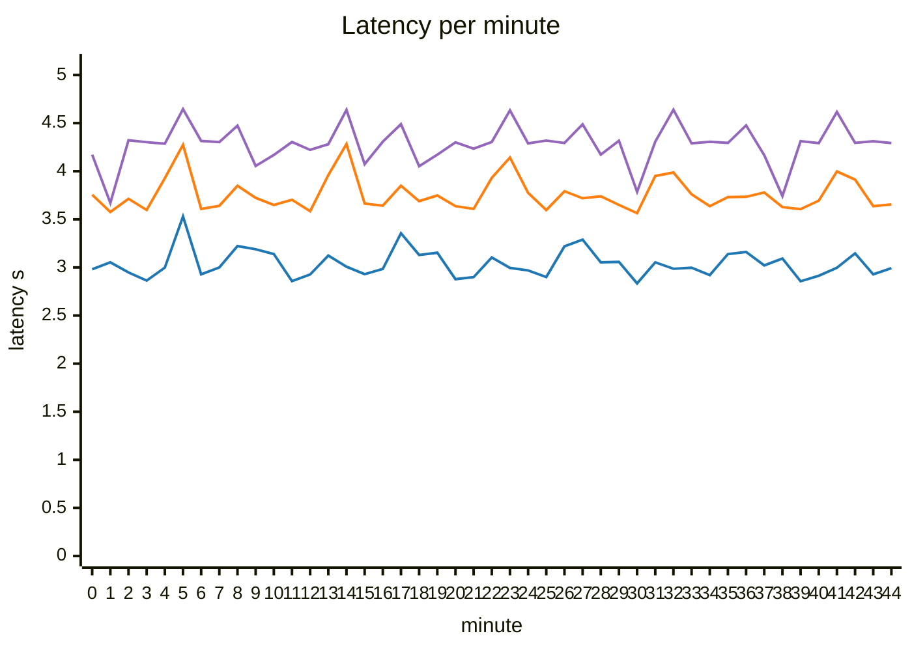
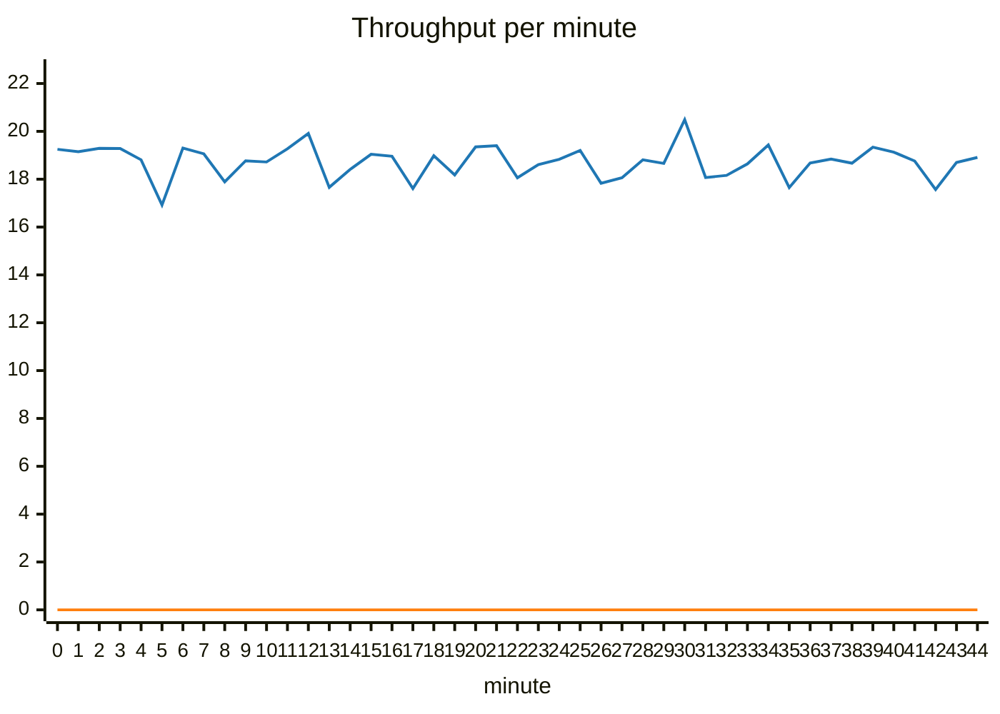

## hammer32k — 2026-11-10 21:49 UTC

**PASS** · 2703 s · 1710 requests · 0 (0.0%) errors · 0 rate-limited · 50,539,662 tokens billed

45 min closed loop with 2 concurrent ~32K-token requests (350 distinct). 1710 requests, 50,539,662 tokens billed.

|  | requests | errors | 429s | p50 s | p90 s | p99 s | max s | req/s | API tok/s | MRR |
|---|---|---|---|---|---|---|---|---|---|---|
| all | 1,710 | 0 (0.0%) | 0 | 3.013 | 3.740 | 4.315 | 4.646 | 0.633 | 18,718 | 0.983 |
| min 0–5 | 194 | 0 (0.0%) | 0 | 2.977 | 3.737 | 4.287 | 4.322 | 0.647 | 19,157 | 0.987 |
| min 5–10 | 187 | 0 (0.0%) | 0 | 3.099 | 3.747 | 4.498 | 4.646 | 0.623 | 18,390 | 0.982 |
| min 10–15 | 191 | 0 (0.0%) | 0 | 3.003 | 3.736 | 4.337 | 4.638 | 0.637 | 18,794 | 0.981 |
| min 15–20 | 188 | 0 (0.0%) | 0 | 3.086 | 3.720 | 4.289 | 4.489 | 0.627 | 18,556 | 0.977 |
| min 20–25 | 191 | 0 (0.0%) | 0 | 2.962 | 3.776 | 4.337 | 4.633 | 0.637 | 18,850 | 0.989 |
| min 25–30 | 188 | 0 (0.0%) | 0 | 3.084 | 3.720 | 4.317 | 4.488 | 0.627 | 18,512 | 0.980 |
| min 30–35 | 192 | 0 (0.0%) | 0 | 2.935 | 3.781 | 4.338 | 4.639 | 0.640 | 18,958 | 0.983 |
| min 35–40 | 189 | 0 (0.0%) | 0 | 3.063 | 3.719 | 4.296 | 4.477 | 0.630 | 18,634 | 0.975 |
| min 40–45 | 190 | 0 (0.0%) | 0 | 2.992 | 3.887 | 4.345 | 4.616 | 0.633 | 18,615 | 0.990 |

*Latency per minute: p50, p90, max*

*Throughput per minute: API tokens/s ÷ 1000, errors*
