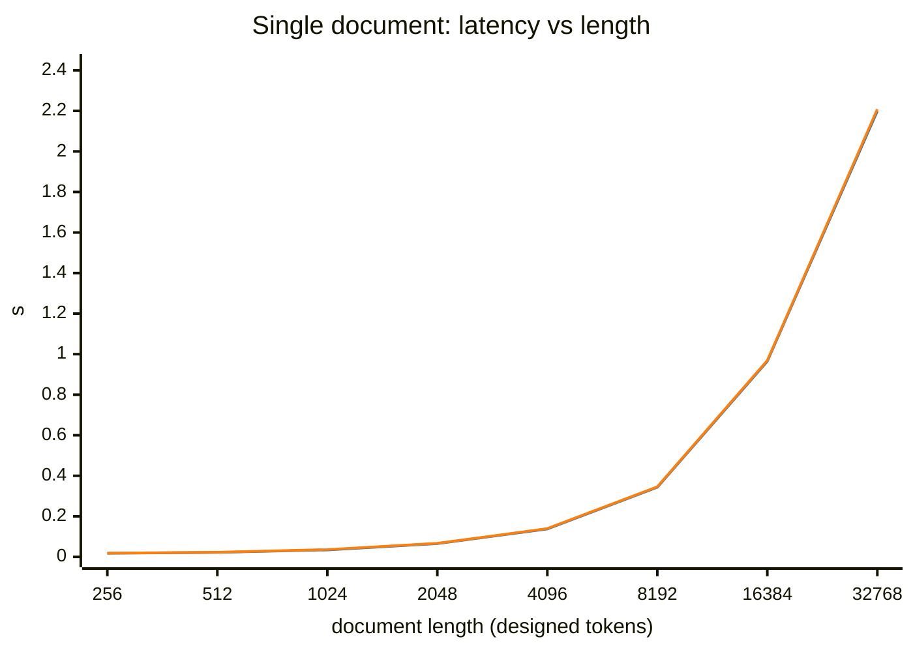
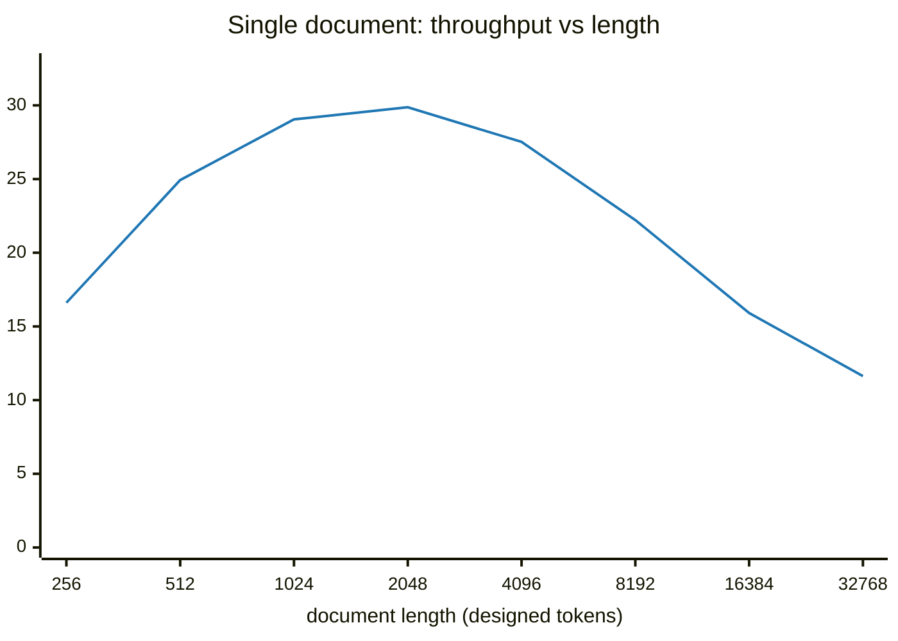
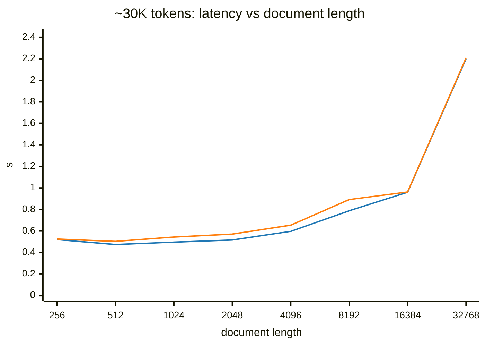
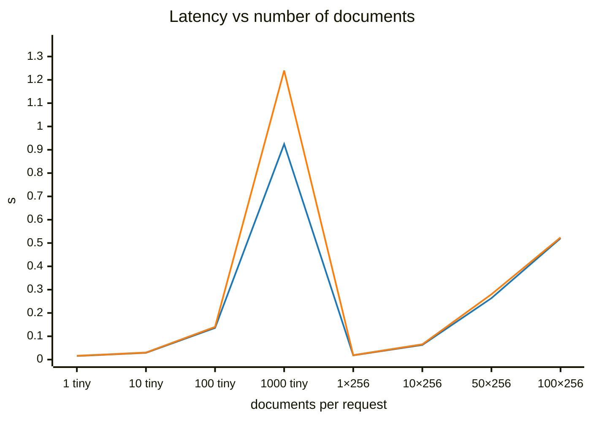
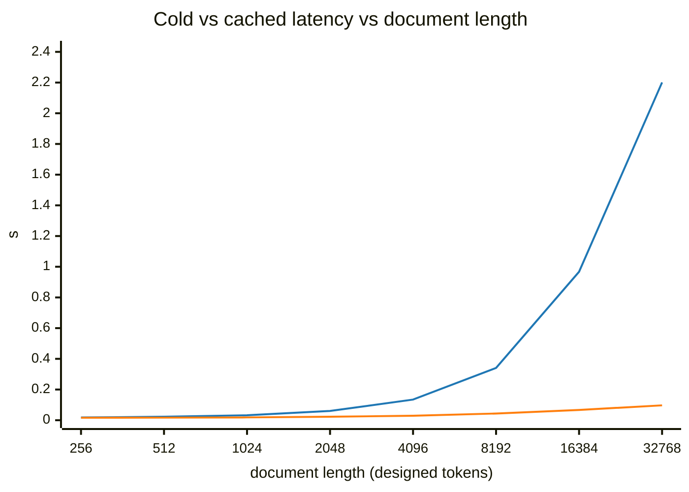
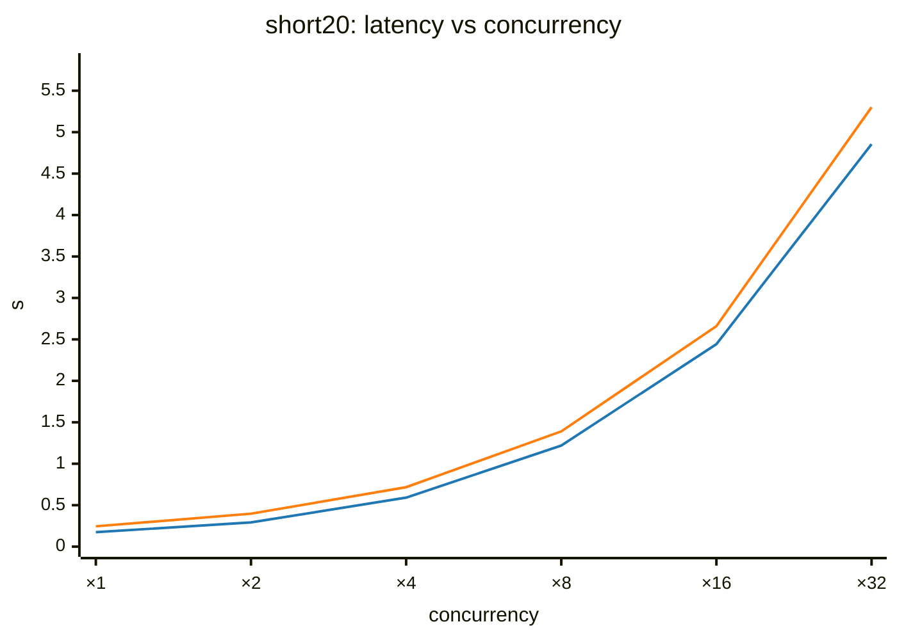
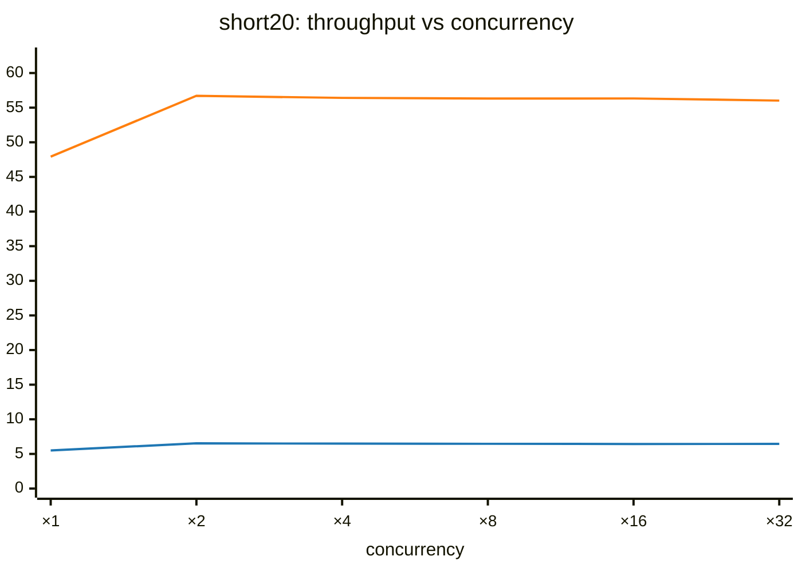
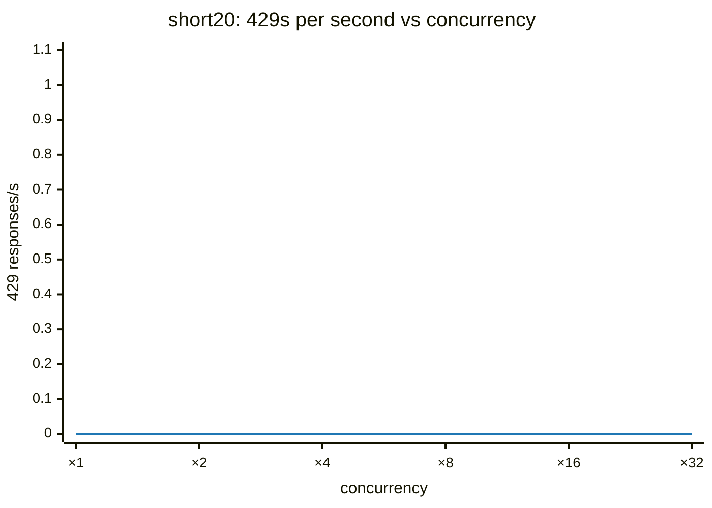

## meticulous — 2026-11-10 21:42 UTC

**PASS** · 444 s · 1607 requests · 0 (0.0%) errors · 0 rate-limited · 16,189,292 tokens billed

Sequential requests (one in flight) unless stated; every query carries a nonce so nothing is served from the API's prefix cache.

### Single document: latency vs length

| rung | Qwen tokens | billed | errors | p50 s | p90 s | max s | API tok/s |
|---|---|---|---|---|---|---|---|
| 256 | 229 | 323 | 0 (0.0%) | 0.018 | 0.018 | 0.068 | 16,614 |
| 512 | 457 | 551 | 0 (0.0%) | 0.022 | 0.023 | 0.027 | 24,929 |
| 1,024 | 911 | 1,005 | 0 (0.0%) | 0.034 | 0.036 | 0.037 | 29,054 |
| 2,048 | 1,872 | 1,966 | 0 (0.0%) | 0.066 | 0.067 | 0.068 | 29,867 |
| 4,096 | 3,707 | 3,801 | 0 (0.0%) | 0.138 | 0.140 | 0.142 | 27,518 |
| 8,192 | 7,545 | 7,640 | 0 (0.0%) | 0.343 | 0.346 | 0.349 | 22,222 |
| 16,384 | 15,274 | 15,368 | 0 (0.0%) | 0.965 | 0.969 | 0.971 | 15,913 |
| 32,768 | 25,438 | 25,536 | 0 (0.0%) | 2.199 | 2.208 | 2.210 | 11,630 |

*Single document: latency vs length: p50, p90*

*Single document: throughput vs length: API tokens/s ÷ 1000*

### ~30K tokens per request: latency vs document length (fewer, longer documents)

| rung | docs/request | billed | errors | p50 s | p90 s | max s | API tok/s |
|---|---|---|---|---|---|---|---|
| 256 | 100 | 32,399 | 0 (0.0%) | 0.520 | 0.525 | 0.526 | 62,133 |
| 512 | 55 | 30,271 | 0 (0.0%) | 0.475 | 0.504 | 0.531 | 62,821 |
| 1,024 | 28 | 28,164 | 0 (0.0%) | 0.496 | 0.544 | 0.552 | 56,570 |
| 2,048 | 13 | 25,572 | 0 (0.0%) | 0.517 | 0.571 | 0.604 | 50,629 |
| 4,096 | 6 | 22,807 | 0 (0.0%) | 0.597 | 0.654 | 0.685 | 39,228 |
| 8,192 | 3 | 22,923 | 0 (0.0%) | 0.788 | 0.892 | 0.964 | 30,281 |
| 16,384 | 1 | 15,367 | 0 (0.0%) | 0.960 | 0.962 | 0.967 | 16,002 |
| 32,768 | 1 | 25,540 | 0 (0.0%) | 2.201 | 2.208 | 2.210 | 11,619 |

*~30K tokens: latency vs document length: p50, p90*

### Latency vs number of documents

| documents | billed | errors | p50 s | p90 s | max s | MRR |
|---|---|---|---|---|---|---|
| 1 tiny | 91.3 | 0 (0.0%) | 0.015 | 0.016 | 0.018 | 1.000 |
| 10 tiny | 918 | 0 (0.0%) | 0.029 | 0.030 | 0.030 | 1.000 |
| 100 tiny | 9,279 | 0 (0.0%) | 0.136 | 0.140 | 0.141 | 1.000 |
| 1000 tiny | 94,289 | 0 (0.0%) | 0.924 | 1.240 | 1.250 | 1.000 |
| 1×256 | 323 | 0 (0.0%) | 0.018 | 0.019 | 0.020 | 1.000 |
| 10×256 | 3,230 | 0 (0.0%) | 0.063 | 0.066 | 0.068 | 1.000 |
| 50×256 | 16,160 | 0 (0.0%) | 0.263 | 0.280 | 0.284 | 1.000 |
| 100×256 | 32,309 | 0 (0.0%) | 0.520 | 0.524 | 0.540 | 1.000 |

*Latency vs number of documents: p50, p90*

### Cold vs cached: the same single-document request sent twice in a row

The API caches prompt prefixes, so a repeated (query, document) pair skips most of the compute. Cold = fresh nonce in the query; cached = the identical request again immediately after.

| rung | pairs | cold p50 s | cached p50 s | speed-up × | cold max s | cached max s | errors |
|---|---|---|---|---|---|---|---|
| 256 | 10 | 0.018 | 0.016 | 1.125 | 0.049 | 0.033 |  |
| 512 | 10 | 0.023 | 0.017 | 1.341 | 0.023 | 0.017 |  |
| 1,024 | 10 | 0.032 | 0.018 | 1.768 | 0.033 | 0.040 |  |
| 2,048 | 10 | 0.061 | 0.022 | 2.691 | 0.062 | 0.024 |  |
| 4,096 | 10 | 0.135 | 0.029 | 4.578 | 0.136 | 0.033 |  |
| 8,192 | 10 | 0.341 | 0.044 | 7.790 | 0.349 | 0.047 |  |
| 16,384 | 10 | 0.967 | 0.067 | 14.4 | 0.972 | 0.068 |  |
| 32,768 | 10 | 2.201 | 0.097 | 22.7 | 2.213 | 0.101 |  |

*Cold vs cached latency vs document length: cold p50, cached p50*

### short20: latency and throughput vs concurrency

|  | requests | errors | 429s | p50 s | p90 s | p99 s | max s | req/s | API tok/s | MRR |
|---|---|---|---|---|---|---|---|---|---|---|
| ×1 | 138 | 0 (0.0%) | 0 | 0.174 | 0.245 | 0.309 | 0.318 | 5.508 | 47,934 | 0.677 |
| ×2 | 165 | 0 (0.0%) | 0 | 0.292 | 0.397 | 0.459 | 0.464 | 6.531 | 56,706 | 0.672 |
| ×4 | 166 | 0 (0.0%) | 0 | 0.591 | 0.717 | 0.859 | 0.874 | 6.486 | 56,414 | 0.666 |
| ×8 | 169 | 0 (0.0%) | 0 | 1.219 | 1.390 | 1.515 | 1.568 | 6.464 | 56,320 | 0.675 |
| ×16 | 177 | 0 (0.0%) | 0 | 2.443 | 2.660 | 2.839 | 2.903 | 6.437 | 56,332 | 0.664 |
| ×32 | 192 | 0 (0.0%) | 0 | 4.855 | 5.301 | 5.495 | 5.552 | 6.445 | 56,020 | 0.672 |

No 429s up to concurrency ×32.

*short20: latency vs concurrency: p50, p90*

*short20: throughput vs concurrency: req/s, API tokens/s ÷ 1000*

*short20: 429s per second vs concurrency: 429/s*

1607 requests, 16,189,292 tokens billed.
