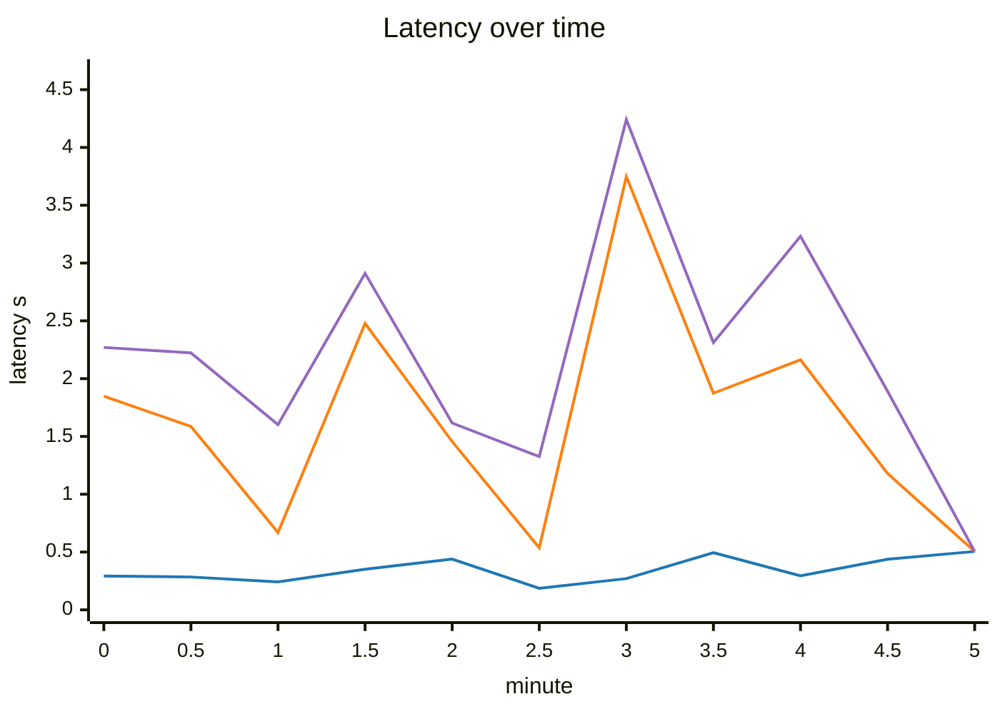
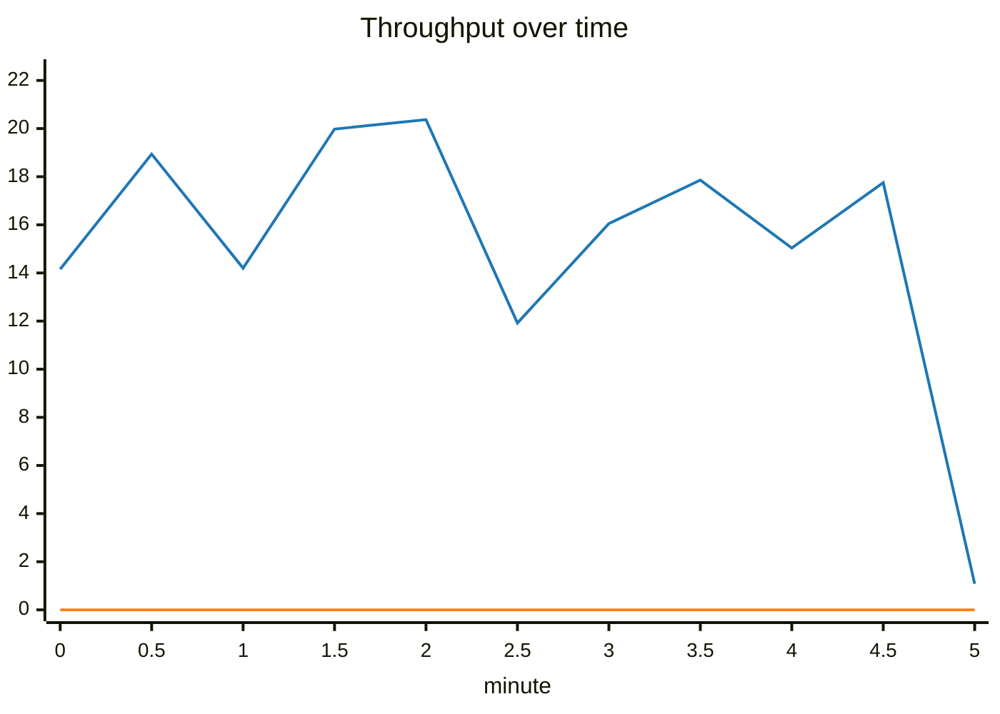

## normal — 2026-11-10 21:26 UTC

**PASS** · 301 s · 437 requests · 0 (0.0%) errors · 0 rate-limited · 5,021,049 tokens billed

5 min of Poisson traffic at 1.5 req/s; mix short20 60%, many100 10%, mid1k 10%, mid4k 10%, long8k 5%, long32k 5%. Billed 5,021,049 tokens.

|  | requests | errors | 429s | p50 s | p90 s | p99 s | max s | req/s | API tok/s | MRR |
|---|---|---|---|---|---|---|---|---|---|---|
| all | 437 | 0 (0.0%) | 0 | 0.329 | 1.715 | 3.753 | 4.241 | 1.457 | 16,737 | 0.793 |
| short20 | 241 | 0 (0.0%) | 0 | 0.214 | 1.340 | 3.375 | 3.911 | 0.803 | 6,867 | 0.636 |
| many100 | 48 | 0 (0.0%) | 0 | 0.545 | 1.837 | 3.350 | 3.793 | 0.160 | 5,190 | 0.958 |
| mid1k | 42 | 0 (0.0%) | 0 | 0.037 | 1.252 | 3.094 | 3.744 | 0.140 | 140 | 1.000 |
| mid4k | 43 | 0 (0.0%) | 0 | 0.143 | 0.946 | 1.948 | 2.557 | 0.143 | 545 | 1.000 |
| long8k | 31 | 0 (0.0%) | 0 | 0.455 | 2.342 | 3.487 | 3.758 | 0.103 | 789 | 1.000 |
| long32k | 32 | 0 (0.0%) | 0 | 1.603 | 2.265 | 3.928 | 4.241 | 0.107 | 3,206 | 0.984 |

*Latency over time: p50, p90, max*

*Throughput over time: API tokens/s ÷ 1000, errors*
