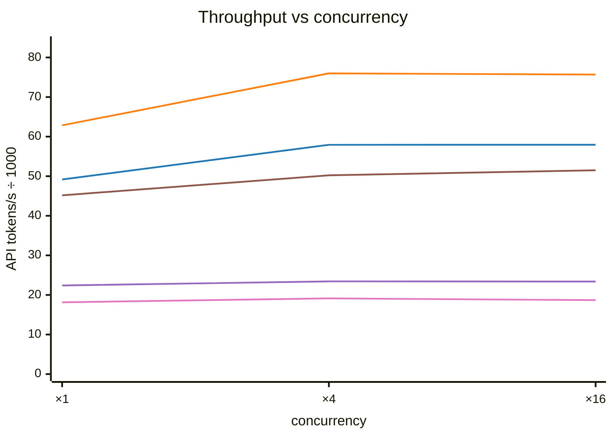
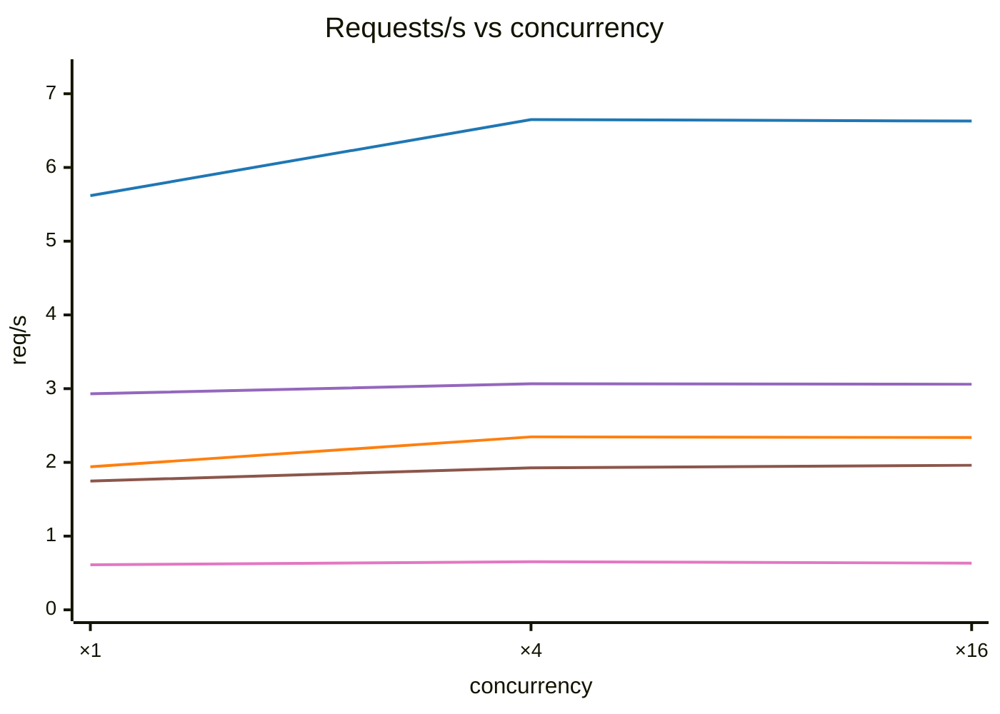
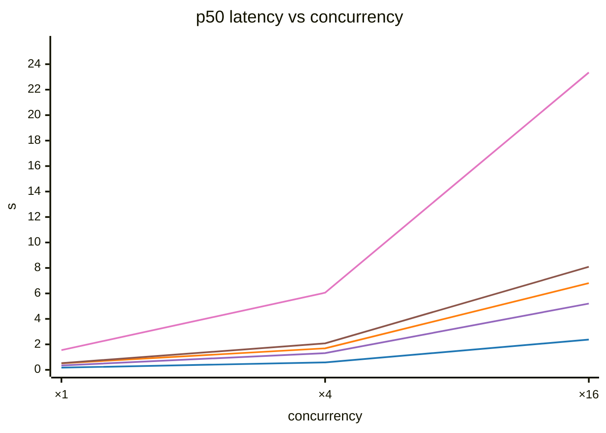

## speed — 2026-11-10 21:34 UTC

**PASS** · 462 s · 1147 requests · 0 (0.0%) errors · 0 rate-limited · 18,254,440 tokens billed

Closed loop, 25 s per cell, 5 request classes × concurrency [1, 4, 16]. 1147 requests, 18,254,440 tokens billed.

|  | requests | errors | 429s | p50 s | p90 s | p99 s | max s | req/s | API tok/s | MRR |
|---|---|---|---|---|---|---|---|---|---|---|
| short20 ×1 | 141 | 0 (0.0%) | 0 | 0.172 | 0.239 | 0.302 | 0.308 | 5.618 | 49,168 | 0.665 |
| short20 ×4 | 169 | 0 (0.0%) | 0 | 0.583 | 0.726 | 0.811 | 0.853 | 6.649 | 57,929 | 0.668 |
| short20 ×16 | 181 | 0 (0.0%) | 0 | 2.373 | 2.582 | 2.756 | 2.820 | 6.630 | 57,954 | 0.666 |
| many100 ×1 | 49 | 0 (0.0%) | 0 | 0.515 | 0.520 | 0.522 | 0.522 | 1.941 | 62,854 | 0.980 |
| many100 ×4 | 62 | 0 (0.0%) | 0 | 1.689 | 1.743 | 1.799 | 1.868 | 2.346 | 75,983 | 0.984 |
| many100 ×16 | 74 | 0 (0.0%) | 0 | 6.807 | 6.828 | 6.889 | 7.030 | 2.337 | 75,688 | 0.986 |
| long8k ×1 | 74 | 0 (0.0%) | 0 | 0.341 | 0.343 | 0.347 | 0.348 | 2.930 | 22,387 | 1.000 |
| long8k ×4 | 80 | 0 (0.0%) | 0 | 1.313 | 1.320 | 1.328 | 1.336 | 3.066 | 23,425 | 1.000 |
| long8k ×16 | 92 | 0 (0.0%) | 0 | 5.202 | 5.265 | 5.283 | 5.299 | 3.060 | 23,384 | 1.000 |
| pack32k ×1 | 44 | 0 (0.0%) | 0 | 0.524 | 0.803 | 0.913 | 0.928 | 1.747 | 45,169 | 1.000 |
| pack32k ×4 | 52 | 0 (0.0%) | 0 | 2.078 | 2.367 | 2.511 | 2.540 | 1.925 | 50,222 | 1.000 |
| pack32k ×16 | 63 | 0 (0.0%) | 0 | 8.090 | 8.598 | 8.903 | 8.905 | 1.961 | 51,509 | 1.000 |
| long32k ×1 | 16 | 0 (0.0%) | 0 | 1.546 | 2.192 | 2.207 | 2.207 | 0.612 | 18,136 | 1.000 |
| long32k ×4 | 19 | 0 (0.0%) | 0 | 6.057 | 7.145 | 7.248 | 7.259 | 0.652 | 19,140 | 1.000 |
| long32k ×16 | 31 | 0 (0.0%) | 0 | 23.3 | 24.9 | 25.2 | 25.3 | 0.633 | 18,681 | 1.000 |

*Throughput vs concurrency: short20, many100, long8k, pack32k, long32k*

*Requests/s vs concurrency: short20, many100, long8k, pack32k, long32k*

*p50 latency vs concurrency: short20, many100, long8k, pack32k, long32k*
