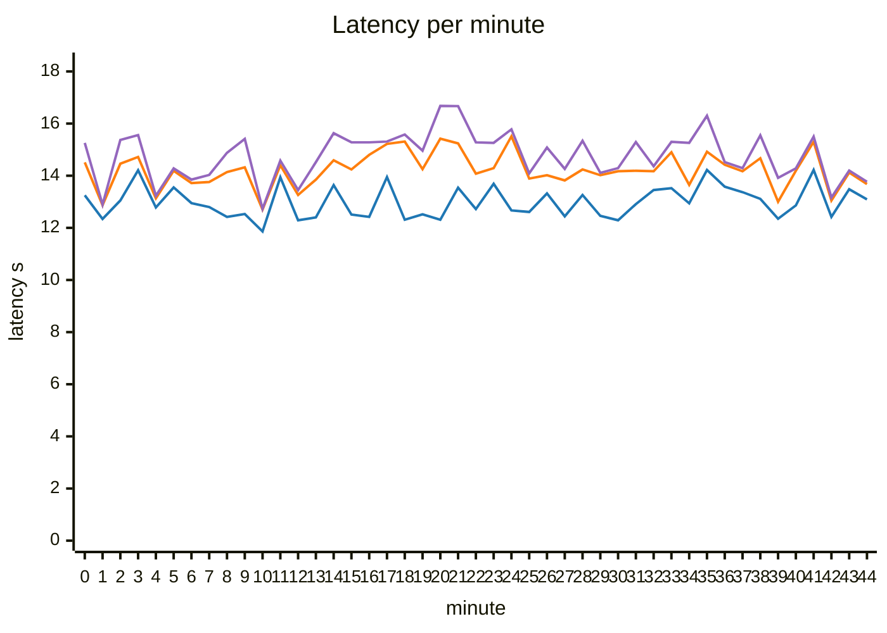
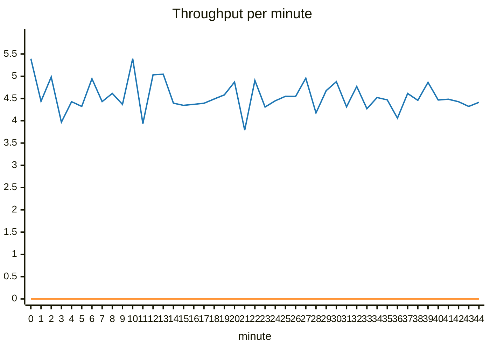

## hammer32k — 2026-11-11 02:33 UTC

**PASS** · 2707 s · 415 requests · 0 (0.0%) errors · 0 rate-limited · 12,266,525 tokens billed

45 min closed loop with 2 concurrent ~32K-token requests (350 distinct). 415 requests, 12,266,525 tokens billed.

|  | requests | errors | 429s | p50 s | p90 s | p99 s | max s | req/s | API tok/s | MRR |
|---|---|---|---|---|---|---|---|---|---|---|
| all | 415 | 0 (0.0%) | 0 | 12.9 | 14.4 | 15.6 | 16.7 | 0.154 | 4,543 | 0.996 |
| min 0–5 | 47 | 0 (0.0%) | 0 | 12.9 | 14.4 | 15.5 | 15.6 | 0.157 | 4,643 | 1.000 |
| min 5–10 | 46 | 0 (0.0%) | 0 | 12.8 | 14.0 | 15.2 | 15.4 | 0.153 | 4,536 | 1.000 |
| min 10–15 | 48 | 0 (0.0%) | 0 | 12.5 | 14.1 | 15.1 | 15.6 | 0.160 | 4,761 | 0.990 |
| min 15–20 | 45 | 0 (0.0%) | 0 | 12.7 | 15.2 | 15.5 | 15.6 | 0.150 | 4,436 | 1.000 |
| min 20–25 | 46 | 0 (0.0%) | 0 | 12.8 | 15.3 | 16.7 | 16.7 | 0.153 | 4,465 | 0.989 |
| min 25–30 | 46 | 0 (0.0%) | 0 | 12.6 | 14.0 | 15.2 | 15.3 | 0.153 | 4,581 | 0.989 |
| min 30–35 | 47 | 0 (0.0%) | 0 | 12.9 | 14.3 | 15.3 | 15.3 | 0.157 | 4,551 | 1.000 |
| min 35–40 | 45 | 0 (0.0%) | 0 | 13.1 | 14.5 | 16.0 | 16.3 | 0.150 | 4,493 | 1.000 |
| min 40–45 | 45 | 0 (0.0%) | 0 | 13.1 | 14.2 | 15.4 | 15.5 | 0.150 | 4,423 | 1.000 |

*Latency per minute: p50, p90, max*

*Throughput per minute: API tokens/s ÷ 1000, errors*
