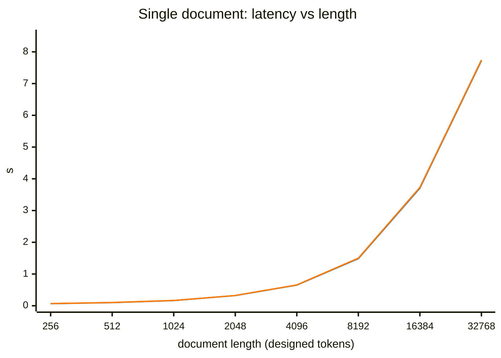
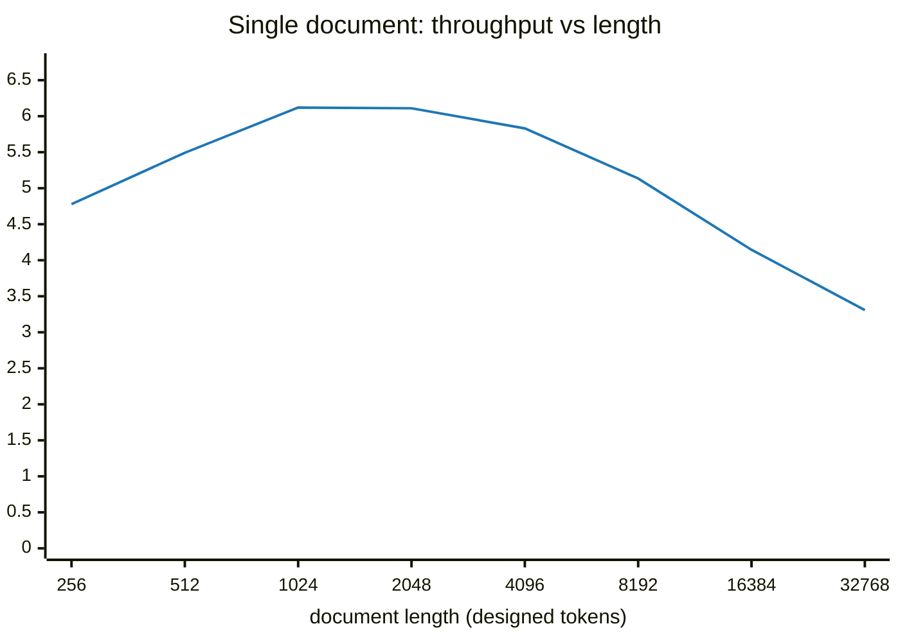
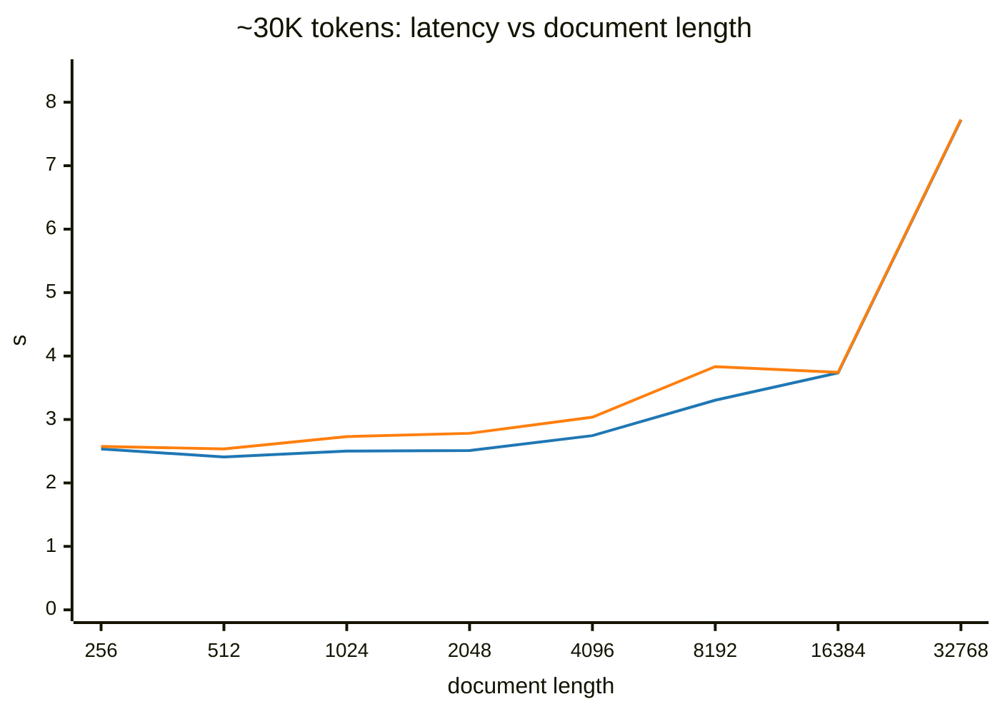
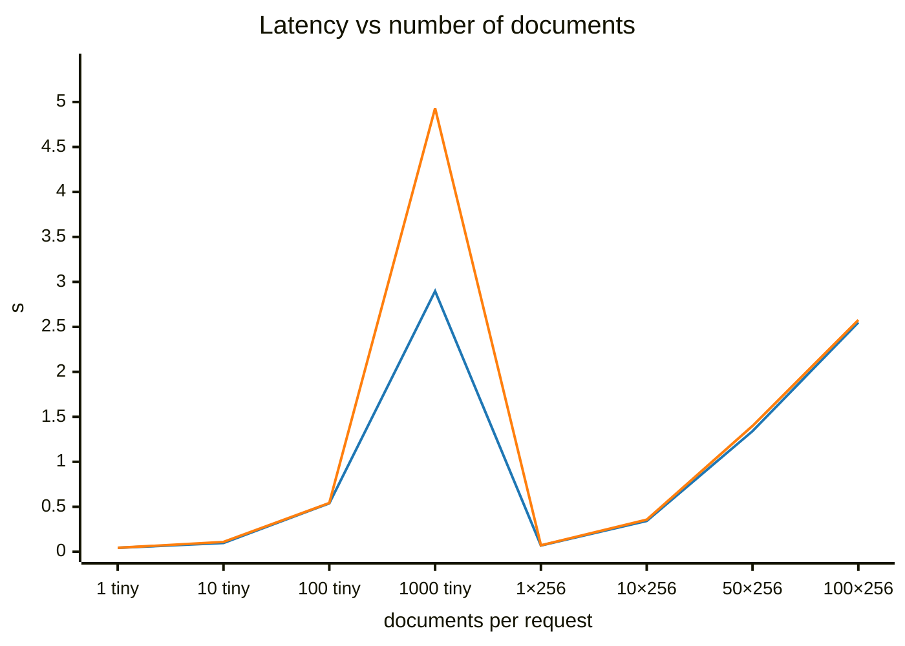
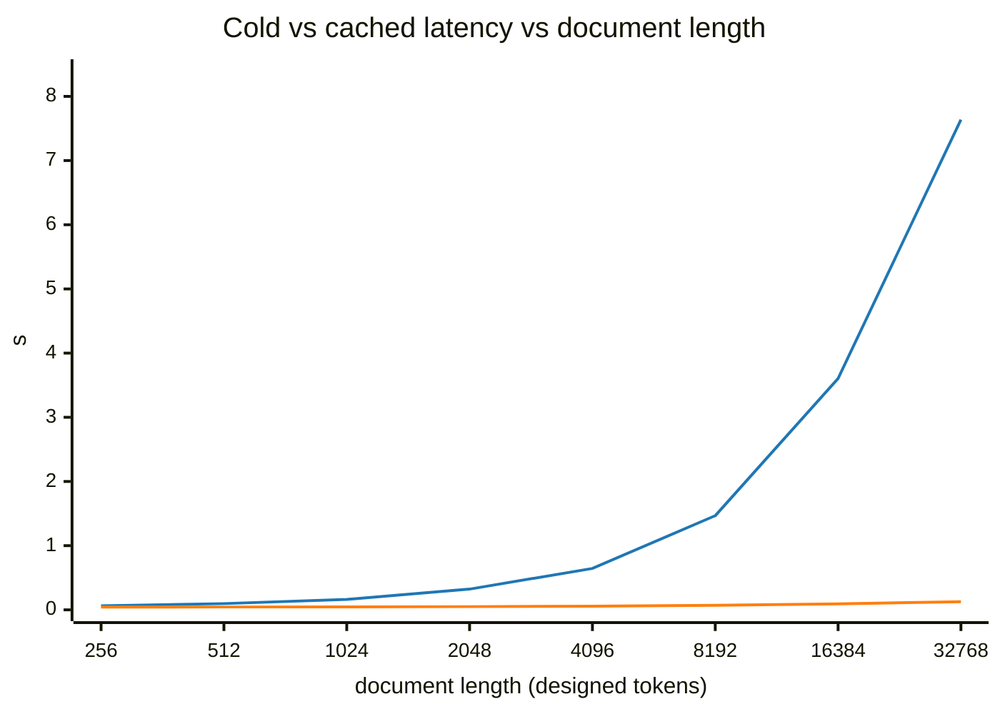
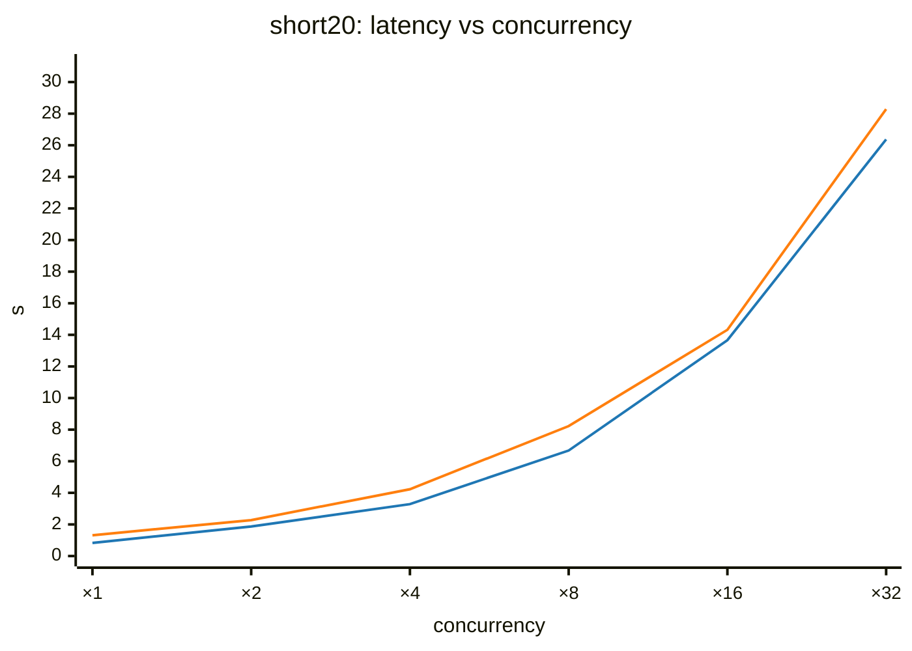
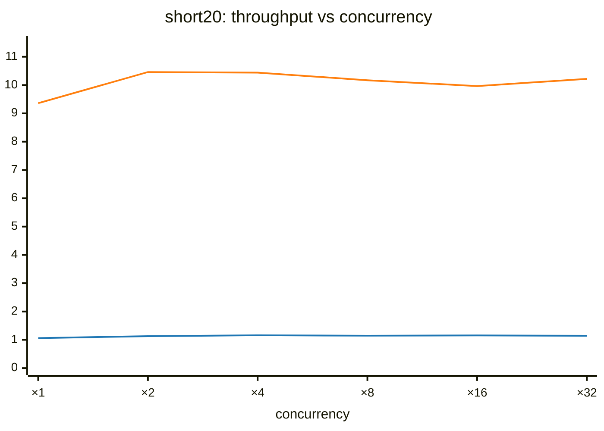
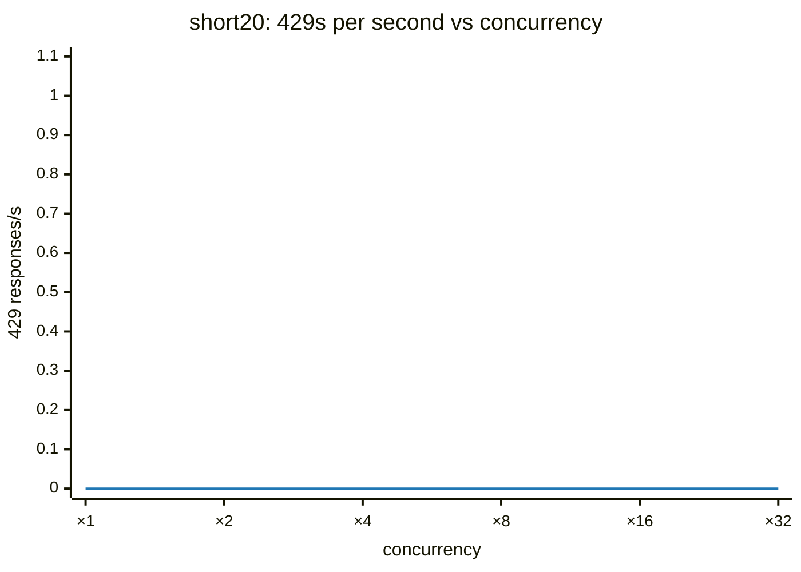

## meticulous — 2026-11-11 02:12 UTC

**PASS** · 1277 s · 829 requests · 0 (0.0%) errors · 0 rate-limited · 9,459,021 tokens billed

Sequential requests (one in flight) unless stated; every query carries a nonce so nothing is served from the API's prefix cache.

### Single document: latency vs length

| rung | Qwen tokens | billed | errors | p50 s | p90 s | max s | API tok/s |
|---|---|---|---|---|---|---|---|
| 256 | 229 | 324 | 0 (0.0%) | 0.067 | 0.069 | 0.088 | 4,779 |
| 512 | 457 | 551 | 0 (0.0%) | 0.100 | 0.102 | 0.104 | 5,492 |
| 1,024 | 911 | 1,005 | 0 (0.0%) | 0.164 | 0.167 | 0.168 | 6,120 |
| 2,048 | 1,872 | 1,966 | 0 (0.0%) | 0.322 | 0.324 | 0.328 | 6,110 |
| 4,096 | 3,707 | 3,801 | 0 (0.0%) | 0.651 | 0.657 | 0.661 | 5,831 |
| 8,192 | 7,545 | 7,640 | 0 (0.0%) | 1.487 | 1.501 | 1.508 | 5,135 |
| 16,384 | 15,274 | 15,368 | 0 (0.0%) | 3.708 | 3.732 | 3.745 | 4,145 |
| 32,768 | 25,438 | 25,536 | 0 (0.0%) | 7.722 | 7.744 | 7.790 | 3,309 |

*Single document: latency vs length: p50, p90*

*Single document: throughput vs length: API tokens/s ÷ 1000*

### ~30K tokens per request: latency vs document length (fewer, longer documents)

| rung | docs/request | billed | errors | p50 s | p90 s | max s | API tok/s |
|---|---|---|---|---|---|---|---|
| 256 | 100 | 32,446 | 0 (0.0%) | 2.537 | 2.576 | 2.579 | 12,752 |
| 512 | 55 | 30,271 | 0 (0.0%) | 2.409 | 2.537 | 2.696 | 12,489 |
| 1,024 | 28 | 28,178 | 0 (0.0%) | 2.503 | 2.730 | 2.805 | 11,326 |
| 2,048 | 13 | 25,572 | 0 (0.0%) | 2.510 | 2.782 | 2.987 | 10,456 |
| 4,096 | 6 | 22,807 | 0 (0.0%) | 2.746 | 3.037 | 3.242 | 8,470 |
| 8,192 | 3 | 22,922 | 0 (0.0%) | 3.304 | 3.834 | 4.216 | 7,177 |
| 16,384 | 1 | 15,367 | 0 (0.0%) | 3.734 | 3.743 | 3.751 | 4,114 |
| 32,768 | 1 | 25,540 | 0 (0.0%) | 7.718 | 7.727 | 7.764 | 3,311 |

*~30K tokens: latency vs document length: p50, p90*

### Latency vs number of documents

| documents | billed | errors | p50 s | p90 s | max s | MRR |
|---|---|---|---|---|---|---|
| 1 tiny | 91.4 | 0 (0.0%) | 0.044 | 0.044 | 0.046 | 1.000 |
| 10 tiny | 922 | 0 (0.0%) | 0.097 | 0.109 | 0.109 | 1.000 |
| 100 tiny | 9,299 | 0 (0.0%) | 0.539 | 0.542 | 0.544 | 1.000 |
| 1000 tiny | 94,089 | 0 (0.0%) | 2.897 | 4.931 | 4.931 | 1.000 |
| 1×256 | 323 | 0 (0.0%) | 0.070 | 0.072 | 0.073 | 1.000 |
| 10×256 | 3,230 | 0 (0.0%) | 0.342 | 0.356 | 0.385 | 1.000 |
| 50×256 | 16,155 | 0 (0.0%) | 1.341 | 1.399 | 1.432 | 1.000 |
| 100×256 | 32,289 | 0 (0.0%) | 2.550 | 2.576 | 2.581 | 0.950 |

*Latency vs number of documents: p50, p90*

### Cold vs cached: the same single-document request sent twice in a row

The API caches prompt prefixes, so a repeated (query, document) pair skips most of the compute. Cold = fresh nonce in the query; cached = the identical request again immediately after.

| rung | pairs | cold p50 s | cached p50 s | speed-up × | cold max s | cached max s | errors |
|---|---|---|---|---|---|---|---|
| 256 | 10 | 0.063 | 0.043 | 1.446 | 0.081 | 0.044 |  |
| 512 | 10 | 0.097 | 0.044 | 2.196 | 0.099 | 0.045 |  |
| 1,024 | 10 | 0.162 | 0.046 | 3.564 | 0.166 | 0.046 |  |
| 2,048 | 10 | 0.323 | 0.050 | 6.466 | 0.327 | 0.051 |  |
| 4,096 | 10 | 0.646 | 0.057 | 11.3 | 0.654 | 0.058 |  |
| 8,192 | 10 | 1.467 | 0.070 | 21.0 | 1.474 | 0.071 |  |
| 16,384 | 10 | 3.605 | 0.094 | 38.3 | 3.618 | 0.098 |  |
| 32,768 | 10 | 7.638 | 0.125 | 60.9 | 7.742 | 0.128 |  |

*Cold vs cached latency vs document length: cold p50, cached p50*

### short20: latency and throughput vs concurrency

|  | requests | errors | 429s | p50 s | p90 s | p99 s | max s | req/s | API tok/s | MRR |
|---|---|---|---|---|---|---|---|---|---|---|
| ×1 | 27 | 0 (0.0%) | 0 | 0.829 | 1.315 | 1.626 | 1.658 | 1.061 | 9,359 | 0.665 |
| ×2 | 30 | 0 (0.0%) | 0 | 1.871 | 2.272 | 2.615 | 2.617 | 1.129 | 10,456 | 0.659 |
| ×4 | 32 | 0 (0.0%) | 0 | 3.284 | 4.228 | 4.551 | 4.554 | 1.161 | 10,444 | 0.655 |
| ×8 | 36 | 0 (0.0%) | 0 | 6.679 | 8.226 | 8.396 | 8.398 | 1.146 | 10,166 | 0.695 |
| ×16 | 44 | 0 (0.0%) | 0 | 13.7 | 14.3 | 14.9 | 14.9 | 1.156 | 9,965 | 0.716 |
| ×32 | 60 | 0 (0.0%) | 0 | 26.4 | 28.3 | 29.1 | 29.5 | 1.144 | 10,225 | 0.679 |

No 429s up to concurrency ×32.

*short20: latency vs concurrency: p50, p90*

*short20: throughput vs concurrency: req/s, API tokens/s ÷ 1000*

*short20: 429s per second vs concurrency: 429/s*

829 requests, 9,459,021 tokens billed.
