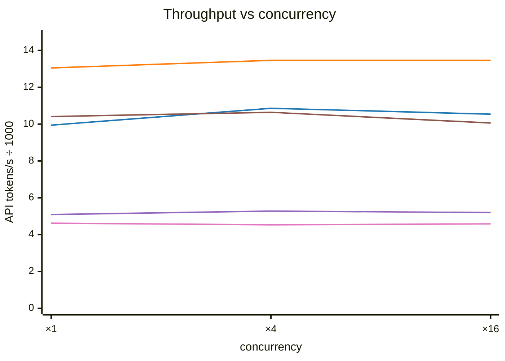
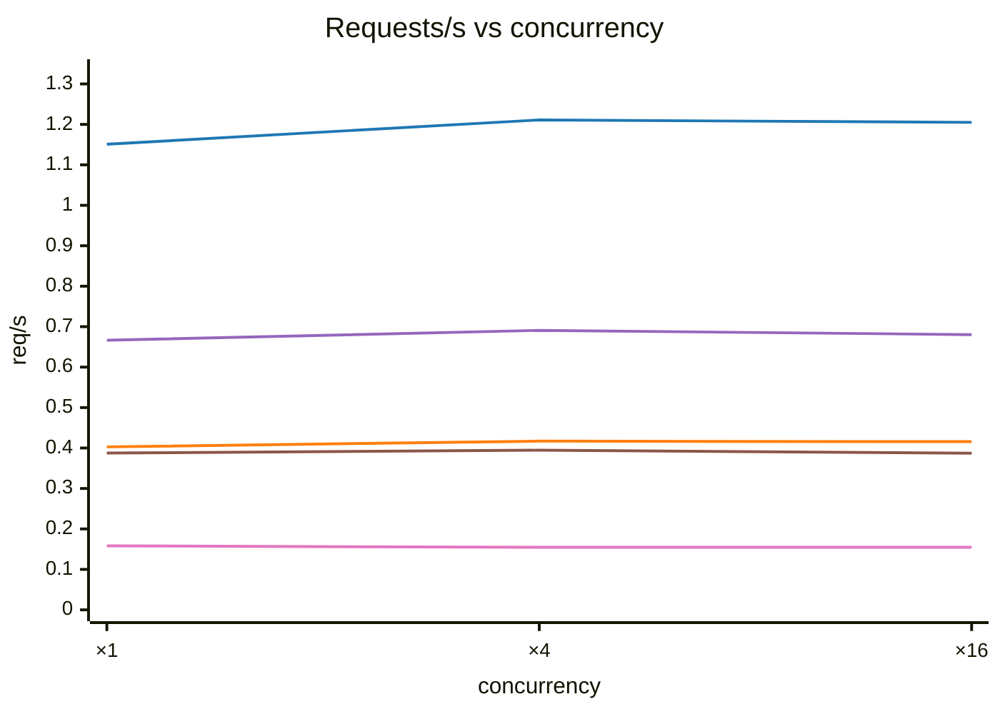
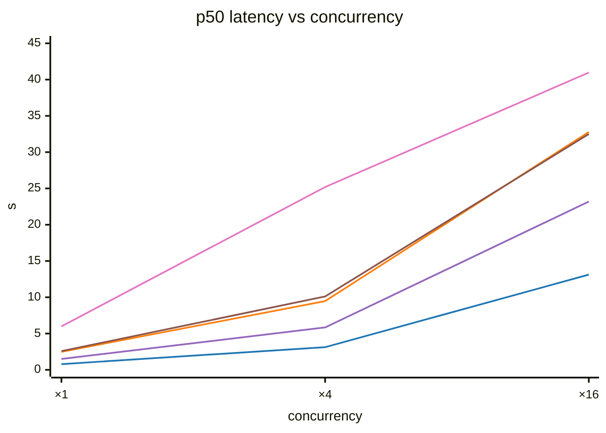

## speed — 2026-11-11 01:58 UTC

**PASS** · 620 s · 308 requests · 7 (2.3%) errors · 0 rate-limited · 5,088,065 tokens billed

Closed loop, 25 s per cell, 5 request classes × concurrency [1, 4, 16]. 308 requests, 5,088,065 tokens billed.

|  | requests | errors | 429s | p50 s | p90 s | p99 s | max s | req/s | API tok/s | MRR |
|---|---|---|---|---|---|---|---|---|---|---|
| short20 ×1 | 29 | 0 (0.0%) | 0 | 0.788 | 1.176 | 1.527 | 1.564 | 1.151 | 9,944 | 0.665 |
| short20 ×4 | 34 | 0 (0.0%) | 0 | 3.122 | 3.985 | 4.278 | 4.285 | 1.211 | 10,856 | 0.675 |
| short20 ×16 | 45 | 0 (0.0%) | 0 | 13.1 | 14.0 | 14.1 | 14.2 | 1.205 | 10,540 | 0.711 |
| many100 ×1 | 11 | 0 (0.0%) | 0 | 2.478 | 2.503 | 2.510 | 2.511 | 0.403 | 13,046 | 1.000 |
| many100 ×4 | 14 | 0 (0.0%) | 0 | 9.473 | 9.817 | 9.865 | 9.872 | 0.417 | 13,458 | 1.000 |
| many100 ×16 | 26 | 0 (0.0%) | 0 | 32.8 | 38.6 | 38.8 | 38.9 | 0.416 | 13,458 | 0.981 |
| long8k ×1 | 17 | 0 (0.0%) | 0 | 1.500 | 1.516 | 1.519 | 1.520 | 0.666 | 5,093 | 1.000 |
| long8k ×4 | 21 | 0 (0.0%) | 0 | 5.841 | 5.854 | 5.859 | 5.859 | 0.691 | 5,279 | 1.000 |
| long8k ×16 | 33 | 0 (0.0%) | 0 | 23.2 | 23.6 | 23.8 | 23.8 | 0.680 | 5,199 | 1.000 |
| pack32k ×1 | 10 | 0 (0.0%) | 0 | 2.581 | 2.846 | 3.321 | 3.374 | 0.388 | 10,415 | 1.000 |
| pack32k ×4 | 13 | 0 (0.0%) | 0 | 10.1 | 10.9 | 10.9 | 10.9 | 0.395 | 10,645 | 1.000 |
| pack32k ×16 | 25 | 0 (0.0%) | 0 | 32.5 | 42.1 | 42.3 | 42.3 | 0.387 | 10,059 | 1.000 |
| long32k ×1 | 4 | 0 (0.0%) | 0 | 5.983 | 7.195 | 7.575 | 7.617 | 0.158 | 4,623 | 1.000 |
| long32k ×4 | 7 | 0 (0.0%) | 0 | 25.2 | 26.1 | 26.2 | 26.2 | 0.155 | 4,533 | 1.000 |
| long32k ×16 | 19 | 7 (36.8%) | 0 | 41.0 | 58.5 | 58.7 | 58.7 | 0.155 | 4,585 | 1.000 |

| error | count | example | response |
|---|---|---|---|
| http 424 ModelError timed out at SageMaker | 7 | natural-2wikimqa natural-2wikimqa/query_88 | {"ErrorCode":"INTERNAL_FAILURE_FROM_MODEL","LogStreamArn":"arn:aws:logs:eu-west-3:<account-id>:log-group:/aws/sagemaker/Endpoints/reranker-aws031-4b","Message":"Received server error (0) from primary with message \"Your invocation timed out while waiting for a response from container primary. Review |

*Throughput vs concurrency: short20, many100, long8k, pack32k, long32k*

*Requests/s vs concurrency: short20, many100, long8k, pack32k, long32k*

*p50 latency vs concurrency: short20, many100, long8k, pack32k, long32k*
