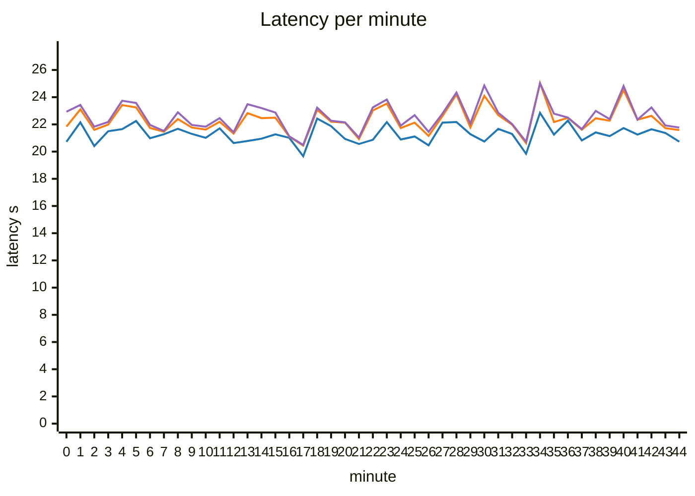
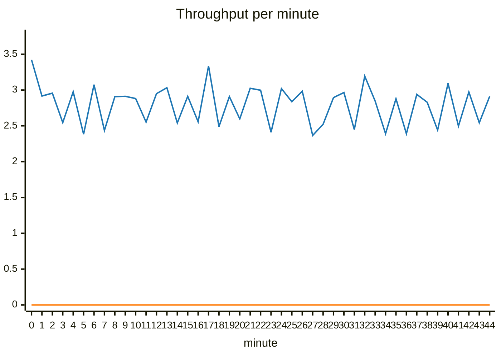

## hammer32k — 2026-11-11 09:47 UTC

**PASS** · 2713 s · 255 requests · 0 (0.0%) errors · 0 rate-limited · 7,540,268 tokens billed

45 min closed loop with 2 concurrent ~32K-token requests (350 distinct). 255 requests, 7,540,268 tokens billed.

|  | requests | errors | 429s | p50 s | p90 s | p99 s | max s | req/s | API tok/s | MRR |
|---|---|---|---|---|---|---|---|---|---|---|
| all | 255 | 0 (0.0%) | 0 | 21.1 | 22.8 | 24.8 | 25.0 | 0.094 | 2,793 | 0.992 |
| min 0–5 | 30 | 0 (0.0%) | 0 | 21.1 | 22.9 | 23.7 | 23.7 | 0.100 | 2,963 | 1.000 |
| min 5–10 | 28 | 0 (0.0%) | 0 | 21.5 | 22.4 | 23.4 | 23.6 | 0.093 | 2,743 | 0.982 |
| min 10–15 | 28 | 0 (0.0%) | 0 | 21.0 | 22.3 | 23.4 | 23.5 | 0.093 | 2,791 | 1.000 |
| min 15–20 | 29 | 0 (0.0%) | 0 | 21.0 | 22.5 | 23.1 | 23.2 | 0.097 | 2,840 | 0.983 |
| min 20–25 | 28 | 0 (0.0%) | 0 | 20.9 | 22.9 | 23.7 | 23.8 | 0.093 | 2,810 | 0.982 |
| min 25–30 | 28 | 0 (0.0%) | 0 | 21.3 | 22.7 | 24.2 | 24.3 | 0.093 | 2,720 | 1.000 |
| min 30–35 | 28 | 0 (0.0%) | 0 | 21.1 | 23.8 | 25.0 | 25.0 | 0.093 | 2,769 | 0.982 |
| min 35–40 | 28 | 0 (0.0%) | 0 | 21.3 | 22.5 | 22.9 | 23.0 | 0.093 | 2,696 | 1.000 |
| min 40–45 | 28 | 0 (0.0%) | 0 | 21.3 | 22.6 | 24.7 | 24.8 | 0.093 | 2,804 | 1.000 |

*Latency per minute: p50, p90, max*

*Throughput per minute: API tokens/s ÷ 1000, errors*
