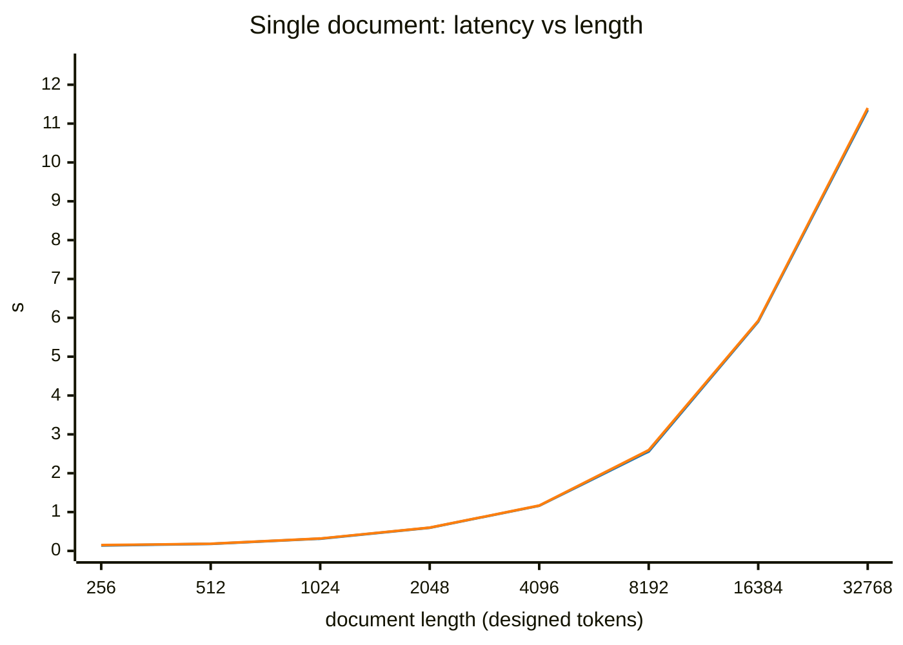
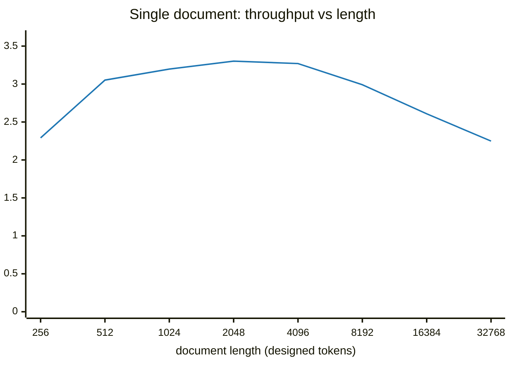
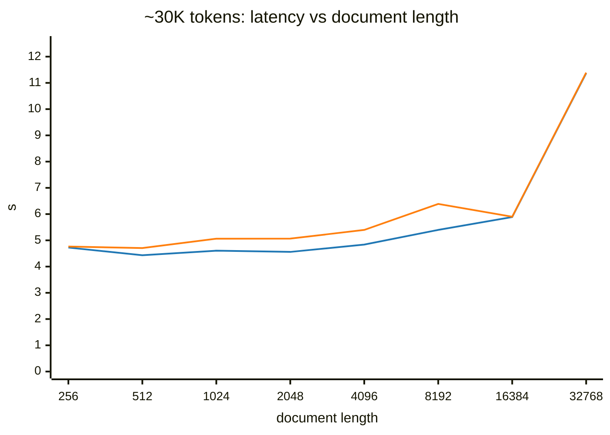
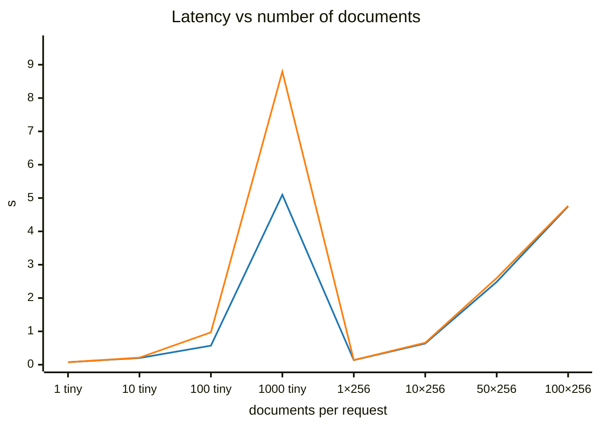
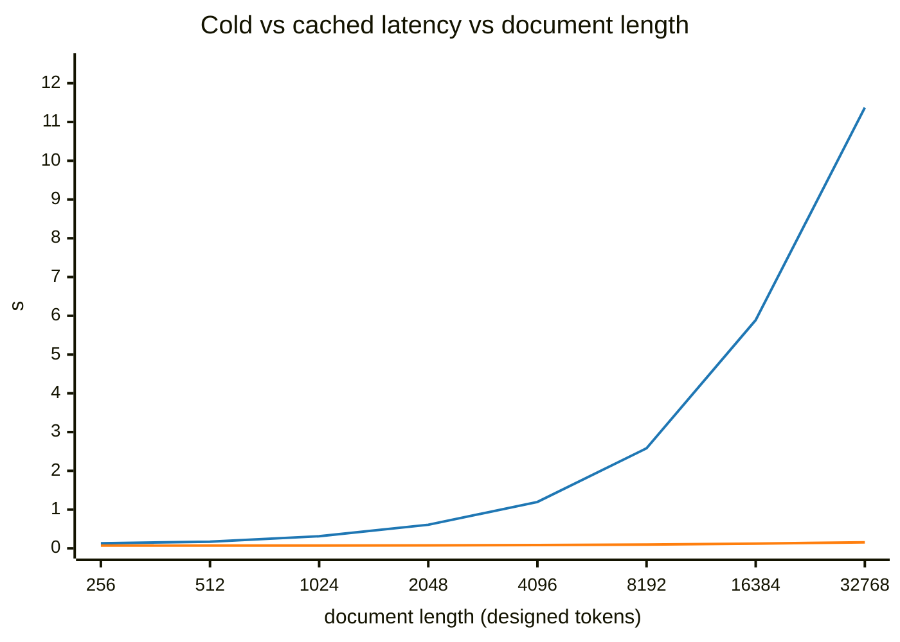
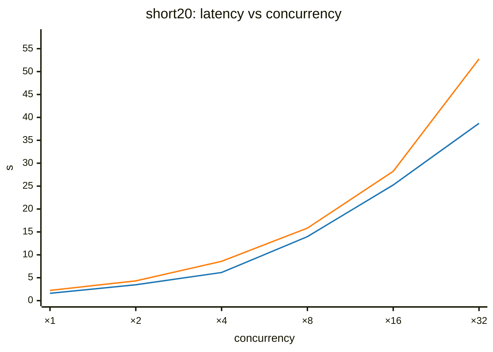
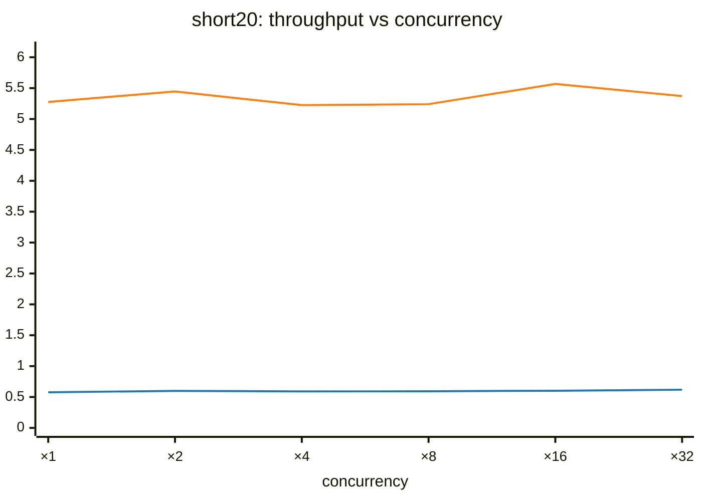
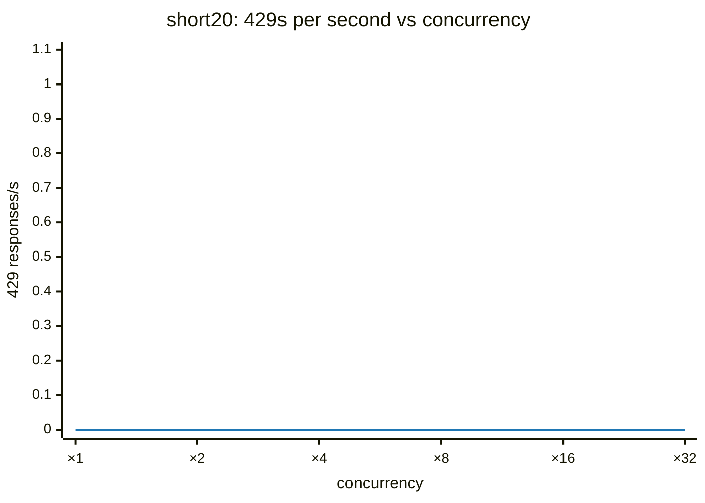

## meticulous — 2026-11-11 09:13 UTC

**PASS** · 1987 s · 749 requests · 0 (0.0%) errors · 0 rate-limited · 8,750,600 tokens billed

Sequential requests (one in flight) unless stated; every query carries a nonce so nothing is served from the API's prefix cache.

### Single document: latency vs length

| rung | Qwen tokens | billed | errors | p50 s | p90 s | max s | API tok/s |
|---|---|---|---|---|---|---|---|
| 256 | 229 | 323 | 0 (0.0%) | 0.139 | 0.150 | 0.155 | 2,291 |
| 512 | 457 | 551 | 0 (0.0%) | 0.181 | 0.183 | 0.187 | 3,052 |
| 1,024 | 911 | 1,005 | 0 (0.0%) | 0.313 | 0.320 | 0.321 | 3,197 |
| 2,048 | 1,872 | 1,966 | 0 (0.0%) | 0.595 | 0.600 | 0.602 | 3,302 |
| 4,096 | 3,707 | 3,800 | 0 (0.0%) | 1.161 | 1.168 | 1.171 | 3,270 |
| 8,192 | 7,545 | 7,640 | 0 (0.0%) | 2.558 | 2.595 | 2.605 | 2,991 |
| 16,384 | 15,274 | 15,368 | 0 (0.0%) | 5.902 | 5.923 | 5.932 | 2,608 |
| 32,768 | 25,438 | 25,536 | 0 (0.0%) | 11.4 | 11.4 | 11.5 | 2,249 |

*Single document: latency vs length: p50, p90*

*Single document: throughput vs length: API tokens/s ÷ 1000*

### ~30K tokens per request: latency vs document length (fewer, longer documents)

| rung | docs/request | billed | errors | p50 s | p90 s | max s | API tok/s |
|---|---|---|---|---|---|---|---|
| 256 | 100 | 32,392 | 0 (0.0%) | 4.724 | 4.765 | 4.796 | 6,860 |
| 512 | 55 | 30,275 | 0 (0.0%) | 4.433 | 4.705 | 4.960 | 6,796 |
| 1,024 | 28 | 28,178 | 0 (0.0%) | 4.606 | 5.062 | 5.230 | 6,130 |
| 2,048 | 13 | 25,566 | 0 (0.0%) | 4.559 | 5.066 | 5.446 | 5,753 |
| 4,096 | 6 | 22,805 | 0 (0.0%) | 4.839 | 5.397 | 5.746 | 4,795 |
| 8,192 | 3 | 22,922 | 0 (0.0%) | 5.397 | 6.388 | 7.064 | 4,333 |
| 16,384 | 1 | 15,366 | 0 (0.0%) | 5.889 | 5.900 | 5.928 | 2,609 |
| 32,768 | 1 | 25,540 | 0 (0.0%) | 11.4 | 11.4 | 11.4 | 2,247 |

*~30K tokens: latency vs document length: p50, p90*

### Latency vs number of documents

| documents | billed | errors | p50 s | p90 s | max s | MRR |
|---|---|---|---|---|---|---|
| 1 tiny | 91.4 | 0 (0.0%) | 0.075 | 0.076 | 0.077 | 1.000 |
| 10 tiny | 922 | 0 (0.0%) | 0.201 | 0.212 | 0.214 | 1.000 |
| 100 tiny | 9,349 | 0 (0.0%) | 0.572 | 0.971 | 0.975 | 0.950 |
| 1000 tiny | 93,989 | 0 (0.0%) | 5.098 | 8.795 | 9.074 | 0.950 |
| 1×256 | 323 | 0 (0.0%) | 0.136 | 0.141 | 0.144 | 1.000 |
| 10×256 | 3,230 | 0 (0.0%) | 0.638 | 0.659 | 0.729 | 1.000 |
| 50×256 | 16,170 | 0 (0.0%) | 2.484 | 2.600 | 2.694 | 1.000 |
| 100×256 | 32,339 | 0 (0.0%) | 4.750 | 4.765 | 4.806 | 1.000 |

*Latency vs number of documents: p50, p90*

### Cold vs cached: the same single-document request sent twice in a row

The API caches prompt prefixes, so a repeated (query, document) pair skips most of the compute. Cold = fresh nonce in the query; cached = the identical request again immediately after.

| rung | pairs | cold p50 s | cached p50 s | speed-up × | cold max s | cached max s | errors |
|---|---|---|---|---|---|---|---|
| 256 | 10 | 0.130 | 0.070 | 1.858 | 0.138 | 0.084 |  |
| 512 | 10 | 0.172 | 0.071 | 2.420 | 0.176 | 0.072 |  |
| 1,024 | 10 | 0.312 | 0.072 | 4.307 | 0.319 | 0.073 |  |
| 2,048 | 10 | 0.609 | 0.076 | 7.985 | 0.616 | 0.079 |  |
| 4,096 | 10 | 1.197 | 0.084 | 14.2 | 1.204 | 0.086 |  |
| 8,192 | 10 | 2.582 | 0.097 | 26.6 | 2.592 | 0.098 |  |
| 16,384 | 10 | 5.890 | 0.123 | 47.9 | 5.901 | 0.127 |  |
| 32,768 | 10 | 11.4 | 0.156 | 72.9 | 11.5 | 0.184 |  |

*Cold vs cached latency vs document length: cold p50, cached p50*

### short20: latency and throughput vs concurrency

|  | requests | errors | 429s | p50 s | p90 s | p99 s | max s | req/s | API tok/s | MRR |
|---|---|---|---|---|---|---|---|---|---|---|
| ×1 | 15 | 0 (0.0%) | 0 | 1.602 | 2.240 | 3.019 | 3.139 | 0.577 | 5,277 | 0.697 |
| ×2 | 16 | 0 (0.0%) | 0 | 3.467 | 4.309 | 4.923 | 4.924 | 0.600 | 5,446 | 0.646 |
| ×4 | 19 | 0 (0.0%) | 0 | 6.142 | 8.582 | 8.611 | 8.614 | 0.590 | 5,225 | 0.676 |
| ×8 | 23 | 0 (0.0%) | 0 | 14.0 | 15.8 | 16.4 | 16.6 | 0.593 | 5,241 | 0.703 |
| ×16 | 30 | 0 (0.0%) | 0 | 25.3 | 28.2 | 29.1 | 29.5 | 0.602 | 5,568 | 0.697 |
| ×32 | 46 | 0 (0.0%) | 0 | 38.7 | 52.8 | 53.7 | 54.0 | 0.618 | 5,371 | 0.739 |

No 429s up to concurrency ×32.

*short20: latency vs concurrency: p50, p90*

*short20: throughput vs concurrency: req/s, API tokens/s ÷ 1000*

*short20: 429s per second vs concurrency: 429/s*

749 requests, 8,750,600 tokens billed.
