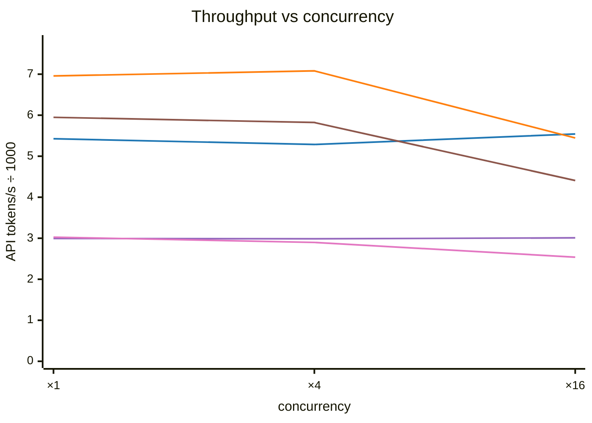
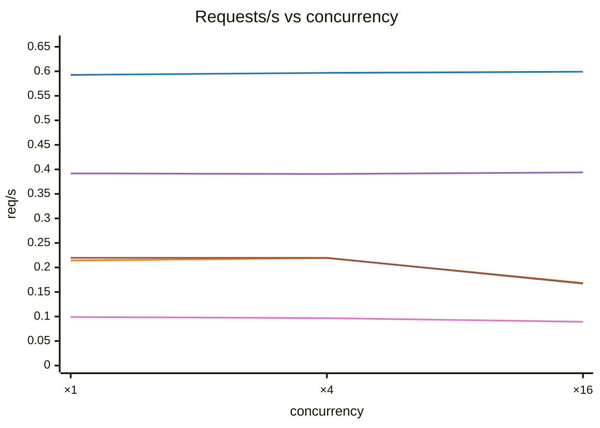
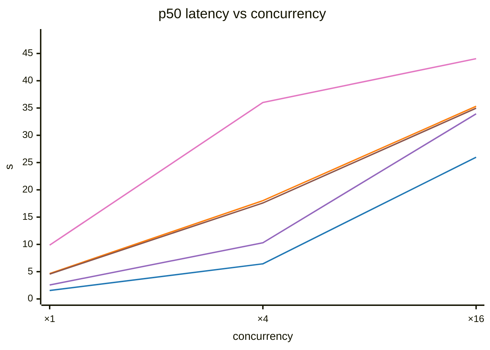

## speed — 2026-11-11 08:58 UTC

**FAIL** · 735 s · 211 requests · 25 (11.8%) errors · 0 rate-limited · 3,128,205 tokens billed

Closed loop, 25 s per cell, 5 request classes × concurrency [1, 4, 16]. 211 requests, 3,128,205 tokens billed.

|  | requests | errors | 429s | p50 s | p90 s | p99 s | max s | req/s | API tok/s | MRR |
|---|---|---|---|---|---|---|---|---|---|---|
| short20 ×1 | 15 | 0 (0.0%) | 0 | 1.553 | 2.194 | 2.944 | 3.059 | 0.593 | 5,425 | 0.686 |
| short20 ×4 | 19 | 0 (0.0%) | 0 | 6.441 | 8.042 | 9.029 | 9.143 | 0.597 | 5,286 | 0.676 |
| short20 ×16 | 30 | 0 (0.0%) | 0 | 26.0 | 29.1 | 29.7 | 29.7 | 0.599 | 5,542 | 0.700 |
| many100 ×1 | 6 | 0 (0.0%) | 0 | 4.656 | 4.694 | 4.704 | 4.705 | 0.214 | 6,957 | 1.000 |
| many100 ×4 | 9 | 0 (0.0%) | 0 | 18.0 | 18.7 | 18.8 | 18.8 | 0.219 | 7,081 | 1.000 |
| many100 ×16 | 21 | 7 (33.3%) | 0 | 35.3 | 58.5 | 59.9 | 59.9 | 0.168 | 5,446 | 1.000 |
| long8k ×1 | 10 | 0 (0.0%) | 0 | 2.555 | 2.561 | 2.561 | 2.561 | 0.392 | 2,995 | 1.000 |
| long8k ×4 | 13 | 0 (0.0%) | 0 | 10.3 | 10.4 | 10.4 | 10.4 | 0.391 | 2,986 | 1.000 |
| long8k ×16 | 25 | 0 (0.0%) | 0 | 33.9 | 40.8 | 41.3 | 41.4 | 0.394 | 3,010 | 1.000 |
| pack32k ×1 | 6 | 0 (0.0%) | 0 | 4.551 | 5.213 | 5.502 | 5.534 | 0.220 | 5,948 | 1.000 |
| pack32k ×4 | 9 | 0 (0.0%) | 0 | 17.6 | 19.2 | 19.9 | 19.9 | 0.220 | 5,822 | 1.000 |
| pack32k ×16 | 21 | 7 (33.3%) | 0 | 35.0 | 58.6 | 59.6 | 59.6 | 0.167 | 4,407 | 1.000 |
| long32k ×1 | 3 | 0 (0.0%) | 0 | 9.863 | 10.4 | 10.6 | 10.6 | 0.099 | 3,027 | 1.000 |
| long32k ×4 | 6 | 0 (0.0%) | 0 | 36.0 | 41.7 | 42.1 | 42.2 | 0.097 | 2,898 | 1.000 |
| long32k ×16 | 18 | 11 (61.1%) | 0 | 44.1 | 56.4 | 57.2 | 57.2 | 0.089 | 2,539 | 1.000 |

| error | count | example | response |
|---|---|---|---|
| http 424 ModelError timed out at SageMaker | 25 | ladder-256 ladder-256/ctx256_query83 | {"ErrorCode":"INTERNAL_FAILURE_FROM_MODEL","LogStreamArn":"arn:aws:logs:eu-west-3:<account-id>:log-group:/aws/sagemaker/Endpoints/reranker-aws031-8b","Message":"Received server error (0) from primary with message \"Your invocation timed out while waiting for a response from container primary. Review |

*Throughput vs concurrency: short20, many100, long8k, pack32k, long32k*

*Requests/s vs concurrency: short20, many100, long8k, pack32k, long32k*

*p50 latency vs concurrency: short20, many100, long8k, pack32k, long32k*
