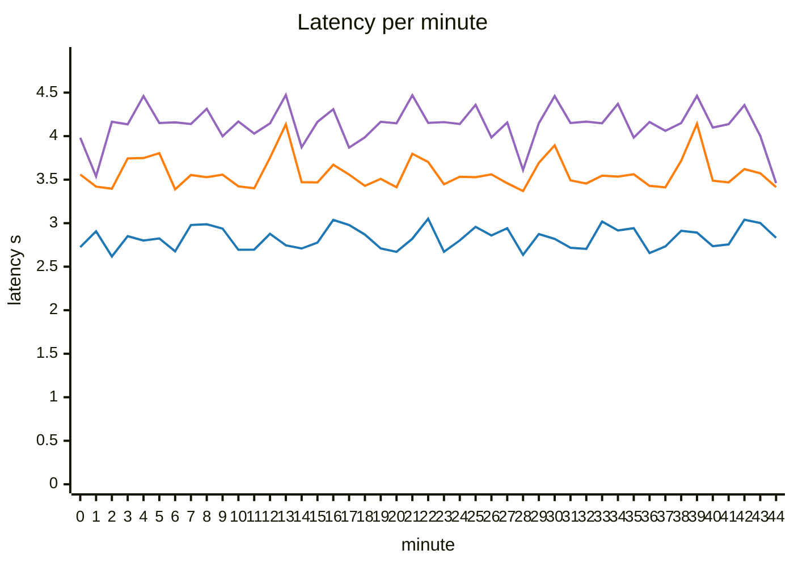
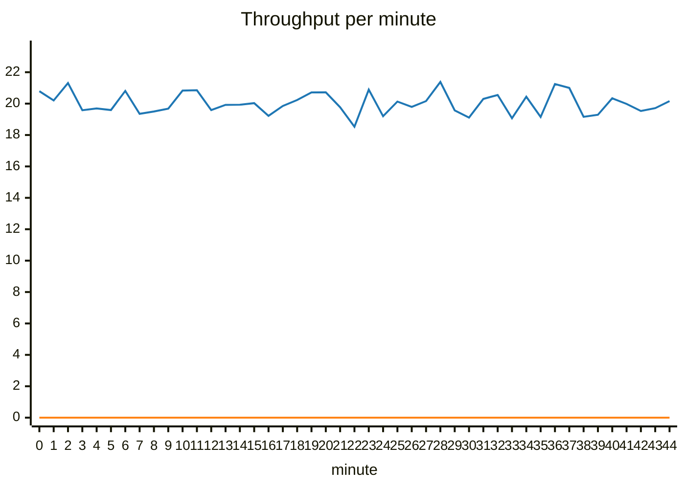

## hammer32k — 2026-11-13 10:35 UTC

**PASS** · 2702 s · 1828 requests · 0 (0.0%) errors · 0 rate-limited · 54,051,355 tokens billed

45 min closed loop with 2 concurrent ~32K-token requests (350 distinct). 1828 requests, 54,051,355 tokens billed.

|  | requests | errors | 429s | p50 s | p90 s | p99 s | max s | req/s | API tok/s | MRR |
|---|---|---|---|---|---|---|---|---|---|---|
| all | 1,828 | 0 (0.0%) | 0 | 2.812 | 3.544 | 4.165 | 4.473 | 0.677 | 20,019 | 0.981 |
| min 0–5 | 206 | 0 (0.0%) | 0 | 2.792 | 3.550 | 4.164 | 4.460 | 0.687 | 20,315 | 0.981 |
| min 5–10 | 201 | 0 (0.0%) | 0 | 2.859 | 3.539 | 4.150 | 4.314 | 0.670 | 19,787 | 0.979 |
| min 10–15 | 205 | 0 (0.0%) | 0 | 2.746 | 3.547 | 4.167 | 4.473 | 0.683 | 20,225 | 0.986 |
| min 15–20 | 203 | 0 (0.0%) | 0 | 2.871 | 3.535 | 4.164 | 4.309 | 0.677 | 20,006 | 0.981 |
| min 20–25 | 202 | 0 (0.0%) | 0 | 2.769 | 3.667 | 4.161 | 4.470 | 0.673 | 19,821 | 0.986 |
| min 25–30 | 204 | 0 (0.0%) | 0 | 2.846 | 3.534 | 4.149 | 4.360 | 0.680 | 20,207 | 0.980 |
| min 30–35 | 202 | 0 (0.0%) | 0 | 2.804 | 3.561 | 4.369 | 4.460 | 0.673 | 19,895 | 0.982 |
| min 35–40 | 203 | 0 (0.0%) | 0 | 2.801 | 3.567 | 4.162 | 4.463 | 0.677 | 19,970 | 0.978 |
| min 40–45 | 202 | 0 (0.0%) | 0 | 2.845 | 3.527 | 4.137 | 4.356 | 0.673 | 19,945 | 0.979 |

*Latency per minute: p50, p90, max*

*Throughput per minute: API tokens/s ÷ 1000, errors*
