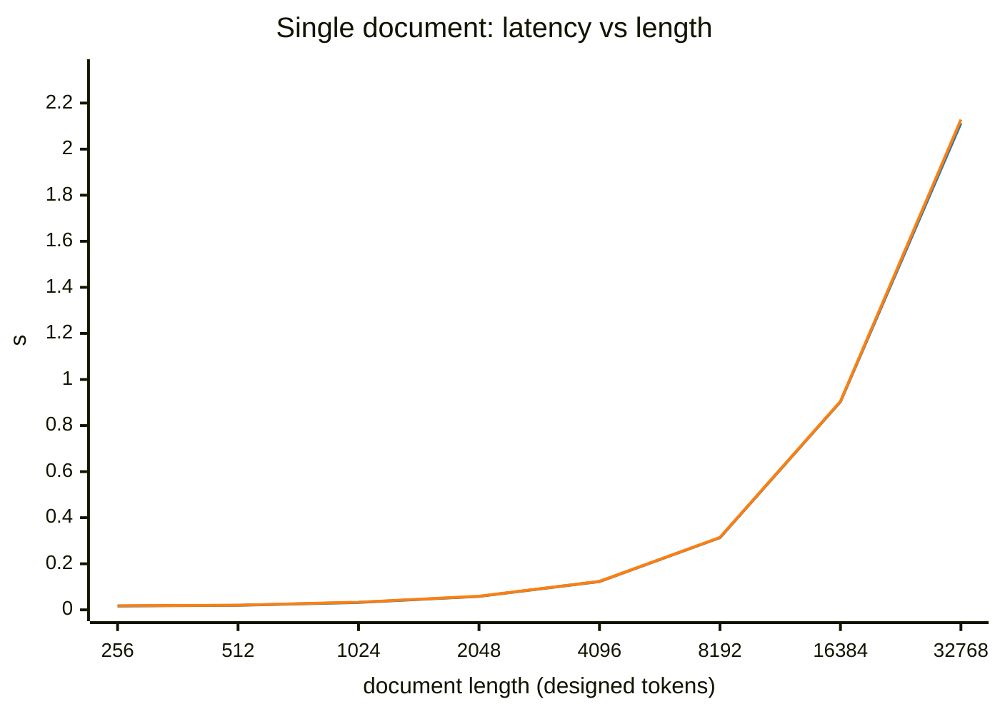
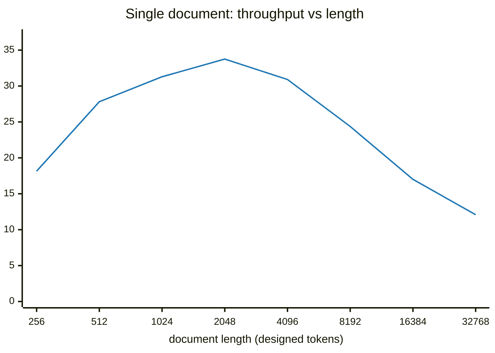
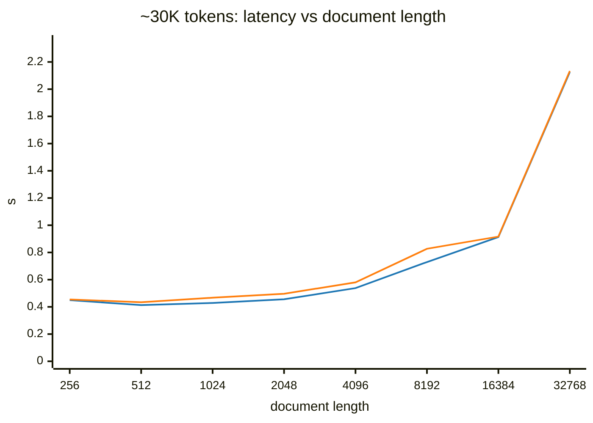
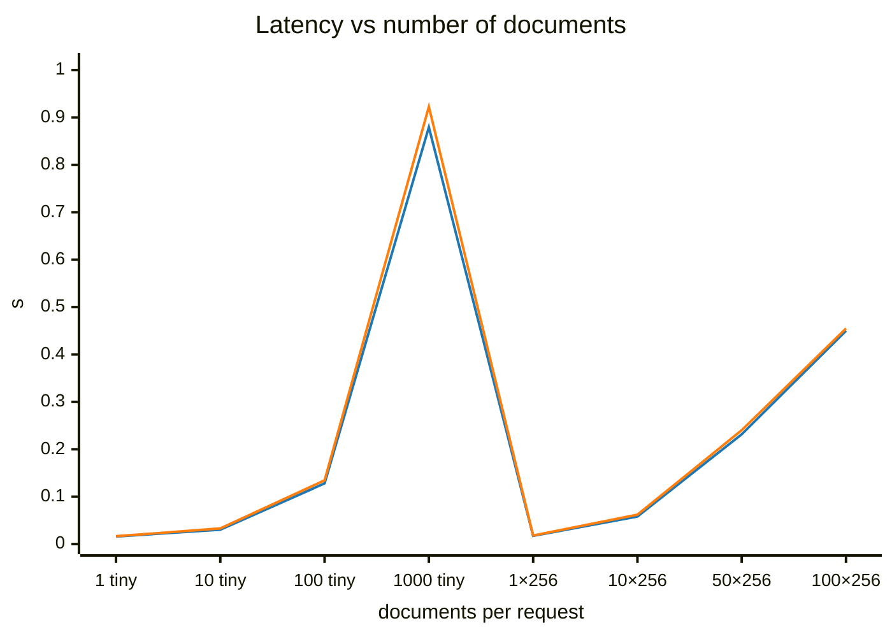
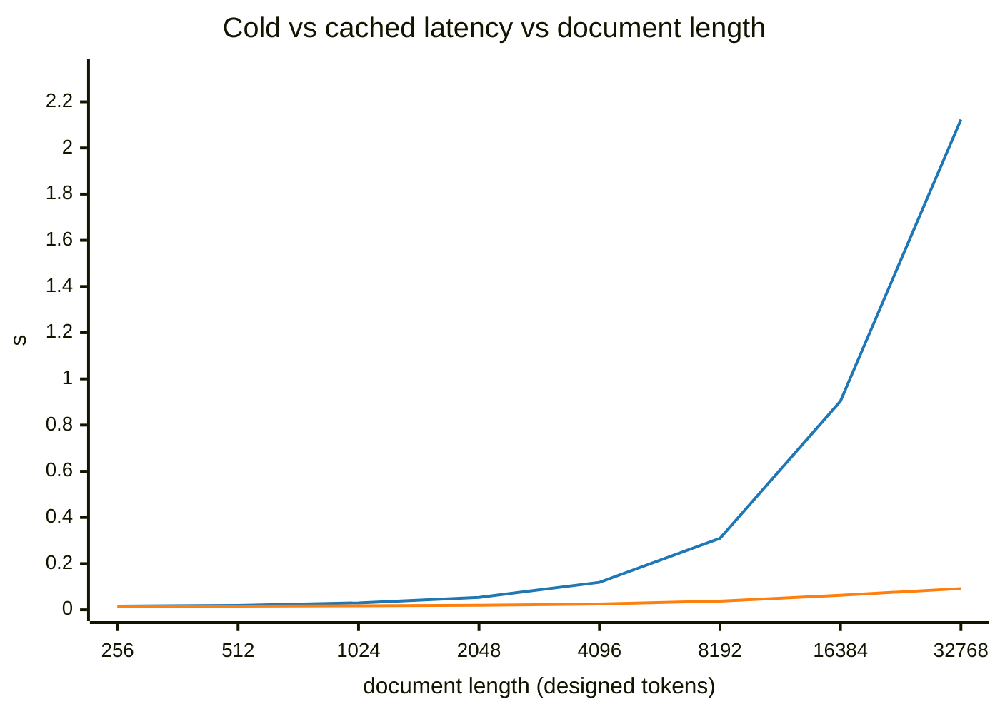
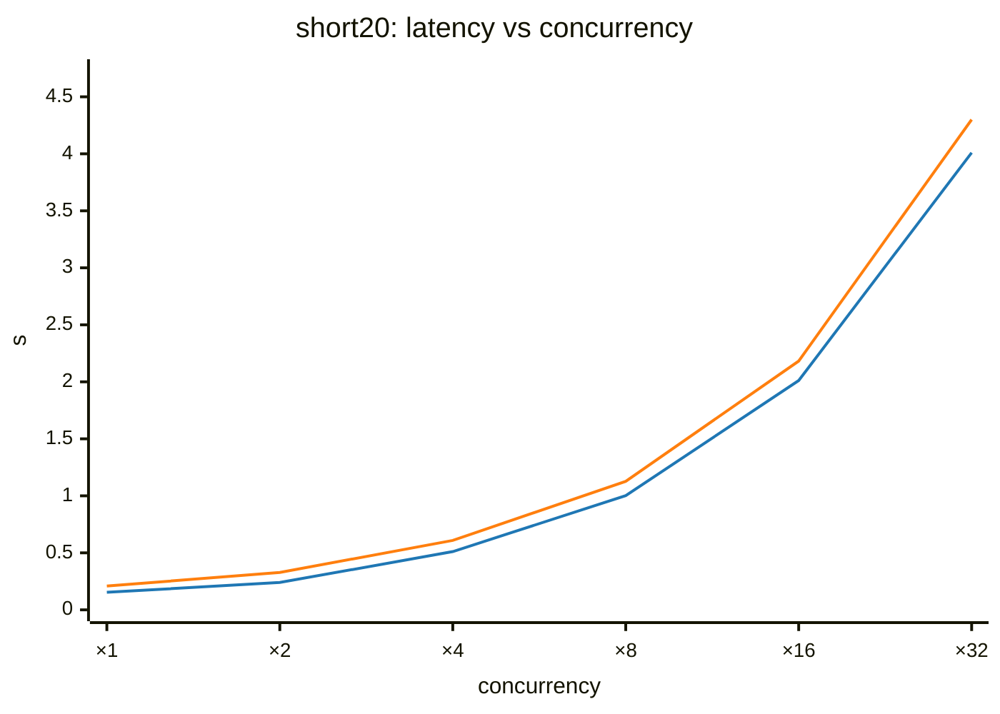
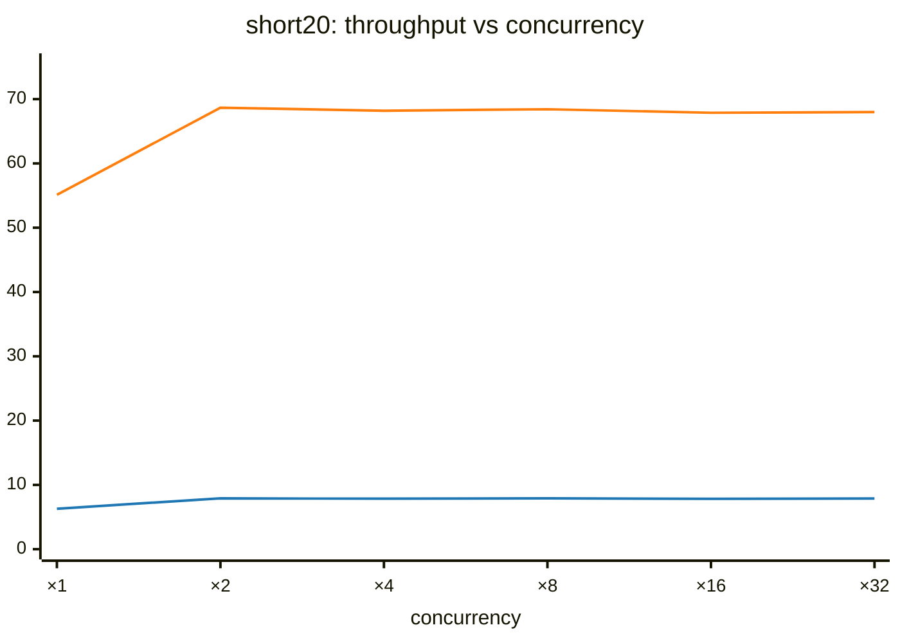
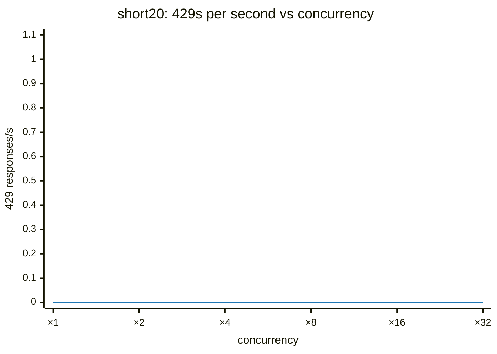

## meticulous — 2026-11-13 10:28 UTC

**PASS** · 425 s · 1802 requests · 0 (0.0%) errors · 0 rate-limited · 17,846,624 tokens billed

Sequential requests (one in flight) unless stated; every query carries a nonce so nothing is served from the API's prefix cache.

### Single document: latency vs length

| rung | Qwen tokens | billed | errors | p50 s | p90 s | max s | API tok/s |
|---|---|---|---|---|---|---|---|
| 256 | 229 | 324 | 0 (0.0%) | 0.017 | 0.018 | 0.041 | 18,146 |
| 512 | 457 | 551 | 0 (0.0%) | 0.020 | 0.020 | 0.023 | 27,819 |
| 1,024 | 911 | 1,005 | 0 (0.0%) | 0.032 | 0.033 | 0.034 | 31,287 |
| 2,048 | 1,872 | 1,966 | 0 (0.0%) | 0.058 | 0.059 | 0.061 | 33,749 |
| 4,096 | 3,707 | 3,801 | 0 (0.0%) | 0.123 | 0.124 | 0.124 | 30,905 |
| 8,192 | 7,545 | 7,640 | 0 (0.0%) | 0.313 | 0.315 | 0.316 | 24,371 |
| 16,384 | 15,274 | 15,368 | 0 (0.0%) | 0.903 | 0.905 | 0.913 | 17,006 |
| 32,768 | 25,438 | 25,536 | 0 (0.0%) | 2.113 | 2.128 | 2.130 | 12,085 |

*Single document: latency vs length: p50, p90*

*Single document: throughput vs length: API tokens/s ÷ 1000*

### ~30K tokens per request: latency vs document length (fewer, longer documents)

| rung | docs/request | billed | errors | p50 s | p90 s | max s | API tok/s |
|---|---|---|---|---|---|---|---|
| 256 | 100 | 32,339 | 0 (0.0%) | 0.450 | 0.454 | 0.454 | 71,702 |
| 512 | 55 | 30,275 | 0 (0.0%) | 0.413 | 0.434 | 0.450 | 73,011 |
| 1,024 | 28 | 28,192 | 0 (0.0%) | 0.429 | 0.467 | 0.477 | 65,427 |
| 2,048 | 13 | 25,572 | 0 (0.0%) | 0.456 | 0.496 | 0.526 | 57,689 |
| 4,096 | 6 | 22,804 | 0 (0.0%) | 0.538 | 0.580 | 0.615 | 43,482 |
| 8,192 | 3 | 22,922 | 0 (0.0%) | 0.729 | 0.827 | 0.890 | 32,586 |
| 16,384 | 1 | 15,367 | 0 (0.0%) | 0.913 | 0.916 | 0.918 | 16,812 |
| 32,768 | 1 | 25,540 | 0 (0.0%) | 2.126 | 2.134 | 2.144 | 12,027 |

*~30K tokens: latency vs document length: p50, p90*

### Latency vs number of documents

| documents | billed | errors | p50 s | p90 s | max s | MRR |
|---|---|---|---|---|---|---|
| 1 tiny | 91.5 | 0 (0.0%) | 0.016 | 0.017 | 0.017 | 1.000 |
| 10 tiny | 919 | 0 (0.0%) | 0.030 | 0.033 | 0.035 | 1.000 |
| 100 tiny | 9,319 | 0 (0.0%) | 0.128 | 0.134 | 0.136 | 1.000 |
| 1000 tiny | 94,389 | 0 (0.0%) | 0.879 | 0.923 | 1.166 | 1.000 |
| 1×256 | 323 | 0 (0.0%) | 0.017 | 0.018 | 0.019 | 1.000 |
| 10×256 | 3,232 | 0 (0.0%) | 0.058 | 0.062 | 0.065 | 1.000 |
| 50×256 | 16,155 | 0 (0.0%) | 0.232 | 0.240 | 0.245 | 1.000 |
| 100×256 | 32,349 | 0 (0.0%) | 0.450 | 0.455 | 0.456 | 1.000 |

*Latency vs number of documents: p50, p90*

### Cold vs cached: the same single-document request sent twice in a row

The API caches prompt prefixes, so a repeated (query, document) pair skips most of the compute. Cold = fresh nonce in the query; cached = the identical request again immediately after.

| rung | pairs | cold p50 s | cached p50 s | speed-up × | cold max s | cached max s | errors |
|---|---|---|---|---|---|---|---|
| 256 | 10 | 0.016 | 0.016 | 1.002 | 0.038 | 0.018 |  |
| 512 | 10 | 0.019 | 0.016 | 1.179 | 0.020 | 0.018 |  |
| 1,024 | 10 | 0.030 | 0.017 | 1.739 | 0.031 | 0.019 |  |
| 2,048 | 10 | 0.054 | 0.020 | 2.745 | 0.055 | 0.021 |  |
| 4,096 | 10 | 0.119 | 0.025 | 4.717 | 0.121 | 0.026 |  |
| 8,192 | 10 | 0.309 | 0.038 | 8.201 | 0.311 | 0.038 |  |
| 16,384 | 10 | 0.904 | 0.063 | 14.3 | 0.907 | 0.064 |  |
| 32,768 | 10 | 2.123 | 0.092 | 23.1 | 2.135 | 0.093 |  |

*Cold vs cached latency vs document length: cold p50, cached p50*

### short20: latency and throughput vs concurrency

|  | requests | errors | 429s | p50 s | p90 s | p99 s | max s | req/s | API tok/s | MRR |
|---|---|---|---|---|---|---|---|---|---|---|
| ×1 | 158 | 0 (0.0%) | 0 | 0.154 | 0.209 | 0.265 | 0.274 | 6.296 | 55,124 | 0.659 |
| ×2 | 199 | 0 (0.0%) | 0 | 0.240 | 0.328 | 0.377 | 0.431 | 7.906 | 68,661 | 0.665 |
| ×4 | 200 | 0 (0.0%) | 0 | 0.511 | 0.609 | 0.716 | 0.718 | 7.853 | 68,190 | 0.655 |
| ×8 | 205 | 0 (0.0%) | 0 | 1.002 | 1.127 | 1.236 | 1.283 | 7.904 | 68,434 | 0.661 |
| ×16 | 212 | 0 (0.0%) | 0 | 2.011 | 2.182 | 2.323 | 2.381 | 7.845 | 67,885 | 0.658 |
| ×32 | 228 | 0 (0.0%) | 0 | 4.010 | 4.300 | 4.467 | 4.513 | 7.884 | 67,987 | 0.647 |

No 429s up to concurrency ×32.

*short20: latency vs concurrency: p50, p90*

*short20: throughput vs concurrency: req/s, API tokens/s ÷ 1000*

*short20: 429s per second vs concurrency: 429/s*

1802 requests, 17,846,624 tokens billed.
