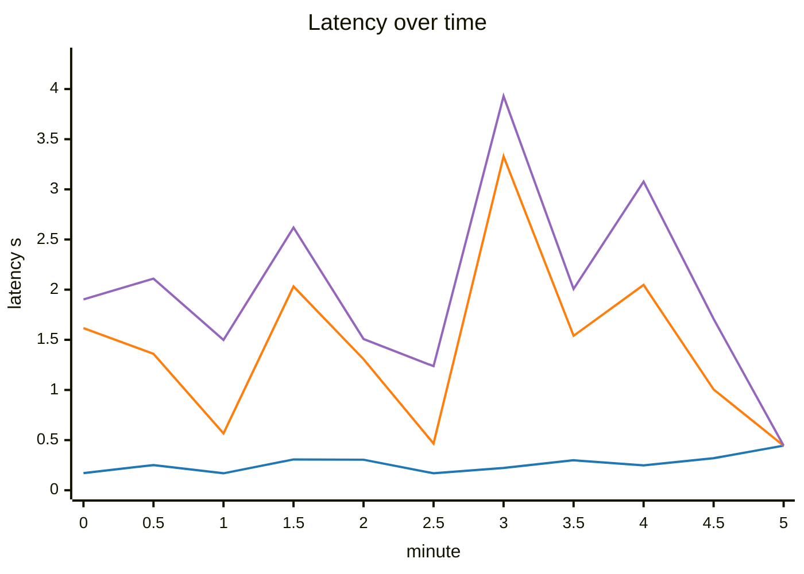
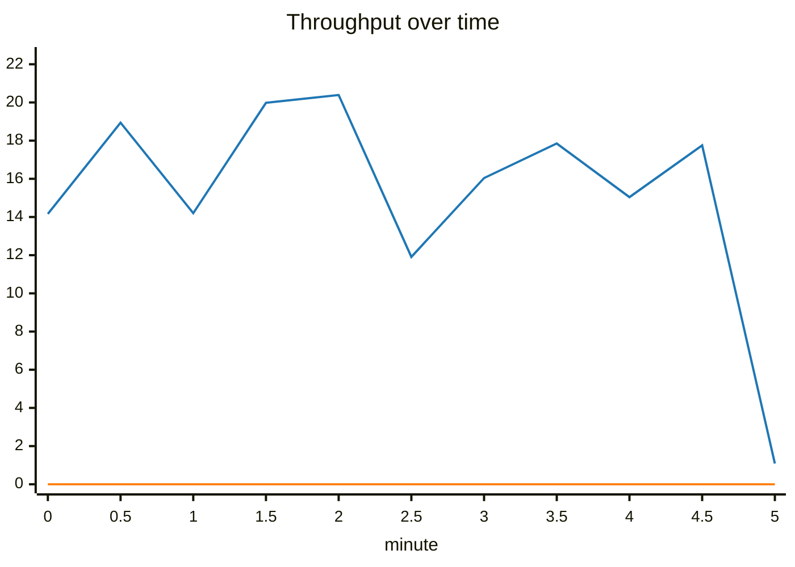

## normal — 2026-11-13 10:12 UTC

**PASS** · 301 s · 437 requests · 0 (0.0%) errors · 0 rate-limited · 5,020,470 tokens billed

5 min of Poisson traffic at 1.5 req/s; mix short20 60%, many100 10%, mid1k 10%, mid4k 10%, long8k 5%, long32k 5%. Billed 5,020,470 tokens.

|  | requests | errors | 429s | p50 s | p90 s | p99 s | max s | req/s | API tok/s | MRR |
|---|---|---|---|---|---|---|---|---|---|---|
| all | 437 | 0 (0.0%) | 0 | 0.247 | 1.513 | 3.345 | 3.929 | 1.457 | 16,735 | 0.789 |
| short20 | 241 | 0 (0.0%) | 0 | 0.181 | 1.163 | 3.087 | 3.564 | 0.803 | 6,867 | 0.627 |
| many100 | 48 | 0 (0.0%) | 0 | 0.473 | 1.556 | 3.006 | 3.363 | 0.160 | 5,188 | 0.958 |
| mid1k | 42 | 0 (0.0%) | 0 | 0.034 | 1.120 | 2.806 | 3.433 | 0.140 | 140 | 1.000 |
| mid4k | 43 | 0 (0.0%) | 0 | 0.122 | 0.800 | 1.571 | 2.056 | 0.143 | 545 | 1.000 |
| long8k | 31 | 0 (0.0%) | 0 | 0.330 | 2.063 | 3.093 | 3.305 | 0.103 | 789 | 1.000 |
| long32k | 32 | 0 (0.0%) | 0 | 1.476 | 2.108 | 3.665 | 3.929 | 0.107 | 3,206 | 0.984 |

*Latency over time: p50, p90, max*

*Throughput over time: API tokens/s ÷ 1000, errors*
