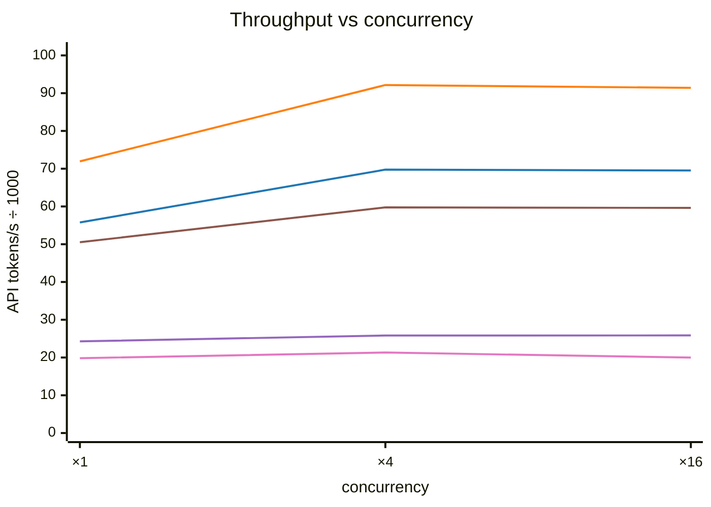
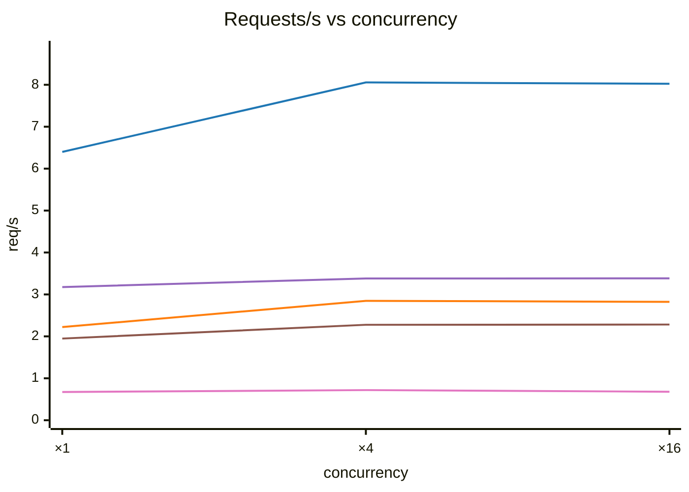
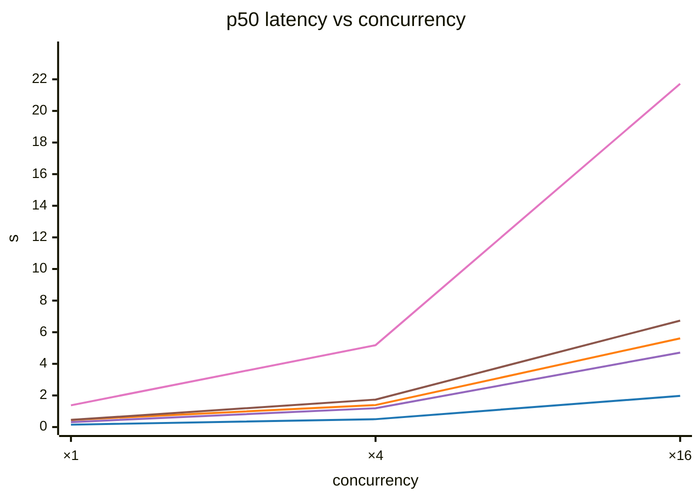

## speed — 2026-11-13 10:20 UTC

**PASS** · 457 s · 1318 requests · 0 (0.0%) errors · 0 rate-limited · 20,935,800 tokens billed

Closed loop, 25 s per cell, 5 request classes × concurrency [1, 4, 16]. 1318 requests, 20,935,800 tokens billed.

|  | requests | errors | 429s | p50 s | p90 s | p99 s | max s | req/s | API tok/s | MRR |
|---|---|---|---|---|---|---|---|---|---|---|
| short20 ×1 | 160 | 0 (0.0%) | 0 | 0.150 | 0.203 | 0.262 | 0.268 | 6.399 | 55,761 | 0.651 |
| short20 ×4 | 205 | 0 (0.0%) | 0 | 0.498 | 0.595 | 0.651 | 0.707 | 8.056 | 69,755 | 0.654 |
| short20 ×16 | 216 | 0 (0.0%) | 0 | 1.972 | 2.135 | 2.272 | 2.326 | 8.024 | 69,520 | 0.654 |
| many100 ×1 | 56 | 0 (0.0%) | 0 | 0.450 | 0.455 | 0.460 | 0.460 | 2.221 | 71,942 | 0.982 |
| many100 ×4 | 75 | 0 (0.0%) | 0 | 1.391 | 1.431 | 1.474 | 1.580 | 2.847 | 92,157 | 0.987 |
| many100 ×16 | 86 | 0 (0.0%) | 0 | 5.612 | 5.659 | 5.710 | 5.902 | 2.823 | 91,398 | 0.988 |
| long8k ×1 | 80 | 0 (0.0%) | 0 | 0.314 | 0.317 | 0.319 | 0.321 | 3.176 | 24,268 | 1.000 |
| long8k ×4 | 88 | 0 (0.0%) | 0 | 1.190 | 1.196 | 1.202 | 1.226 | 3.381 | 25,833 | 1.000 |
| long8k ×16 | 100 | 0 (0.0%) | 0 | 4.711 | 4.766 | 4.774 | 4.789 | 3.383 | 25,850 | 1.000 |
| pack32k ×1 | 49 | 0 (0.0%) | 0 | 0.453 | 0.748 | 0.862 | 0.876 | 1.948 | 50,522 | 1.000 |
| pack32k ×4 | 60 | 0 (0.0%) | 0 | 1.738 | 2.074 | 2.243 | 2.251 | 2.276 | 59,755 | 1.000 |
| pack32k ×16 | 72 | 0 (0.0%) | 0 | 6.733 | 7.370 | 7.675 | 7.723 | 2.282 | 59,623 | 1.000 |
| long32k ×1 | 17 | 0 (0.0%) | 0 | 1.377 | 2.084 | 2.101 | 2.102 | 0.674 | 19,832 | 1.000 |
| long32k ×4 | 21 | 0 (0.0%) | 0 | 5.180 | 6.604 | 6.739 | 6.749 | 0.719 | 21,317 | 1.000 |
| long32k ×16 | 33 | 0 (0.0%) | 0 | 21.7 | 23.1 | 24.0 | 24.3 | 0.680 | 19,984 | 0.985 |

*Throughput vs concurrency: short20, many100, long8k, pack32k, long32k*

*Requests/s vs concurrency: short20, many100, long8k, pack32k, long32k*

*p50 latency vs concurrency: short20, many100, long8k, pack32k, long32k*
