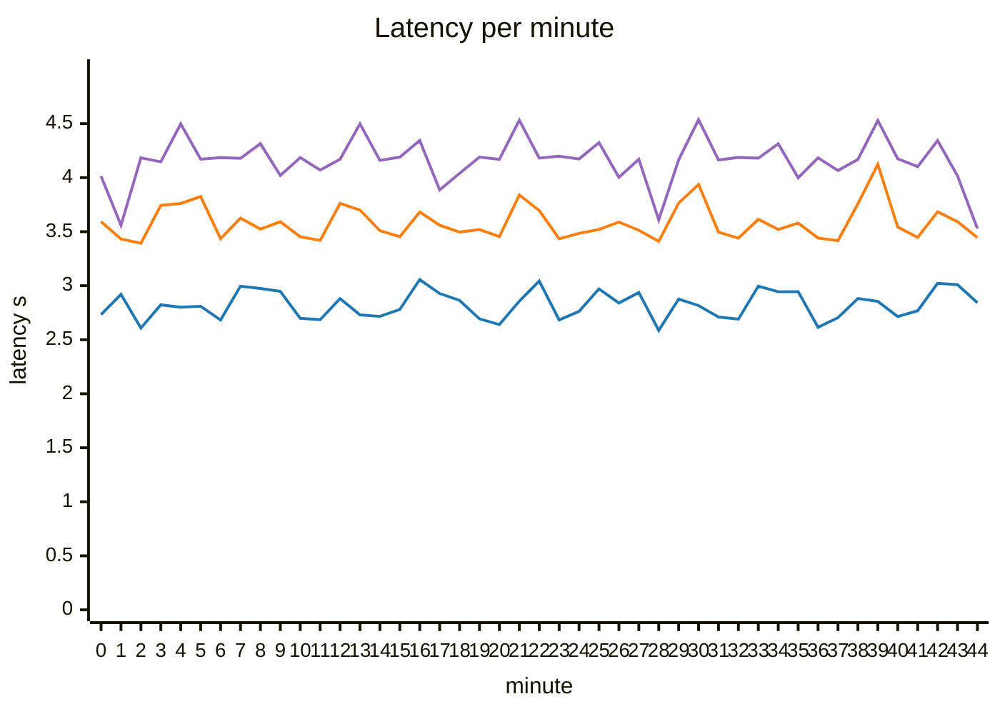
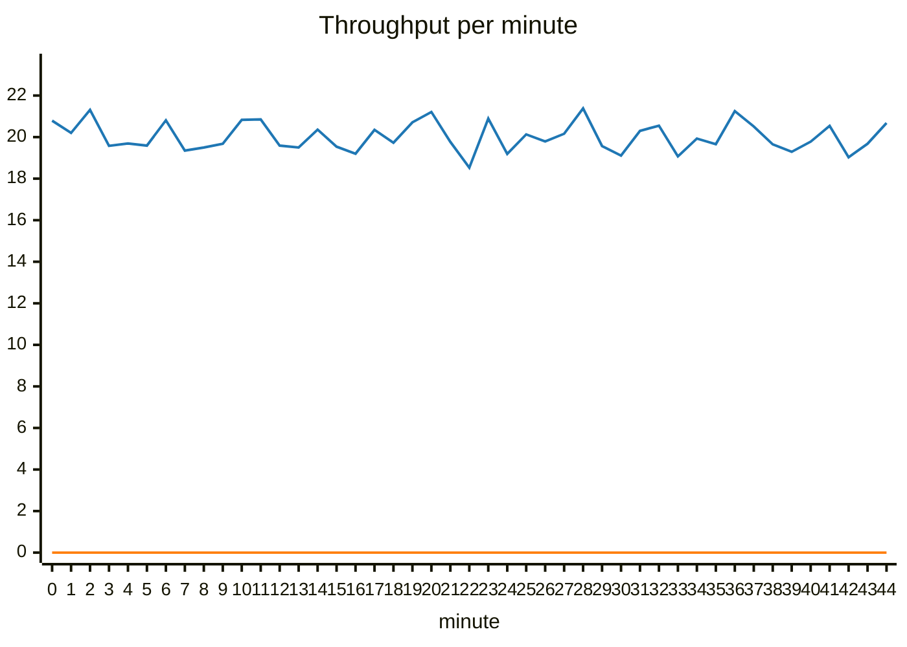

## hammer32k — 2026-11-13 12:10 UTC

**PASS** · 2703 s · 1828 requests · 0 (0.0%) errors · 0 rate-limited · 54,051,633 tokens billed

45 min closed loop with 2 concurrent ~32K-token requests (350 distinct). 1828 requests, 54,051,633 tokens billed.

|  | requests | errors | 429s | p50 s | p90 s | p99 s | max s | req/s | API tok/s | MRR |
|---|---|---|---|---|---|---|---|---|---|---|
| all | 1,828 | 0 (0.0%) | 0 | 2.811 | 3.570 | 4.186 | 4.537 | 0.677 | 20,019 | 0.983 |
| min 0–5 | 206 | 0 (0.0%) | 0 | 2.793 | 3.573 | 4.183 | 4.498 | 0.687 | 20,315 | 0.987 |
| min 5–10 | 201 | 0 (0.0%) | 0 | 2.865 | 3.548 | 4.179 | 4.315 | 0.670 | 19,787 | 0.981 |
| min 10–15 | 205 | 0 (0.0%) | 0 | 2.743 | 3.558 | 4.185 | 4.498 | 0.683 | 20,225 | 0.989 |
| min 15–20 | 202 | 0 (0.0%) | 0 | 2.874 | 3.542 | 4.190 | 4.344 | 0.673 | 19,908 | 0.981 |
| min 20–25 | 203 | 0 (0.0%) | 0 | 2.742 | 3.659 | 4.198 | 4.532 | 0.677 | 19,919 | 0.980 |
| min 25–30 | 204 | 0 (0.0%) | 0 | 2.845 | 3.548 | 4.165 | 4.324 | 0.680 | 20,207 | 0.982 |
| min 30–35 | 201 | 0 (0.0%) | 0 | 2.792 | 3.616 | 4.314 | 4.537 | 0.670 | 19,793 | 0.983 |
| min 35–40 | 204 | 0 (0.0%) | 0 | 2.807 | 3.583 | 4.183 | 4.528 | 0.680 | 20,072 | 0.981 |
| min 40–45 | 202 | 0 (0.0%) | 0 | 2.845 | 3.533 | 4.167 | 4.344 | 0.673 | 19,945 | 0.981 |

*Latency per minute: p50, p90, max*

*Throughput per minute: API tokens/s ÷ 1000, errors*
