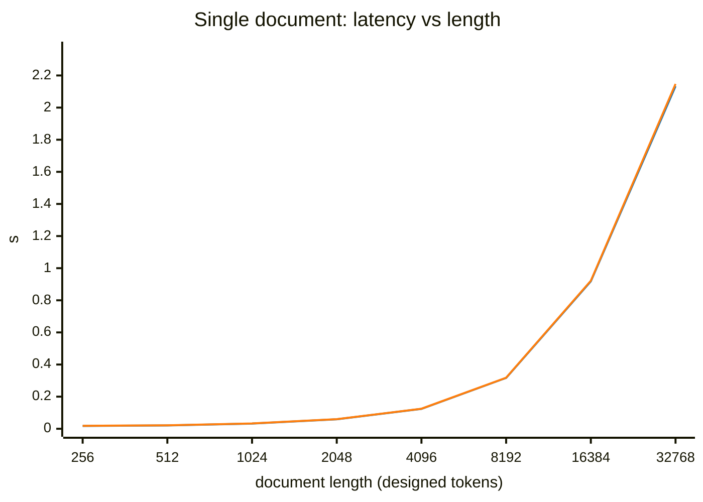
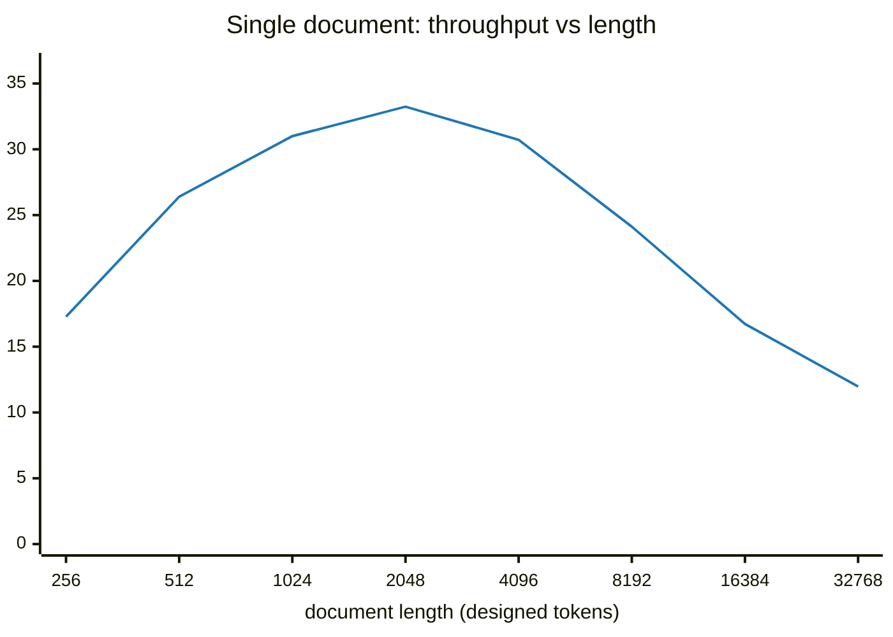
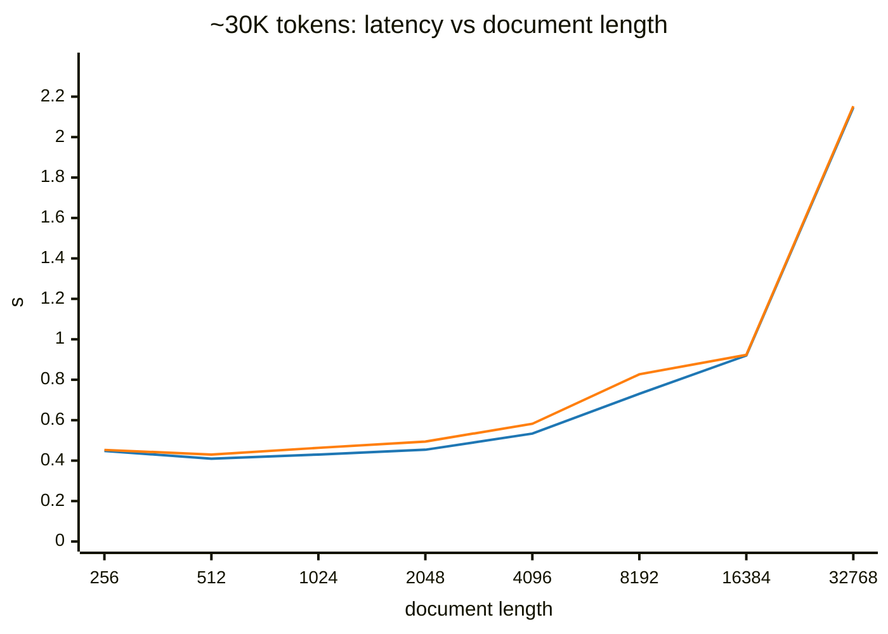
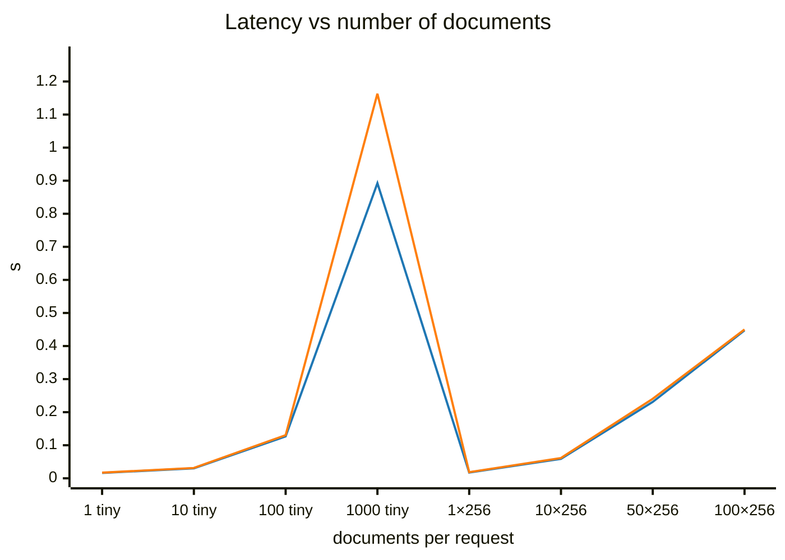
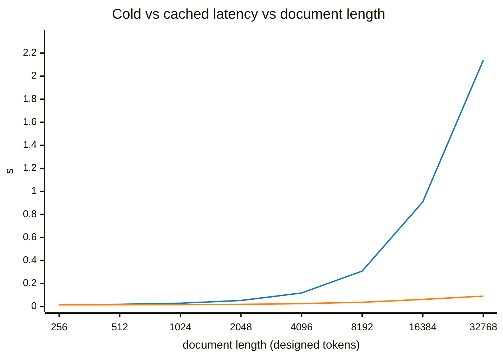
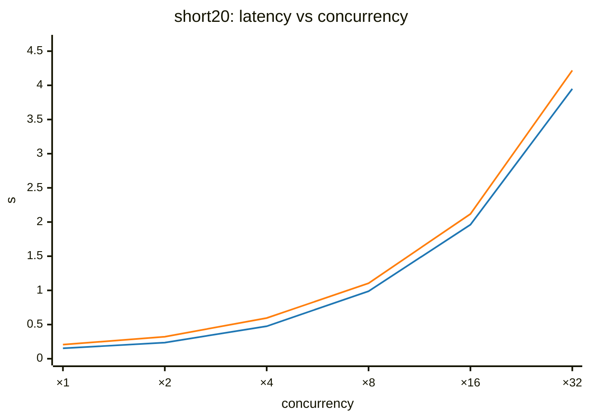
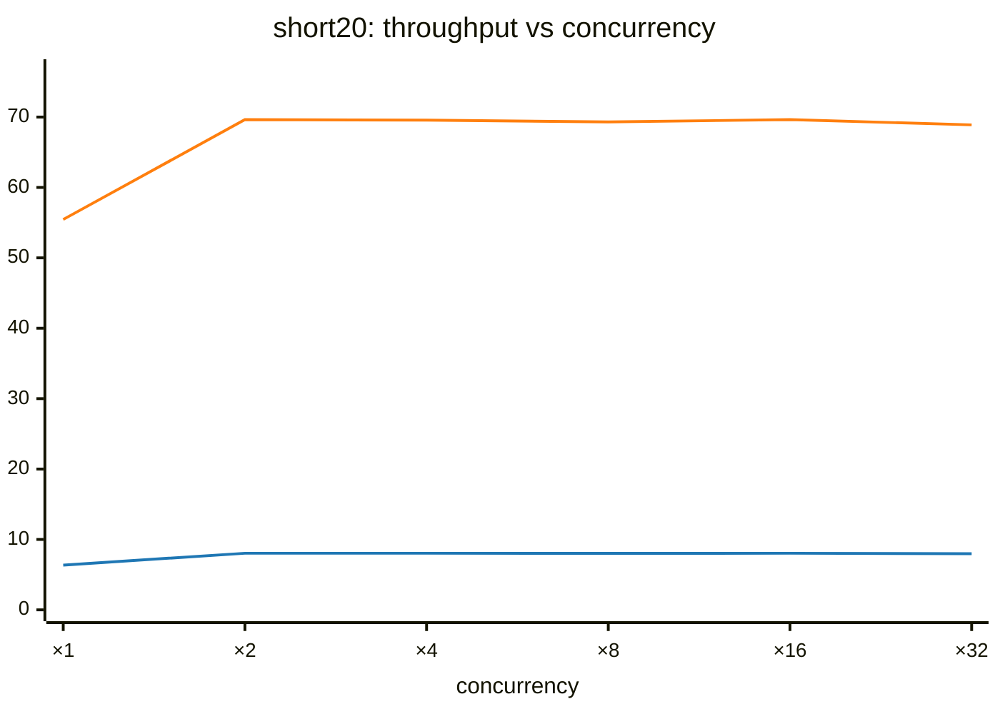
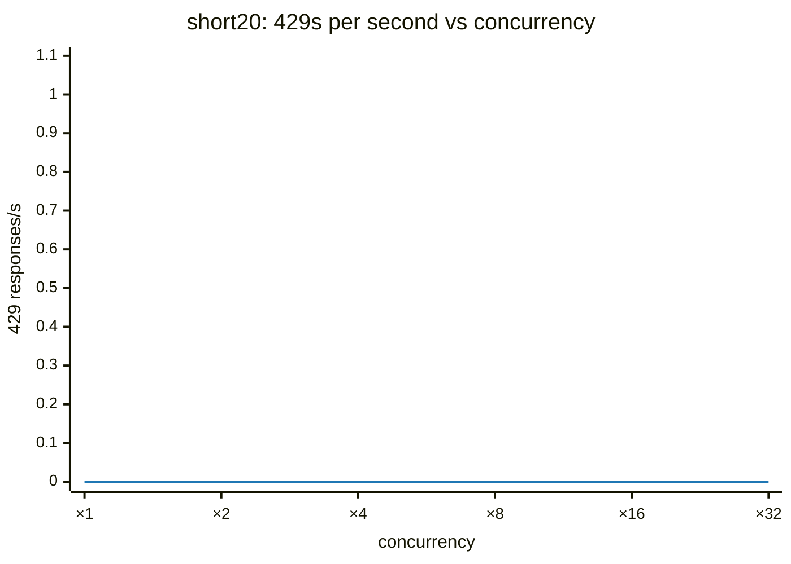

## meticulous — 2026-11-13 12:03 UTC

**PASS** · 427 s · 1821 requests · 0 (0.0%) errors · 0 rate-limited · 18,000,750 tokens billed

Sequential requests (one in flight) unless stated; every query carries a nonce so nothing is served from the API's prefix cache.

### Single document: latency vs length

| rung | Qwen tokens | billed | errors | p50 s | p90 s | max s | API tok/s |
|---|---|---|---|---|---|---|---|
| 256 | 229 | 324 | 0 (0.0%) | 0.018 | 0.018 | 0.044 | 17,276 |
| 512 | 457 | 551 | 0 (0.0%) | 0.020 | 0.022 | 0.026 | 26,399 |
| 1,024 | 911 | 1,005 | 0 (0.0%) | 0.032 | 0.033 | 0.034 | 30,996 |
| 2,048 | 1,872 | 1,966 | 0 (0.0%) | 0.059 | 0.060 | 0.062 | 33,239 |
| 4,096 | 3,707 | 3,800 | 0 (0.0%) | 0.124 | 0.125 | 0.125 | 30,720 |
| 8,192 | 7,545 | 7,639 | 0 (0.0%) | 0.317 | 0.318 | 0.319 | 24,116 |
| 16,384 | 15,274 | 15,369 | 0 (0.0%) | 0.918 | 0.922 | 0.926 | 16,733 |
| 32,768 | 25,438 | 25,536 | 0 (0.0%) | 2.133 | 2.147 | 2.152 | 11,970 |

*Single document: latency vs length: p50, p90*

*Single document: throughput vs length: API tokens/s ÷ 1000*

### ~30K tokens per request: latency vs document length (fewer, longer documents)

| rung | docs/request | billed | errors | p50 s | p90 s | max s | API tok/s |
|---|---|---|---|---|---|---|---|
| 256 | 100 | 32,406 | 0 (0.0%) | 0.448 | 0.453 | 0.454 | 72,093 |
| 512 | 55 | 30,289 | 0 (0.0%) | 0.410 | 0.430 | 0.448 | 73,374 |
| 1,024 | 28 | 28,192 | 0 (0.0%) | 0.430 | 0.463 | 0.471 | 65,797 |
| 2,048 | 13 | 25,572 | 0 (0.0%) | 0.454 | 0.494 | 0.523 | 57,904 |
| 4,096 | 6 | 22,807 | 0 (0.0%) | 0.534 | 0.582 | 0.613 | 43,681 |
| 8,192 | 3 | 22,922 | 0 (0.0%) | 0.731 | 0.827 | 0.885 | 32,596 |
| 16,384 | 1 | 15,367 | 0 (0.0%) | 0.920 | 0.923 | 0.926 | 16,703 |
| 32,768 | 1 | 25,540 | 0 (0.0%) | 2.146 | 2.153 | 2.161 | 11,909 |

*~30K tokens: latency vs document length: p50, p90*

### Latency vs number of documents

| documents | billed | errors | p50 s | p90 s | max s | MRR |
|---|---|---|---|---|---|---|
| 1 tiny | 91.6 | 0 (0.0%) | 0.016 | 0.017 | 0.018 | 1.000 |
| 10 tiny | 922 | 0 (0.0%) | 0.030 | 0.031 | 0.032 | 1.000 |
| 100 tiny | 9,279 | 0 (0.0%) | 0.127 | 0.131 | 0.131 | 0.950 |
| 1000 tiny | 94,189 | 0 (0.0%) | 0.893 | 1.163 | 1.164 | 0.850 |
| 1×256 | 323 | 0 (0.0%) | 0.018 | 0.019 | 0.019 | 1.000 |
| 10×256 | 3,238 | 0 (0.0%) | 0.059 | 0.061 | 0.067 | 1.000 |
| 50×256 | 16,145 | 0 (0.0%) | 0.231 | 0.240 | 0.246 | 1.000 |
| 100×256 | 32,359 | 0 (0.0%) | 0.447 | 0.450 | 0.453 | 1.000 |

*Latency vs number of documents: p50, p90*

### Cold vs cached: the same single-document request sent twice in a row

The API caches prompt prefixes, so a repeated (query, document) pair skips most of the compute. Cold = fresh nonce in the query; cached = the identical request again immediately after.

| rung | pairs | cold p50 s | cached p50 s | speed-up × | cold max s | cached max s | errors |
|---|---|---|---|---|---|---|---|
| 256 | 10 | 0.016 | 0.016 | 1.049 | 0.031 | 0.017 |  |
| 512 | 10 | 0.020 | 0.016 | 1.199 | 0.021 | 0.017 |  |
| 1,024 | 10 | 0.030 | 0.017 | 1.723 | 0.031 | 0.018 |  |
| 2,048 | 10 | 0.054 | 0.020 | 2.733 | 0.054 | 0.022 |  |
| 4,096 | 10 | 0.118 | 0.026 | 4.578 | 0.119 | 0.028 |  |
| 8,192 | 10 | 0.309 | 0.038 | 8.115 | 0.310 | 0.039 |  |
| 16,384 | 10 | 0.909 | 0.063 | 14.5 | 0.911 | 0.063 |  |
| 32,768 | 10 | 2.139 | 0.091 | 23.5 | 2.151 | 0.093 |  |

*Cold vs cached latency vs document length: cold p50, cached p50*

### short20: latency and throughput vs concurrency

|  | requests | errors | 429s | p50 s | p90 s | p99 s | max s | req/s | API tok/s | MRR |
|---|---|---|---|---|---|---|---|---|---|---|
| ×1 | 159 | 0 (0.0%) | 0 | 0.152 | 0.207 | 0.264 | 0.276 | 6.353 | 55,446 | 0.667 |
| ×2 | 202 | 0 (0.0%) | 0 | 0.236 | 0.321 | 0.369 | 0.381 | 8.037 | 69,633 | 0.670 |
| ×4 | 205 | 0 (0.0%) | 0 | 0.475 | 0.595 | 0.660 | 0.703 | 8.036 | 69,565 | 0.676 |
| ×8 | 208 | 0 (0.0%) | 0 | 0.988 | 1.104 | 1.240 | 1.262 | 8.019 | 69,310 | 0.667 |
| ×16 | 216 | 0 (0.0%) | 0 | 1.961 | 2.118 | 2.280 | 2.334 | 8.038 | 69,631 | 0.660 |
| ×32 | 231 | 0 (0.0%) | 0 | 3.949 | 4.219 | 4.369 | 4.423 | 7.965 | 68,886 | 0.661 |

No 429s up to concurrency ×32.

*short20: latency vs concurrency: p50, p90*

*short20: throughput vs concurrency: req/s, API tokens/s ÷ 1000*

*short20: 429s per second vs concurrency: 429/s*

1821 requests, 18,000,750 tokens billed.
