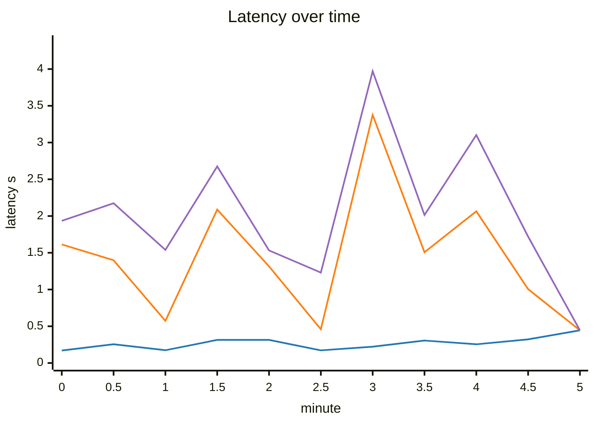
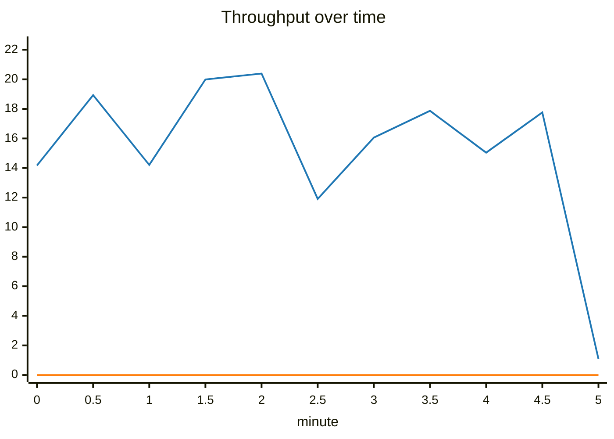

## normal — 2026-11-13 11:48 UTC

**PASS** · 301 s · 437 requests · 0 (0.0%) errors · 0 rate-limited · 5,022,011 tokens billed

5 min of Poisson traffic at 1.5 req/s; mix short20 60%, many100 10%, mid1k 10%, mid4k 10%, long8k 5%, long32k 5%. Billed 5,022,011 tokens.

|  | requests | errors | 429s | p50 s | p90 s | p99 s | max s | req/s | API tok/s | MRR |
|---|---|---|---|---|---|---|---|---|---|---|
| all | 437 | 0 (0.0%) | 0 | 0.244 | 1.535 | 3.389 | 3.971 | 1.457 | 16,740 | 0.793 |
| short20 | 241 | 0 (0.0%) | 0 | 0.184 | 1.177 | 3.117 | 3.604 | 0.803 | 6,867 | 0.635 |
| many100 | 48 | 0 (0.0%) | 0 | 0.480 | 1.615 | 3.036 | 3.402 | 0.160 | 5,193 | 0.958 |
| mid1k | 42 | 0 (0.0%) | 0 | 0.035 | 1.139 | 2.838 | 3.474 | 0.140 | 140 | 1.000 |
| mid4k | 43 | 0 (0.0%) | 0 | 0.125 | 0.809 | 1.606 | 2.113 | 0.143 | 545 | 1.000 |
| long8k | 31 | 0 (0.0%) | 0 | 0.333 | 2.080 | 3.151 | 3.364 | 0.103 | 789 | 1.000 |
| long32k | 32 | 0 (0.0%) | 0 | 1.492 | 2.170 | 3.702 | 3.971 | 0.107 | 3,206 | 0.984 |

*Latency over time: p50, p90, max*

*Throughput over time: API tokens/s ÷ 1000, errors*
