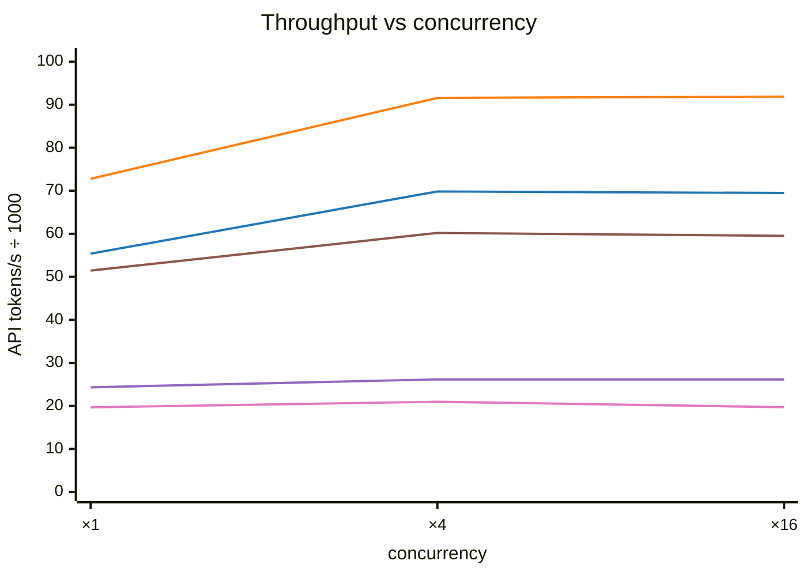
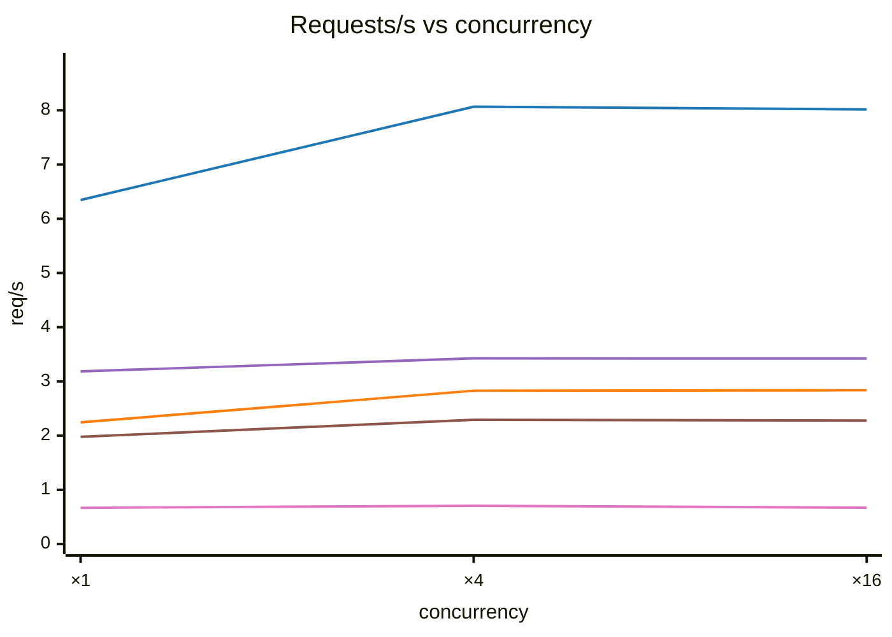
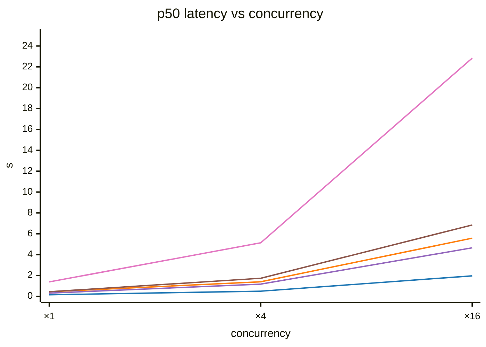

## speed — 2026-11-13 11:56 UTC

**PASS** · 458 s · 1319 requests · 0 (0.0%) errors · 0 rate-limited · 20,969,846 tokens billed

Closed loop, 25 s per cell, 5 request classes × concurrency [1, 4, 16]. 1319 requests, 20,969,846 tokens billed.

|  | requests | errors | 429s | p50 s | p90 s | p99 s | max s | req/s | API tok/s | MRR |
|---|---|---|---|---|---|---|---|---|---|---|
| short20 ×1 | 159 | 0 (0.0%) | 0 | 0.153 | 0.205 | 0.264 | 0.279 | 6.346 | 55,381 | 0.663 |
| short20 ×4 | 205 | 0 (0.0%) | 0 | 0.498 | 0.590 | 0.687 | 0.702 | 8.066 | 69,839 | 0.671 |
| short20 ×16 | 215 | 0 (0.0%) | 0 | 1.966 | 2.150 | 2.262 | 2.283 | 8.017 | 69,482 | 0.652 |
| many100 ×1 | 57 | 0 (0.0%) | 0 | 0.444 | 0.448 | 0.453 | 0.456 | 2.245 | 72,788 | 0.982 |
| many100 ×4 | 74 | 0 (0.0%) | 0 | 1.400 | 1.452 | 1.499 | 1.590 | 2.828 | 91,579 | 0.980 |
| many100 ×16 | 86 | 0 (0.0%) | 0 | 5.579 | 5.616 | 5.670 | 5.907 | 2.837 | 91,882 | 0.983 |
| long8k ×1 | 80 | 0 (0.0%) | 0 | 0.314 | 0.317 | 0.321 | 0.322 | 3.184 | 24,324 | 1.000 |
| long8k ×4 | 89 | 0 (0.0%) | 0 | 1.175 | 1.181 | 1.192 | 1.210 | 3.425 | 26,172 | 1.000 |
| long8k ×16 | 101 | 0 (0.0%) | 0 | 4.655 | 4.706 | 4.718 | 4.730 | 3.423 | 26,150 | 1.000 |
| pack32k ×1 | 50 | 0 (0.0%) | 0 | 0.445 | 0.738 | 0.860 | 0.873 | 1.977 | 51,435 | 1.000 |
| pack32k ×4 | 60 | 0 (0.0%) | 0 | 1.736 | 2.046 | 2.214 | 2.235 | 2.293 | 60,200 | 1.000 |
| pack32k ×16 | 72 | 0 (0.0%) | 0 | 6.845 | 7.394 | 7.681 | 7.702 | 2.278 | 59,525 | 1.000 |
| long32k ×1 | 17 | 0 (0.0%) | 0 | 1.388 | 2.116 | 2.139 | 2.140 | 0.668 | 19,674 | 1.000 |
| long32k ×4 | 21 | 0 (0.0%) | 0 | 5.135 | 6.730 | 6.856 | 6.868 | 0.707 | 20,966 | 1.000 |
| long32k ×16 | 33 | 0 (0.0%) | 0 | 22.8 | 23.6 | 24.5 | 24.7 | 0.670 | 19,697 | 0.985 |

*Throughput vs concurrency: short20, many100, long8k, pack32k, long32k*

*Requests/s vs concurrency: short20, many100, long8k, pack32k, long32k*

*p50 latency vs concurrency: short20, many100, long8k, pack32k, long32k*
