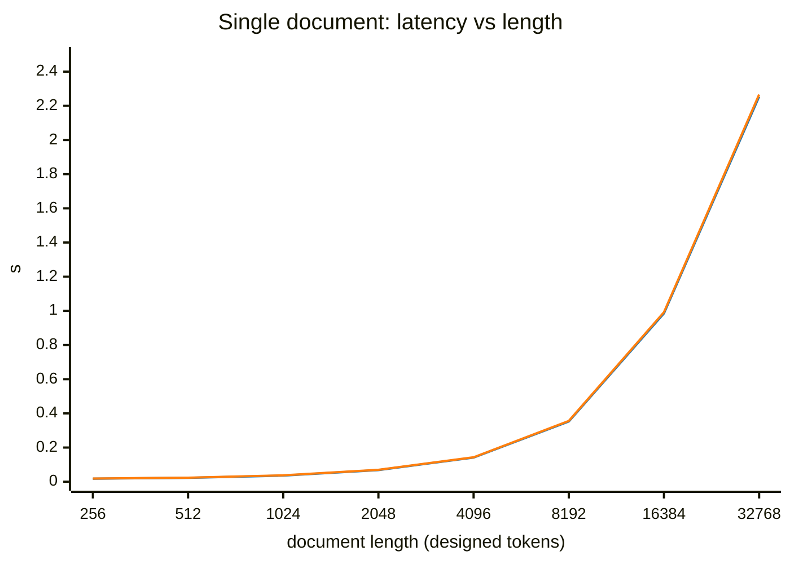
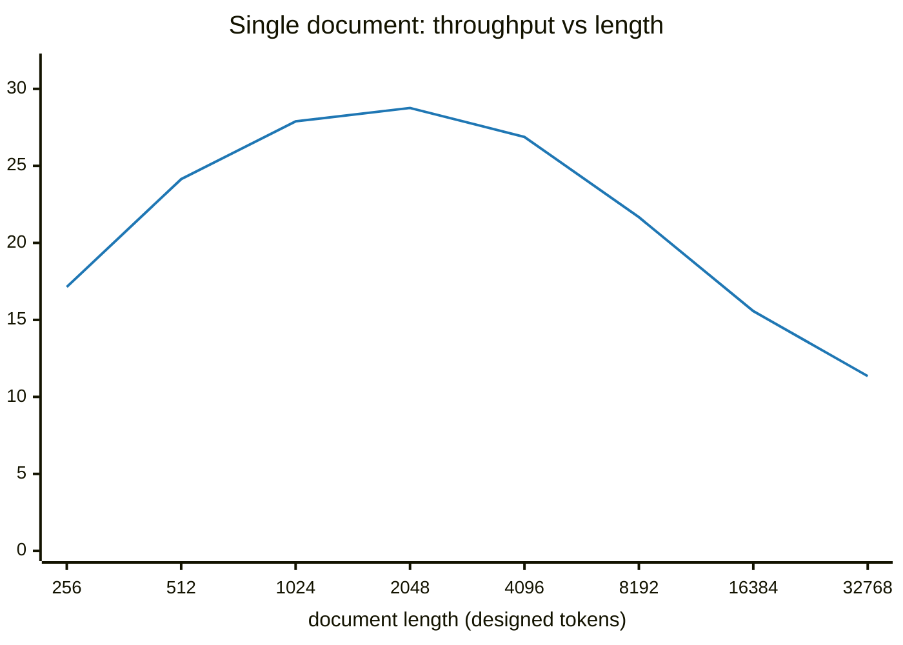
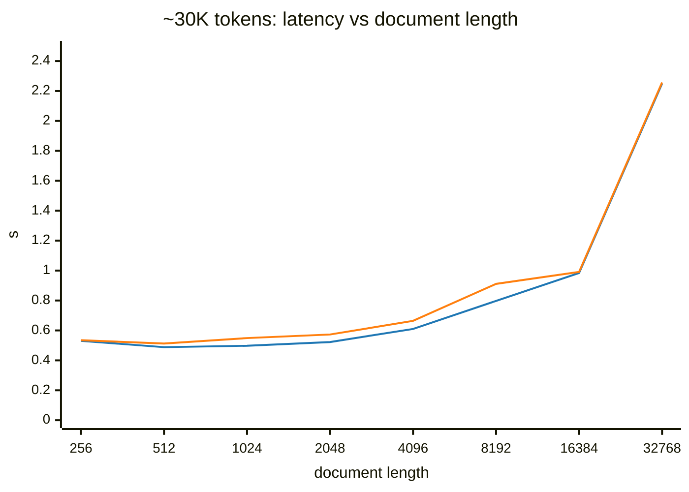
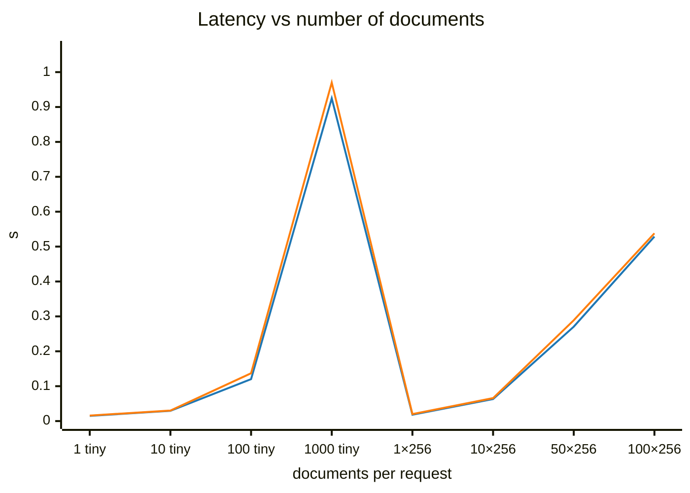
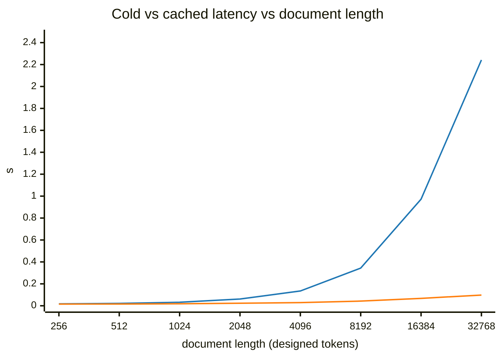
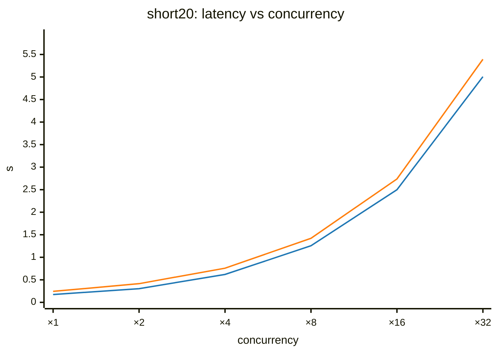
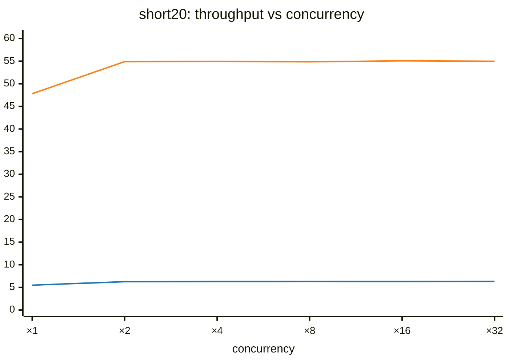
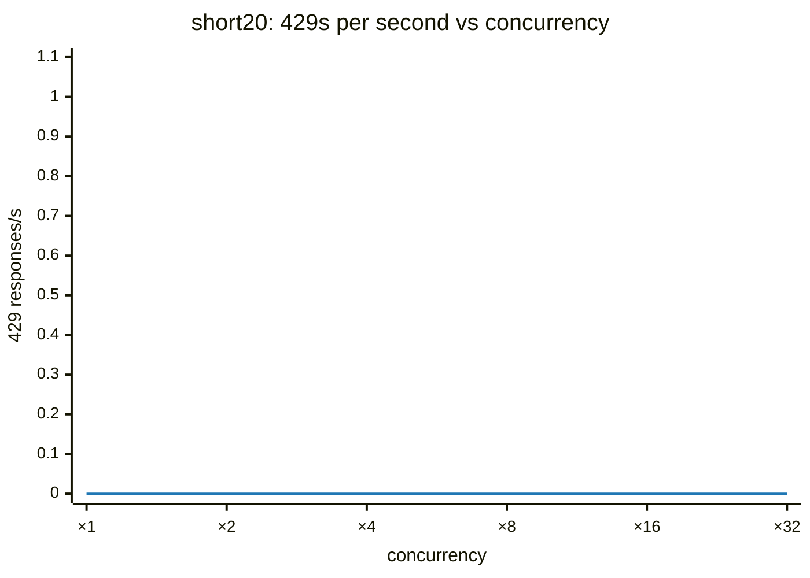

## meticulous — 2026-11-13 13:50 UTC

**PASS** · 448 s · 1580 requests · 0 (0.0%) errors · 0 rate-limited · 15,959,162 tokens billed

Sequential requests (one in flight) unless stated; every query carries a nonce so nothing is served from the API's prefix cache.

### Single document: latency vs length

| rung | Qwen tokens | billed | errors | p50 s | p90 s | max s | API tok/s |
|---|---|---|---|---|---|---|---|
| 256 | 229 | 324 | 0 (0.0%) | 0.018 | 0.019 | 0.042 | 17,137 |
| 512 | 457 | 551 | 0 (0.0%) | 0.023 | 0.023 | 0.028 | 24,143 |
| 1,024 | 911 | 1,005 | 0 (0.0%) | 0.036 | 0.038 | 0.042 | 27,891 |
| 2,048 | 1,872 | 1,966 | 0 (0.0%) | 0.068 | 0.069 | 0.070 | 28,758 |
| 4,096 | 3,707 | 3,801 | 0 (0.0%) | 0.141 | 0.143 | 0.146 | 26,882 |
| 8,192 | 7,545 | 7,640 | 0 (0.0%) | 0.352 | 0.356 | 0.359 | 21,672 |
| 16,384 | 15,274 | 15,368 | 0 (0.0%) | 0.985 | 0.992 | 0.993 | 15,573 |
| 32,768 | 25,438 | 25,536 | 0 (0.0%) | 2.253 | 2.266 | 2.269 | 11,354 |

*Single document: latency vs length: p50, p90*

*Single document: throughput vs length: API tokens/s ÷ 1000*

### ~30K tokens per request: latency vs document length (fewer, longer documents)

| rung | docs/request | billed | errors | p50 s | p90 s | max s | API tok/s |
|---|---|---|---|---|---|---|---|
| 256 | 100 | 32,372 | 0 (0.0%) | 0.530 | 0.535 | 0.541 | 60,850 |
| 512 | 55 | 30,289 | 0 (0.0%) | 0.488 | 0.512 | 0.537 | 61,680 |
| 1,024 | 28 | 28,183 | 0 (0.0%) | 0.498 | 0.549 | 0.557 | 56,045 |
| 2,048 | 13 | 25,573 | 0 (0.0%) | 0.522 | 0.573 | 0.605 | 50,042 |
| 4,096 | 6 | 22,809 | 0 (0.0%) | 0.610 | 0.664 | 0.694 | 38,550 |
| 8,192 | 3 | 22,921 | 0 (0.0%) | 0.797 | 0.911 | 0.989 | 29,714 |
| 16,384 | 1 | 15,366 | 0 (0.0%) | 0.984 | 0.991 | 0.999 | 15,593 |
| 32,768 | 1 | 25,540 | 0 (0.0%) | 2.249 | 2.257 | 2.263 | 11,372 |

*~30K tokens: latency vs document length: p50, p90*

### Latency vs number of documents

| documents | billed | errors | p50 s | p90 s | max s | MRR |
|---|---|---|---|---|---|---|
| 1 tiny | 90.7 | 0 (0.0%) | 0.015 | 0.016 | 0.017 | 1.000 |
| 10 tiny | 925 | 0 (0.0%) | 0.029 | 0.030 | 0.031 | 1.000 |
| 100 tiny | 9,289 | 0 (0.0%) | 0.120 | 0.137 | 0.141 | 1.000 |
| 1000 tiny | 94,089 | 0 (0.0%) | 0.925 | 0.970 | 1.266 | 0.950 |
| 1×256 | 323 | 0 (0.0%) | 0.018 | 0.020 | 0.021 | 1.000 |
| 10×256 | 3,232 | 0 (0.0%) | 0.063 | 0.066 | 0.073 | 1.000 |
| 50×256 | 16,150 | 0 (0.0%) | 0.271 | 0.289 | 0.304 | 1.000 |
| 100×256 | 32,329 | 0 (0.0%) | 0.529 | 0.538 | 0.553 | 1.000 |

*Latency vs number of documents: p50, p90*

### Cold vs cached: the same single-document request sent twice in a row

The API caches prompt prefixes, so a repeated (query, document) pair skips most of the compute. Cold = fresh nonce in the query; cached = the identical request again immediately after.

| rung | pairs | cold p50 s | cached p50 s | speed-up × | cold max s | cached max s | errors |
|---|---|---|---|---|---|---|---|
| 256 | 10 | 0.017 | 0.015 | 1.144 | 0.034 | 0.017 |  |
| 512 | 10 | 0.022 | 0.016 | 1.390 | 0.023 | 0.017 |  |
| 1,024 | 10 | 0.032 | 0.018 | 1.776 | 0.035 | 0.022 |  |
| 2,048 | 10 | 0.062 | 0.023 | 2.674 | 0.064 | 0.023 |  |
| 4,096 | 10 | 0.135 | 0.029 | 4.651 | 0.137 | 0.031 |  |
| 8,192 | 10 | 0.344 | 0.043 | 8.051 | 0.347 | 0.044 |  |
| 16,384 | 10 | 0.972 | 0.068 | 14.4 | 0.975 | 0.069 |  |
| 32,768 | 10 | 2.242 | 0.098 | 23.0 | 2.257 | 0.099 |  |

*Cold vs cached latency vs document length: cold p50, cached p50*

### short20: latency and throughput vs concurrency

|  | requests | errors | 429s | p50 s | p90 s | p99 s | max s | req/s | API tok/s | MRR |
|---|---|---|---|---|---|---|---|---|---|---|
| ×1 | 138 | 0 (0.0%) | 0 | 0.174 | 0.244 | 0.318 | 0.321 | 5.495 | 47,803 | 0.665 |
| ×2 | 158 | 0 (0.0%) | 0 | 0.303 | 0.415 | 0.484 | 0.488 | 6.273 | 54,899 | 0.661 |
| ×4 | 160 | 0 (0.0%) | 0 | 0.620 | 0.758 | 0.866 | 0.901 | 6.306 | 54,953 | 0.672 |
| ×8 | 164 | 0 (0.0%) | 0 | 1.256 | 1.421 | 1.556 | 1.558 | 6.316 | 54,858 | 0.679 |
| ×16 | 172 | 0 (0.0%) | 0 | 2.499 | 2.738 | 2.916 | 2.921 | 6.308 | 55,072 | 0.661 |
| ×32 | 188 | 0 (0.0%) | 0 | 5.007 | 5.393 | 5.596 | 5.656 | 6.319 | 54,975 | 0.667 |

No 429s up to concurrency ×32.

*short20: latency vs concurrency: p50, p90*

*short20: throughput vs concurrency: req/s, API tokens/s ÷ 1000*

*short20: 429s per second vs concurrency: 429/s*

1580 requests, 15,959,162 tokens billed.
