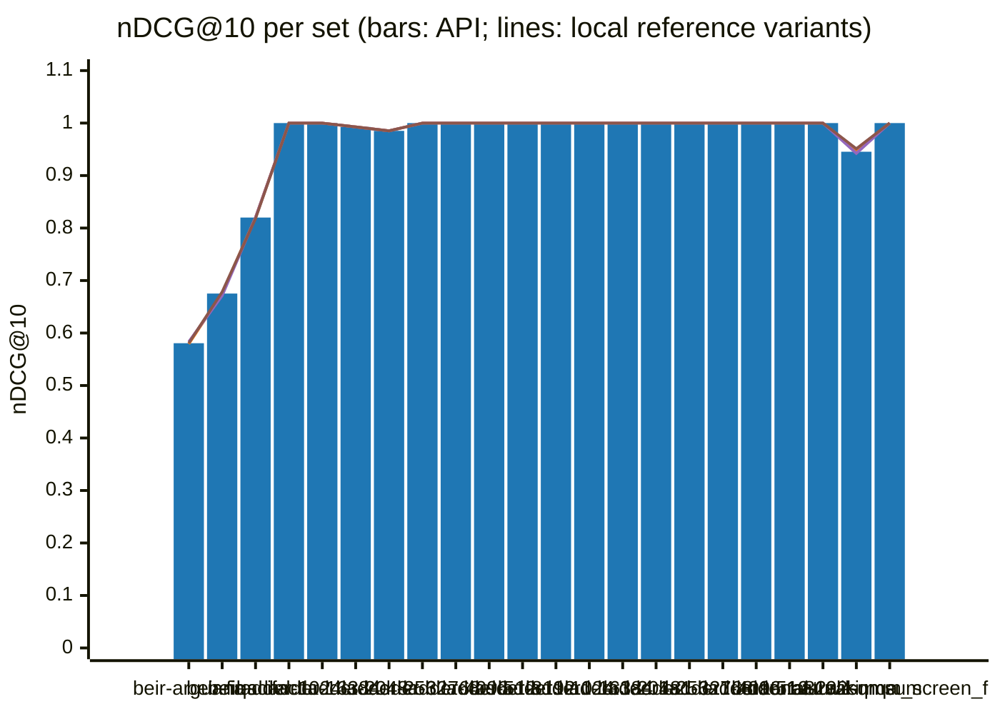
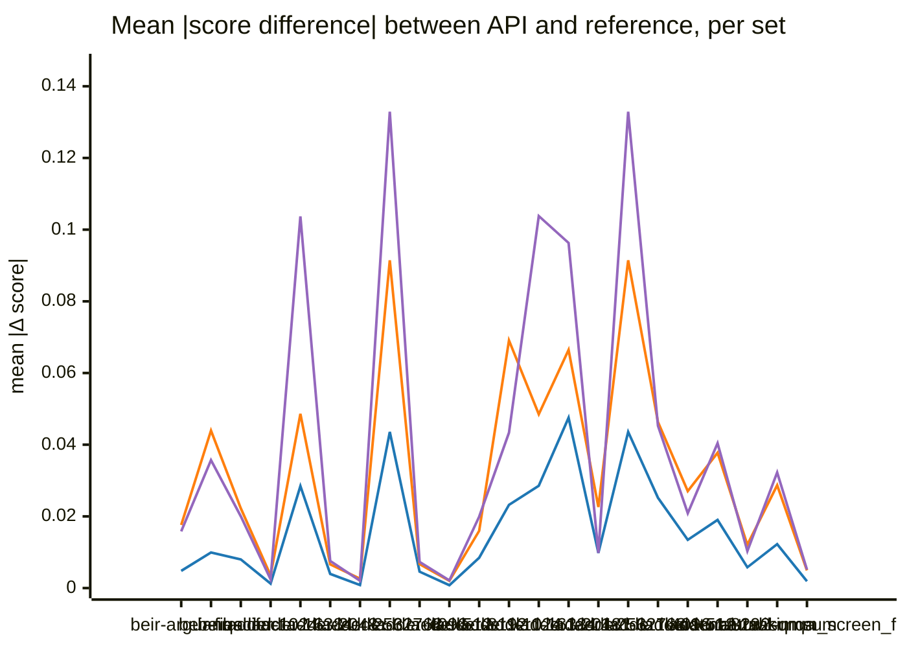
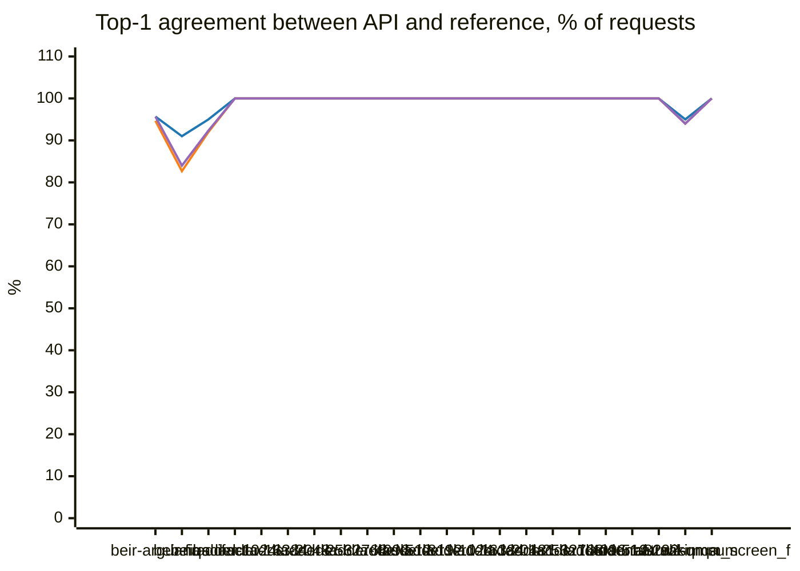

## quality — 2026-11-13 13:32 UTC

**PASS** · 1079 s · 2000 requests · 0 (0.0%) errors · 0 rate-limited · 29,476,787 tokens billed

Up to 300 requests per set (100 for natural-*) at 4 in flight (429s retried); 2000 requests, 29,476,787 tokens billed. nDCG@10 / MRR are against the ground-truth labels; every reference column is computed over the same requests. Local reference variants of Qwen3-Reranker-0.6B (scripts/reference.py): bf16, fp16, fp8, fp8attn, fp8kv, gguf-q4_k_m, gguf-q8_0, vllm-bf16, vllm-fp8, vllm-fp8-fp8kv, vllm-fp8kv, w4, w8, yarn. |Δ| is the mean absolute score difference per document; top-1 is the share of requests where the API and the reference pick the same best document.

| set | requests | errors | 429s | nDCG@10 API | MRR API | p50 s | nDCG bf16 | |Δ| bf16 | top-1 % bf16 | nDCG fp16 | |Δ| fp16 | top-1 % fp16 | nDCG fp8 | |Δ| fp8 | top-1 % fp8 | nDCG fp8attn | |Δ| fp8attn | top-1 % fp8attn | nDCG fp8kv | |Δ| fp8kv | top-1 % fp8kv | nDCG gguf-q4_k_m | |Δ| gguf-q4_k_m | top-1 % gguf-q4_k_m | nDCG gguf-q8_0 | |Δ| gguf-q8_0 | top-1 % gguf-q8_0 | nDCG vllm-bf16 | |Δ| vllm-bf16 | top-1 % vllm-bf16 | nDCG vllm-fp8 | |Δ| vllm-fp8 | top-1 % vllm-fp8 | nDCG vllm-fp8-fp8kv | |Δ| vllm-fp8-fp8kv | top-1 % vllm-fp8-fp8kv | nDCG vllm-fp8kv | |Δ| vllm-fp8kv | top-1 % vllm-fp8kv | nDCG w4 | |Δ| w4 | top-1 % w4 | nDCG w8 | |Δ| w8 | top-1 % w8 | nDCG yarn | |Δ| yarn | top-1 % yarn |
|---|---|---|---|---|---|---|---|---|---|---|---|---|---|---|---|---|---|---|---|---|---|---|---|---|---|---|---|---|---|---|---|---|---|---|---|---|---|---|---|---|---|---|---|---|---|---|---|---|
| beir-arguana | 300 | 0 (0.0%) | 0 | 0.581 | 0.439 | 0.493 | 0.579 | 0.005 | 95.7 | – | – | – | 0.583 | 0.018 | 94.7 | – | – | – | – | – | – | – | – | – | – | – | – | – | – | – | – | – | – | 0.581 | 0.016 | 95.7 | – | – | – | – | – | – | – | – | – | – | – | – |
| beir-fiqa | 300 | 0 (0.0%) | 0 | 0.675 | 0.714 | 0.478 | 0.675 | 0.010 | 91.0 | 0.675 | 0.009 | 92.3 | 0.671 | 0.044 | 82.7 | 0.671 | 0.031 | 86.3 | 0.676 | 0.026 | 88.3 | 0.647 | 0.062 | 76.0 | 0.671 | 0.013 | 91.7 | 0.678 | 0.009 | 92.3 | 0.679 | 0.029 | 85.0 | 0.678 | 0.036 | 84.0 | 0.676 | 0.029 | 89.0 | 0.602 | 0.176 | 64.0 | 0.671 | 0.015 | 91.7 | 0.670 | 0.071 | 74.0 |
| beir-scifact | 300 | 0 (0.0%) | 0 | 0.820 | 0.783 | 0.756 | 0.820 | 0.008 | 95.0 | – | – | – | 0.820 | 0.022 | 92.0 | – | – | – | – | – | – | – | – | – | – | – | – | – | – | – | – | – | – | 0.818 | 0.020 | 92.3 | – | – | – | – | – | – | – | – | – | – | – | – |
| ladder-1024 | 50 | 0 (0.0%) | 0 | 1.000 | 1.000 | 1.657 | 1.000 | 0.001 | 100 | – | – | – | 1.000 | 0.004 | 100 | – | – | – | – | – | – | – | – | – | – | – | – | – | – | – | – | – | – | 1.000 | 0.002 | 100 | – | – | – | – | – | – | – | – | – | – | – | – |
| ladder-16384 | 50 | 0 (0.0%) | 0 | 1.000 | 1.000 | 3.722 | 1.000 | 0.028 | 100 | – | – | – | 1.000 | 0.049 | 100 | – | – | – | 1.000 | 0.057 | 100 | – | – | – | – | – | – | – | – | – | – | – | – | 1.000 | 0.104 | 100 | – | – | – | – | – | – | – | – | – | 1.000 | 0.407 | 100 |
| ladder-2048 | 50 | 0 (0.0%) | 0 | 0.993 | 0.990 | 1.830 | 0.993 | 0.004 | 100 | – | – | – | 0.993 | 0.007 | 100 | – | – | – | – | – | – | – | – | – | – | – | – | – | – | – | – | – | – | 0.993 | 0.008 | 100 | – | – | – | – | – | – | – | – | – | – | – | – |
| ladder-256 | 50 | 0 (0.0%) | 0 | 0.985 | 0.980 | 1.715 | 0.985 | 0.001 | 100 | – | – | – | 0.985 | 0.003 | 100 | – | – | – | – | – | – | – | – | – | – | – | – | – | – | – | – | – | – | 0.985 | 0.002 | 100 | – | – | – | – | – | – | – | – | – | – | – | – |
| ladder-32768 | 50 | 0 (0.0%) | 0 | 1.000 | 1.000 | 8.642 | 1.000 | 0.044 | 100 | – | – | – | 1.000 | 0.091 | 100 | – | – | – | – | – | – | – | – | – | – | – | – | – | – | – | – | – | – | 1.000 | 0.133 | 100 | – | – | – | – | – | – | – | – | – | – | – | – |
| ladder-4096 | 50 | 0 (0.0%) | 0 | 1.000 | 1.000 | 2.141 | 1.000 | 0.005 | 100 | – | – | – | 1.000 | 0.007 | 100 | – | – | – | – | – | – | – | – | – | – | – | – | – | – | – | – | – | – | 1.000 | 0.007 | 100 | – | – | – | – | – | – | – | – | – | – | – | – |
| ladder-512 | 50 | 0 (0.0%) | 0 | 1.000 | 1.000 | 1.733 | 1.000 | 0.001 | 100 | – | – | – | 1.000 | 0.002 | 100 | – | – | – | – | – | – | – | – | – | – | – | – | – | – | – | – | – | – | 1.000 | 0.002 | 100 | – | – | – | – | – | – | – | – | – | – | – | – |
| ladder-8192 | 50 | 0 (0.0%) | 0 | 1.000 | 1.000 | 2.958 | 1.000 | 0.008 | 100 | – | – | – | 1.000 | 0.016 | 100 | – | – | – | – | – | – | – | – | – | – | – | – | – | – | – | – | – | – | 1.000 | 0.020 | 100 | – | – | – | – | – | – | – | – | – | – | – | – |
| ladder1-1024 | 50 | 0 (0.0%) | 0 | 1.000 | 1.000 | 0.108 | 1.000 | 0.023 | 100 | 1.000 | 0.024 | 100 | 1.000 | 0.069 | 100 | 1.000 | 0.045 | 100 | 1.000 | 0.037 | 100 | 1.000 | 0.149 | 100 | 1.000 | 0.029 | 100 | 1.000 | 0.025 | 100 | 1.000 | 0.026 | 100 | 1.000 | 0.043 | 100 | 1.000 | 0.043 | 100 | 1.000 | 0.280 | 100 | 1.000 | 0.032 | 100 | 1.000 | 0.116 | 100 |
| ladder1-16384 | 50 | 0 (0.0%) | 0 | 1.000 | 1.000 | 3.784 | 1.000 | 0.029 | 100 | 1.000 | 0.027 | 100 | 1.000 | 0.048 | 100 | 1.000 | 0.051 | 100 | 1.000 | 0.057 | 100 | 1.000 | 0.093 | 100 | 1.000 | 0.033 | 100 | 1.000 | 0.028 | 100 | 1.000 | 0.053 | 100 | 1.000 | 0.104 | 100 | 1.000 | 0.044 | 100 | 1.000 | 0.384 | 100 | 1.000 | 0.031 | 100 | 1.000 | 0.408 | 100 |
| ladder1-2048 | 50 | 0 (0.0%) | 0 | 1.000 | 1.000 | 0.246 | 1.000 | 0.048 | 100 | 1.000 | 0.048 | 100 | 1.000 | 0.066 | 100 | 1.000 | 0.083 | 100 | 1.000 | 0.056 | 100 | 1.000 | 0.206 | 100 | 1.000 | 0.047 | 100 | 1.000 | 0.046 | 100 | 1.000 | 0.089 | 100 | 1.000 | 0.096 | 100 | 1.000 | 0.068 | 100 | 1.000 | 0.508 | 100 | 1.000 | 0.046 | 100 | 1.000 | 0.137 | 100 |
| ladder1-256 | 50 | 0 (0.0%) | 0 | 1.000 | 1.000 | 0.029 | 1.000 | 0.010 | 100 | 1.000 | 0.008 | 100 | 1.000 | 0.023 | 100 | 1.000 | 0.022 | 100 | 1.000 | 0.014 | 100 | 1.000 | 0.036 | 100 | 1.000 | 0.010 | 100 | 1.000 | 0.010 | 100 | 1.000 | 0.015 | 100 | 1.000 | 0.010 | 100 | 1.000 | 0.007 | 100 | 1.000 | 0.216 | 100 | 1.000 | 0.008 | 100 | 1.000 | 0.128 | 100 |
| ladder1-32768 | 50 | 0 (0.0%) | 0 | 1.000 | 1.000 | 8.705 | 1.000 | 0.044 | 100 | 1.000 | 0.048 | 100 | 1.000 | 0.091 | 100 | 1.000 | 0.095 | 100 | 1.000 | 0.099 | 100 | 1.000 | 0.281 | 100 | 1.000 | 0.059 | 100 | 1.000 | 0.047 | 100 | 1.000 | 0.099 | 100 | 1.000 | 0.133 | 100 | 1.000 | 0.080 | 100 | 1.000 | 0.756 | 100 | 1.000 | 0.053 | 100 | 1.000 | 0.645 | 100 |
| ladder1-4096 | 50 | 0 (0.0%) | 0 | 1.000 | 1.000 | 0.509 | 1.000 | 0.025 | 100 | 1.000 | 0.027 | 100 | 1.000 | 0.046 | 100 | 1.000 | 0.041 | 100 | 1.000 | 0.038 | 100 | 1.000 | 0.092 | 100 | 1.000 | 0.032 | 100 | 1.000 | 0.028 | 100 | 1.000 | 0.042 | 100 | 1.000 | 0.045 | 100 | 1.000 | 0.029 | 100 | 1.000 | 0.364 | 100 | 1.000 | 0.029 | 100 | 1.000 | 0.361 | 100 |
| ladder1-512 | 50 | 0 (0.0%) | 0 | 1.000 | 1.000 | 0.047 | 1.000 | 0.013 | 100 | 1.000 | 0.013 | 100 | 1.000 | 0.027 | 100 | 1.000 | 0.017 | 100 | 1.000 | 0.022 | 100 | 1.000 | 0.075 | 100 | 1.000 | 0.016 | 100 | 1.000 | 0.013 | 100 | 1.000 | 0.019 | 100 | 1.000 | 0.021 | 100 | 1.000 | 0.015 | 100 | 1.000 | 0.373 | 100 | 1.000 | 0.014 | 100 | 1.000 | 0.121 | 100 |
| ladder1-8192 | 50 | 0 (0.0%) | 0 | 1.000 | 1.000 | 1.291 | 1.000 | 0.019 | 100 | 1.000 | 0.019 | 100 | 1.000 | 0.038 | 100 | 1.000 | 0.033 | 100 | 1.000 | 0.027 | 100 | 1.000 | 0.060 | 100 | 1.000 | 0.025 | 100 | 1.000 | 0.020 | 100 | 1.000 | 0.031 | 100 | 1.000 | 0.040 | 100 | 1.000 | 0.029 | 100 | 1.000 | 0.367 | 100 | 1.000 | 0.028 | 100 | 1.000 | 0.173 | 100 |
| natural-2wikimqa | 100 | 0 (0.0%) | 0 | 1.000 | 1.000 | 5.702 | 1.000 | 0.006 | 100 | – | – | – | 1.000 | 0.012 | 100 | – | – | – | – | – | – | – | – | – | – | – | – | – | – | – | – | – | – | 1.000 | 0.010 | 100 | – | – | – | – | – | – | – | – | – | – | – | – |
| natural-qmsum | 100 | 0 (0.0%) | 0 | 0.945 | 0.927 | 6.463 | 0.948 | 0.012 | 95.0 | – | – | – | 0.942 | 0.029 | 94.0 | – | – | – | – | – | – | – | – | – | – | – | – | – | – | – | – | – | – | 0.951 | 0.032 | 94.0 | – | – | – | – | – | – | – | – | – | – | – | – |
| natural-summ_screen_fd | 100 | 0 (0.0%) | 0 | 1.000 | 1.000 | 5.945 | 1.000 | 0.002 | 100 | – | – | – | 1.000 | 0.005 | 100 | – | – | – | – | – | – | – | – | – | – | – | – | – | – | – | – | – | – | 1.000 | 0.005 | 100 | – | – | – | – | – | – | – | – | – | – | – | – |

*nDCG@10 per set (bars: API; lines: local reference variants): API, bf16, fp8, vllm-fp8-fp8kv (incomplete, see table: fp16, fp8attn, fp8kv, gguf-q4_k_m, gguf-q8_0, vllm-bf16, vllm-fp8, vllm-fp8kv, w4, w8, yarn)*

*Mean |score difference| between API and reference, per set: bf16, fp8, vllm-fp8-fp8kv (incomplete, see table: fp16, fp8attn, fp8kv, gguf-q4_k_m, gguf-q8_0, vllm-bf16, vllm-fp8, vllm-fp8kv, w4, w8, yarn)*

*Top-1 agreement between API and reference, % of requests: bf16, fp8, vllm-fp8-fp8kv (incomplete, see table: fp16, fp8attn, fp8kv, gguf-q4_k_m, gguf-q8_0, vllm-bf16, vllm-fp8, vllm-fp8kv, w4, w8, yarn)*
