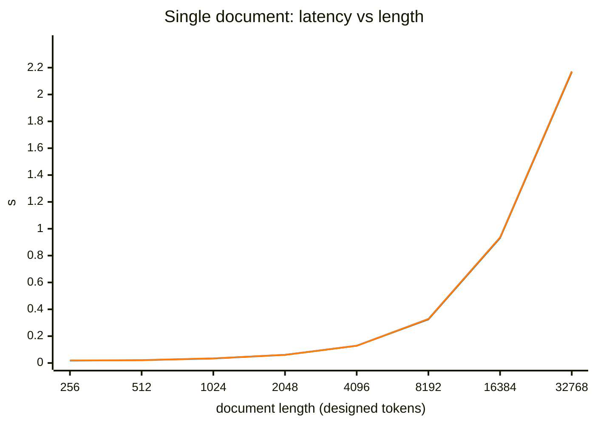
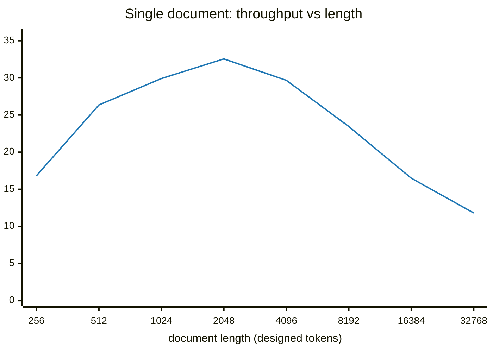
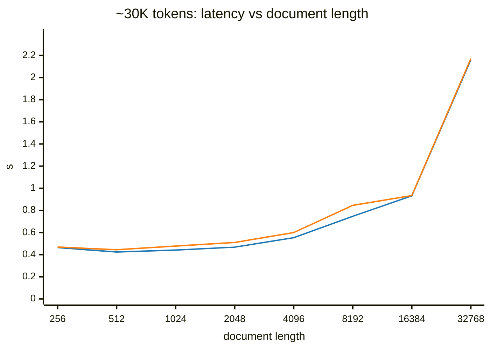
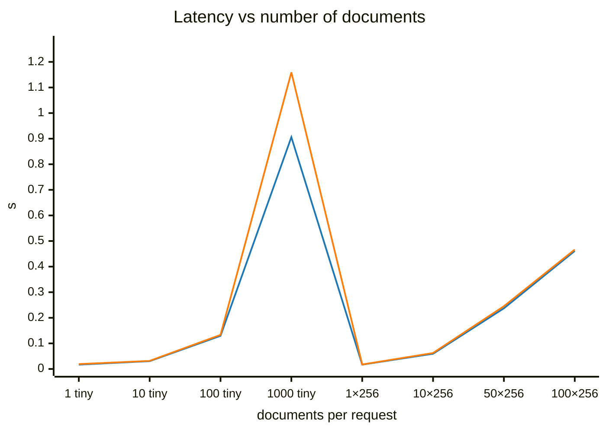
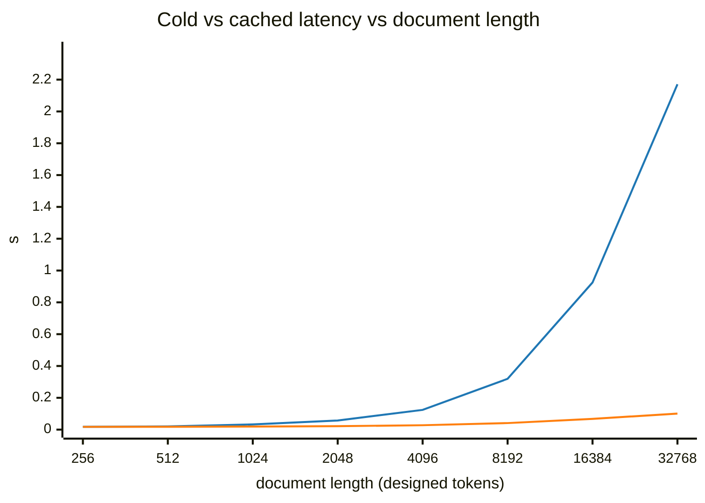
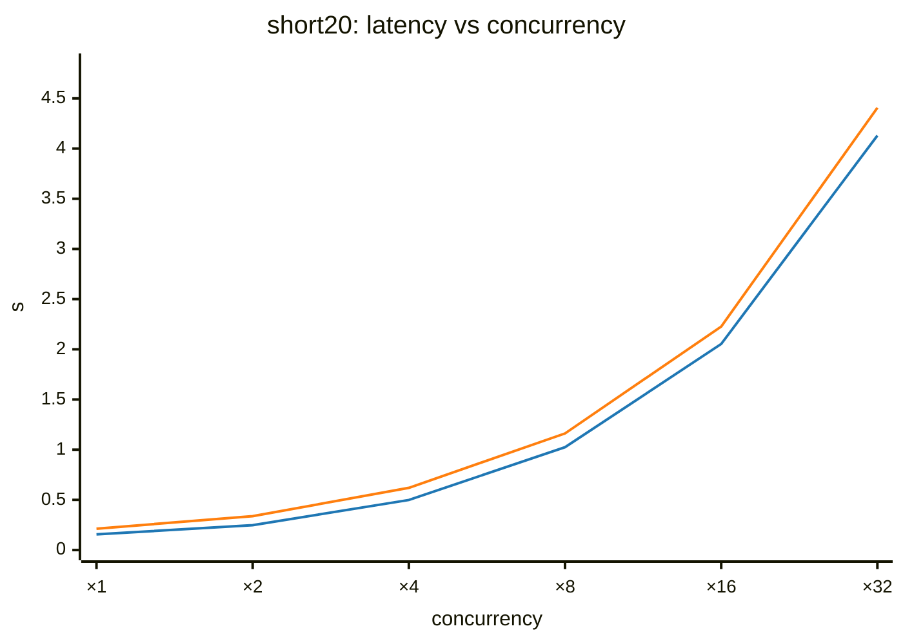
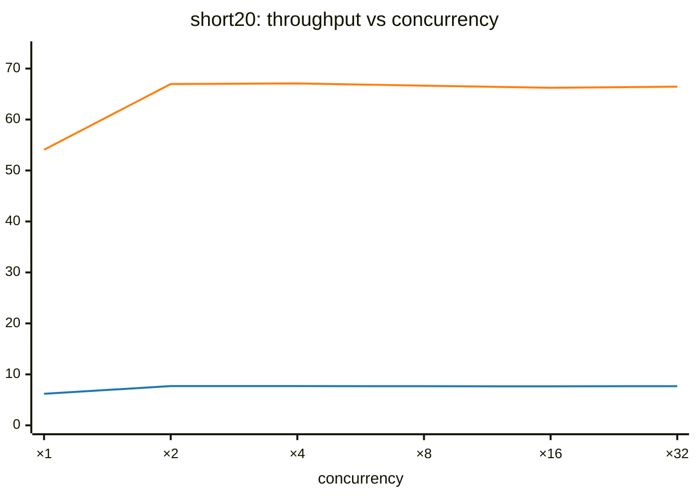
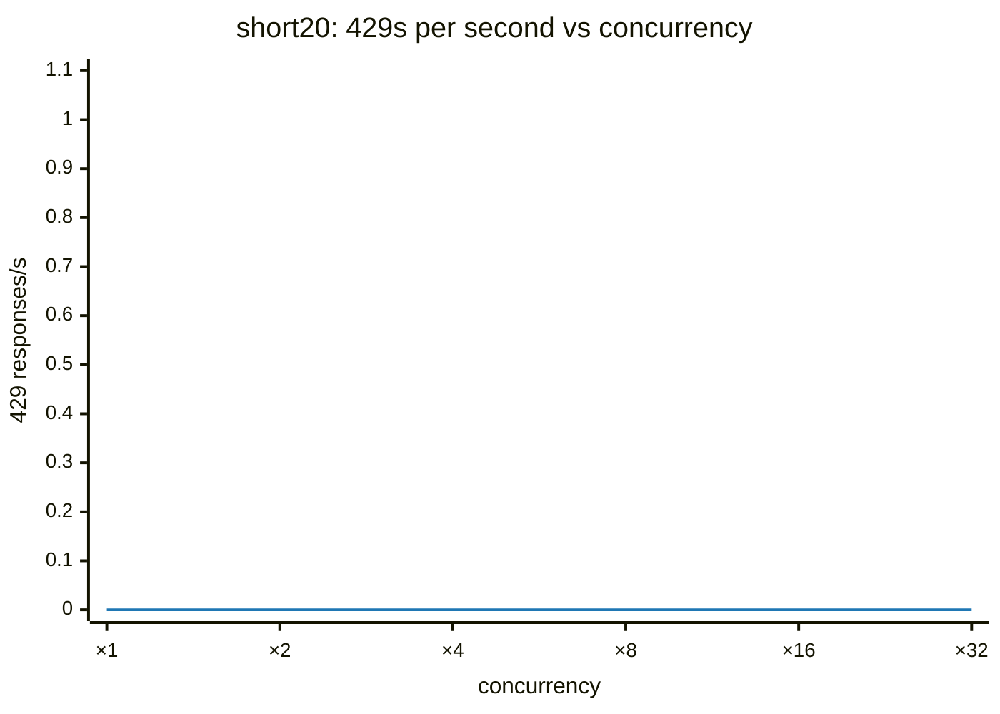

## meticulous — 2026-11-13 14:24 UTC

**PASS** · 432 s · 1777 requests · 0 (0.0%) errors · 0 rate-limited · 17,636,233 tokens billed

Sequential requests (one in flight) unless stated; every query carries a nonce so nothing is served from the API's prefix cache.

### Single document: latency vs length

| rung | Qwen tokens | billed | errors | p50 s | p90 s | max s | API tok/s |
|---|---|---|---|---|---|---|---|
| 256 | 229 | 324 | 0 (0.0%) | 0.018 | 0.019 | 0.057 | 16,817 |
| 512 | 457 | 551 | 0 (0.0%) | 0.021 | 0.022 | 0.023 | 26,346 |
| 1,024 | 911 | 1,005 | 0 (0.0%) | 0.033 | 0.035 | 0.035 | 29,912 |
| 2,048 | 1,872 | 1,966 | 0 (0.0%) | 0.060 | 0.061 | 0.062 | 32,549 |
| 4,096 | 3,707 | 3,801 | 0 (0.0%) | 0.128 | 0.129 | 0.130 | 29,671 |
| 8,192 | 7,545 | 7,639 | 0 (0.0%) | 0.325 | 0.328 | 0.334 | 23,454 |
| 16,384 | 15,274 | 15,368 | 0 (0.0%) | 0.931 | 0.936 | 0.938 | 16,486 |
| 32,768 | 25,438 | 25,536 | 0 (0.0%) | 2.167 | 2.173 | 2.182 | 11,808 |

*Single document: latency vs length: p50, p90*

*Single document: throughput vs length: API tokens/s ÷ 1000*

### ~30K tokens per request: latency vs document length (fewer, longer documents)

| rung | docs/request | billed | errors | p50 s | p90 s | max s | API tok/s |
|---|---|---|---|---|---|---|---|
| 256 | 100 | 32,406 | 0 (0.0%) | 0.464 | 0.469 | 0.469 | 69,713 |
| 512 | 55 | 30,271 | 0 (0.0%) | 0.424 | 0.445 | 0.467 | 70,740 |
| 1,024 | 28 | 28,179 | 0 (0.0%) | 0.441 | 0.478 | 0.494 | 63,526 |
| 2,048 | 13 | 25,573 | 0 (0.0%) | 0.468 | 0.510 | 0.538 | 56,089 |
| 4,096 | 6 | 22,806 | 0 (0.0%) | 0.553 | 0.600 | 0.631 | 42,328 |
| 8,192 | 3 | 22,922 | 0 (0.0%) | 0.747 | 0.846 | 0.912 | 31,813 |
| 16,384 | 1 | 15,367 | 0 (0.0%) | 0.932 | 0.934 | 0.935 | 16,483 |
| 32,768 | 1 | 25,540 | 0 (0.0%) | 2.161 | 2.171 | 2.178 | 11,823 |

*~30K tokens: latency vs document length: p50, p90*

### Latency vs number of documents

| documents | billed | errors | p50 s | p90 s | max s | MRR |
|---|---|---|---|---|---|---|
| 1 tiny | 90.8 | 0 (0.0%) | 0.017 | 0.019 | 0.021 | 1.000 |
| 10 tiny | 922 | 0 (0.0%) | 0.030 | 0.032 | 0.032 | 1.000 |
| 100 tiny | 9,289 | 0 (0.0%) | 0.130 | 0.133 | 0.135 | 1.000 |
| 1000 tiny | 93,889 | 0 (0.0%) | 0.906 | 1.159 | 1.182 | 0.950 |
| 1×256 | 324 | 0 (0.0%) | 0.017 | 0.018 | 0.019 | 1.000 |
| 10×256 | 3,224 | 0 (0.0%) | 0.060 | 0.063 | 0.066 | 1.000 |
| 50×256 | 16,170 | 0 (0.0%) | 0.237 | 0.245 | 0.249 | 1.000 |
| 100×256 | 32,339 | 0 (0.0%) | 0.461 | 0.467 | 0.467 | 1.000 |

*Latency vs number of documents: p50, p90*

### Cold vs cached: the same single-document request sent twice in a row

The API caches prompt prefixes, so a repeated (query, document) pair skips most of the compute. Cold = fresh nonce in the query; cached = the identical request again immediately after.

| rung | pairs | cold p50 s | cached p50 s | speed-up × | cold max s | cached max s | errors |
|---|---|---|---|---|---|---|---|
| 256 | 10 | 0.017 | 0.017 | 1.005 | 0.044 | 0.020 |  |
| 512 | 10 | 0.020 | 0.018 | 1.144 | 0.021 | 0.019 |  |
| 1,024 | 10 | 0.033 | 0.019 | 1.719 | 0.034 | 0.020 |  |
| 2,048 | 10 | 0.057 | 0.022 | 2.647 | 0.058 | 0.024 |  |
| 4,096 | 10 | 0.124 | 0.028 | 4.477 | 0.126 | 0.033 |  |
| 8,192 | 10 | 0.319 | 0.041 | 7.767 | 0.324 | 0.047 |  |
| 16,384 | 10 | 0.925 | 0.068 | 13.6 | 0.927 | 0.069 |  |
| 32,768 | 10 | 2.171 | 0.101 | 21.6 | 2.177 | 0.101 |  |

*Cold vs cached latency vs document length: cold p50, cached p50*

### short20: latency and throughput vs concurrency

|  | requests | errors | 429s | p50 s | p90 s | p99 s | max s | req/s | API tok/s | MRR |
|---|---|---|---|---|---|---|---|---|---|---|
| ×1 | 155 | 0 (0.0%) | 0 | 0.156 | 0.213 | 0.272 | 0.280 | 6.187 | 54,057 | 0.663 |
| ×2 | 194 | 0 (0.0%) | 0 | 0.247 | 0.338 | 0.385 | 0.399 | 7.702 | 66,968 | 0.656 |
| ×4 | 196 | 0 (0.0%) | 0 | 0.499 | 0.620 | 0.733 | 0.736 | 7.711 | 67,085 | 0.662 |
| ×8 | 200 | 0 (0.0%) | 0 | 1.025 | 1.162 | 1.264 | 1.319 | 7.673 | 66,640 | 0.657 |
| ×16 | 208 | 0 (0.0%) | 0 | 2.053 | 2.227 | 2.375 | 2.426 | 7.660 | 66,218 | 0.660 |
| ×32 | 224 | 0 (0.0%) | 0 | 4.130 | 4.406 | 4.580 | 4.631 | 7.686 | 66,449 | 0.655 |

No 429s up to concurrency ×32.

*short20: latency vs concurrency: p50, p90*

*short20: throughput vs concurrency: req/s, API tokens/s ÷ 1000*

*short20: 429s per second vs concurrency: 429/s*

1777 requests, 17,636,233 tokens billed.
