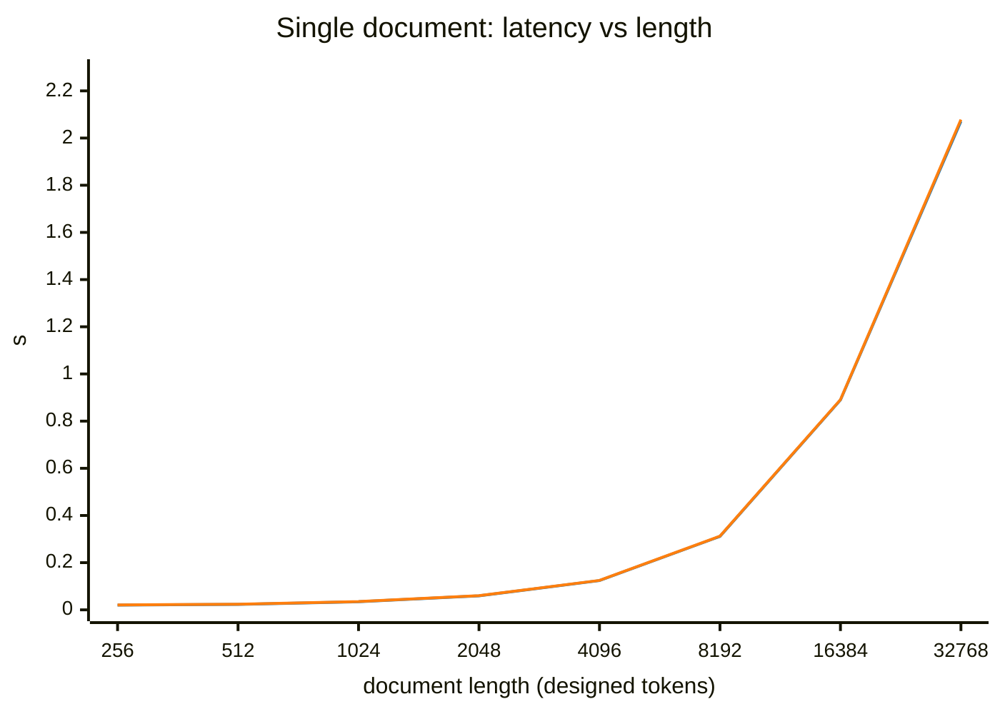
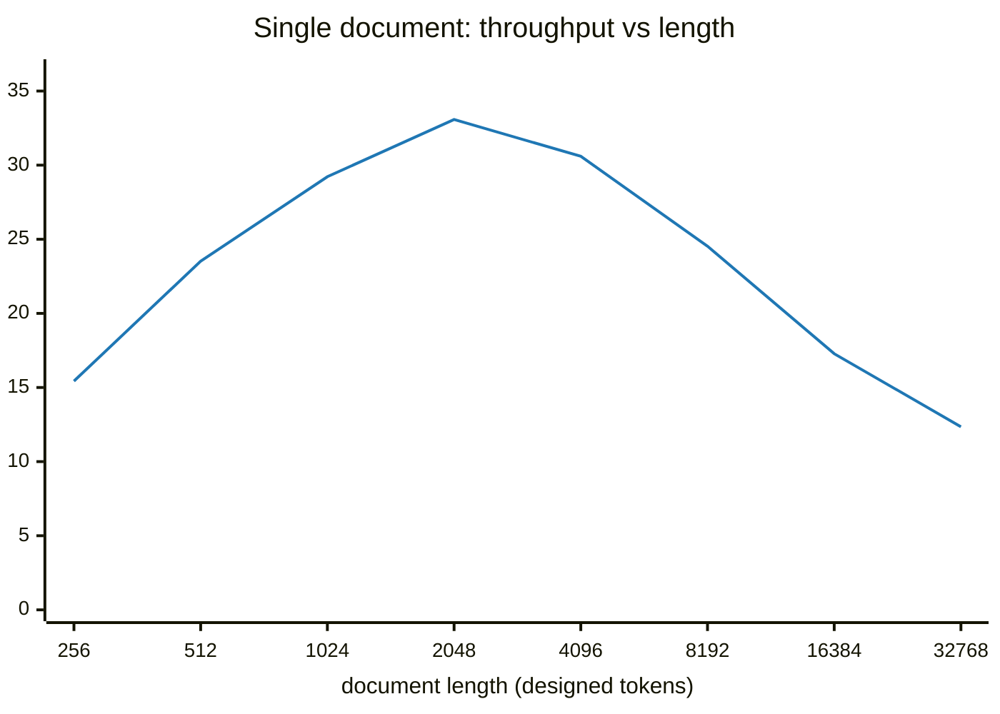
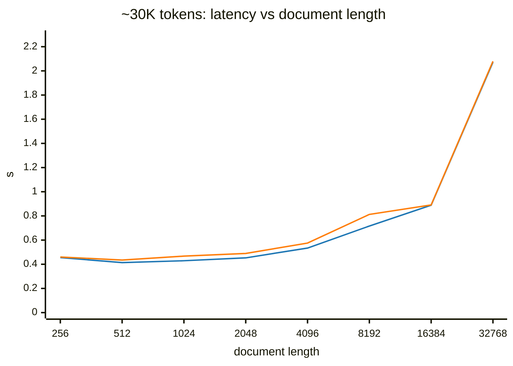
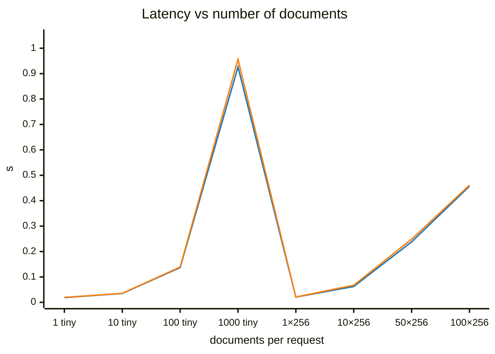
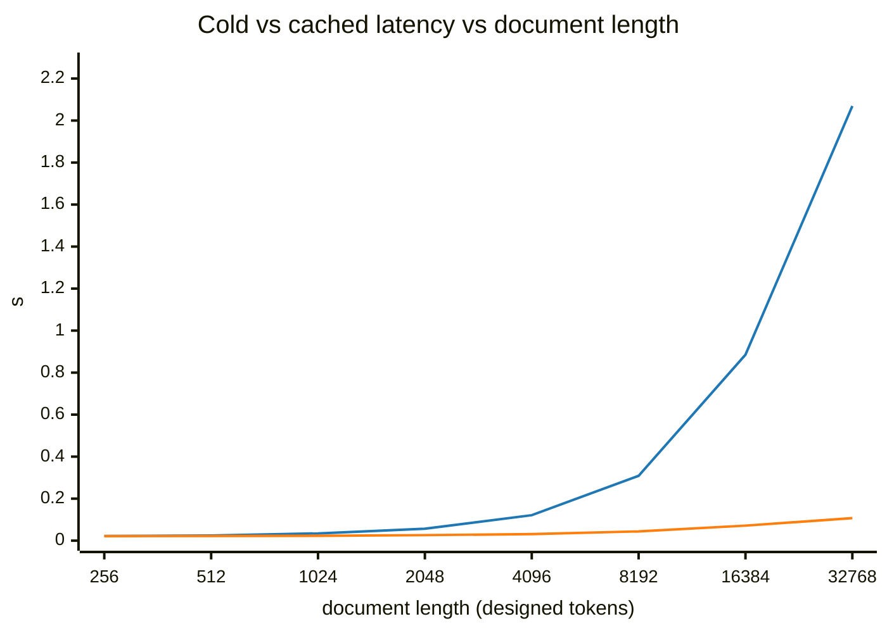
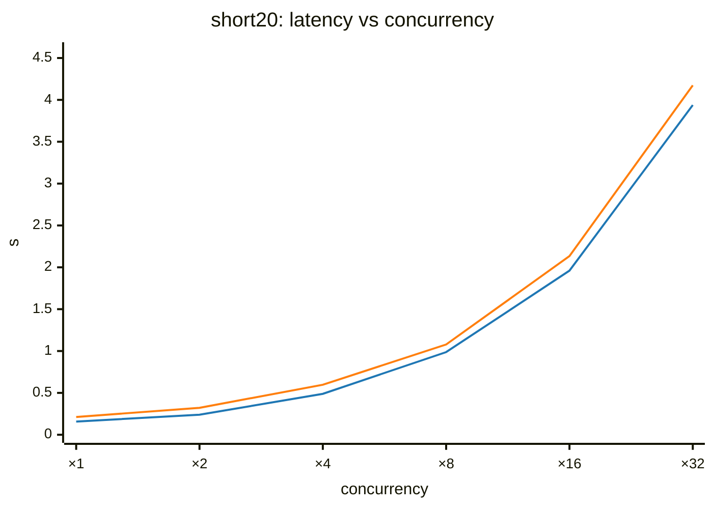
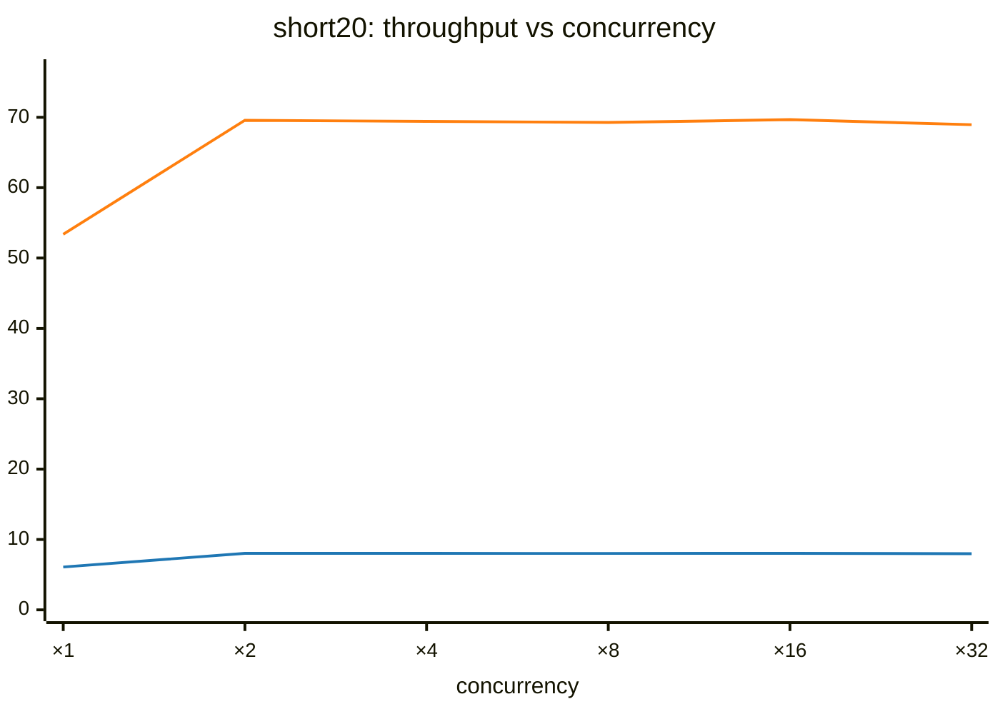
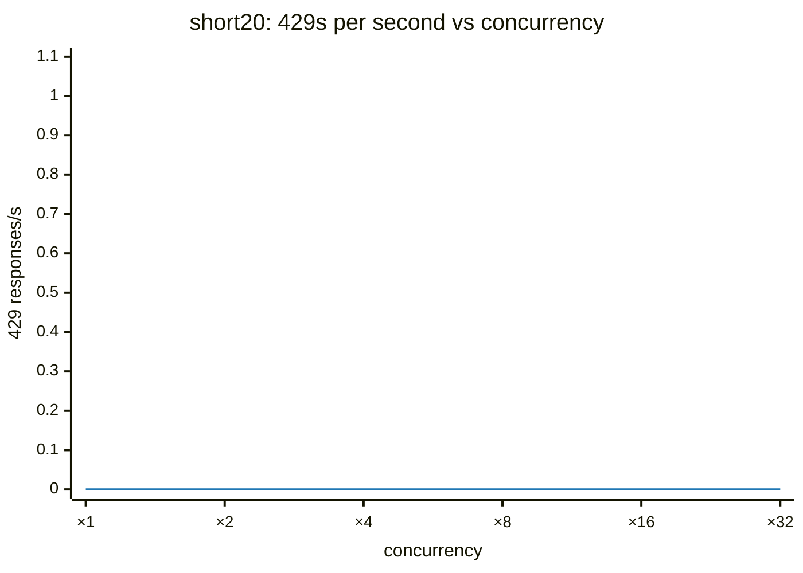

## meticulous — 2026-11-13 14:58 UTC

**PASS** · 422 s · 1811 requests · 0 (0.0%) errors · 0 rate-limited · 17,918,524 tokens billed

Sequential requests (one in flight) unless stated; every query carries a nonce so nothing is served from the API's prefix cache.

### Single document: latency vs length

| rung | Qwen tokens | billed | errors | p50 s | p90 s | max s | API tok/s |
|---|---|---|---|---|---|---|---|
| 256 | 229 | 324 | 0 (0.0%) | 0.020 | 0.021 | 0.042 | 15,430 |
| 512 | 457 | 551 | 0 (0.0%) | 0.023 | 0.024 | 0.027 | 23,521 |
| 1,024 | 911 | 1,005 | 0 (0.0%) | 0.034 | 0.035 | 0.036 | 29,222 |
| 2,048 | 1,872 | 1,966 | 0 (0.0%) | 0.059 | 0.060 | 0.061 | 33,076 |
| 4,096 | 3,707 | 3,800 | 0 (0.0%) | 0.124 | 0.125 | 0.127 | 30,596 |
| 8,192 | 7,545 | 7,640 | 0 (0.0%) | 0.311 | 0.313 | 0.316 | 24,529 |
| 16,384 | 15,274 | 15,369 | 0 (0.0%) | 0.889 | 0.891 | 0.893 | 17,276 |
| 32,768 | 25,438 | 25,536 | 0 (0.0%) | 2.071 | 2.078 | 2.082 | 12,352 |

*Single document: latency vs length: p50, p90*

*Single document: throughput vs length: API tokens/s ÷ 1000*

### ~30K tokens per request: latency vs document length (fewer, longer documents)

| rung | docs/request | billed | errors | p50 s | p90 s | max s | API tok/s |
|---|---|---|---|---|---|---|---|
| 256 | 100 | 32,379 | 0 (0.0%) | 0.456 | 0.460 | 0.461 | 70,921 |
| 512 | 55 | 30,293 | 0 (0.0%) | 0.414 | 0.435 | 0.453 | 72,500 |
| 1,024 | 28 | 28,168 | 0 (0.0%) | 0.429 | 0.467 | 0.474 | 65,103 |
| 2,048 | 13 | 25,571 | 0 (0.0%) | 0.453 | 0.489 | 0.524 | 57,755 |
| 4,096 | 6 | 22,805 | 0 (0.0%) | 0.534 | 0.575 | 0.608 | 43,857 |
| 8,192 | 3 | 22,922 | 0 (0.0%) | 0.716 | 0.812 | 0.877 | 33,100 |
| 16,384 | 1 | 15,367 | 0 (0.0%) | 0.889 | 0.891 | 0.892 | 17,285 |
| 32,768 | 1 | 25,540 | 0 (0.0%) | 2.072 | 2.079 | 2.081 | 12,346 |

*~30K tokens: latency vs document length: p50, p90*

### Latency vs number of documents

| documents | billed | errors | p50 s | p90 s | max s | MRR |
|---|---|---|---|---|---|---|
| 1 tiny | 91.0 | 0 (0.0%) | 0.019 | 0.019 | 0.020 | 1.000 |
| 10 tiny | 925 | 0 (0.0%) | 0.035 | 0.036 | 0.036 | 1.000 |
| 100 tiny | 9,279 | 0 (0.0%) | 0.137 | 0.139 | 0.142 | 0.950 |
| 1000 tiny | 93,989 | 0 (0.0%) | 0.926 | 0.956 | 1.143 | 0.850 |
| 1×256 | 323 | 0 (0.0%) | 0.021 | 0.021 | 0.021 | 1.000 |
| 10×256 | 3,230 | 0 (0.0%) | 0.062 | 0.067 | 0.070 | 1.000 |
| 50×256 | 16,180 | 0 (0.0%) | 0.238 | 0.249 | 0.255 | 1.000 |
| 100×256 | 32,299 | 0 (0.0%) | 0.457 | 0.461 | 0.462 | 1.000 |

*Latency vs number of documents: p50, p90*

### Cold vs cached: the same single-document request sent twice in a row

The API caches prompt prefixes, so a repeated (query, document) pair skips most of the compute. Cold = fresh nonce in the query; cached = the identical request again immediately after.

| rung | pairs | cold p50 s | cached p50 s | speed-up × | cold max s | cached max s | errors |
|---|---|---|---|---|---|---|---|
| 256 | 10 | 0.023 | 0.022 | 1.035 | 0.049 | 0.023 |  |
| 512 | 10 | 0.024 | 0.022 | 1.108 | 0.026 | 0.023 |  |
| 1,024 | 10 | 0.034 | 0.023 | 1.493 | 0.035 | 0.026 |  |
| 2,048 | 10 | 0.057 | 0.026 | 2.169 | 0.062 | 0.029 |  |
| 4,096 | 10 | 0.121 | 0.031 | 3.874 | 0.123 | 0.032 |  |
| 8,192 | 10 | 0.309 | 0.044 | 6.987 | 0.330 | 0.046 |  |
| 16,384 | 10 | 0.885 | 0.072 | 12.4 | 0.890 | 0.076 |  |
| 32,768 | 10 | 2.069 | 0.107 | 19.3 | 2.081 | 0.110 |  |

*Cold vs cached latency vs document length: cold p50, cached p50*

### short20: latency and throughput vs concurrency

|  | requests | errors | 429s | p50 s | p90 s | p99 s | max s | req/s | API tok/s | MRR |
|---|---|---|---|---|---|---|---|---|---|---|
| ×1 | 153 | 0 (0.0%) | 0 | 0.158 | 0.212 | 0.270 | 0.279 | 6.090 | 53,380 | 0.665 |
| ×2 | 201 | 0 (0.0%) | 0 | 0.239 | 0.322 | 0.375 | 0.383 | 8.029 | 69,579 | 0.674 |
| ×4 | 204 | 0 (0.0%) | 0 | 0.489 | 0.597 | 0.686 | 0.718 | 8.019 | 69,417 | 0.673 |
| ×8 | 207 | 0 (0.0%) | 0 | 0.987 | 1.078 | 1.205 | 1.257 | 8.014 | 69,267 | 0.670 |
| ×16 | 215 | 0 (0.0%) | 0 | 1.960 | 2.134 | 2.255 | 2.275 | 8.036 | 69,670 | 0.654 |
| ×32 | 231 | 0 (0.0%) | 0 | 3.938 | 4.174 | 4.362 | 4.409 | 7.972 | 68,954 | 0.665 |

No 429s up to concurrency ×32.

*short20: latency vs concurrency: p50, p90*

*short20: throughput vs concurrency: req/s, API tokens/s ÷ 1000*

*short20: 429s per second vs concurrency: 429/s*

1811 requests, 17,918,524 tokens billed.
