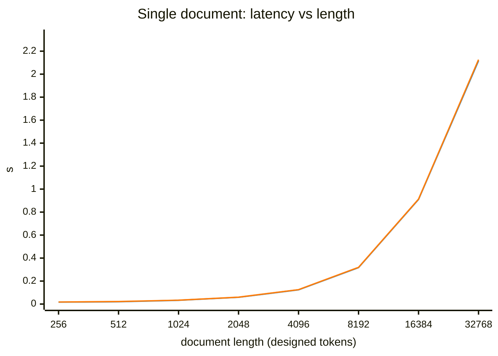
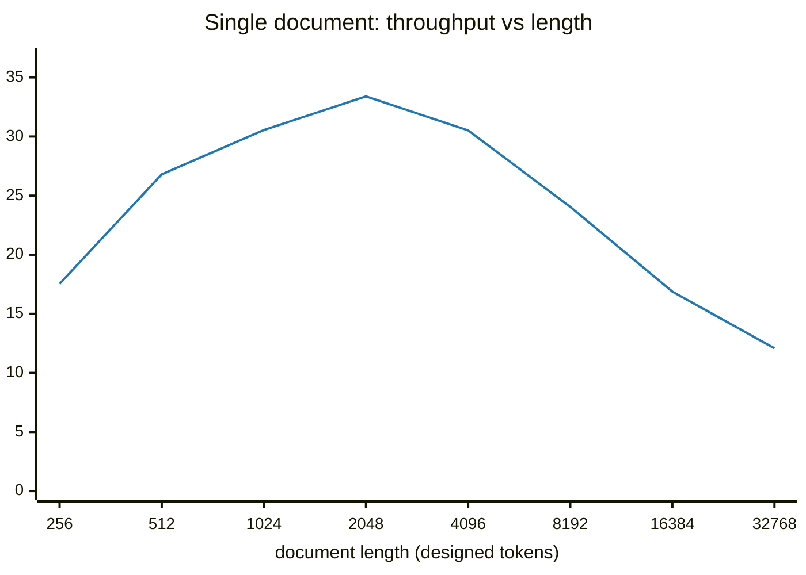
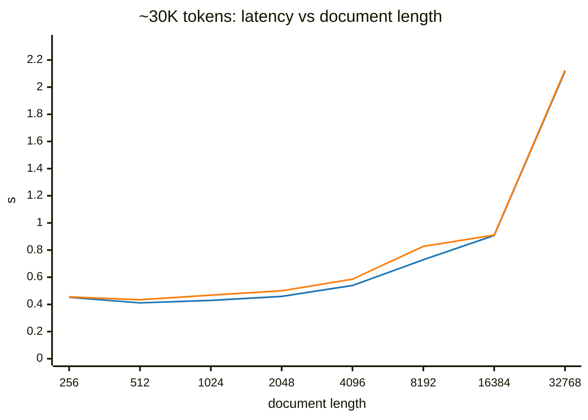
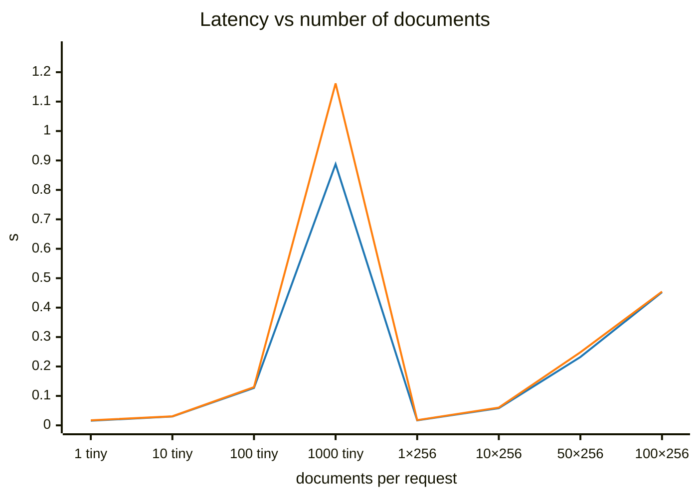
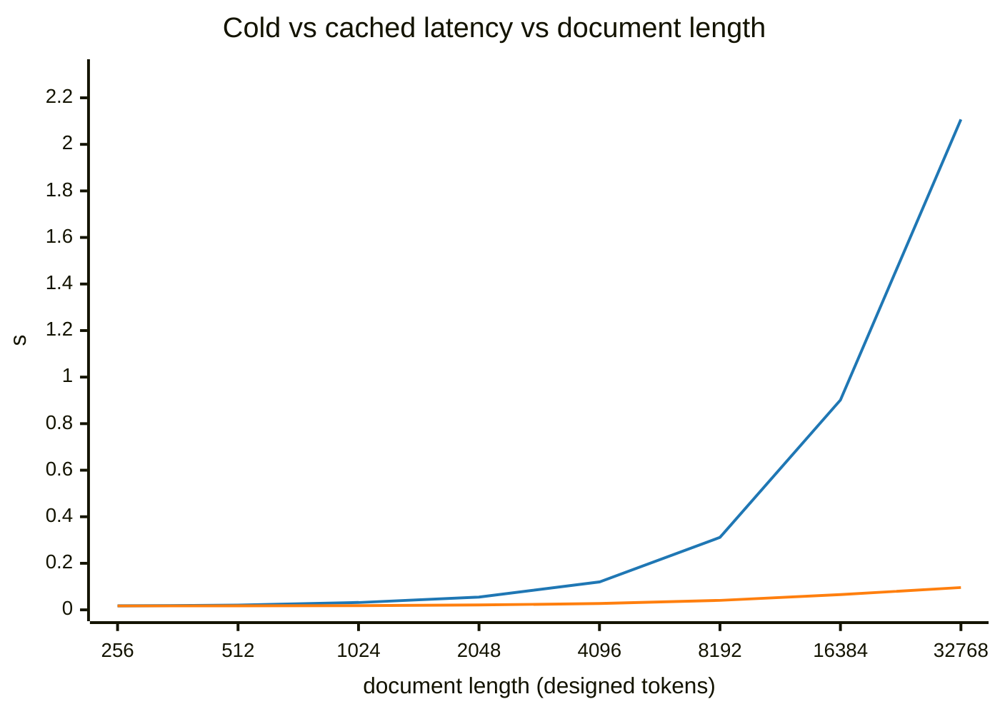
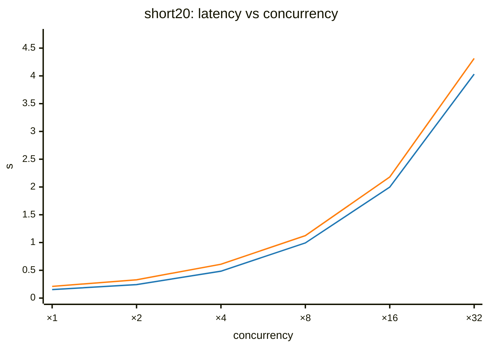
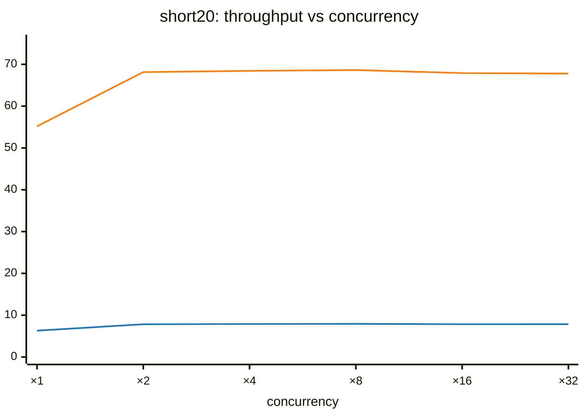
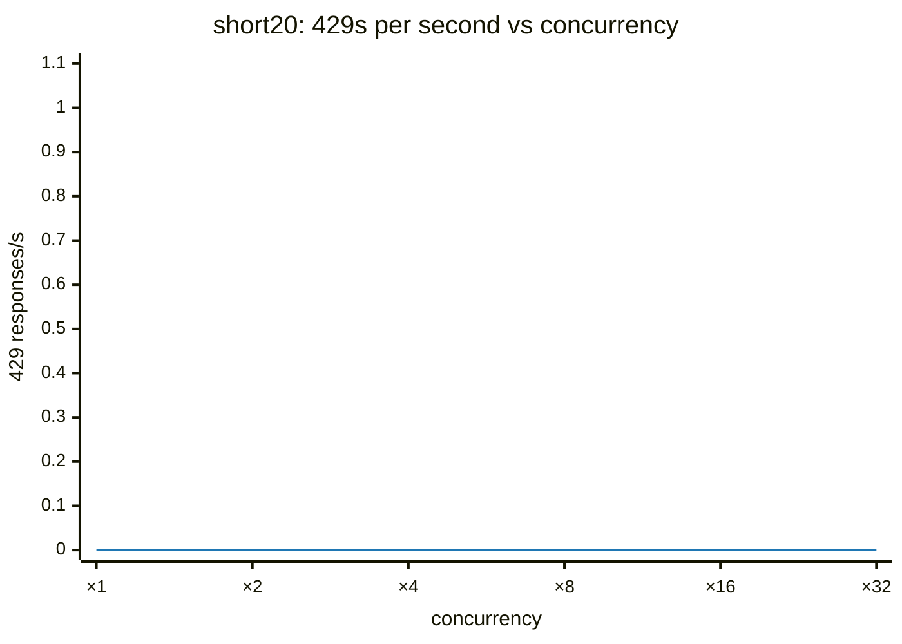

## meticulous — 2026-11-13 15:55 UTC

**PASS** · 426 s · 1802 requests · 0 (0.0%) errors · 0 rate-limited · 17,838,603 tokens billed

Sequential requests (one in flight) unless stated; every query carries a nonce so nothing is served from the API's prefix cache.

### Single document: latency vs length

| rung | Qwen tokens | billed | errors | p50 s | p90 s | max s | API tok/s |
|---|---|---|---|---|---|---|---|
| 256 | 229 | 324 | 0 (0.0%) | 0.017 | 0.018 | 0.059 | 17,537 |
| 512 | 457 | 551 | 0 (0.0%) | 0.020 | 0.022 | 0.026 | 26,797 |
| 1,024 | 911 | 1,005 | 0 (0.0%) | 0.033 | 0.034 | 0.035 | 30,545 |
| 2,048 | 1,872 | 1,966 | 0 (0.0%) | 0.059 | 0.060 | 0.060 | 33,398 |
| 4,096 | 3,707 | 3,801 | 0 (0.0%) | 0.124 | 0.125 | 0.126 | 30,524 |
| 8,192 | 7,545 | 7,640 | 0 (0.0%) | 0.317 | 0.319 | 0.322 | 24,053 |
| 16,384 | 15,274 | 15,368 | 0 (0.0%) | 0.910 | 0.913 | 0.916 | 16,883 |
| 32,768 | 25,438 | 25,536 | 0 (0.0%) | 2.117 | 2.126 | 2.129 | 12,082 |

*Single document: latency vs length: p50, p90*

*Single document: throughput vs length: API tokens/s ÷ 1000*

### ~30K tokens per request: latency vs document length (fewer, longer documents)

| rung | docs/request | billed | errors | p50 s | p90 s | max s | API tok/s |
|---|---|---|---|---|---|---|---|
| 256 | 100 | 32,359 | 0 (0.0%) | 0.452 | 0.456 | 0.461 | 71,341 |
| 512 | 55 | 30,282 | 0 (0.0%) | 0.411 | 0.434 | 0.454 | 72,615 |
| 1,024 | 28 | 28,178 | 0 (0.0%) | 0.429 | 0.468 | 0.479 | 65,228 |
| 2,048 | 13 | 25,572 | 0 (0.0%) | 0.459 | 0.500 | 0.530 | 57,345 |
| 4,096 | 6 | 22,809 | 0 (0.0%) | 0.539 | 0.586 | 0.618 | 43,186 |
| 8,192 | 3 | 22,924 | 0 (0.0%) | 0.729 | 0.828 | 0.890 | 32,536 |
| 16,384 | 1 | 15,366 | 0 (0.0%) | 0.908 | 0.911 | 0.920 | 16,906 |
| 32,768 | 1 | 25,540 | 0 (0.0%) | 2.116 | 2.124 | 2.129 | 12,081 |

*~30K tokens: latency vs document length: p50, p90*

### Latency vs number of documents

| documents | billed | errors | p50 s | p90 s | max s | MRR |
|---|---|---|---|---|---|---|
| 1 tiny | 91.1 | 0 (0.0%) | 0.016 | 0.017 | 0.018 | 1.000 |
| 10 tiny | 914 | 0 (0.0%) | 0.030 | 0.031 | 0.032 | 1.000 |
| 100 tiny | 9,309 | 0 (0.0%) | 0.127 | 0.130 | 0.131 | 1.000 |
| 1000 tiny | 94,089 | 0 (0.0%) | 0.888 | 1.162 | 1.175 | 1.000 |
| 1×256 | 324 | 0 (0.0%) | 0.017 | 0.018 | 0.019 | 1.000 |
| 10×256 | 3,228 | 0 (0.0%) | 0.058 | 0.060 | 0.065 | 1.000 |
| 50×256 | 16,165 | 0 (0.0%) | 0.232 | 0.248 | 0.257 | 1.000 |
| 100×256 | 32,349 | 0 (0.0%) | 0.453 | 0.455 | 0.455 | 1.000 |

*Latency vs number of documents: p50, p90*

### Cold vs cached: the same single-document request sent twice in a row

The API caches prompt prefixes, so a repeated (query, document) pair skips most of the compute. Cold = fresh nonce in the query; cached = the identical request again immediately after.

| rung | pairs | cold p50 s | cached p50 s | speed-up × | cold max s | cached max s | errors |
|---|---|---|---|---|---|---|---|
| 256 | 10 | 0.017 | 0.017 | 1.012 | 0.047 | 0.020 |  |
| 512 | 10 | 0.020 | 0.017 | 1.177 | 0.021 | 0.019 |  |
| 1,024 | 10 | 0.031 | 0.018 | 1.725 | 0.032 | 0.022 |  |
| 2,048 | 10 | 0.055 | 0.021 | 2.617 | 0.056 | 0.025 |  |
| 4,096 | 10 | 0.120 | 0.027 | 4.441 | 0.121 | 0.030 |  |
| 8,192 | 10 | 0.311 | 0.041 | 7.658 | 0.323 | 0.042 |  |
| 16,384 | 10 | 0.901 | 0.066 | 13.8 | 0.904 | 0.066 |  |
| 32,768 | 10 | 2.107 | 0.096 | 22.0 | 2.115 | 0.099 |  |

*Cold vs cached latency vs document length: cold p50, cached p50*

### short20: latency and throughput vs concurrency

|  | requests | errors | 429s | p50 s | p90 s | p99 s | max s | req/s | API tok/s | MRR |
|---|---|---|---|---|---|---|---|---|---|---|
| ×1 | 158 | 0 (0.0%) | 0 | 0.153 | 0.210 | 0.265 | 0.272 | 6.302 | 55,162 | 0.658 |
| ×2 | 198 | 0 (0.0%) | 0 | 0.242 | 0.330 | 0.378 | 0.433 | 7.832 | 68,126 | 0.664 |
| ×4 | 201 | 0 (0.0%) | 0 | 0.484 | 0.609 | 0.671 | 0.716 | 7.896 | 68,430 | 0.649 |
| ×8 | 206 | 0 (0.0%) | 0 | 0.993 | 1.124 | 1.233 | 1.275 | 7.943 | 68,634 | 0.655 |
| ×16 | 212 | 0 (0.0%) | 0 | 1.998 | 2.180 | 2.323 | 2.378 | 7.847 | 67,902 | 0.657 |
| ×32 | 227 | 0 (0.0%) | 0 | 4.032 | 4.314 | 4.468 | 4.520 | 7.861 | 67,777 | 0.658 |

No 429s up to concurrency ×32.

*short20: latency vs concurrency: p50, p90*

*short20: throughput vs concurrency: req/s, API tokens/s ÷ 1000*

*short20: 429s per second vs concurrency: 429/s*

1802 requests, 17,838,603 tokens billed.
