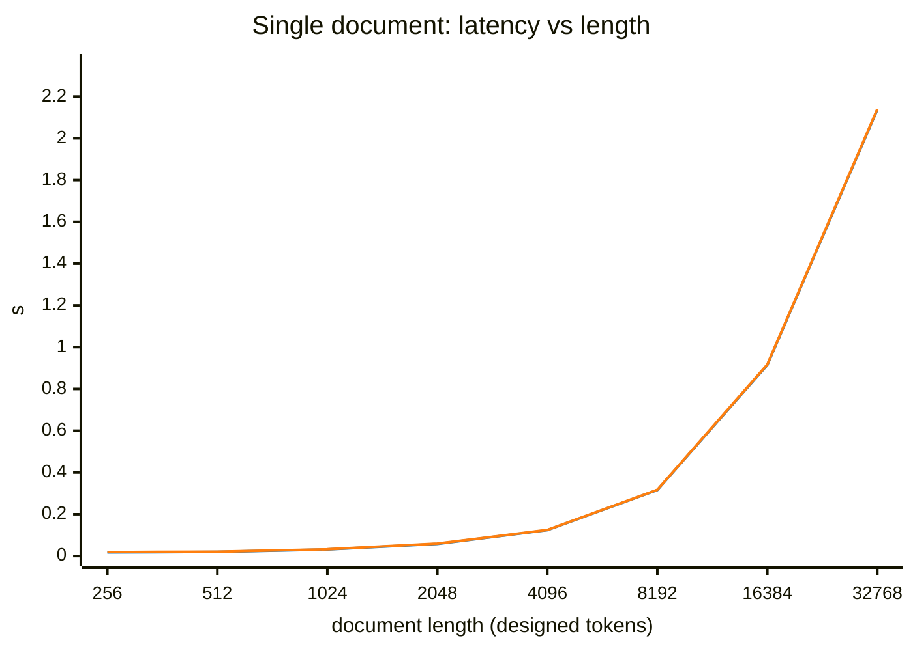
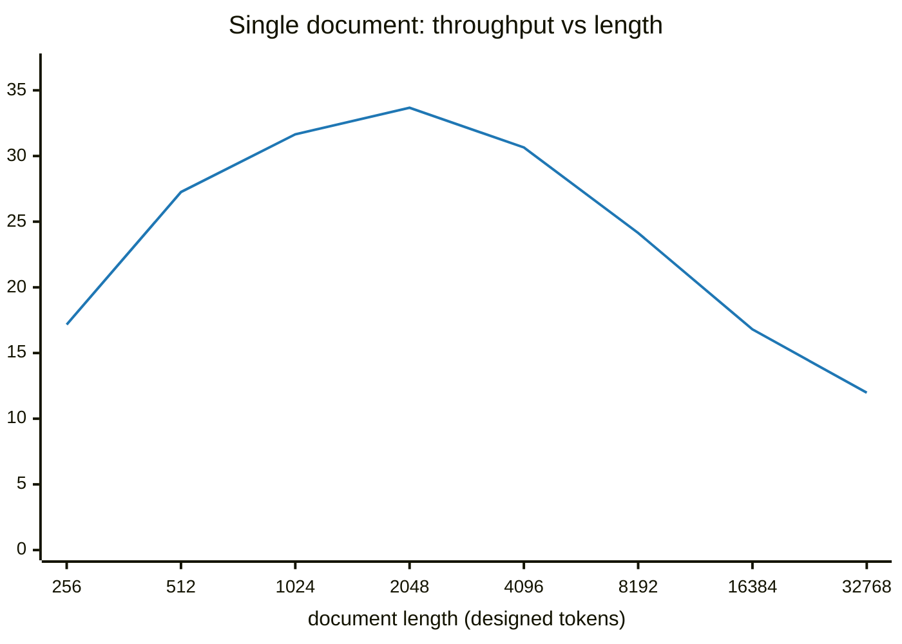
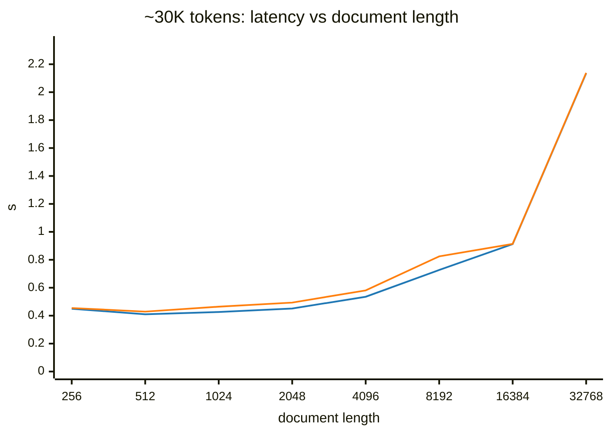
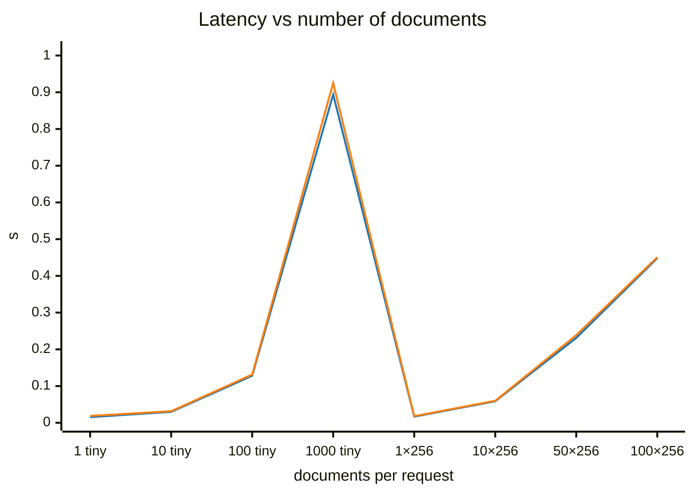
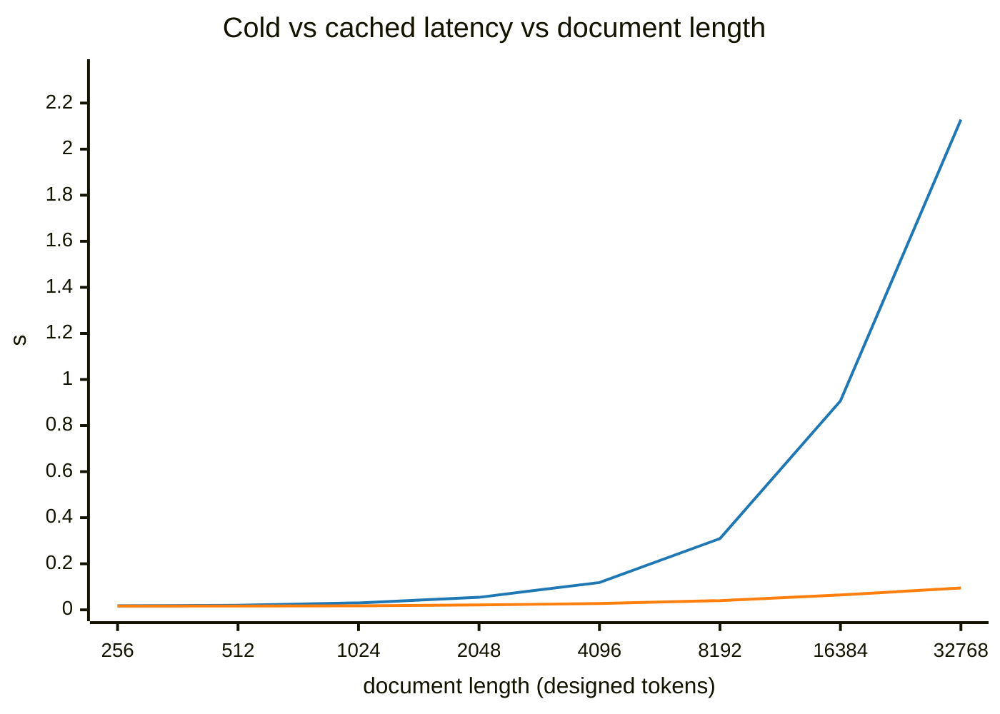
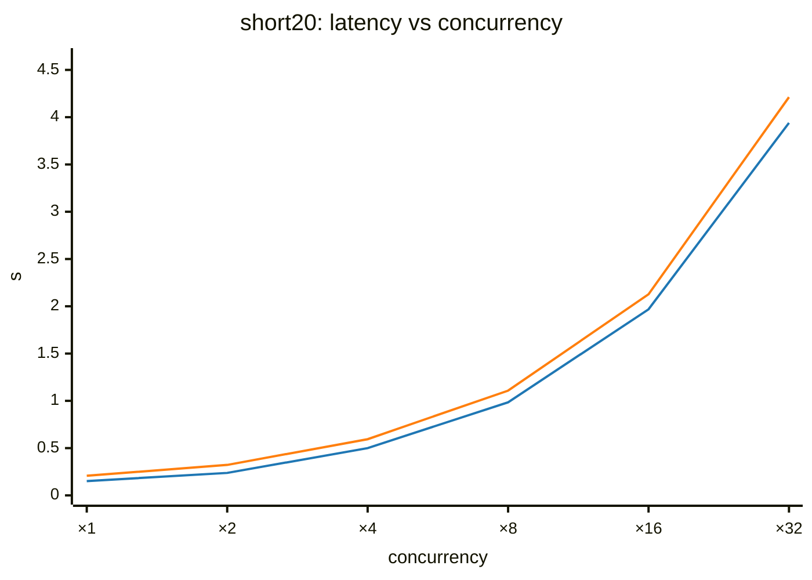
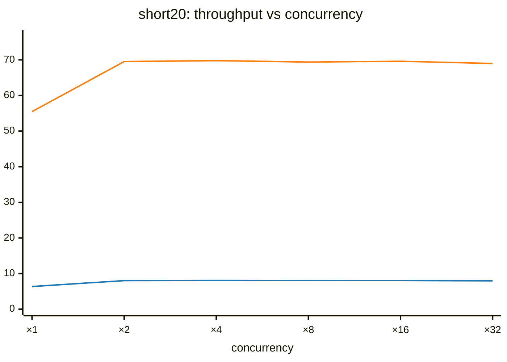
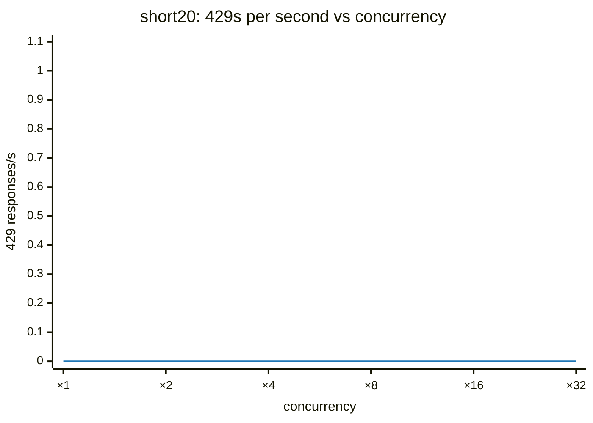

## meticulous — 2026-11-13 16:29 UTC

**PASS** · 426 s · 1821 requests · 0 (0.0%) errors · 0 rate-limited · 17,998,749 tokens billed

Sequential requests (one in flight) unless stated; every query carries a nonce so nothing is served from the API's prefix cache.

### Single document: latency vs length

| rung | Qwen tokens | billed | errors | p50 s | p90 s | max s | API tok/s |
|---|---|---|---|---|---|---|---|
| 256 | 229 | 323 | 0 (0.0%) | 0.017 | 0.019 | 0.063 | 17,173 |
| 512 | 457 | 551 | 0 (0.0%) | 0.020 | 0.021 | 0.022 | 27,262 |
| 1,024 | 911 | 1,005 | 0 (0.0%) | 0.032 | 0.033 | 0.034 | 31,647 |
| 2,048 | 1,872 | 1,966 | 0 (0.0%) | 0.058 | 0.059 | 0.060 | 33,665 |
| 4,096 | 3,707 | 3,800 | 0 (0.0%) | 0.124 | 0.125 | 0.127 | 30,652 |
| 8,192 | 7,545 | 7,640 | 0 (0.0%) | 0.316 | 0.317 | 0.323 | 24,142 |
| 16,384 | 15,274 | 15,368 | 0 (0.0%) | 0.915 | 0.917 | 0.919 | 16,799 |
| 32,768 | 25,438 | 25,536 | 0 (0.0%) | 2.137 | 2.140 | 2.148 | 11,980 |

*Single document: latency vs length: p50, p90*

*Single document: throughput vs length: API tokens/s ÷ 1000*

### ~30K tokens per request: latency vs document length (fewer, longer documents)

| rung | docs/request | billed | errors | p50 s | p90 s | max s | API tok/s |
|---|---|---|---|---|---|---|---|
| 256 | 100 | 32,392 | 0 (0.0%) | 0.450 | 0.455 | 0.456 | 71,834 |
| 512 | 55 | 30,286 | 0 (0.0%) | 0.410 | 0.429 | 0.478 | 72,871 |
| 1,024 | 28 | 28,178 | 0 (0.0%) | 0.426 | 0.464 | 0.472 | 65,895 |
| 2,048 | 13 | 25,574 | 0 (0.0%) | 0.451 | 0.494 | 0.522 | 58,035 |
| 4,096 | 6 | 22,805 | 0 (0.0%) | 0.535 | 0.581 | 0.611 | 43,744 |
| 8,192 | 3 | 22,923 | 0 (0.0%) | 0.727 | 0.824 | 0.884 | 32,661 |
| 16,384 | 1 | 15,367 | 0 (0.0%) | 0.912 | 0.914 | 0.915 | 16,834 |
| 32,768 | 1 | 25,541 | 0 (0.0%) | 2.135 | 2.138 | 2.148 | 11,977 |

*~30K tokens: latency vs document length: p50, p90*

### Latency vs number of documents

| documents | billed | errors | p50 s | p90 s | max s | MRR |
|---|---|---|---|---|---|---|
| 1 tiny | 90.9 | 0 (0.0%) | 0.015 | 0.019 | 0.024 | 1.000 |
| 10 tiny | 915 | 0 (0.0%) | 0.030 | 0.032 | 0.037 | 1.000 |
| 100 tiny | 9,299 | 0 (0.0%) | 0.128 | 0.131 | 0.132 | 1.000 |
| 1000 tiny | 94,189 | 0 (0.0%) | 0.894 | 0.925 | 1.161 | 0.950 |
| 1×256 | 323 | 0 (0.0%) | 0.017 | 0.018 | 0.018 | 1.000 |
| 10×256 | 3,233 | 0 (0.0%) | 0.059 | 0.060 | 0.064 | 1.000 |
| 50×256 | 16,160 | 0 (0.0%) | 0.231 | 0.239 | 0.244 | 1.000 |
| 100×256 | 32,329 | 0 (0.0%) | 0.448 | 0.451 | 0.461 | 1.000 |

*Latency vs number of documents: p50, p90*

### Cold vs cached: the same single-document request sent twice in a row

The API caches prompt prefixes, so a repeated (query, document) pair skips most of the compute. Cold = fresh nonce in the query; cached = the identical request again immediately after.

| rung | pairs | cold p50 s | cached p50 s | speed-up × | cold max s | cached max s | errors |
|---|---|---|---|---|---|---|---|
| 256 | 10 | 0.017 | 0.017 | 1.031 | 0.041 | 0.019 |  |
| 512 | 10 | 0.020 | 0.017 | 1.172 | 0.020 | 0.018 |  |
| 1,024 | 10 | 0.030 | 0.018 | 1.703 | 0.031 | 0.021 |  |
| 2,048 | 10 | 0.054 | 0.021 | 2.571 | 0.055 | 0.023 |  |
| 4,096 | 10 | 0.118 | 0.027 | 4.316 | 0.120 | 0.030 |  |
| 8,192 | 10 | 0.309 | 0.040 | 7.708 | 0.312 | 0.041 |  |
| 16,384 | 10 | 0.907 | 0.065 | 14.0 | 0.909 | 0.071 |  |
| 32,768 | 10 | 2.128 | 0.095 | 22.5 | 2.137 | 0.095 |  |

*Cold vs cached latency vs document length: cold p50, cached p50*

### short20: latency and throughput vs concurrency

|  | requests | errors | 429s | p50 s | p90 s | p99 s | max s | req/s | API tok/s | MRR |
|---|---|---|---|---|---|---|---|---|---|---|
| ×1 | 160 | 0 (0.0%) | 0 | 0.152 | 0.207 | 0.266 | 0.274 | 6.371 | 55,480 | 0.663 |
| ×2 | 201 | 0 (0.0%) | 0 | 0.238 | 0.322 | 0.369 | 0.422 | 8.023 | 69,522 | 0.670 |
| ×4 | 205 | 0 (0.0%) | 0 | 0.500 | 0.594 | 0.655 | 0.704 | 8.060 | 69,786 | 0.674 |
| ×8 | 208 | 0 (0.0%) | 0 | 0.984 | 1.108 | 1.209 | 1.263 | 8.028 | 69,378 | 0.670 |
| ×16 | 216 | 0 (0.0%) | 0 | 1.968 | 2.127 | 2.272 | 2.328 | 8.033 | 69,605 | 0.660 |
| ×32 | 231 | 0 (0.0%) | 0 | 3.940 | 4.212 | 4.368 | 4.426 | 7.974 | 68,977 | 0.663 |

No 429s up to concurrency ×32.

*short20: latency vs concurrency: p50, p90*

*short20: throughput vs concurrency: req/s, API tokens/s ÷ 1000*

*short20: 429s per second vs concurrency: 429/s*

1821 requests, 17,998,749 tokens billed.
