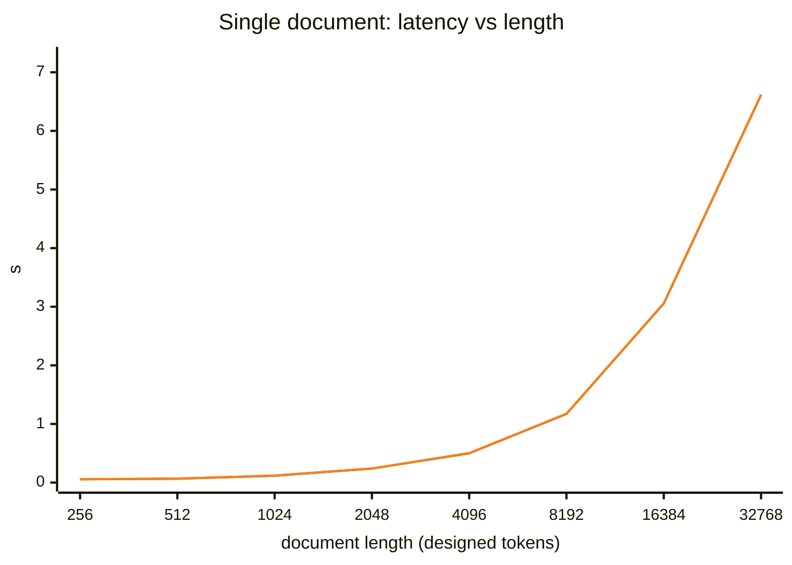
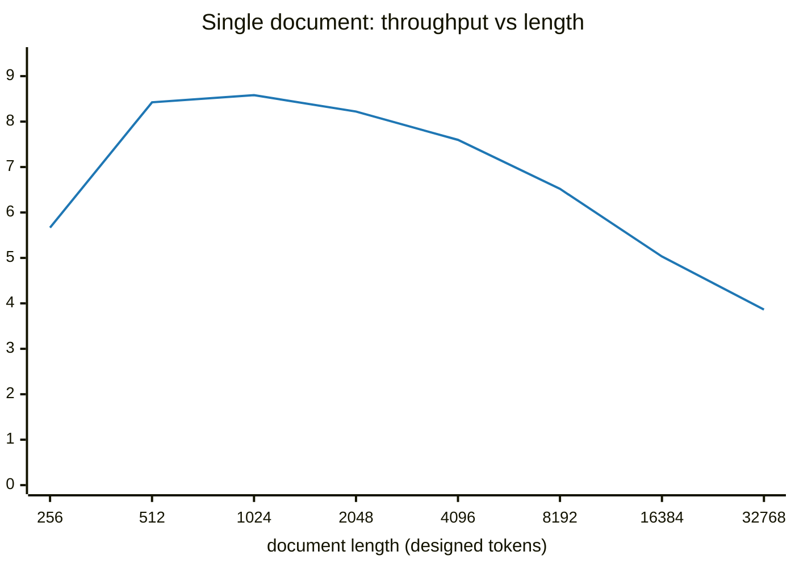
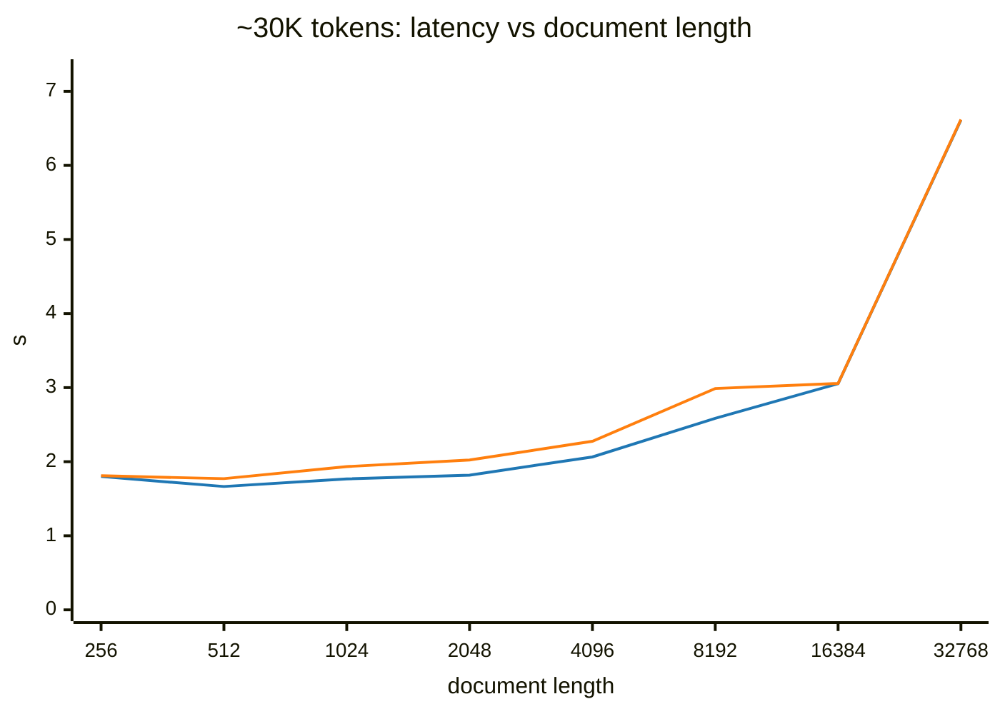
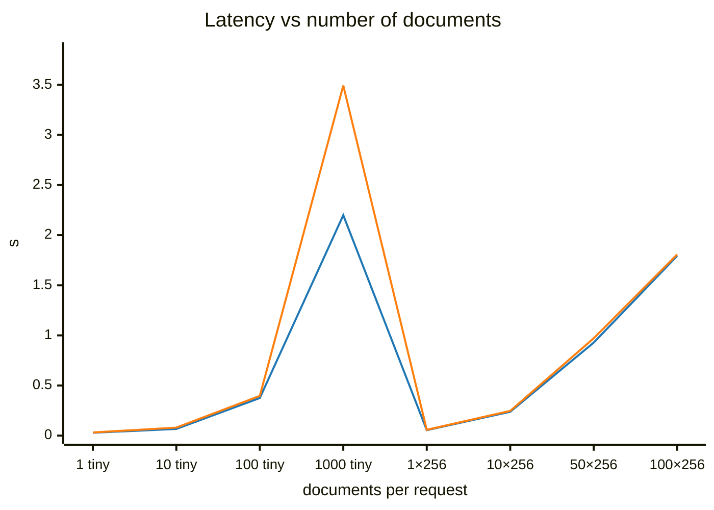
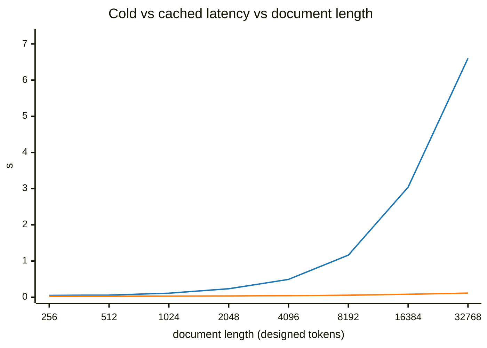
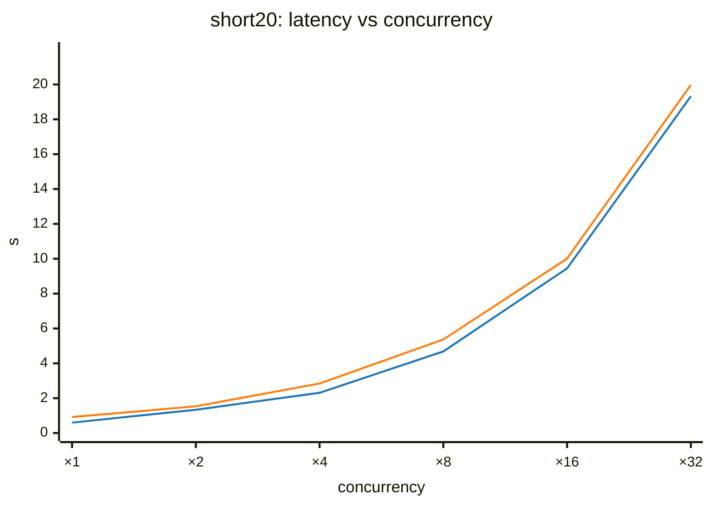
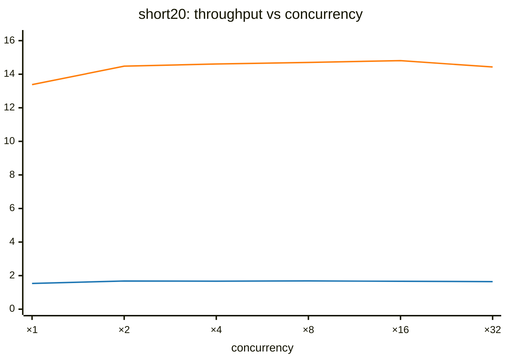
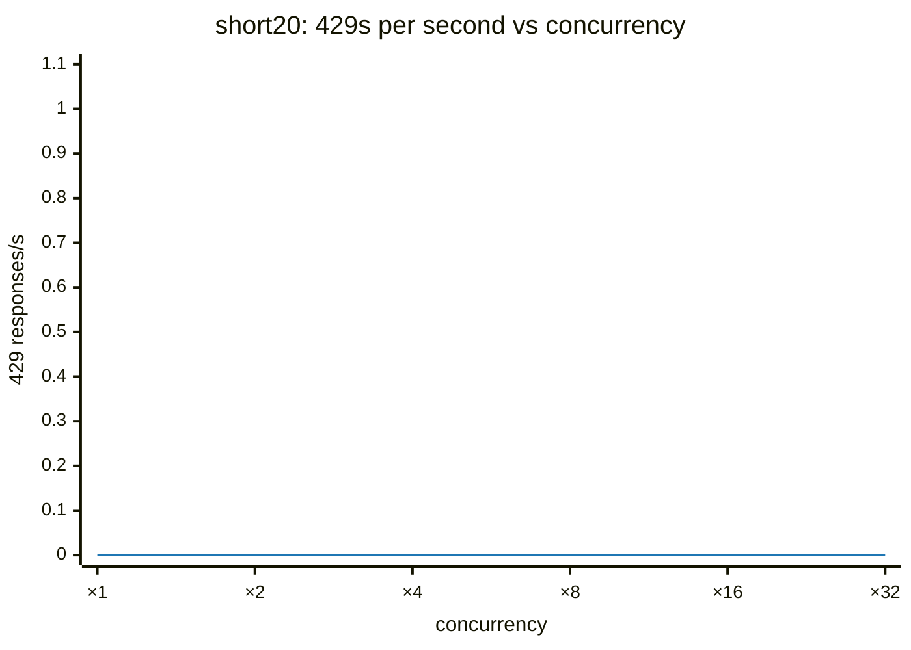

## meticulous — 2026-11-13 17:48 UTC

**PASS** · 1051 s · 906 requests · 1 (0.1%) errors · 0 rate-limited · 10,092,288 tokens billed

Sequential requests (one in flight) unless stated; every query carries a nonce so nothing is served from the API's prefix cache.

### Single document: latency vs length

| rung | Qwen tokens | billed | errors | p50 s | p90 s | max s | API tok/s |
|---|---|---|---|---|---|---|---|
| 256 | 229 | 324 | 0 (0.0%) | 0.056 | 0.057 | 0.088 | 5,668 |
| 512 | 457 | 551 | 0 (0.0%) | 0.065 | 0.067 | 0.067 | 8,424 |
| 1,024 | 911 | 1,005 | 0 (0.0%) | 0.117 | 0.118 | 0.119 | 8,582 |
| 2,048 | 1,872 | 1,966 | 0 (0.0%) | 0.239 | 0.240 | 0.242 | 8,221 |
| 4,096 | 3,707 | 3,800 | 0 (0.0%) | 0.500 | 0.502 | 0.506 | 7,598 |
| 8,192 | 7,545 | 7,640 | 0 (0.0%) | 1.171 | 1.174 | 1.176 | 6,520 |
| 16,384 | 15,274 | 15,368 | 0 (0.0%) | 3.054 | 3.057 | 3.058 | 5,032 |
| 32,768 | 25,438 | 25,536 | 0 (0.0%) | 6.612 | 6.618 | 6.671 | 3,864 |

*Single document: latency vs length: p50, p90*

*Single document: throughput vs length: API tokens/s ÷ 1000*

### ~30K tokens per request: latency vs document length (fewer, longer documents)

| rung | docs/request | billed | errors | p50 s | p90 s | max s | API tok/s |
|---|---|---|---|---|---|---|---|
| 256 | 100 | 32,446 | 0 (0.0%) | 1.800 | 1.810 | 1.813 | 18,036 |
| 512 | 55 | 30,271 | 0 (0.0%) | 1.665 | 1.771 | 1.865 | 17,959 |
| 1,024 | 28 | 28,174 | 0 (0.0%) | 1.768 | 1.934 | 2.001 | 15,964 |
| 2,048 | 13 | 25,568 | 0 (0.0%) | 1.818 | 2.023 | 2.153 | 14,384 |
| 4,096 | 6 | 22,805 | 0 (0.0%) | 2.064 | 2.276 | 2.424 | 11,281 |
| 8,192 | 3 | 22,923 | 0 (0.0%) | 2.586 | 2.988 | 3.275 | 9,161 |
| 16,384 | 1 | 15,367 | 0 (0.0%) | 3.054 | 3.057 | 3.059 | 5,032 |
| 32,768 | 1 | 25,541 | 0 (0.0%) | 6.611 | 6.619 | 6.671 | 3,863 |

*~30K tokens: latency vs document length: p50, p90*

### Latency vs number of documents

| documents | billed | errors | p50 s | p90 s | max s | MRR |
|---|---|---|---|---|---|---|
| 1 tiny | 91.1 | 0 (0.0%) | 0.029 | 0.031 | 0.032 | 1.000 |
| 10 tiny | 921 | 0 (0.0%) | 0.066 | 0.080 | 0.081 | 1.000 |
| 100 tiny | 9,279 | 0 (0.0%) | 0.375 | 0.396 | 0.397 | 1.000 |
| 1000 tiny | 93,989 | 0 (0.0%) | 2.199 | 3.493 | 3.604 | 1.000 |
| 1×256 | 324 | 0 (0.0%) | 0.055 | 0.058 | 0.058 | 1.000 |
| 10×256 | 3,234 | 0 (0.0%) | 0.238 | 0.246 | 0.267 | 1.000 |
| 50×256 | 16,160 | 0 (0.0%) | 0.928 | 0.971 | 0.990 | 1.000 |
| 100×256 | 32,289 | 0 (0.0%) | 1.793 | 1.808 | 1.814 | 0.950 |

*Latency vs number of documents: p50, p90*

### Cold vs cached: the same single-document request sent twice in a row

The API caches prompt prefixes, so a repeated (query, document) pair skips most of the compute. Cold = fresh nonce in the query; cached = the identical request again immediately after.

| rung | pairs | cold p50 s | cached p50 s | speed-up × | cold max s | cached max s | errors |
|---|---|---|---|---|---|---|---|
| 256 | 10 | 0.051 | 0.029 | 1.784 | 0.060 | 0.031 |  |
| 512 | 10 | 0.060 | 0.030 | 1.984 | 0.061 | 0.031 |  |
| 1,024 | 10 | 0.111 | 0.031 | 3.578 | 0.114 | 0.032 |  |
| 2,048 | 10 | 0.234 | 0.036 | 6.576 | 0.236 | 0.038 |  |
| 4,096 | 10 | 0.492 | 0.043 | 11.5 | 0.495 | 0.044 |  |
| 8,192 | 10 | 1.163 | 0.056 | 20.6 | 1.166 | 0.057 |  |
| 16,384 | 10 | 3.043 | 0.082 | 37.1 | 3.048 | 0.084 |  |
| 32,768 | 10 | 6.603 | 0.115 | 57.5 | 6.652 | 0.117 |  |

*Cold vs cached latency vs document length: cold p50, cached p50*

### short20: latency and throughput vs concurrency

|  | requests | errors | 429s | p50 s | p90 s | p99 s | max s | req/s | API tok/s | MRR |
|---|---|---|---|---|---|---|---|---|---|---|
| ×1 | 39 | 0 (0.0%) | 0 | 0.597 | 0.920 | 1.133 | 1.175 | 1.533 | 13,380 | 0.717 |
| ×2 | 43 | 0 (0.0%) | 0 | 1.336 | 1.535 | 1.798 | 1.800 | 1.678 | 14,477 | 0.732 |
| ×4 | 45 | 0 (0.0%) | 0 | 2.307 | 2.841 | 3.142 | 3.142 | 1.670 | 14,611 | 0.729 |
| ×8 | 48 | 0 (0.0%) | 0 | 4.684 | 5.369 | 5.818 | 5.819 | 1.684 | 14,703 | 0.704 |
| ×16 | 57 | 0 (0.0%) | 0 | 9.447 | 10.0 | 10.6 | 10.8 | 1.663 | 14,813 | 0.695 |
| ×32 | 74 | 1 (1.4%) | 0 | 19.3 | 20.0 | 20.2 | 20.2 | 1.642 | 14,426 | 0.695 |

No 429s up to concurrency ×32.

*short20: latency vs concurrency: p50, p90*

*short20: throughput vs concurrency: req/s, API tokens/s ÷ 1000*

*short20: 429s per second vs concurrency: 429/s*

| error | count | example | response |
|---|---|---|---|
| http 424 ModelError container 0 | 1 | beir-arguana beir-arguana/test-education-pstrgsehwt-con02a | {"ErrorCode":"INTERNAL_FAILURE_FROM_MODEL","LogStreamArn":"arn:aws:logs:eu-west-3:<account-id>:log-group:/aws/sagemaker/Endpoints/reranker-aws031-4b-int8-1","Message":"Received server error (0) from primary with message \"Connection reset by peer for the reranker-aws031-4b-int8-1 endpoint. Please re |

906 requests, 10,092,288 tokens billed.
