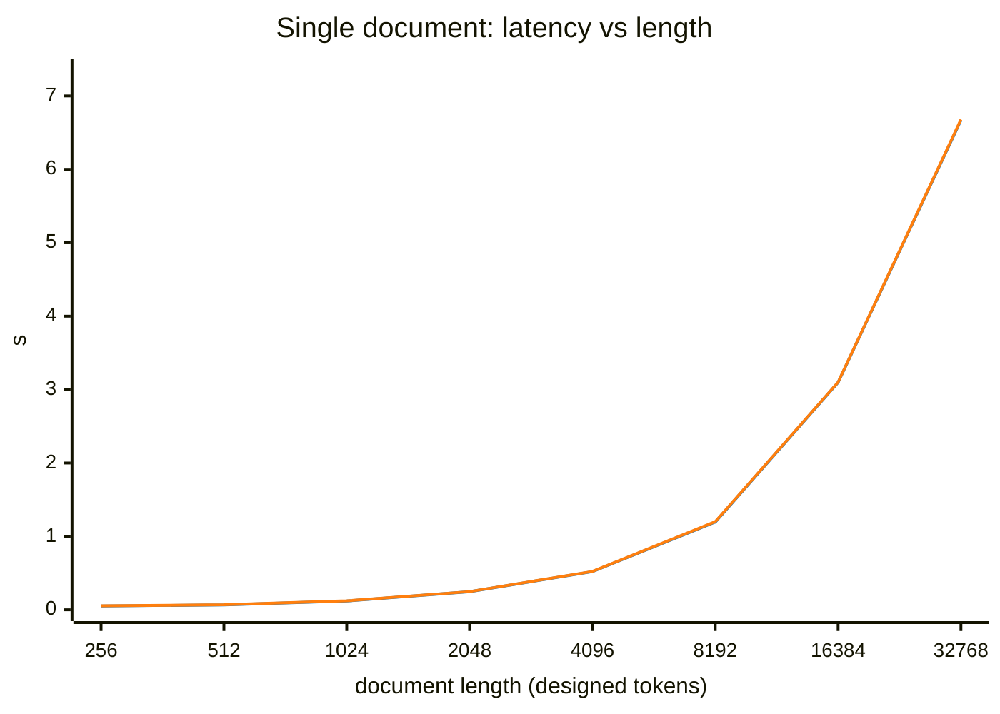
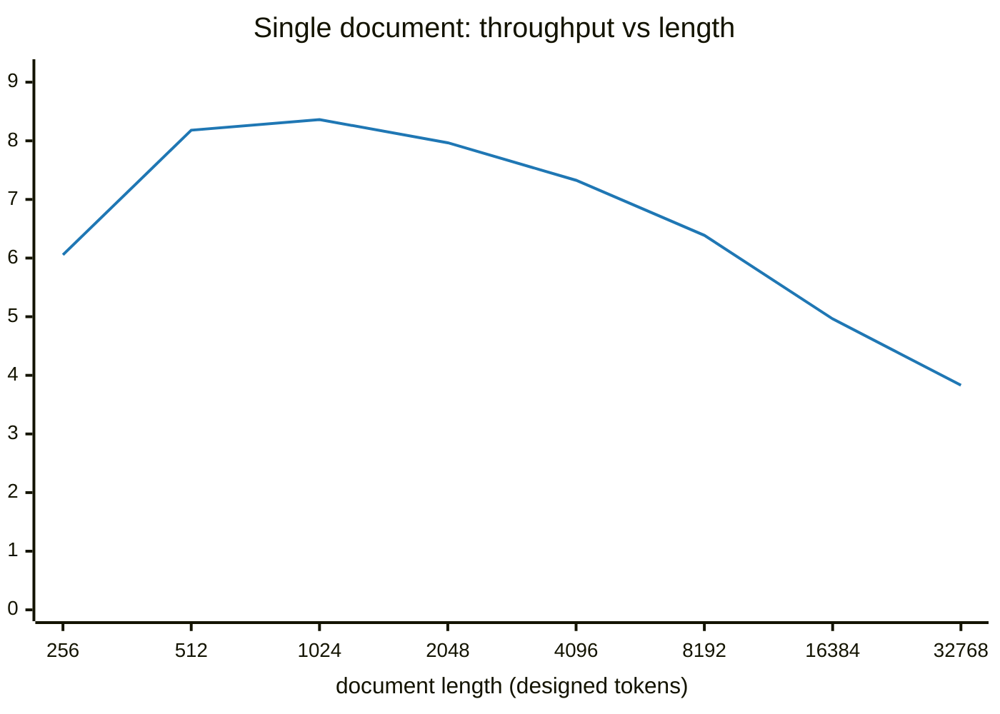
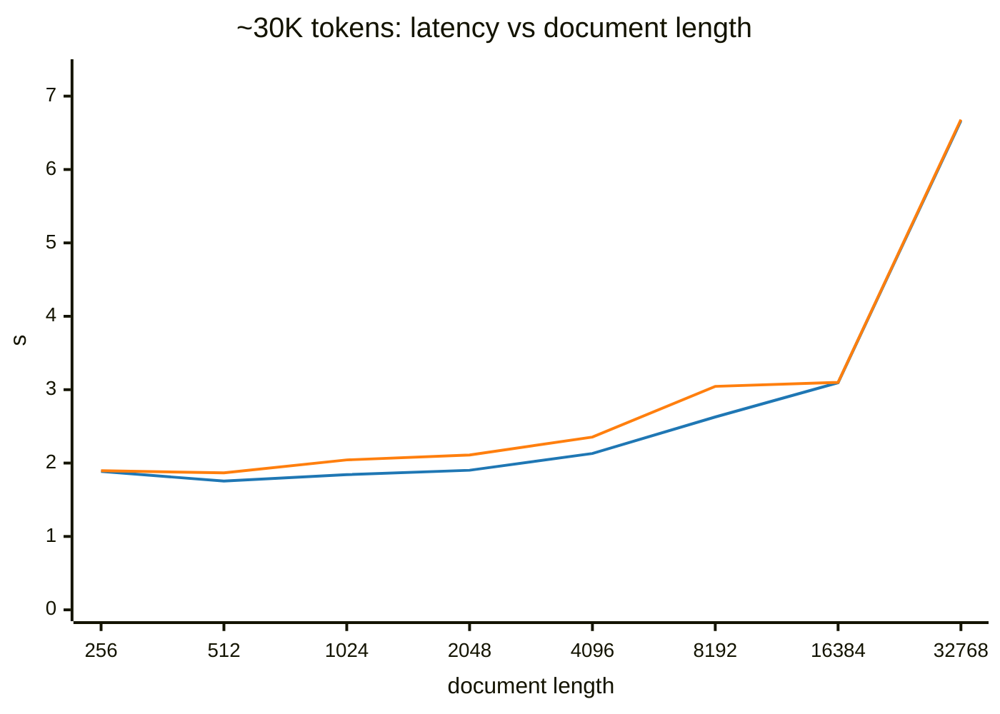
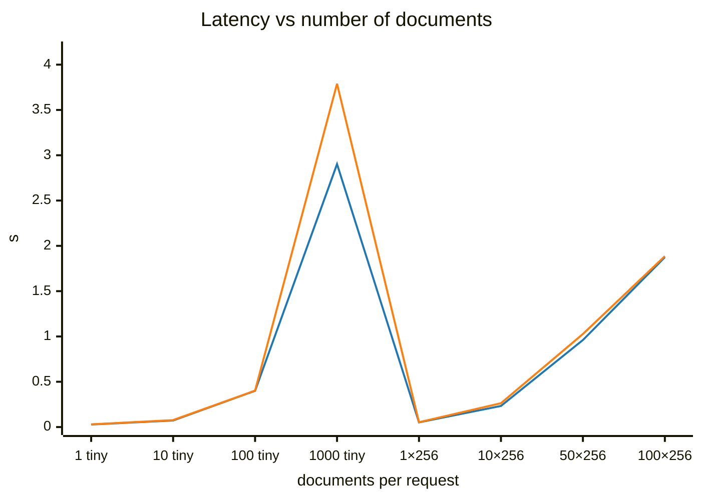
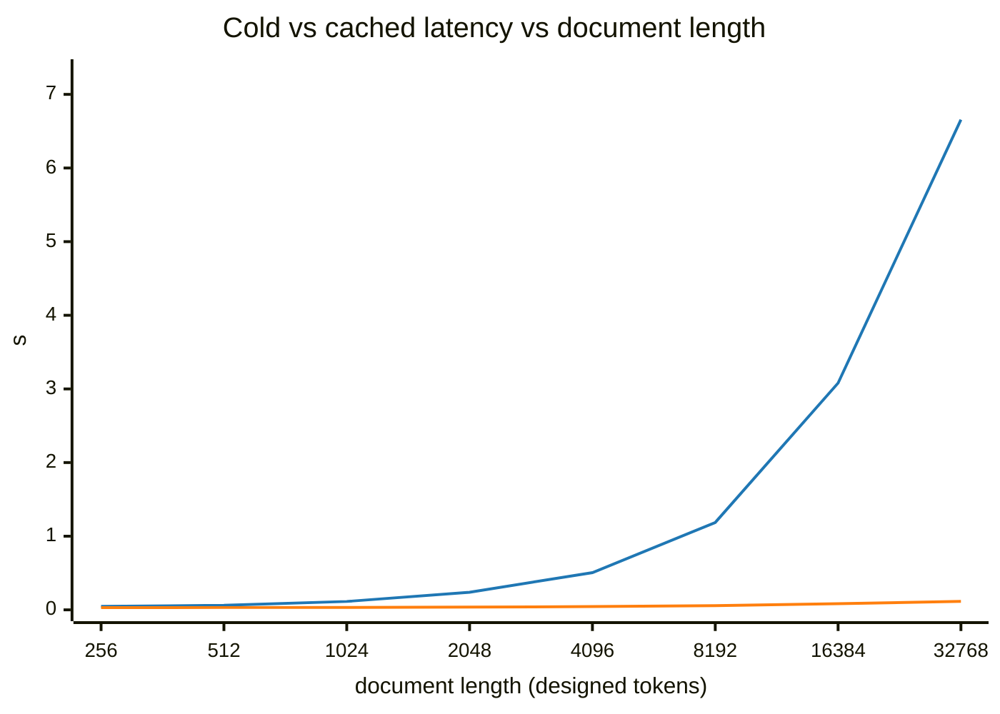
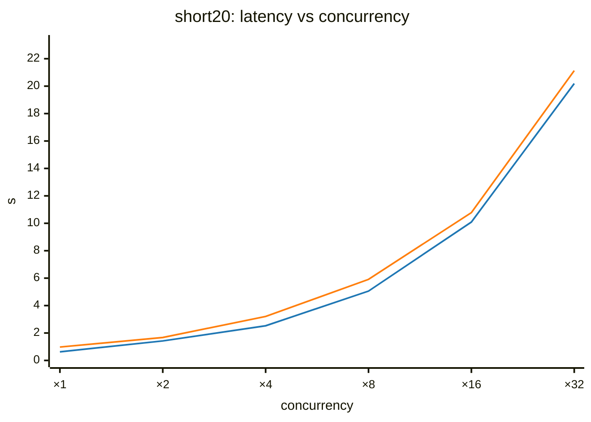
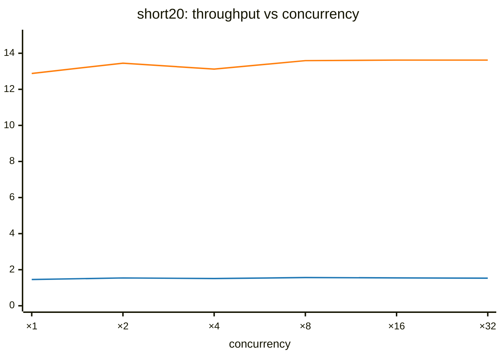
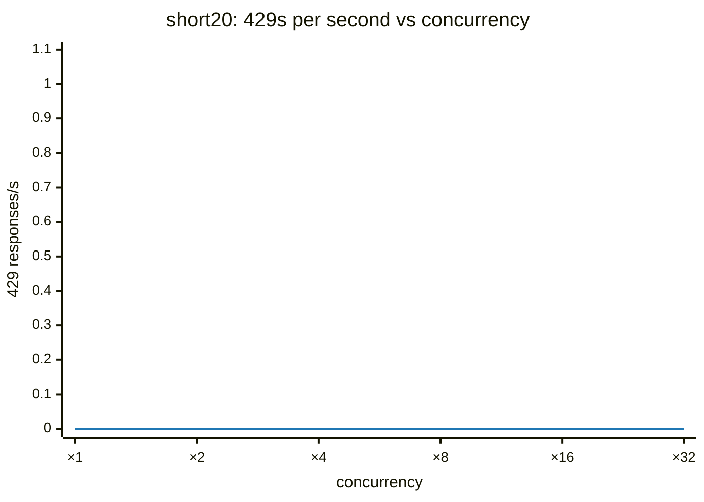

## meticulous — 2026-11-13 18:01 UTC

**PASS** · 1075 s · 888 requests · 0 (0.0%) errors · 0 rate-limited · 9,944,407 tokens billed

Sequential requests (one in flight) unless stated; every query carries a nonce so nothing is served from the API's prefix cache.

### Single document: latency vs length

| rung | Qwen tokens | billed | errors | p50 s | p90 s | max s | API tok/s |
|---|---|---|---|---|---|---|---|
| 256 | 229 | 323 | 0 (0.0%) | 0.052 | 0.054 | 0.084 | 6,055 |
| 512 | 457 | 551 | 0 (0.0%) | 0.067 | 0.069 | 0.071 | 8,181 |
| 1,024 | 911 | 1,005 | 0 (0.0%) | 0.120 | 0.122 | 0.123 | 8,362 |
| 2,048 | 1,872 | 1,966 | 0 (0.0%) | 0.246 | 0.248 | 0.253 | 7,967 |
| 4,096 | 3,707 | 3,801 | 0 (0.0%) | 0.520 | 0.523 | 0.527 | 7,327 |
| 8,192 | 7,545 | 7,640 | 0 (0.0%) | 1.195 | 1.201 | 1.207 | 6,388 |
| 16,384 | 15,274 | 15,368 | 0 (0.0%) | 3.097 | 3.101 | 3.105 | 4,963 |
| 32,768 | 25,438 | 25,536 | 0 (0.0%) | 6.668 | 6.678 | 6.730 | 3,831 |

*Single document: latency vs length: p50, p90*

*Single document: throughput vs length: API tokens/s ÷ 1000*

### ~30K tokens per request: latency vs document length (fewer, longer documents)

| rung | docs/request | billed | errors | p50 s | p90 s | max s | API tok/s |
|---|---|---|---|---|---|---|---|
| 256 | 100 | 32,379 | 0 (0.0%) | 1.886 | 1.895 | 1.902 | 17,174 |
| 512 | 55 | 30,278 | 0 (0.0%) | 1.754 | 1.867 | 1.977 | 17,085 |
| 1,024 | 28 | 28,174 | 0 (0.0%) | 1.842 | 2.043 | 2.108 | 15,200 |
| 2,048 | 13 | 25,572 | 0 (0.0%) | 1.902 | 2.110 | 2.263 | 13,815 |
| 4,096 | 6 | 22,807 | 0 (0.0%) | 2.131 | 2.354 | 2.514 | 10,931 |
| 8,192 | 3 | 22,923 | 0 (0.0%) | 2.628 | 3.045 | 3.346 | 8,995 |
| 16,384 | 1 | 15,367 | 0 (0.0%) | 3.095 | 3.100 | 3.104 | 4,965 |
| 32,768 | 1 | 25,541 | 0 (0.0%) | 6.663 | 6.680 | 6.728 | 3,830 |

*~30K tokens: latency vs document length: p50, p90*

### Latency vs number of documents

| documents | billed | errors | p50 s | p90 s | max s | MRR |
|---|---|---|---|---|---|---|
| 1 tiny | 91.5 | 0 (0.0%) | 0.029 | 0.030 | 0.033 | 1.000 |
| 10 tiny | 921 | 0 (0.0%) | 0.072 | 0.077 | 0.077 | 1.000 |
| 100 tiny | 9,299 | 0 (0.0%) | 0.400 | 0.402 | 0.405 | 1.000 |
| 1000 tiny | 93,489 | 0 (0.0%) | 2.902 | 3.789 | 3.810 | 1.000 |
| 1×256 | 323 | 0 (0.0%) | 0.052 | 0.054 | 0.055 | 1.000 |
| 10×256 | 3,232 | 0 (0.0%) | 0.233 | 0.263 | 0.284 | 1.000 |
| 50×256 | 16,155 | 0 (0.0%) | 0.960 | 1.027 | 1.057 | 1.000 |
| 100×256 | 32,339 | 0 (0.0%) | 1.875 | 1.886 | 1.886 | 0.950 |

*Latency vs number of documents: p50, p90*

### Cold vs cached: the same single-document request sent twice in a row

The API caches prompt prefixes, so a repeated (query, document) pair skips most of the compute. Cold = fresh nonce in the query; cached = the identical request again immediately after.

| rung | pairs | cold p50 s | cached p50 s | speed-up × | cold max s | cached max s | errors |
|---|---|---|---|---|---|---|---|
| 256 | 10 | 0.048 | 0.030 | 1.622 | 0.066 | 0.031 |  |
| 512 | 10 | 0.061 | 0.031 | 1.953 | 0.063 | 0.032 |  |
| 1,024 | 10 | 0.114 | 0.033 | 3.444 | 0.116 | 0.033 |  |
| 2,048 | 10 | 0.239 | 0.037 | 6.470 | 0.244 | 0.038 |  |
| 4,096 | 10 | 0.506 | 0.044 | 11.5 | 0.513 | 0.045 |  |
| 8,192 | 10 | 1.186 | 0.057 | 20.9 | 1.196 | 0.058 |  |
| 16,384 | 10 | 3.080 | 0.083 | 37.3 | 3.089 | 0.084 |  |
| 32,768 | 10 | 6.657 | 0.115 | 58.0 | 6.710 | 0.118 |  |

*Cold vs cached latency vs document length: cold p50, cached p50*

### short20: latency and throughput vs concurrency

|  | requests | errors | 429s | p50 s | p90 s | p99 s | max s | req/s | API tok/s | MRR |
|---|---|---|---|---|---|---|---|---|---|---|
| ×1 | 37 | 0 (0.0%) | 0 | 0.626 | 0.978 | 1.196 | 1.233 | 1.457 | 12,879 | 0.680 |
| ×2 | 40 | 0 (0.0%) | 0 | 1.423 | 1.673 | 1.927 | 1.928 | 1.543 | 13,448 | 0.723 |
| ×4 | 41 | 0 (0.0%) | 0 | 2.528 | 3.207 | 3.452 | 3.457 | 1.509 | 13,124 | 0.732 |
| ×8 | 46 | 0 (0.0%) | 0 | 5.057 | 5.911 | 6.245 | 6.245 | 1.564 | 13,590 | 0.728 |
| ×16 | 54 | 0 (0.0%) | 0 | 10.1 | 10.8 | 11.1 | 11.3 | 1.546 | 13,624 | 0.715 |
| ×32 | 70 | 0 (0.0%) | 0 | 20.2 | 21.1 | 21.6 | 21.6 | 1.531 | 13,619 | 0.687 |

No 429s up to concurrency ×32.

*short20: latency vs concurrency: p50, p90*

*short20: throughput vs concurrency: req/s, API tokens/s ÷ 1000*

*short20: 429s per second vs concurrency: 429/s*

888 requests, 9,944,407 tokens billed.
