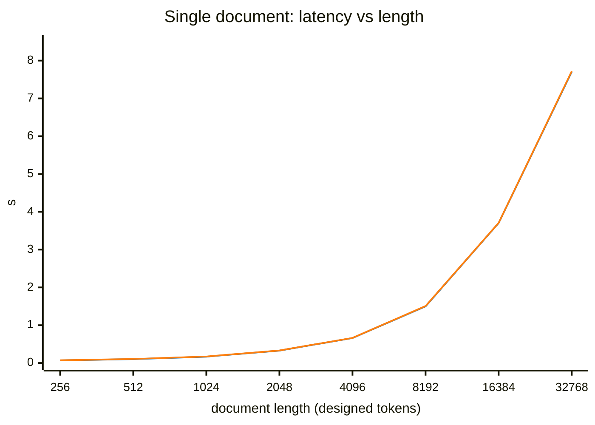
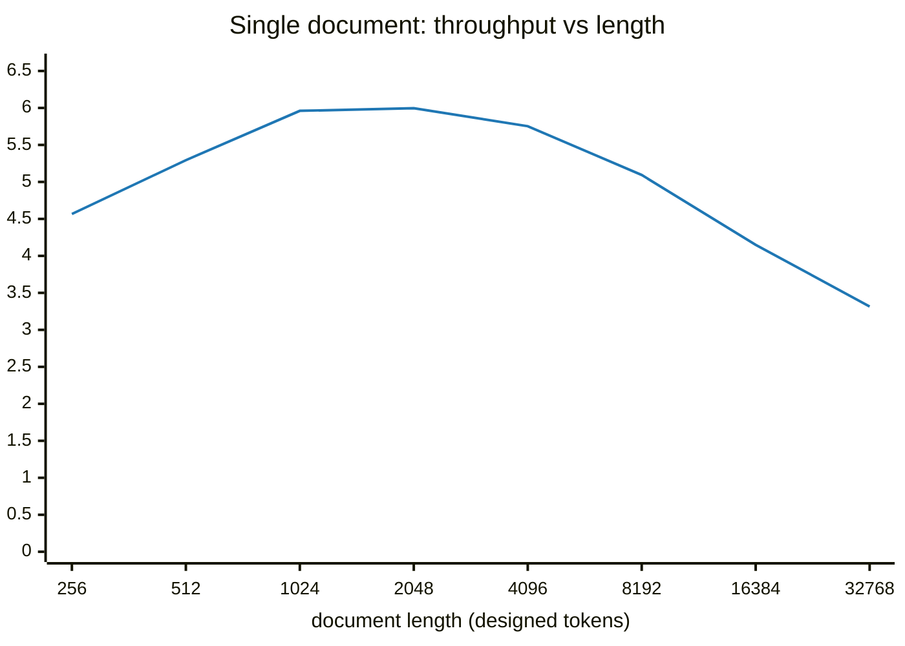
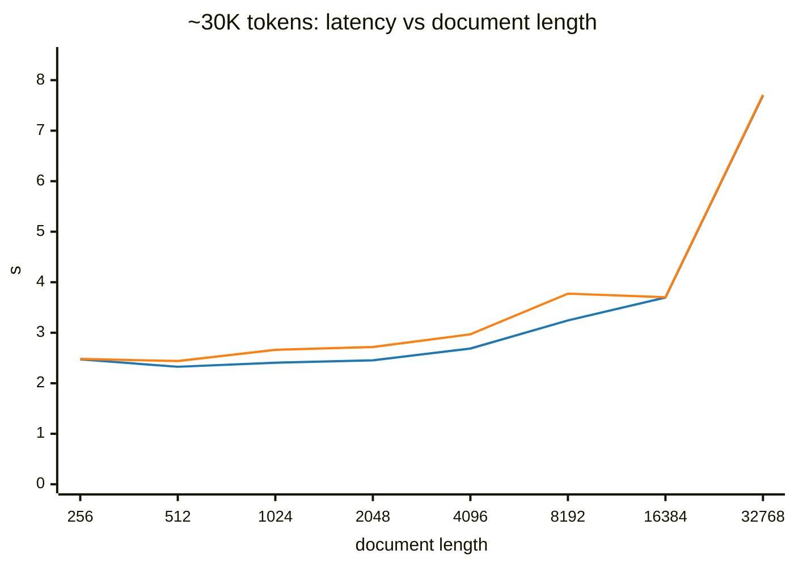
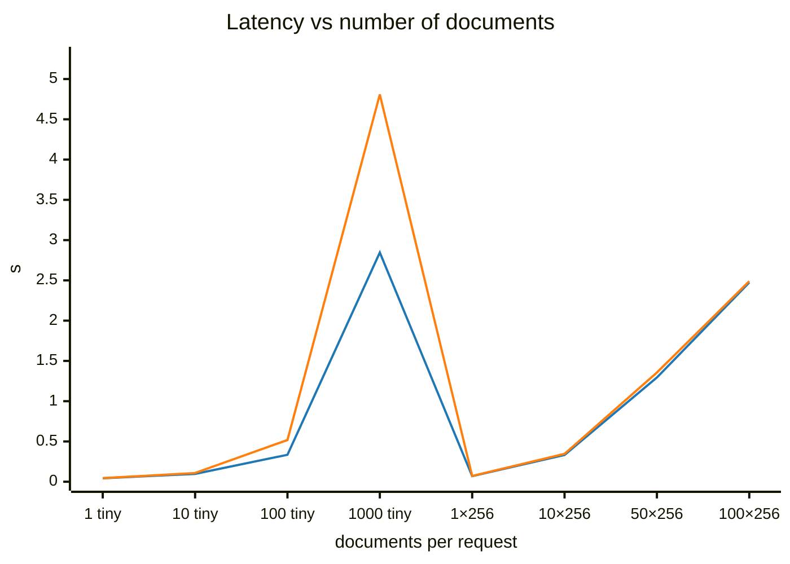
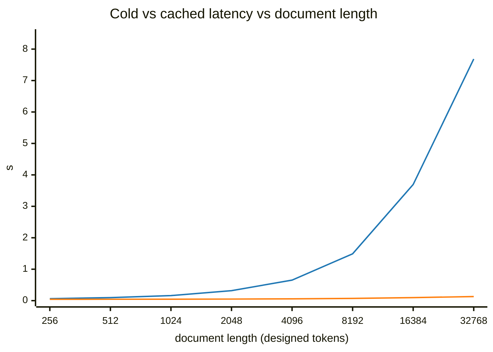
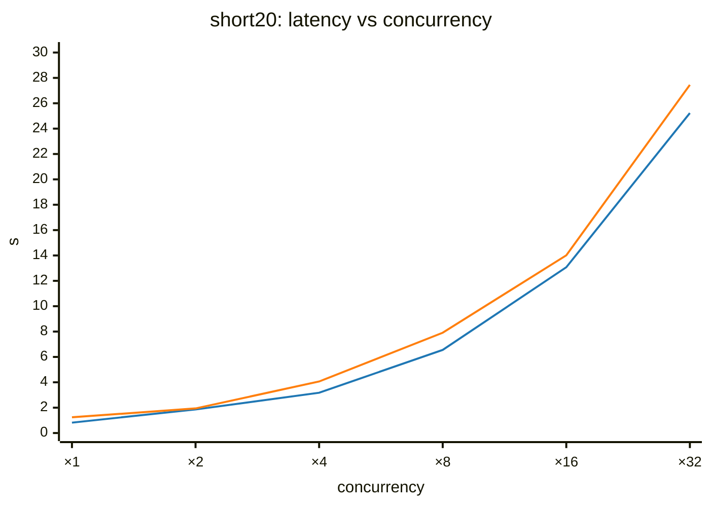
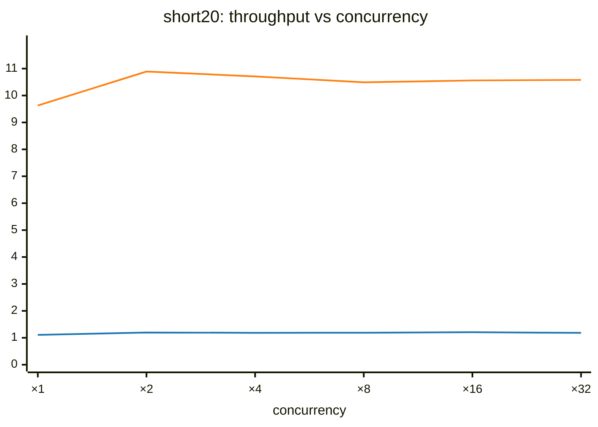
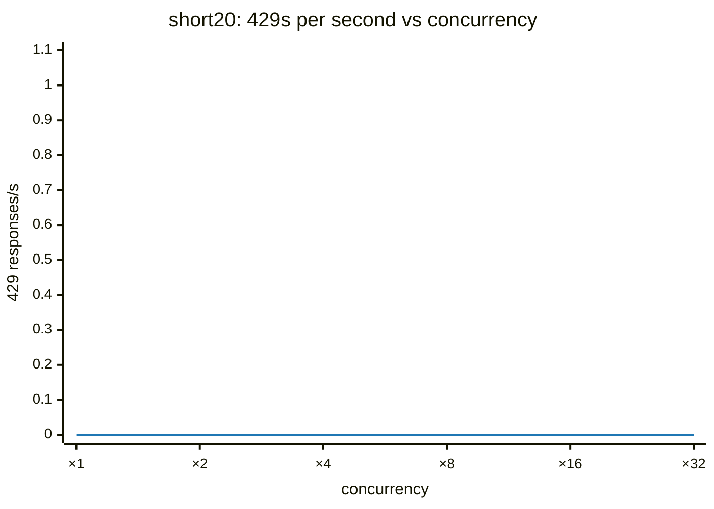

## meticulous — 2026-11-13 19:35 UTC

**PASS** · 1267 s · 836 requests · 0 (0.0%) errors · 0 rate-limited · 9,517,763 tokens billed

Sequential requests (one in flight) unless stated; every query carries a nonce so nothing is served from the API's prefix cache.

### Single document: latency vs length

| rung | Qwen tokens | billed | errors | p50 s | p90 s | max s | API tok/s |
|---|---|---|---|---|---|---|---|
| 256 | 229 | 323 | 0 (0.0%) | 0.070 | 0.072 | 0.095 | 4,566 |
| 512 | 457 | 551 | 0 (0.0%) | 0.103 | 0.107 | 0.108 | 5,294 |
| 1,024 | 911 | 1,005 | 0 (0.0%) | 0.168 | 0.171 | 0.172 | 5,961 |
| 2,048 | 1,872 | 1,966 | 0 (0.0%) | 0.328 | 0.331 | 0.333 | 5,996 |
| 4,096 | 3,707 | 3,801 | 0 (0.0%) | 0.660 | 0.663 | 0.667 | 5,753 |
| 8,192 | 7,545 | 7,639 | 0 (0.0%) | 1.499 | 1.506 | 1.507 | 5,094 |
| 16,384 | 15,274 | 15,368 | 0 (0.0%) | 3.704 | 3.707 | 3.712 | 4,149 |
| 32,768 | 25,438 | 25,536 | 0 (0.0%) | 7.704 | 7.720 | 7.760 | 3,316 |

*Single document: latency vs length: p50, p90*

*Single document: throughput vs length: API tokens/s ÷ 1000*

### ~30K tokens per request: latency vs document length (fewer, longer documents)

| rung | docs/request | billed | errors | p50 s | p90 s | max s | API tok/s |
|---|---|---|---|---|---|---|---|
| 256 | 100 | 32,366 | 0 (0.0%) | 2.472 | 2.481 | 2.482 | 13,093 |
| 512 | 55 | 30,275 | 0 (0.0%) | 2.326 | 2.440 | 2.594 | 12,969 |
| 1,024 | 28 | 28,183 | 0 (0.0%) | 2.406 | 2.661 | 2.742 | 11,663 |
| 2,048 | 13 | 25,578 | 0 (0.0%) | 2.453 | 2.717 | 2.897 | 10,721 |
| 4,096 | 6 | 22,805 | 0 (0.0%) | 2.687 | 2.968 | 3.167 | 8,663 |
| 8,192 | 3 | 22,921 | 0 (0.0%) | 3.244 | 3.774 | 4.147 | 7,284 |
| 16,384 | 1 | 15,366 | 0 (0.0%) | 3.697 | 3.702 | 3.712 | 4,156 |
| 32,768 | 1 | 25,541 | 0 (0.0%) | 7.694 | 7.707 | 7.743 | 3,321 |

*~30K tokens: latency vs document length: p50, p90*

### Latency vs number of documents

| documents | billed | errors | p50 s | p90 s | max s | MRR |
|---|---|---|---|---|---|---|
| 1 tiny | 91.1 | 0 (0.0%) | 0.043 | 0.044 | 0.046 | 1.000 |
| 10 tiny | 917 | 0 (0.0%) | 0.097 | 0.108 | 0.110 | 1.000 |
| 100 tiny | 9,319 | 0 (0.0%) | 0.334 | 0.518 | 0.523 | 1.000 |
| 1000 tiny | 93,989 | 0 (0.0%) | 2.846 | 4.808 | 4.820 | 1.000 |
| 1×256 | 324 | 0 (0.0%) | 0.069 | 0.072 | 0.073 | 1.000 |
| 10×256 | 3,237 | 0 (0.0%) | 0.332 | 0.346 | 0.373 | 1.000 |
| 50×256 | 16,160 | 0 (0.0%) | 1.294 | 1.356 | 1.383 | 1.000 |
| 100×256 | 32,319 | 0 (0.0%) | 2.473 | 2.489 | 2.495 | 0.950 |

*Latency vs number of documents: p50, p90*

### Cold vs cached: the same single-document request sent twice in a row

The API caches prompt prefixes, so a repeated (query, document) pair skips most of the compute. Cold = fresh nonce in the query; cached = the identical request again immediately after.

| rung | pairs | cold p50 s | cached p50 s | speed-up × | cold max s | cached max s | errors |
|---|---|---|---|---|---|---|---|
| 256 | 10 | 0.063 | 0.043 | 1.456 | 0.068 | 0.044 |  |
| 512 | 10 | 0.096 | 0.045 | 2.144 | 0.098 | 0.046 |  |
| 1,024 | 10 | 0.161 | 0.046 | 3.494 | 0.164 | 0.048 |  |
| 2,048 | 10 | 0.318 | 0.050 | 6.333 | 0.325 | 0.051 |  |
| 4,096 | 10 | 0.653 | 0.058 | 11.3 | 0.658 | 0.059 |  |
| 8,192 | 10 | 1.490 | 0.071 | 21.1 | 1.498 | 0.072 |  |
| 16,384 | 10 | 3.694 | 0.096 | 38.5 | 3.699 | 0.099 |  |
| 32,768 | 10 | 7.686 | 0.130 | 59.2 | 7.752 | 0.131 |  |

*Cold vs cached latency vs document length: cold p50, cached p50*

### short20: latency and throughput vs concurrency

|  | requests | errors | 429s | p50 s | p90 s | p99 s | max s | req/s | API tok/s | MRR |
|---|---|---|---|---|---|---|---|---|---|---|
| ×1 | 28 | 0 (0.0%) | 0 | 0.821 | 1.242 | 1.580 | 1.615 | 1.109 | 9,629 | 0.671 |
| ×2 | 31 | 0 (0.0%) | 0 | 1.860 | 1.941 | 2.503 | 2.506 | 1.197 | 10,893 | 0.670 |
| ×4 | 33 | 0 (0.0%) | 0 | 3.177 | 4.063 | 4.370 | 4.372 | 1.185 | 10,712 | 0.668 |
| ×8 | 37 | 0 (0.0%) | 0 | 6.552 | 7.908 | 8.088 | 8.088 | 1.187 | 10,485 | 0.702 |
| ×16 | 45 | 0 (0.0%) | 0 | 13.1 | 14.0 | 14.6 | 14.6 | 1.208 | 10,560 | 0.712 |
| ×32 | 62 | 0 (0.0%) | 0 | 25.2 | 27.4 | 27.8 | 27.8 | 1.182 | 10,584 | 0.685 |

No 429s up to concurrency ×32.

*short20: latency vs concurrency: p50, p90*

*short20: throughput vs concurrency: req/s, API tokens/s ÷ 1000*

*short20: 429s per second vs concurrency: 429/s*

836 requests, 9,517,763 tokens billed.
