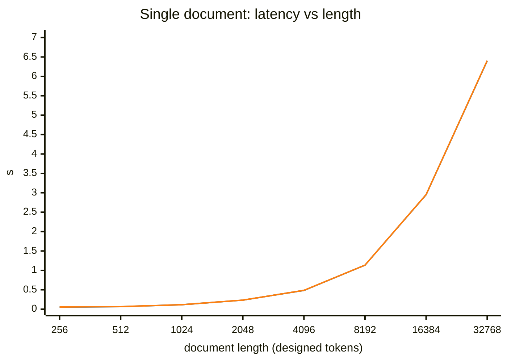
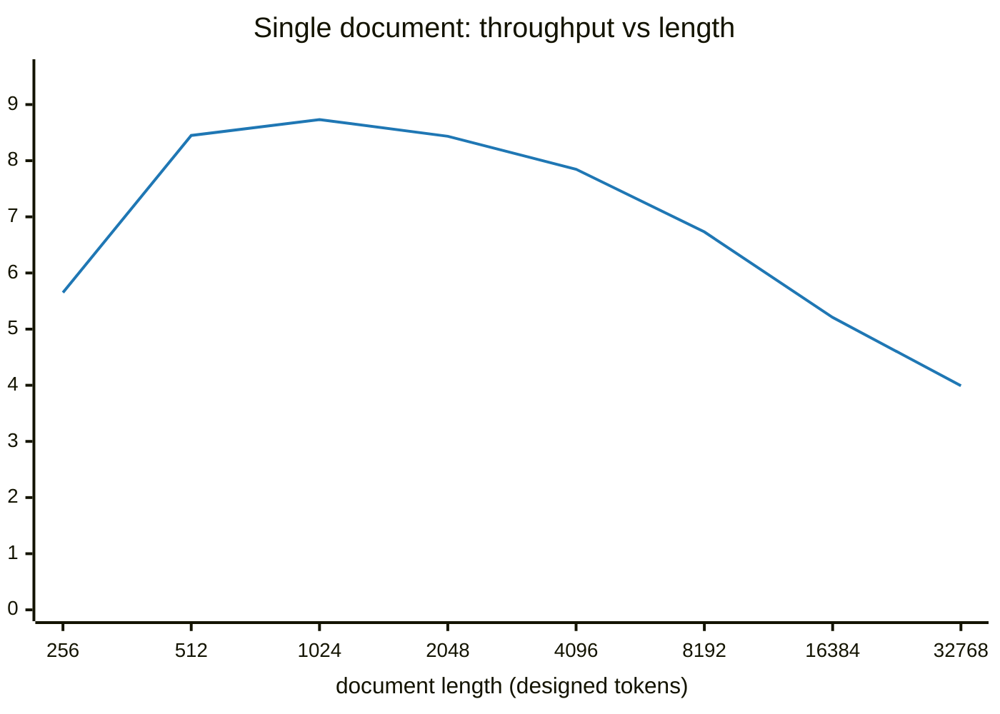
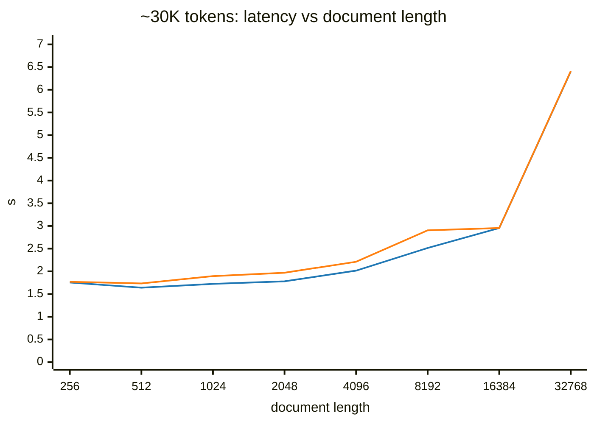
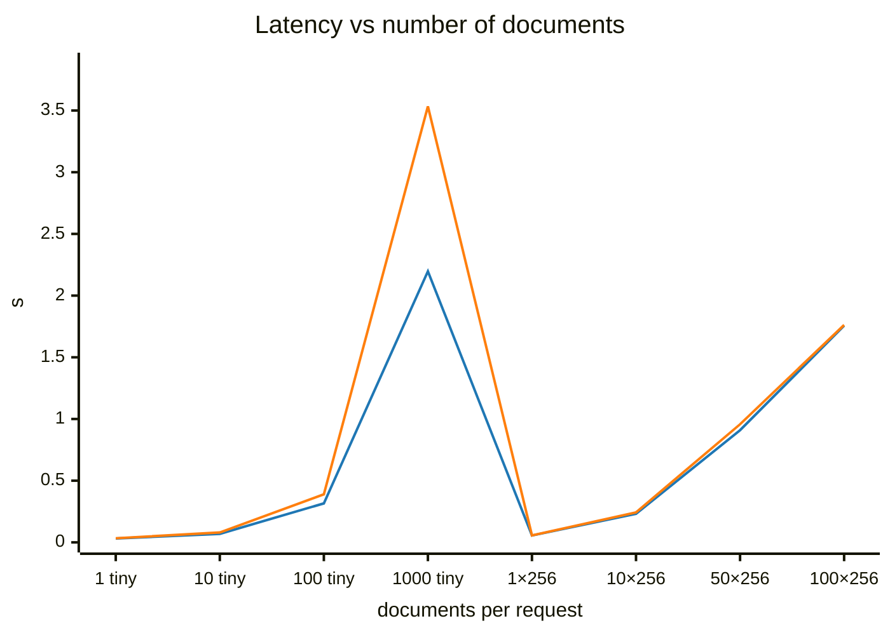
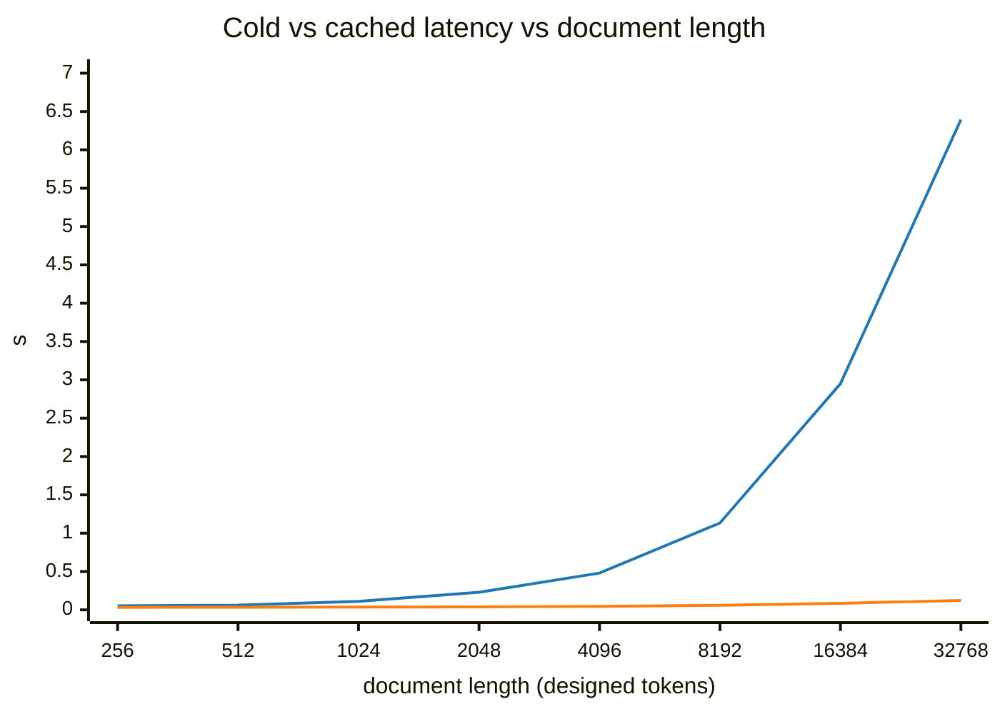
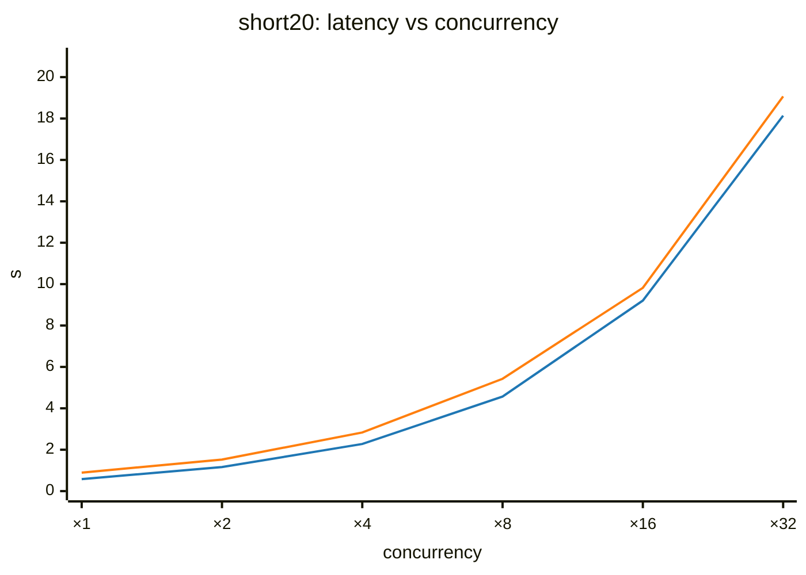
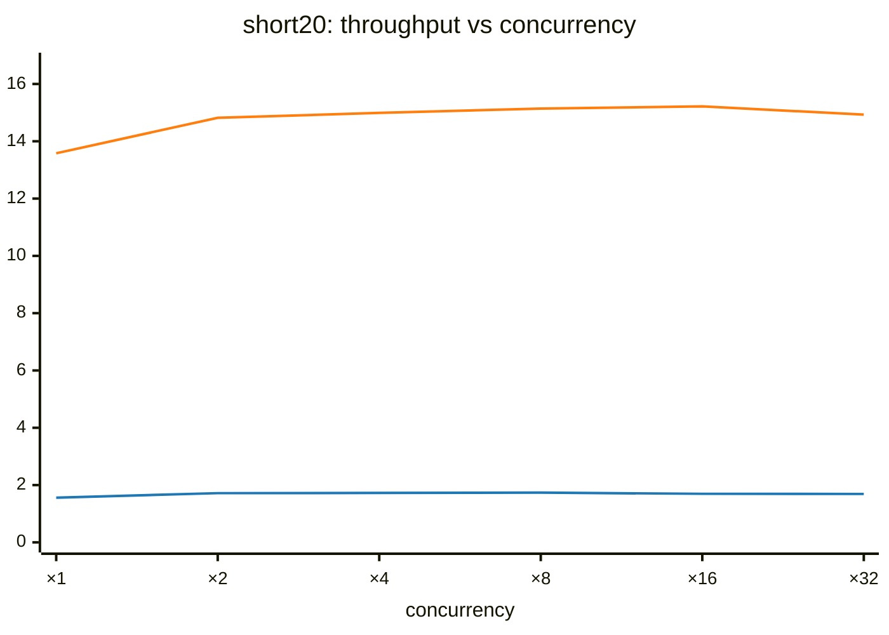
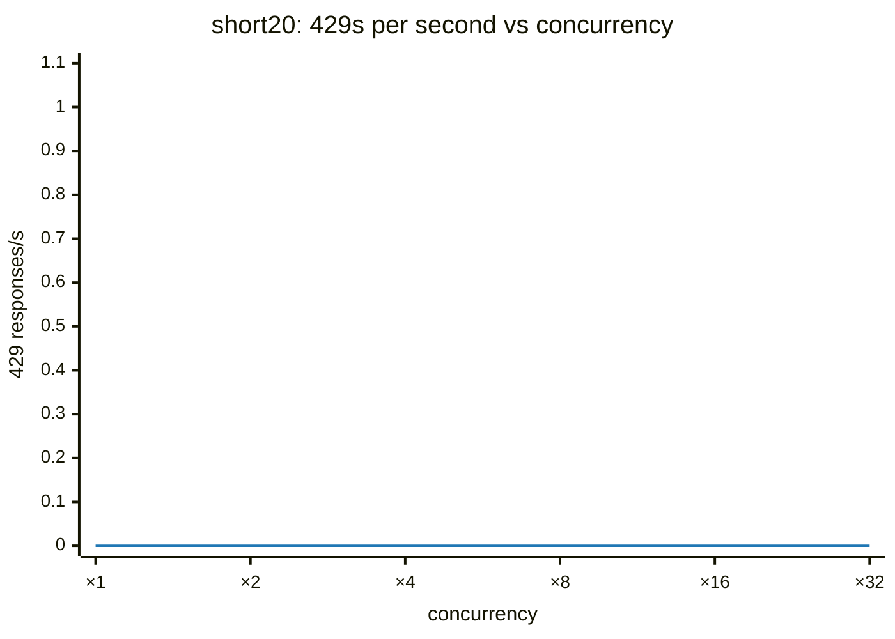

## meticulous — 2026-11-13 20:44 UTC

**PASS** · 1027 s · 913 requests · 0 (0.0%) errors · 0 rate-limited · 10,166,525 tokens billed

Sequential requests (one in flight) unless stated; every query carries a nonce so nothing is served from the API's prefix cache.

### Single document: latency vs length

| rung | Qwen tokens | billed | errors | p50 s | p90 s | max s | API tok/s |
|---|---|---|---|---|---|---|---|
| 256 | 229 | 324 | 0 (0.0%) | 0.056 | 0.057 | 0.088 | 5,651 |
| 512 | 457 | 551 | 0 (0.0%) | 0.065 | 0.066 | 0.067 | 8,450 |
| 1,024 | 911 | 1,005 | 0 (0.0%) | 0.115 | 0.116 | 0.117 | 8,732 |
| 2,048 | 1,872 | 1,966 | 0 (0.0%) | 0.233 | 0.234 | 0.236 | 8,435 |
| 4,096 | 3,707 | 3,801 | 0 (0.0%) | 0.484 | 0.486 | 0.488 | 7,847 |
| 8,192 | 7,545 | 7,640 | 0 (0.0%) | 1.135 | 1.136 | 1.139 | 6,732 |
| 16,384 | 15,274 | 15,368 | 0 (0.0%) | 2.951 | 2.953 | 2.955 | 5,208 |
| 32,768 | 25,438 | 25,536 | 0 (0.0%) | 6.399 | 6.406 | 6.449 | 3,992 |

*Single document: latency vs length: p50, p90*

*Single document: throughput vs length: API tokens/s ÷ 1000*

### ~30K tokens per request: latency vs document length (fewer, longer documents)

| rung | docs/request | billed | errors | p50 s | p90 s | max s | API tok/s |
|---|---|---|---|---|---|---|---|
| 256 | 100 | 32,392 | 0 (0.0%) | 1.754 | 1.770 | 1.776 | 18,435 |
| 512 | 55 | 30,286 | 0 (0.0%) | 1.640 | 1.734 | 1.835 | 18,323 |
| 1,024 | 28 | 28,183 | 0 (0.0%) | 1.724 | 1.895 | 1.942 | 16,344 |
| 2,048 | 13 | 25,564 | 0 (0.0%) | 1.780 | 1.970 | 2.098 | 14,707 |
| 4,096 | 6 | 22,804 | 0 (0.0%) | 2.016 | 2.211 | 2.361 | 11,588 |
| 8,192 | 3 | 22,921 | 0 (0.0%) | 2.515 | 2.904 | 3.194 | 9,420 |
| 16,384 | 1 | 15,367 | 0 (0.0%) | 2.953 | 2.955 | 2.958 | 5,202 |
| 32,768 | 1 | 25,541 | 0 (0.0%) | 6.404 | 6.412 | 6.460 | 3,990 |

*~30K tokens: latency vs document length: p50, p90*

### Latency vs number of documents

| documents | billed | errors | p50 s | p90 s | max s | MRR |
|---|---|---|---|---|---|---|
| 1 tiny | 90.9 | 0 (0.0%) | 0.031 | 0.033 | 0.033 | 1.000 |
| 10 tiny | 917 | 0 (0.0%) | 0.069 | 0.080 | 0.081 | 1.000 |
| 100 tiny | 9,329 | 0 (0.0%) | 0.316 | 0.389 | 0.391 | 1.000 |
| 1000 tiny | 93,989 | 0 (0.0%) | 2.197 | 3.534 | 3.558 | 1.000 |
| 1×256 | 323 | 0 (0.0%) | 0.056 | 0.057 | 0.058 | 1.000 |
| 10×256 | 3,233 | 0 (0.0%) | 0.231 | 0.243 | 0.263 | 1.000 |
| 50×256 | 16,155 | 0 (0.0%) | 0.909 | 0.957 | 0.979 | 1.000 |
| 100×256 | 32,319 | 0 (0.0%) | 1.756 | 1.762 | 1.763 | 0.950 |

*Latency vs number of documents: p50, p90*

### Cold vs cached: the same single-document request sent twice in a row

The API caches prompt prefixes, so a repeated (query, document) pair skips most of the compute. Cold = fresh nonce in the query; cached = the identical request again immediately after.

| rung | pairs | cold p50 s | cached p50 s | speed-up × | cold max s | cached max s | errors |
|---|---|---|---|---|---|---|---|
| 256 | 10 | 0.053 | 0.032 | 1.637 | 0.062 | 0.033 |  |
| 512 | 10 | 0.061 | 0.034 | 1.828 | 0.063 | 0.034 |  |
| 1,024 | 10 | 0.111 | 0.036 | 3.121 | 0.112 | 0.038 |  |
| 2,048 | 10 | 0.229 | 0.039 | 5.920 | 0.230 | 0.039 |  |
| 4,096 | 10 | 0.479 | 0.046 | 10.5 | 0.481 | 0.047 |  |
| 8,192 | 10 | 1.133 | 0.059 | 19.1 | 1.136 | 0.061 |  |
| 16,384 | 10 | 2.950 | 0.085 | 34.6 | 2.954 | 0.088 |  |
| 32,768 | 10 | 6.395 | 0.122 | 52.3 | 6.447 | 0.126 |  |

*Cold vs cached latency vs document length: cold p50, cached p50*

### short20: latency and throughput vs concurrency

|  | requests | errors | 429s | p50 s | p90 s | p99 s | max s | req/s | API tok/s | MRR |
|---|---|---|---|---|---|---|---|---|---|---|
| ×1 | 40 | 0 (0.0%) | 0 | 0.580 | 0.893 | 1.112 | 1.147 | 1.558 | 13,577 | 0.735 |
| ×2 | 44 | 0 (0.0%) | 0 | 1.165 | 1.524 | 1.753 | 1.757 | 1.718 | 14,820 | 0.727 |
| ×4 | 46 | 0 (0.0%) | 0 | 2.276 | 2.833 | 3.057 | 3.062 | 1.725 | 14,990 | 0.727 |
| ×8 | 50 | 0 (0.0%) | 0 | 4.568 | 5.427 | 5.656 | 5.865 | 1.735 | 15,136 | 0.741 |
| ×16 | 59 | 0 (0.0%) | 0 | 9.205 | 9.822 | 10.1 | 10.2 | 1.695 | 15,221 | 0.697 |
| ×32 | 74 | 0 (0.0%) | 0 | 18.1 | 19.1 | 19.3 | 19.3 | 1.690 | 14,933 | 0.682 |

No 429s up to concurrency ×32.

*short20: latency vs concurrency: p50, p90*

*short20: throughput vs concurrency: req/s, API tokens/s ÷ 1000*

*short20: 429s per second vs concurrency: 429/s*

913 requests, 10,166,525 tokens billed.
