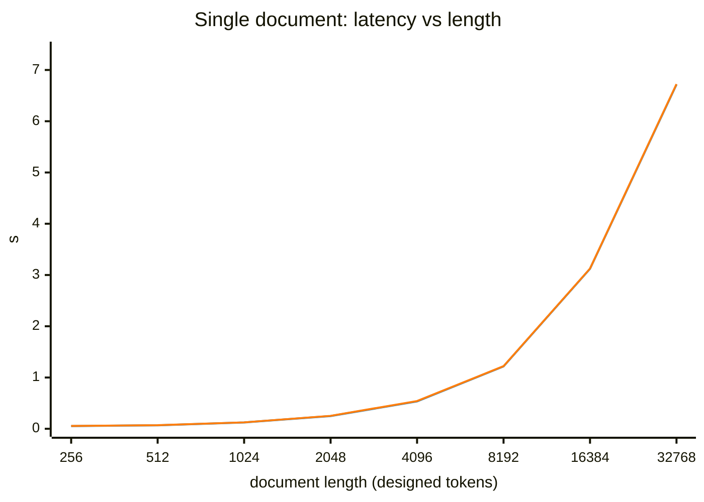
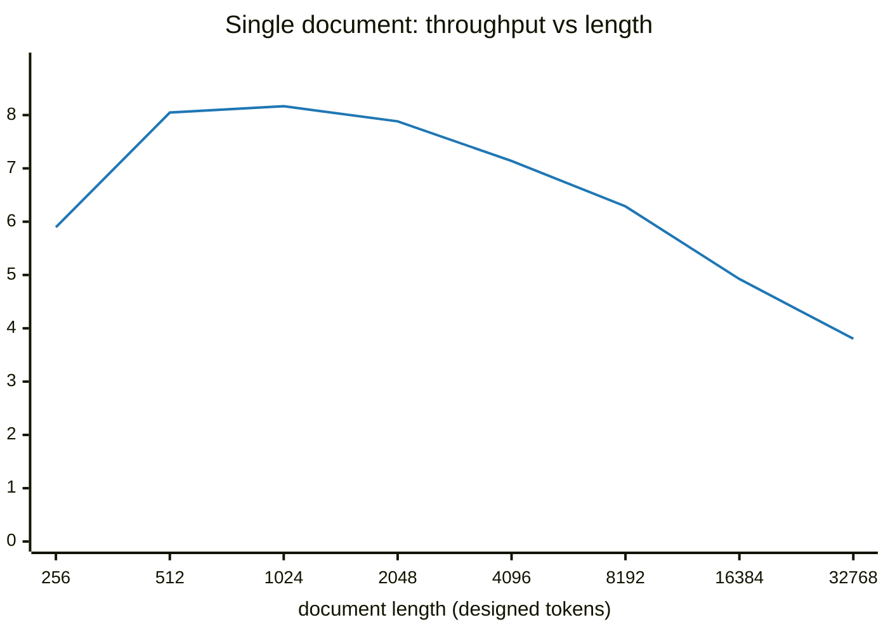
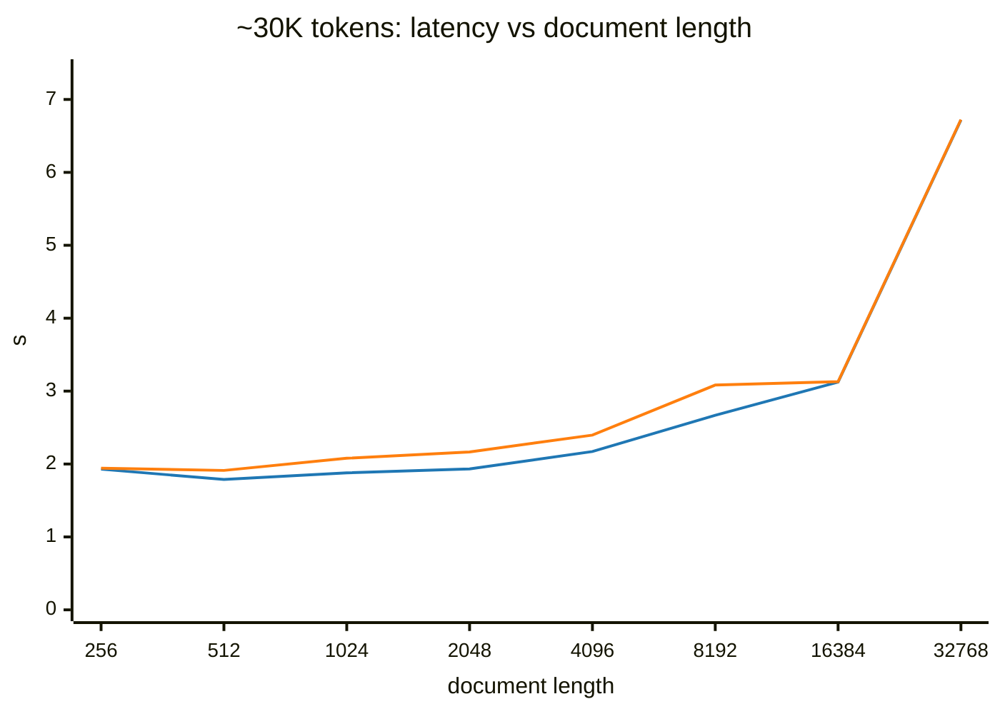
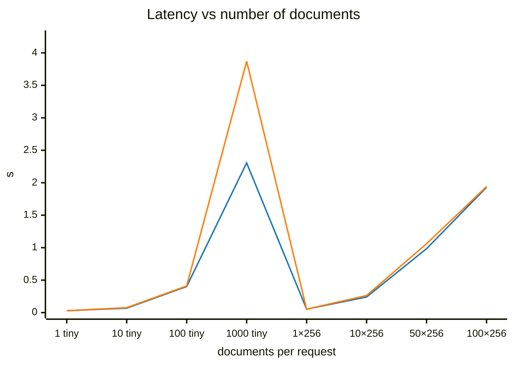
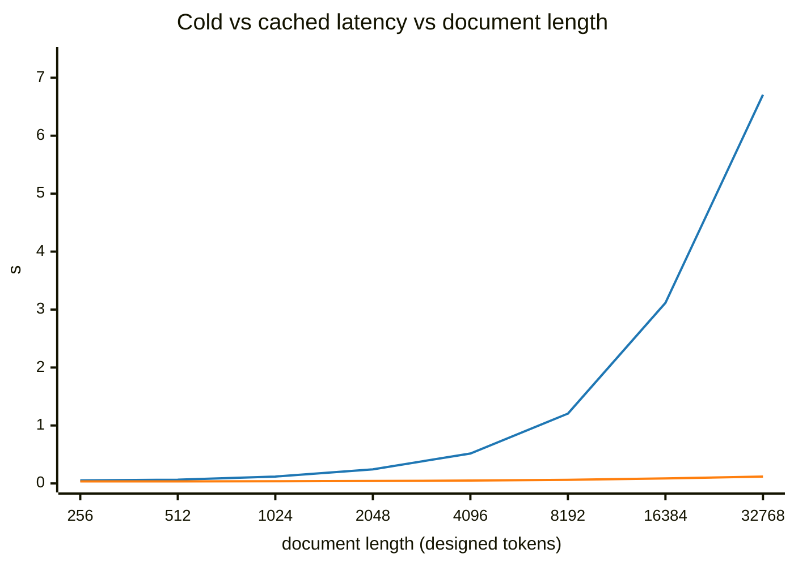
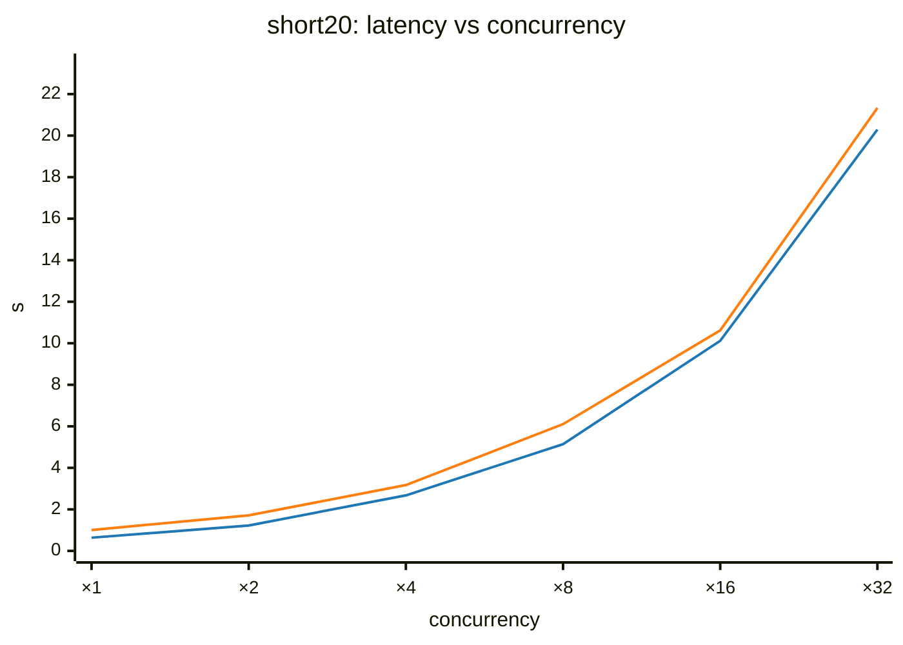
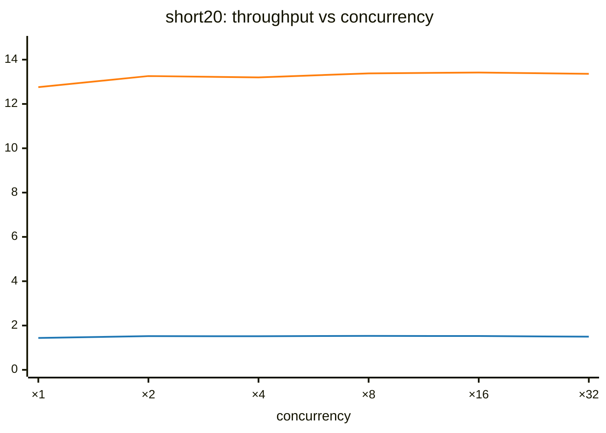
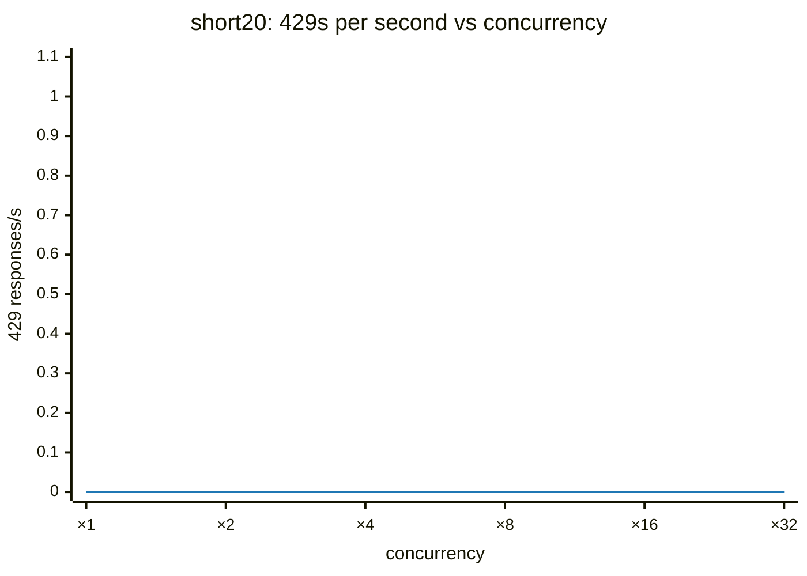

## meticulous — 2026-11-13 21:13 UTC

**PASS** · 1083 s · 883 requests · 0 (0.0%) errors · 0 rate-limited · 9,910,149 tokens billed

Sequential requests (one in flight) unless stated; every query carries a nonce so nothing is served from the API's prefix cache.

### Single document: latency vs length

| rung | Qwen tokens | billed | errors | p50 s | p90 s | max s | API tok/s |
|---|---|---|---|---|---|---|---|
| 256 | 229 | 324 | 0 (0.0%) | 0.053 | 0.055 | 0.088 | 5,896 |
| 512 | 457 | 551 | 0 (0.0%) | 0.068 | 0.070 | 0.071 | 8,047 |
| 1,024 | 911 | 1,005 | 0 (0.0%) | 0.123 | 0.125 | 0.126 | 8,166 |
| 2,048 | 1,872 | 1,966 | 0 (0.0%) | 0.249 | 0.252 | 0.255 | 7,883 |
| 4,096 | 3,707 | 3,801 | 0 (0.0%) | 0.533 | 0.541 | 0.542 | 7,139 |
| 8,192 | 7,545 | 7,640 | 0 (0.0%) | 1.217 | 1.221 | 1.222 | 6,287 |
| 16,384 | 15,274 | 15,368 | 0 (0.0%) | 3.121 | 3.126 | 3.130 | 4,924 |
| 32,768 | 25,438 | 25,536 | 0 (0.0%) | 6.715 | 6.725 | 6.770 | 3,804 |

*Single document: latency vs length: p50, p90*

*Single document: throughput vs length: API tokens/s ÷ 1000*

### ~30K tokens per request: latency vs document length (fewer, longer documents)

| rung | docs/request | billed | errors | p50 s | p90 s | max s | API tok/s |
|---|---|---|---|---|---|---|---|
| 256 | 100 | 32,386 | 0 (0.0%) | 1.929 | 1.942 | 1.947 | 16,804 |
| 512 | 55 | 30,293 | 0 (0.0%) | 1.788 | 1.912 | 2.013 | 16,704 |
| 1,024 | 28 | 28,183 | 0 (0.0%) | 1.879 | 2.079 | 2.135 | 14,952 |
| 2,048 | 13 | 25,572 | 0 (0.0%) | 1.933 | 2.166 | 2.309 | 13,519 |
| 4,096 | 6 | 22,805 | 0 (0.0%) | 2.171 | 2.397 | 2.552 | 10,748 |
| 8,192 | 3 | 22,923 | 0 (0.0%) | 2.669 | 3.083 | 3.385 | 8,896 |
| 16,384 | 1 | 15,367 | 0 (0.0%) | 3.123 | 3.130 | 3.132 | 4,918 |
| 32,768 | 1 | 25,540 | 0 (0.0%) | 6.718 | 6.724 | 6.781 | 3,804 |

*~30K tokens: latency vs document length: p50, p90*

### Latency vs number of documents

| documents | billed | errors | p50 s | p90 s | max s | MRR |
|---|---|---|---|---|---|---|
| 1 tiny | 90.7 | 0 (0.0%) | 0.029 | 0.029 | 0.032 | 1.000 |
| 10 tiny | 916 | 0 (0.0%) | 0.068 | 0.076 | 0.077 | 1.000 |
| 100 tiny | 9,299 | 0 (0.0%) | 0.401 | 0.410 | 0.411 | 1.000 |
| 1000 tiny | 93,889 | 0 (0.0%) | 2.306 | 3.870 | 3.878 | 1.000 |
| 1×256 | 324 | 0 (0.0%) | 0.053 | 0.053 | 0.054 | 1.000 |
| 10×256 | 3,231 | 0 (0.0%) | 0.241 | 0.264 | 0.290 | 1.000 |
| 50×256 | 16,145 | 0 (0.0%) | 0.985 | 1.061 | 1.084 | 1.000 |
| 100×256 | 32,299 | 0 (0.0%) | 1.929 | 1.941 | 1.950 | 0.950 |

*Latency vs number of documents: p50, p90*

### Cold vs cached: the same single-document request sent twice in a row

The API caches prompt prefixes, so a repeated (query, document) pair skips most of the compute. Cold = fresh nonce in the query; cached = the identical request again immediately after.

| rung | pairs | cold p50 s | cached p50 s | speed-up × | cold max s | cached max s | errors |
|---|---|---|---|---|---|---|---|
| 256 | 10 | 0.053 | 0.035 | 1.492 | 0.092 | 0.037 |  |
| 512 | 10 | 0.065 | 0.036 | 1.784 | 0.066 | 0.047 |  |
| 1,024 | 10 | 0.119 | 0.038 | 3.106 | 0.121 | 0.041 |  |
| 2,048 | 10 | 0.244 | 0.042 | 5.823 | 0.247 | 0.043 |  |
| 4,096 | 10 | 0.516 | 0.050 | 10.4 | 0.527 | 0.050 |  |
| 8,192 | 10 | 1.205 | 0.062 | 19.3 | 1.212 | 0.070 |  |
| 16,384 | 10 | 3.116 | 0.086 | 36.3 | 3.121 | 0.088 |  |
| 32,768 | 10 | 6.706 | 0.119 | 56.2 | 6.768 | 0.121 |  |

*Cold vs cached latency vs document length: cold p50, cached p50*

### short20: latency and throughput vs concurrency

|  | requests | errors | 429s | p50 s | p90 s | p99 s | max s | req/s | API tok/s | MRR |
|---|---|---|---|---|---|---|---|---|---|---|
| ×1 | 36 | 0 (0.0%) | 0 | 0.636 | 1.005 | 1.214 | 1.252 | 1.438 | 12,757 | 0.697 |
| ×2 | 39 | 0 (0.0%) | 0 | 1.225 | 1.712 | 2.029 | 2.214 | 1.520 | 13,263 | 0.700 |
| ×4 | 41 | 0 (0.0%) | 0 | 2.674 | 3.170 | 3.566 | 3.672 | 1.518 | 13,200 | 0.730 |
| ×8 | 45 | 0 (0.0%) | 0 | 5.141 | 6.105 | 6.399 | 6.604 | 1.530 | 13,380 | 0.714 |
| ×16 | 53 | 0 (0.0%) | 0 | 10.1 | 10.6 | 11.1 | 11.3 | 1.525 | 13,421 | 0.727 |
| ×32 | 69 | 0 (0.0%) | 0 | 20.3 | 21.3 | 21.6 | 21.6 | 1.496 | 13,365 | 0.676 |

No 429s up to concurrency ×32.

*short20: latency vs concurrency: p50, p90*

*short20: throughput vs concurrency: req/s, API tokens/s ÷ 1000*

*short20: 429s per second vs concurrency: 429/s*

883 requests, 9,910,149 tokens billed.
