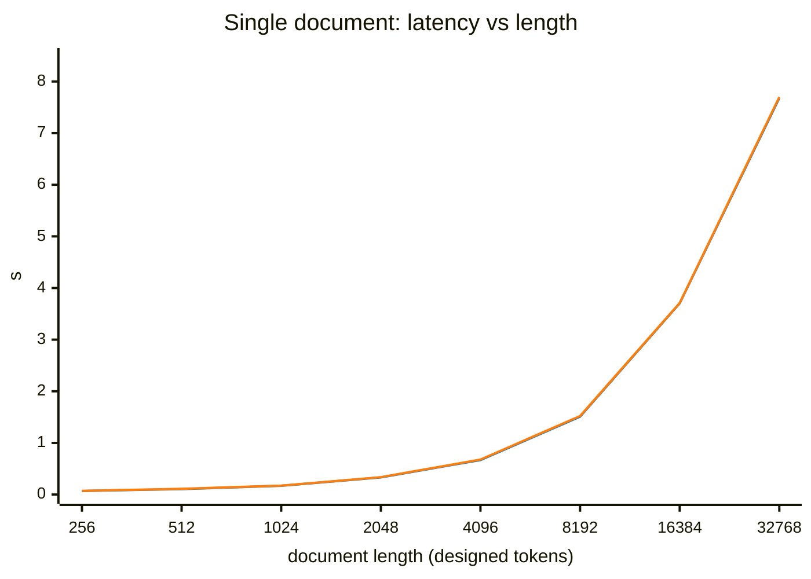
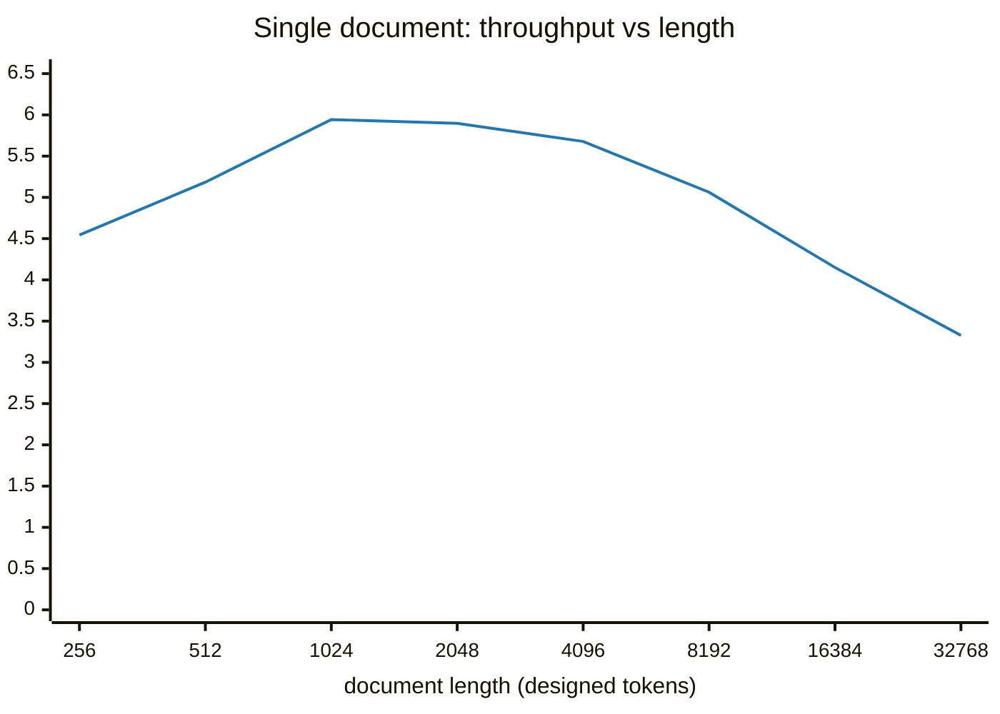
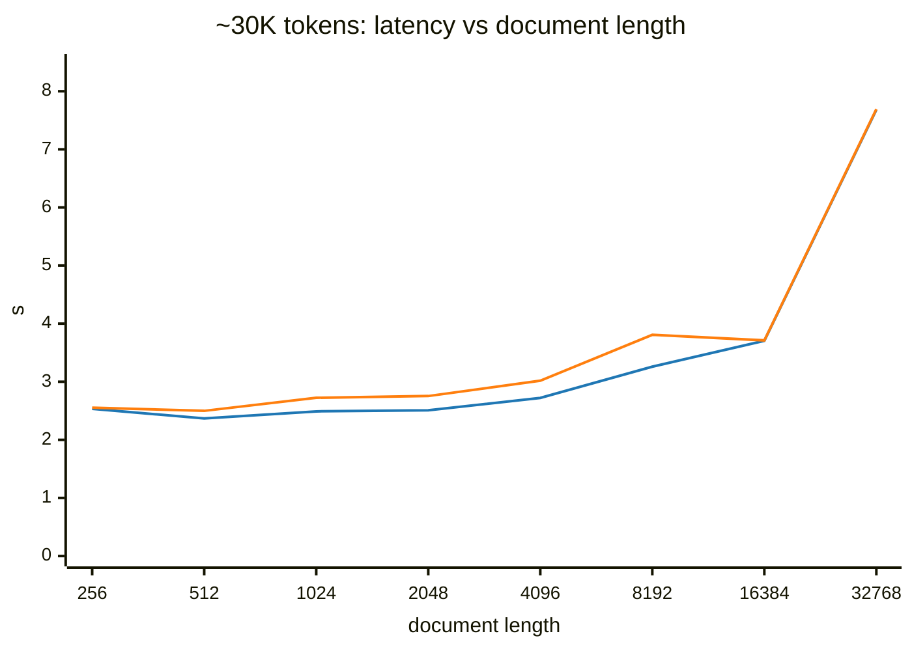
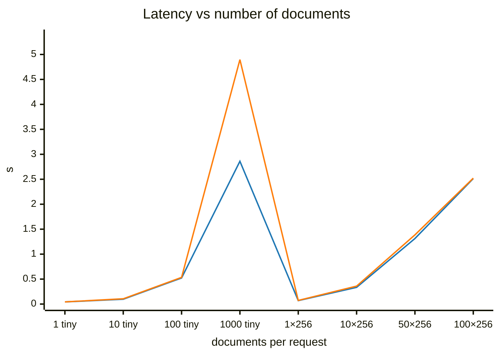
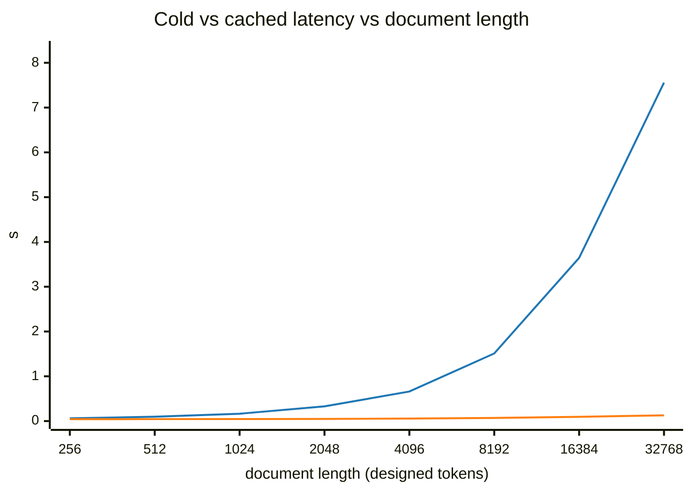
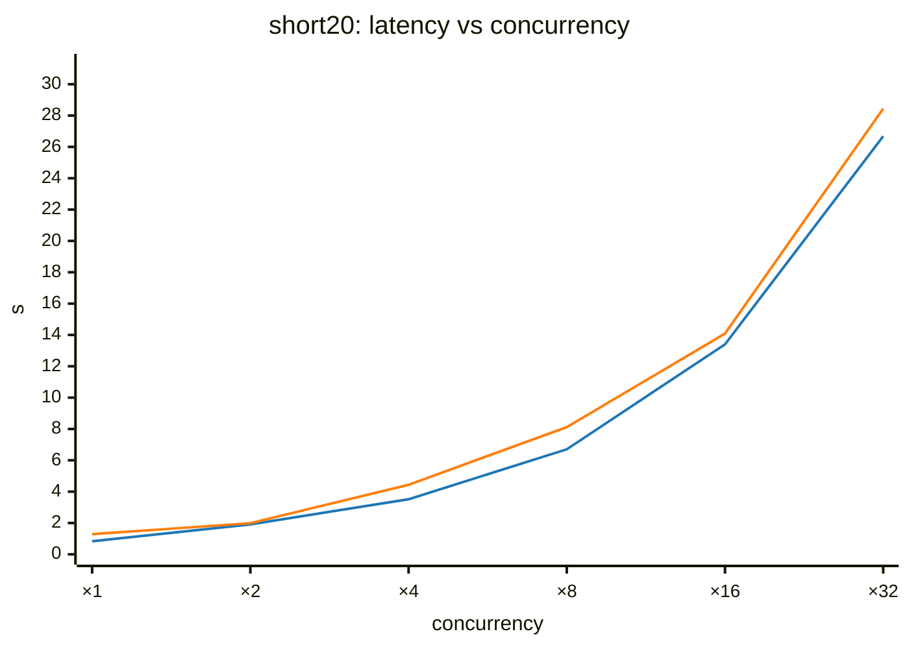
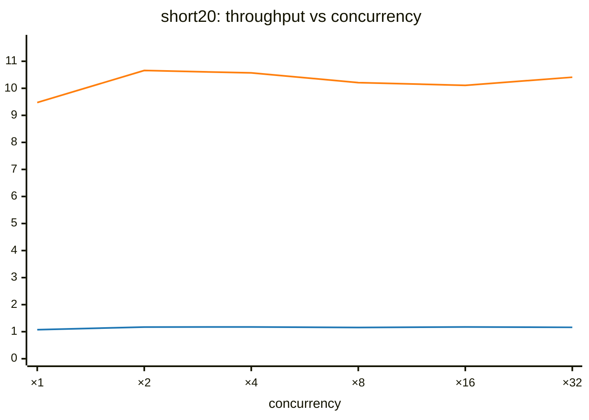
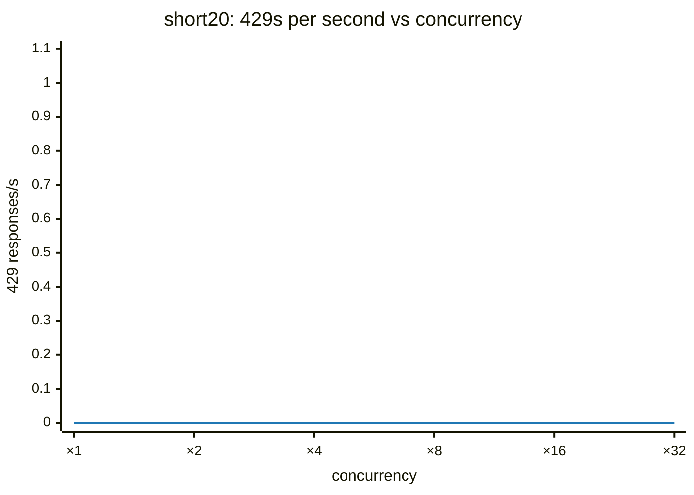

## meticulous — 2026-11-13 22:31 UTC

**PASS** · 1270 s · 832 requests · 1 (0.1%) errors · 0 rate-limited · 9,449,536 tokens billed

Sequential requests (one in flight) unless stated; every query carries a nonce so nothing is served from the API's prefix cache.

### Single document: latency vs length

| rung | Qwen tokens | billed | errors | p50 s | p90 s | max s | API tok/s |
|---|---|---|---|---|---|---|---|
| 256 | 229 | 323 | 0 (0.0%) | 0.070 | 0.072 | 0.102 | 4,544 |
| 512 | 457 | 551 | 0 (0.0%) | 0.105 | 0.110 | 0.115 | 5,184 |
| 1,024 | 911 | 1,005 | 0 (0.0%) | 0.169 | 0.172 | 0.172 | 5,943 |
| 2,048 | 1,872 | 1,966 | 0 (0.0%) | 0.333 | 0.337 | 0.338 | 5,897 |
| 4,096 | 3,707 | 3,800 | 0 (0.0%) | 0.668 | 0.677 | 0.680 | 5,678 |
| 8,192 | 7,545 | 7,640 | 0 (0.0%) | 1.508 | 1.521 | 1.531 | 5,062 |
| 16,384 | 15,274 | 15,368 | 0 (0.0%) | 3.703 | 3.710 | 3.712 | 4,150 |
| 32,768 | 25,438 | 25,536 | 0 (0.0%) | 7.678 | 7.700 | 7.726 | 3,327 |

*Single document: latency vs length: p50, p90*

*Single document: throughput vs length: API tokens/s ÷ 1000*

### ~30K tokens per request: latency vs document length (fewer, longer documents)

| rung | docs/request | billed | errors | p50 s | p90 s | max s | API tok/s |
|---|---|---|---|---|---|---|---|
| 256 | 100 | 32,413 | 1 (6.7%) | 2.533 | 2.553 | 2.570 | 12,799 |
| 512 | 55 | 30,264 | 0 (0.0%) | 2.368 | 2.499 | 2.680 | 12,683 |
| 1,024 | 28 | 28,178 | 0 (0.0%) | 2.490 | 2.724 | 2.789 | 11,378 |
| 2,048 | 13 | 25,570 | 0 (0.0%) | 2.509 | 2.754 | 2.924 | 10,517 |
| 4,096 | 6 | 22,808 | 0 (0.0%) | 2.722 | 3.018 | 3.219 | 8,529 |
| 8,192 | 3 | 22,921 | 0 (0.0%) | 3.259 | 3.807 | 4.181 | 7,246 |
| 16,384 | 1 | 15,366 | 0 (0.0%) | 3.705 | 3.712 | 3.731 | 4,146 |
| 32,768 | 1 | 25,541 | 0 (0.0%) | 7.680 | 7.693 | 7.730 | 3,327 |

*~30K tokens: latency vs document length: p50, p90*

### Latency vs number of documents

| documents | billed | errors | p50 s | p90 s | max s | MRR |
|---|---|---|---|---|---|---|
| 1 tiny | 91.3 | 0 (0.0%) | 0.043 | 0.044 | 0.045 | 1.000 |
| 10 tiny | 917 | 0 (0.0%) | 0.097 | 0.106 | 0.107 | 1.000 |
| 100 tiny | 9,289 | 0 (0.0%) | 0.523 | 0.534 | 0.535 | 1.000 |
| 1000 tiny | 94,189 | 0 (0.0%) | 2.860 | 4.896 | 4.920 | 1.000 |
| 1×256 | 323 | 0 (0.0%) | 0.070 | 0.073 | 0.074 | 1.000 |
| 10×256 | 3,230 | 0 (0.0%) | 0.334 | 0.360 | 0.382 | 1.000 |
| 50×256 | 16,125 | 0 (0.0%) | 1.313 | 1.386 | 1.404 | 1.000 |
| 100×256 | 32,379 | 0 (0.0%) | 2.513 | 2.522 | 2.531 | 0.950 |

*Latency vs number of documents: p50, p90*

### Cold vs cached: the same single-document request sent twice in a row

The API caches prompt prefixes, so a repeated (query, document) pair skips most of the compute. Cold = fresh nonce in the query; cached = the identical request again immediately after.

| rung | pairs | cold p50 s | cached p50 s | speed-up × | cold max s | cached max s | errors |
|---|---|---|---|---|---|---|---|
| 256 | 10 | 0.063 | 0.043 | 1.470 | 0.078 | 0.044 |  |
| 512 | 10 | 0.097 | 0.044 | 2.200 | 0.099 | 0.045 |  |
| 1,024 | 10 | 0.164 | 0.045 | 3.630 | 0.167 | 0.047 |  |
| 2,048 | 10 | 0.329 | 0.048 | 6.794 | 0.331 | 0.050 |  |
| 4,096 | 10 | 0.660 | 0.056 | 11.8 | 0.668 | 0.057 |  |
| 8,192 | 10 | 1.510 | 0.070 | 21.6 | 1.519 | 0.072 |  |
| 16,384 | 10 | 3.643 | 0.096 | 38.0 | 3.699 | 0.098 |  |
| 32,768 | 10 | 7.558 | 0.129 | 58.7 | 7.655 | 0.131 |  |

*Cold vs cached latency vs document length: cold p50, cached p50*

### short20: latency and throughput vs concurrency

|  | requests | errors | 429s | p50 s | p90 s | p99 s | max s | req/s | API tok/s | MRR |
|---|---|---|---|---|---|---|---|---|---|---|
| ×1 | 27 | 0 (0.0%) | 0 | 0.833 | 1.287 | 1.611 | 1.641 | 1.074 | 9,474 | 0.665 |
| ×2 | 31 | 0 (0.0%) | 0 | 1.909 | 1.988 | 2.564 | 2.564 | 1.172 | 10,661 | 0.670 |
| ×4 | 32 | 0 (0.0%) | 0 | 3.514 | 4.437 | 4.508 | 4.508 | 1.176 | 10,572 | 0.656 |
| ×8 | 37 | 0 (0.0%) | 0 | 6.703 | 8.118 | 8.328 | 8.330 | 1.155 | 10,212 | 0.701 |
| ×16 | 44 | 0 (0.0%) | 0 | 13.4 | 14.1 | 14.3 | 14.4 | 1.173 | 10,109 | 0.715 |
| ×32 | 61 | 0 (0.0%) | 0 | 26.7 | 28.4 | 29.1 | 29.1 | 1.161 | 10,410 | 0.672 |

No 429s up to concurrency ×32.

*short20: latency vs concurrency: p50, p90*

*short20: throughput vs concurrency: req/s, API tokens/s ÷ 1000*

*short20: 429s per second vs concurrency: 429/s*

| error | count | example | response |
|---|---|---|---|
| http 424 ModelError container 0 | 1 | ladder-256 ladder-256/ctx256_query50 | {"ErrorCode":"INTERNAL_FAILURE_FROM_MODEL","LogStreamArn":"arn:aws:logs:eu-west-3:<account-id>:log-group:/aws/sagemaker/Endpoints/reranker-aws031-4b-bf16-3","Message":"Received server error (0) from primary with message \"Connection reset by peer for the reranker-aws031-4b-bf16-3 endpoint. Please re |

832 requests, 9,449,536 tokens billed.
