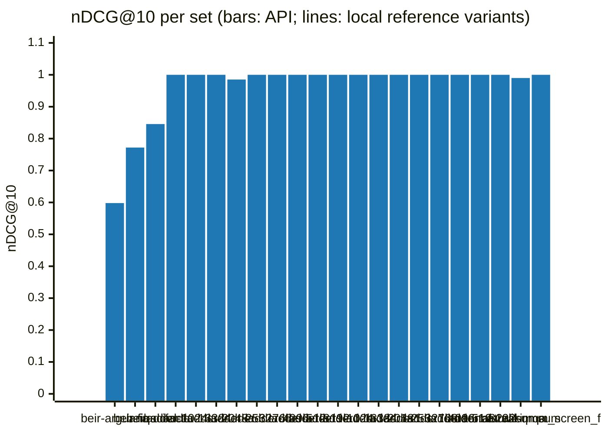

## quality — 2026-11-13 21:13 UTC

**PASS** · 4696 s · 2000 requests · 1 (0.1%) errors · 0 rate-limited · 29,449,422 tokens billed

Up to 300 requests per set (100 for natural-*) at 2 in flight (429s retried); 2000 requests, 29,449,422 tokens billed. nDCG@10 / MRR are against the ground-truth labels; every reference column is computed over the same requests. Local reference variants of Qwen3-Reranker-0.6B (scripts/reference.py): **none available here** — run scripts/reference.py on a GPU. |Δ| is the mean absolute score difference per document; top-1 is the share of requests where the API and the reference pick the same best document.

| set | requests | errors | 429s | nDCG@10 API | MRR API | p50 s |
|---|---|---|---|---|---|---|
| beir-arguana | 300 | 0 (0.0%) | 0 | 0.598 | 0.461 | 1.505 |
| beir-fiqa | 300 | 0 (0.0%) | 0 | 0.772 | 0.790 | 1.307 |
| beir-scifact | 300 | 0 (0.0%) | 0 | 0.846 | 0.810 | 2.260 |
| ladder-1024 | 50 | 0 (0.0%) | 0 | 1.000 | 1.000 | 4.665 |
| ladder-16384 | 50 | 0 (0.0%) | 0 | 1.000 | 1.000 | 7.357 |
| ladder-2048 | 50 | 0 (0.0%) | 0 | 1.000 | 1.000 | 4.874 |
| ladder-256 | 50 | 0 (0.0%) | 0 | 0.985 | 0.980 | 4.820 |
| ladder-32768 | 50 | 0 (0.0%) | 0 | 1.000 | 1.000 | 15.2 |
| ladder-4096 | 50 | 0 (0.0%) | 0 | 1.000 | 1.000 | 5.165 |
| ladder-512 | 50 | 0 (0.0%) | 0 | 1.000 | 1.000 | 4.555 |
| ladder-8192 | 50 | 0 (0.0%) | 0 | 1.000 | 1.000 | 6.322 |
| ladder1-1024 | 50 | 0 (0.0%) | 0 | 1.000 | 1.000 | 0.336 |
| ladder1-16384 | 50 | 0 (0.0%) | 0 | 1.000 | 1.000 | 7.353 |
| ladder1-2048 | 50 | 0 (0.0%) | 0 | 1.000 | 1.000 | 0.650 |
| ladder1-256 | 50 | 0 (0.0%) | 0 | 1.000 | 1.000 | 0.105 |
| ladder1-32768 | 50 | 0 (0.0%) | 0 | 1.000 | 1.000 | 15.2 |
| ladder1-4096 | 50 | 0 (0.0%) | 0 | 1.000 | 1.000 | 1.423 |
| ladder1-512 | 50 | 0 (0.0%) | 0 | 1.000 | 1.000 | 0.205 |
| ladder1-8192 | 50 | 0 (0.0%) | 0 | 1.000 | 1.000 | 2.845 |
| natural-2wikimqa | 100 | 1 (1.0%) | 0 | 1.000 | 1.000 | 12.3 |
| natural-qmsum | 100 | 0 (0.0%) | 0 | 0.990 | 0.987 | 12.8 |
| natural-summ_screen_fd | 100 | 0 (0.0%) | 0 | 1.000 | 1.000 | 12.7 |

| error | count | example | response |
|---|---|---|---|
| http 424 ModelError container 0 | 1 | natural-2wikimqa natural-2wikimqa/query_72 | {"ErrorCode":"INTERNAL_FAILURE_FROM_MODEL","LogStreamArn":"arn:aws:logs:eu-west-3:<account-id>:log-group:/aws/sagemaker/Endpoints/reranker-aws031-4b-bf16-3","Message":"Received server error (0) from primary with message \"Amazon SageMaker could not get a response from the reranker-aws031-4b-bf16-3 e |

*nDCG@10 per set (bars: API; lines: local reference variants): API*
