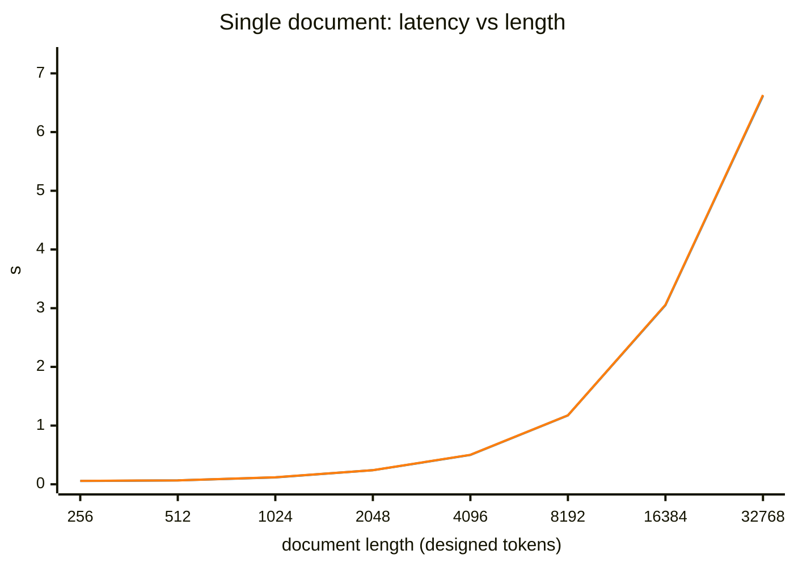
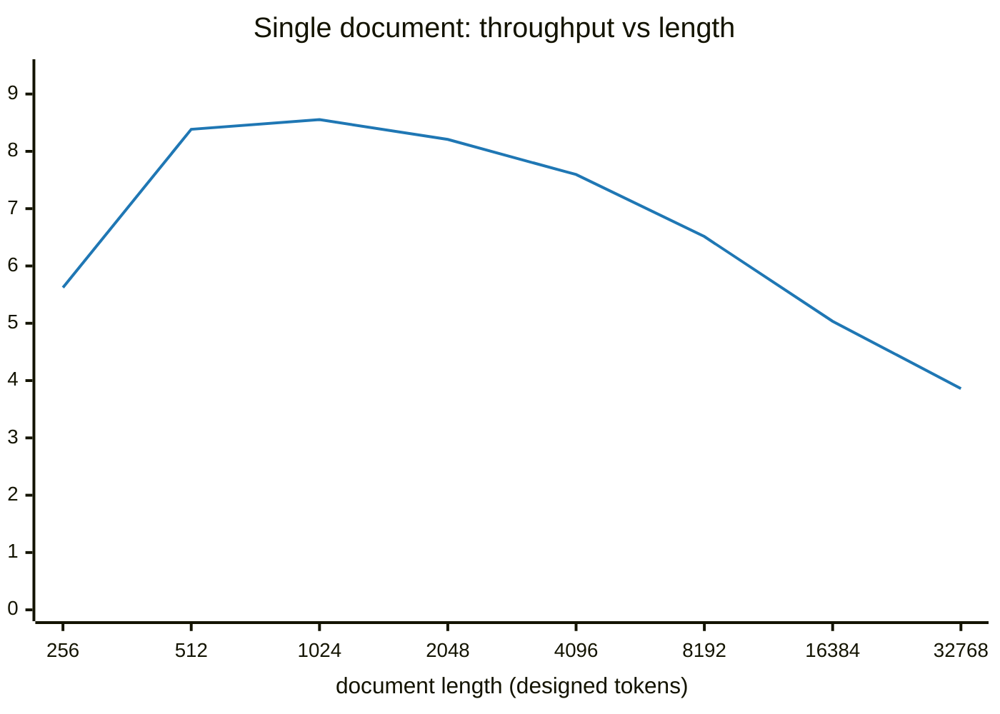
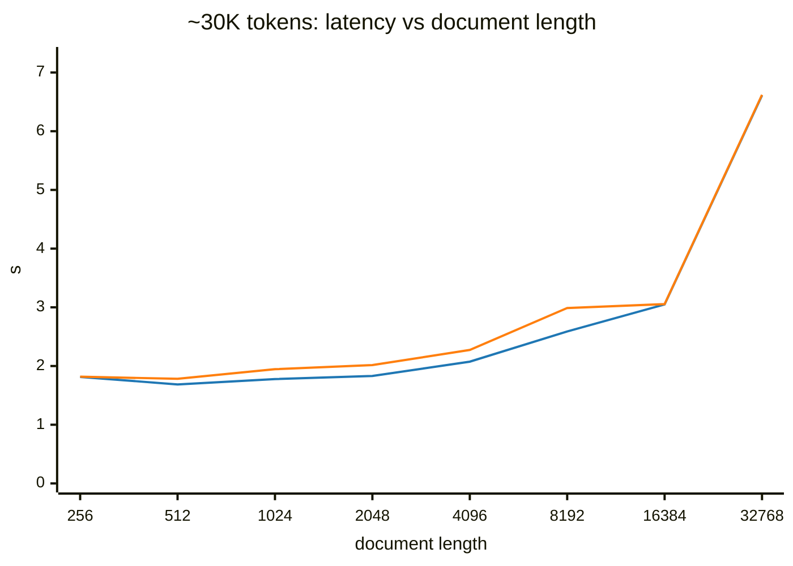
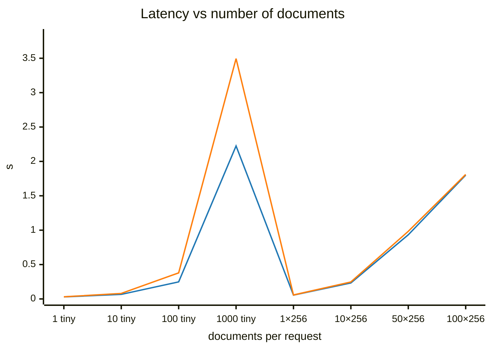
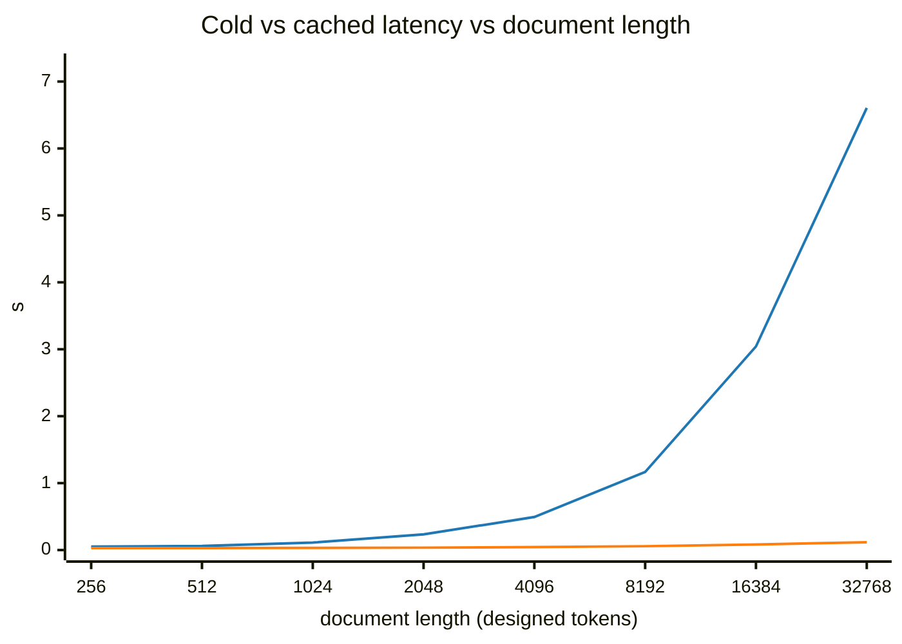
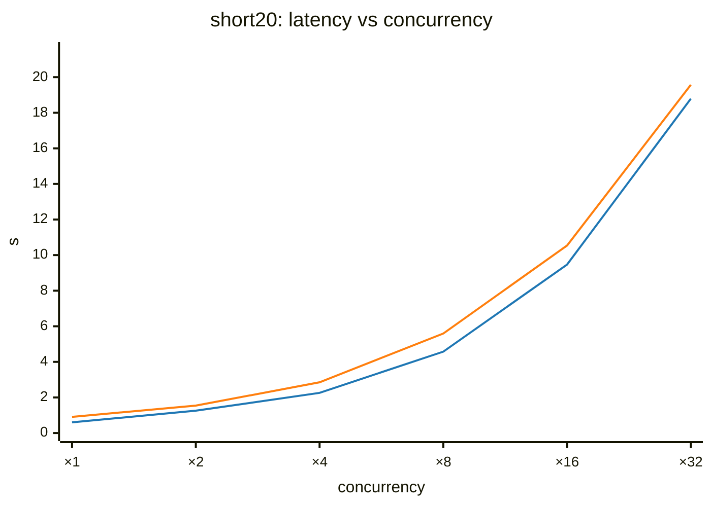
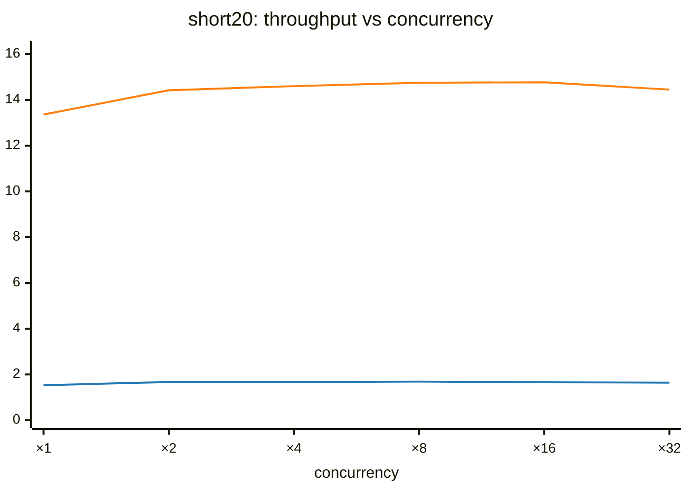
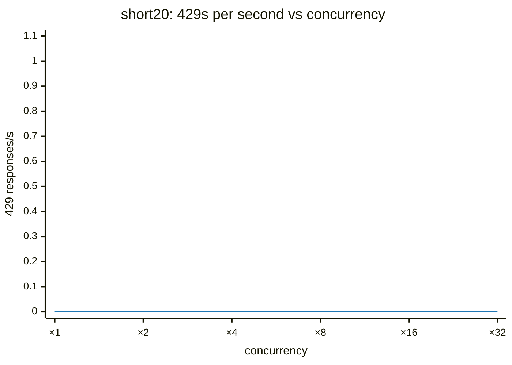

## meticulous — 2026-11-15 11:25 UTC

**PASS** · 1052 s · 906 requests · 0 (0.0%) errors · 0 rate-limited · 10,101,338 tokens billed

Sequential requests (one in flight) unless stated; every query carries a nonce so nothing is served from the API's prefix cache.

### Single document: latency vs length

| rung | Qwen tokens | billed | errors | p50 s | p90 s | max s | API tok/s |
|---|---|---|---|---|---|---|---|
| 256 | 229 | 323 | 0 (0.0%) | 0.056 | 0.058 | 0.090 | 5,622 |
| 512 | 457 | 551 | 0 (0.0%) | 0.065 | 0.067 | 0.067 | 8,385 |
| 1,024 | 911 | 1,005 | 0 (0.0%) | 0.118 | 0.119 | 0.119 | 8,554 |
| 2,048 | 1,872 | 1,966 | 0 (0.0%) | 0.239 | 0.241 | 0.243 | 8,208 |
| 4,096 | 3,707 | 3,800 | 0 (0.0%) | 0.500 | 0.503 | 0.505 | 7,595 |
| 8,192 | 7,545 | 7,640 | 0 (0.0%) | 1.173 | 1.175 | 1.177 | 6,513 |
| 16,384 | 15,274 | 15,369 | 0 (0.0%) | 3.052 | 3.058 | 3.061 | 5,035 |
| 32,768 | 25,438 | 25,536 | 0 (0.0%) | 6.619 | 6.632 | 6.673 | 3,860 |

*Single document: latency vs length: p50, p90*

*Single document: throughput vs length: API tokens/s ÷ 1000*

### ~30K tokens per request: latency vs document length (fewer, longer documents)

| rung | docs/request | billed | errors | p50 s | p90 s | max s | API tok/s |
|---|---|---|---|---|---|---|---|
| 256 | 100 | 32,419 | 0 (0.0%) | 1.814 | 1.819 | 1.824 | 17,901 |
| 512 | 55 | 30,297 | 0 (0.0%) | 1.687 | 1.782 | 1.876 | 17,836 |
| 1,024 | 28 | 28,181 | 0 (0.0%) | 1.778 | 1.946 | 2.002 | 15,886 |
| 2,048 | 13 | 25,570 | 0 (0.0%) | 1.830 | 2.016 | 2.172 | 14,318 |
| 4,096 | 6 | 22,807 | 0 (0.0%) | 2.074 | 2.274 | 2.418 | 11,298 |
| 8,192 | 3 | 22,921 | 0 (0.0%) | 2.589 | 2.988 | 3.277 | 9,161 |
| 16,384 | 1 | 15,367 | 0 (0.0%) | 3.050 | 3.055 | 3.058 | 5,037 |
| 32,768 | 1 | 25,541 | 0 (0.0%) | 6.609 | 6.620 | 6.671 | 3,865 |

*~30K tokens: latency vs document length: p50, p90*

### Latency vs number of documents

| documents | billed | errors | p50 s | p90 s | max s | MRR |
|---|---|---|---|---|---|---|
| 1 tiny | 91.3 | 0 (0.0%) | 0.030 | 0.031 | 0.032 | 1.000 |
| 10 tiny | 921 | 0 (0.0%) | 0.066 | 0.080 | 0.081 | 1.000 |
| 100 tiny | 9,329 | 0 (0.0%) | 0.248 | 0.379 | 0.382 | 1.000 |
| 1000 tiny | 93,889 | 0 (0.0%) | 2.225 | 3.495 | 3.510 | 1.000 |
| 1×256 | 323 | 0 (0.0%) | 0.055 | 0.058 | 0.059 | 1.000 |
| 10×256 | 3,234 | 0 (0.0%) | 0.233 | 0.247 | 0.267 | 1.000 |
| 50×256 | 16,160 | 0 (0.0%) | 0.933 | 0.983 | 1.018 | 1.000 |
| 100×256 | 32,319 | 0 (0.0%) | 1.800 | 1.810 | 1.816 | 0.950 |

*Latency vs number of documents: p50, p90*

### Cold vs cached: the same single-document request sent twice in a row

The API caches prompt prefixes, so a repeated (query, document) pair skips most of the compute. Cold = fresh nonce in the query; cached = the identical request again immediately after.

| rung | pairs | cold p50 s | cached p50 s | speed-up × | cold max s | cached max s | errors |
|---|---|---|---|---|---|---|---|
| 256 | 10 | 0.052 | 0.030 | 1.736 | 0.069 | 0.030 |  |
| 512 | 10 | 0.060 | 0.031 | 1.952 | 0.062 | 0.032 |  |
| 1,024 | 10 | 0.112 | 0.032 | 3.451 | 0.113 | 0.034 |  |
| 2,048 | 10 | 0.234 | 0.036 | 6.502 | 0.238 | 0.037 |  |
| 4,096 | 10 | 0.494 | 0.044 | 11.2 | 0.495 | 0.048 |  |
| 8,192 | 10 | 1.167 | 0.058 | 20.3 | 1.169 | 0.059 |  |
| 16,384 | 10 | 3.042 | 0.083 | 36.6 | 3.049 | 0.084 |  |
| 32,768 | 10 | 6.606 | 0.117 | 56.6 | 6.659 | 0.118 |  |

*Cold vs cached latency vs document length: cold p50, cached p50*

### short20: latency and throughput vs concurrency

|  | requests | errors | 429s | p50 s | p90 s | p99 s | max s | req/s | API tok/s | MRR |
|---|---|---|---|---|---|---|---|---|---|---|
| ×1 | 39 | 0 (0.0%) | 0 | 0.600 | 0.910 | 1.135 | 1.177 | 1.531 | 13,361 | 0.717 |
| ×2 | 43 | 0 (0.0%) | 0 | 1.255 | 1.541 | 1.807 | 1.810 | 1.671 | 14,422 | 0.706 |
| ×4 | 45 | 0 (0.0%) | 0 | 2.258 | 2.851 | 3.153 | 3.156 | 1.670 | 14,604 | 0.711 |
| ×8 | 49 | 0 (0.0%) | 0 | 4.575 | 5.595 | 5.835 | 5.836 | 1.688 | 14,750 | 0.710 |
| ×16 | 57 | 0 (0.0%) | 0 | 9.469 | 10.5 | 10.8 | 10.8 | 1.658 | 14,766 | 0.700 |
| ×32 | 73 | 0 (0.0%) | 0 | 18.8 | 19.6 | 19.8 | 19.8 | 1.644 | 14,450 | 0.682 |

No 429s up to concurrency ×32.

*short20: latency vs concurrency: p50, p90*

*short20: throughput vs concurrency: req/s, API tokens/s ÷ 1000*

*short20: 429s per second vs concurrency: 429/s*

906 requests, 10,101,338 tokens billed.
