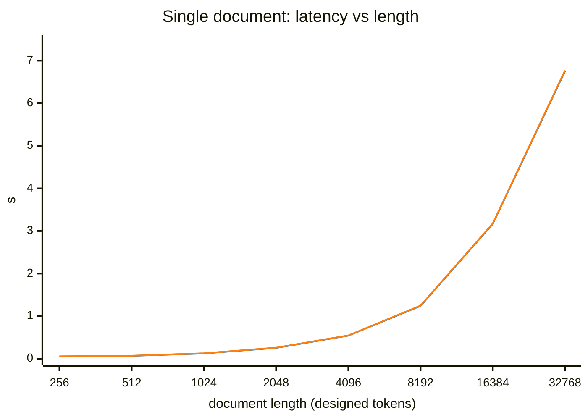
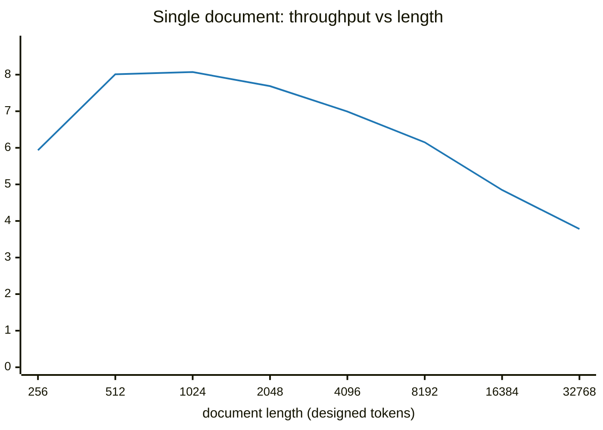
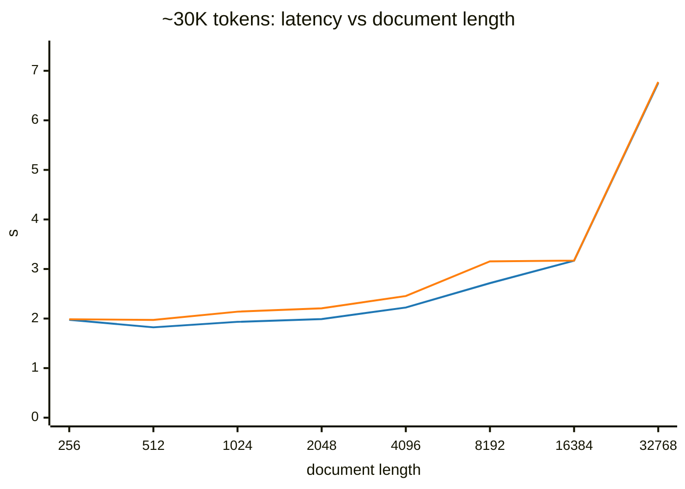
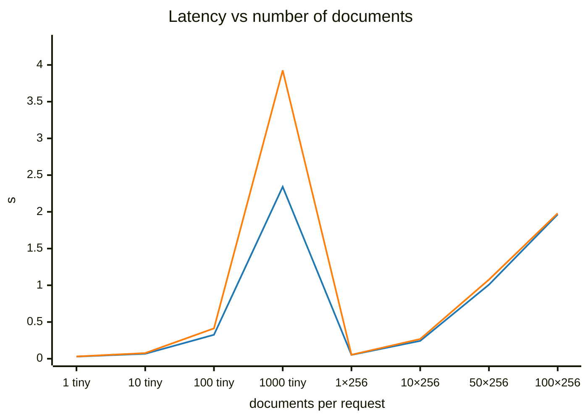
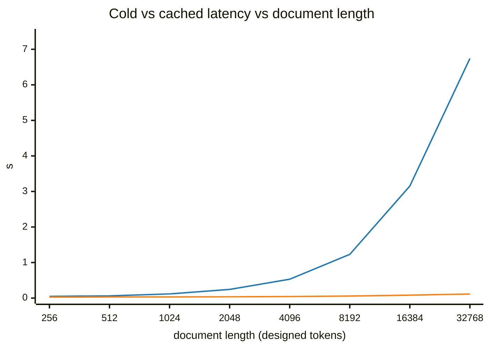
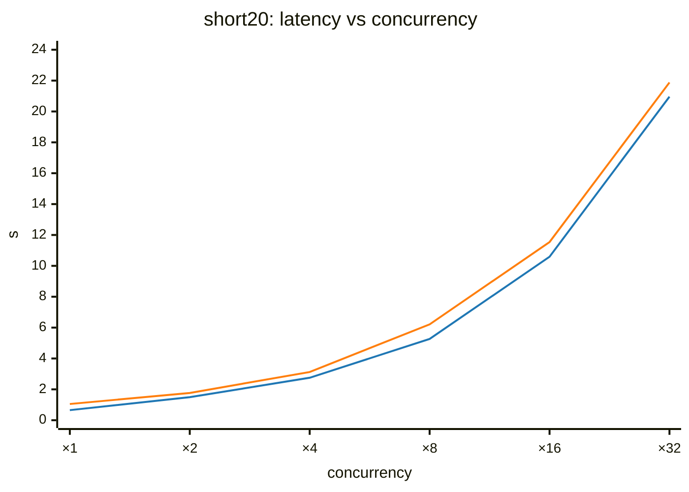
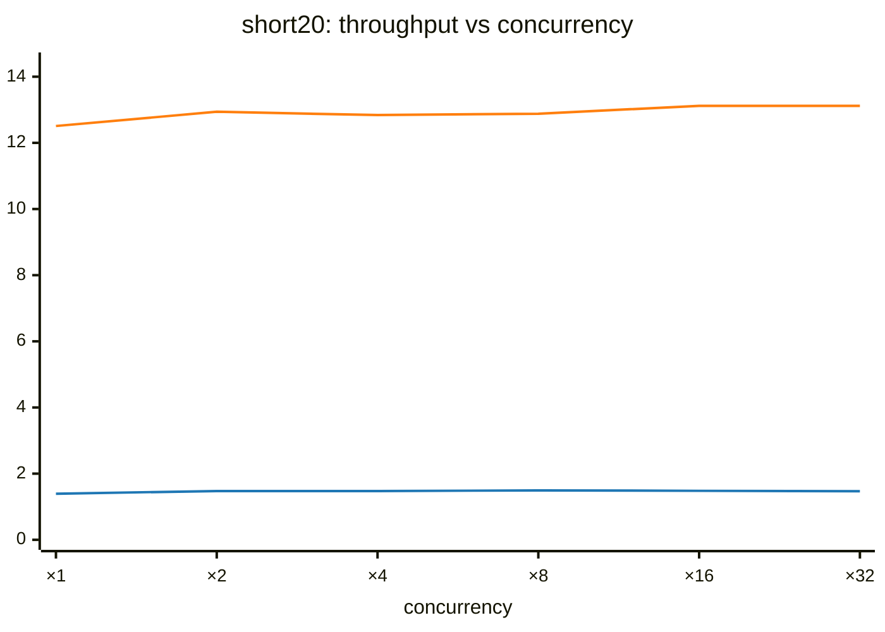
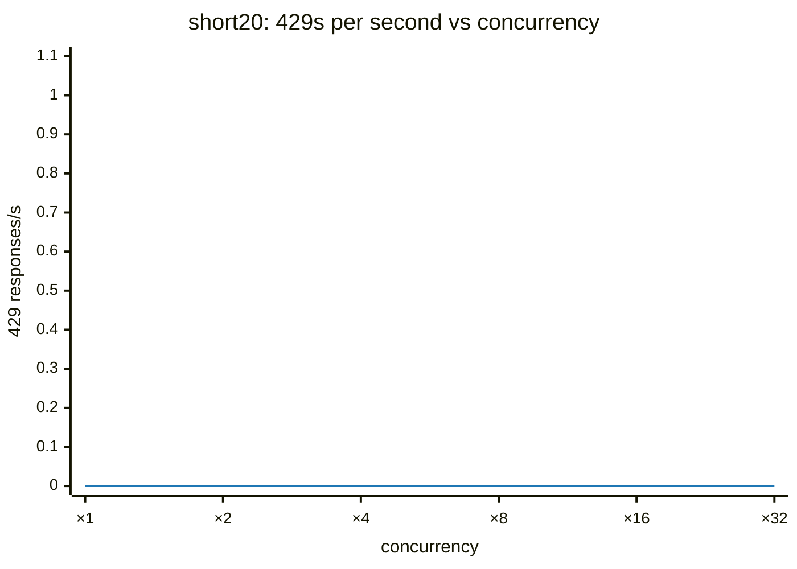

## meticulous — 2026-11-15 11:30 UTC

**PASS** · 1093 s · 877 requests · 0 (0.0%) errors · 0 rate-limited · 9,859,542 tokens billed

Sequential requests (one in flight) unless stated; every query carries a nonce so nothing is served from the API's prefix cache.

### Single document: latency vs length

| rung | Qwen tokens | billed | errors | p50 s | p90 s | max s | API tok/s |
|---|---|---|---|---|---|---|---|
| 256 | 229 | 323 | 0 (0.0%) | 0.053 | 0.055 | 0.090 | 5,933 |
| 512 | 457 | 551 | 0 (0.0%) | 0.068 | 0.071 | 0.072 | 8,011 |
| 1,024 | 911 | 1,005 | 0 (0.0%) | 0.124 | 0.127 | 0.128 | 8,072 |
| 2,048 | 1,872 | 1,966 | 0 (0.0%) | 0.255 | 0.259 | 0.263 | 7,687 |
| 4,096 | 3,707 | 3,801 | 0 (0.0%) | 0.544 | 0.546 | 0.547 | 6,992 |
| 8,192 | 7,545 | 7,639 | 0 (0.0%) | 1.240 | 1.248 | 1.253 | 6,151 |
| 16,384 | 15,274 | 15,368 | 0 (0.0%) | 3.168 | 3.176 | 3.195 | 4,847 |
| 32,768 | 25,438 | 25,536 | 0 (0.0%) | 6.755 | 6.772 | 6.818 | 3,781 |

*Single document: latency vs length: p50, p90*

*Single document: throughput vs length: API tokens/s ÷ 1000*

### ~30K tokens per request: latency vs document length (fewer, longer documents)

| rung | docs/request | billed | errors | p50 s | p90 s | max s | API tok/s |
|---|---|---|---|---|---|---|---|
| 256 | 100 | 32,312 | 0 (0.0%) | 1.975 | 1.986 | 1.990 | 16,363 |
| 512 | 55 | 30,260 | 0 (0.0%) | 1.823 | 1.973 | 2.068 | 16,332 |
| 1,024 | 28 | 28,174 | 0 (0.0%) | 1.934 | 2.139 | 2.192 | 14,513 |
| 2,048 | 13 | 25,572 | 0 (0.0%) | 1.989 | 2.207 | 2.367 | 13,192 |
| 4,096 | 6 | 22,805 | 0 (0.0%) | 2.223 | 2.454 | 2.611 | 10,509 |
| 8,192 | 3 | 22,923 | 0 (0.0%) | 2.715 | 3.155 | 3.500 | 8,692 |
| 16,384 | 1 | 15,367 | 0 (0.0%) | 3.167 | 3.170 | 3.191 | 4,852 |
| 32,768 | 1 | 25,540 | 0 (0.0%) | 6.754 | 6.775 | 6.808 | 3,783 |

*~30K tokens: latency vs document length: p50, p90*

### Latency vs number of documents

| documents | billed | errors | p50 s | p90 s | max s | MRR |
|---|---|---|---|---|---|---|
| 1 tiny | 91.5 | 0 (0.0%) | 0.029 | 0.030 | 0.032 | 1.000 |
| 10 tiny | 920 | 0 (0.0%) | 0.068 | 0.077 | 0.078 | 1.000 |
| 100 tiny | 9,329 | 0 (0.0%) | 0.326 | 0.413 | 0.414 | 1.000 |
| 1000 tiny | 93,889 | 0 (0.0%) | 2.341 | 3.927 | 3.937 | 1.000 |
| 1×256 | 322 | 0 (0.0%) | 0.052 | 0.054 | 0.054 | 1.000 |
| 10×256 | 3,233 | 0 (0.0%) | 0.242 | 0.268 | 0.294 | 1.000 |
| 50×256 | 16,140 | 0 (0.0%) | 1.008 | 1.077 | 1.105 | 1.000 |
| 100×256 | 32,389 | 0 (0.0%) | 1.965 | 1.980 | 1.983 | 0.950 |

*Latency vs number of documents: p50, p90*

### Cold vs cached: the same single-document request sent twice in a row

The API caches prompt prefixes, so a repeated (query, document) pair skips most of the compute. Cold = fresh nonce in the query; cached = the identical request again immediately after.

| rung | pairs | cold p50 s | cached p50 s | speed-up × | cold max s | cached max s | errors |
|---|---|---|---|---|---|---|---|
| 256 | 10 | 0.049 | 0.031 | 1.613 | 0.050 | 0.032 |  |
| 512 | 10 | 0.062 | 0.032 | 1.932 | 0.063 | 0.050 |  |
| 1,024 | 10 | 0.118 | 0.034 | 3.481 | 0.121 | 0.035 |  |
| 2,048 | 10 | 0.244 | 0.037 | 6.588 | 0.249 | 0.040 |  |
| 4,096 | 10 | 0.531 | 0.044 | 12.1 | 0.539 | 0.045 |  |
| 8,192 | 10 | 1.230 | 0.058 | 21.1 | 1.240 | 0.059 |  |
| 16,384 | 10 | 3.152 | 0.083 | 38.0 | 3.157 | 0.084 |  |
| 32,768 | 10 | 6.741 | 0.115 | 58.6 | 6.795 | 0.116 |  |

*Cold vs cached latency vs document length: cold p50, cached p50*

### short20: latency and throughput vs concurrency

|  | requests | errors | 429s | p50 s | p90 s | p99 s | max s | req/s | API tok/s | MRR |
|---|---|---|---|---|---|---|---|---|---|---|
| ×1 | 35 | 0 (0.0%) | 0 | 0.653 | 1.051 | 1.248 | 1.286 | 1.394 | 12,510 | 0.685 |
| ×2 | 38 | 0 (0.0%) | 0 | 1.494 | 1.765 | 2.026 | 2.030 | 1.475 | 12,936 | 0.709 |
| ×4 | 40 | 0 (0.0%) | 0 | 2.751 | 3.124 | 3.529 | 3.532 | 1.474 | 12,838 | 0.736 |
| ×8 | 44 | 0 (0.0%) | 0 | 5.265 | 6.208 | 6.526 | 6.530 | 1.493 | 12,876 | 0.730 |
| ×16 | 52 | 0 (0.0%) | 0 | 10.6 | 11.5 | 11.8 | 11.8 | 1.481 | 13,117 | 0.716 |
| ×32 | 68 | 0 (0.0%) | 0 | 21.0 | 21.9 | 22.7 | 22.7 | 1.470 | 13,117 | 0.680 |

No 429s up to concurrency ×32.

*short20: latency vs concurrency: p50, p90*

*short20: throughput vs concurrency: req/s, API tokens/s ÷ 1000*

*short20: 429s per second vs concurrency: 429/s*

877 requests, 9,859,542 tokens billed.
