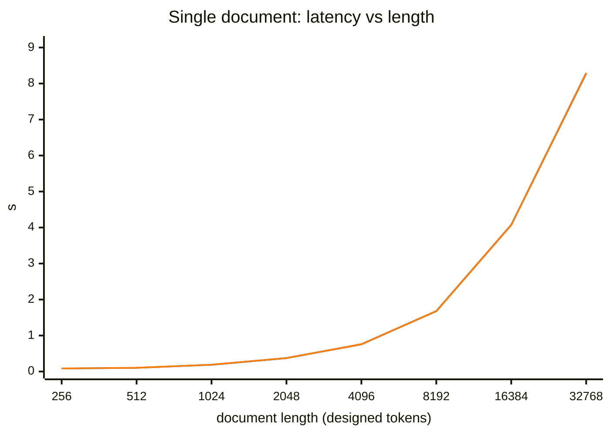
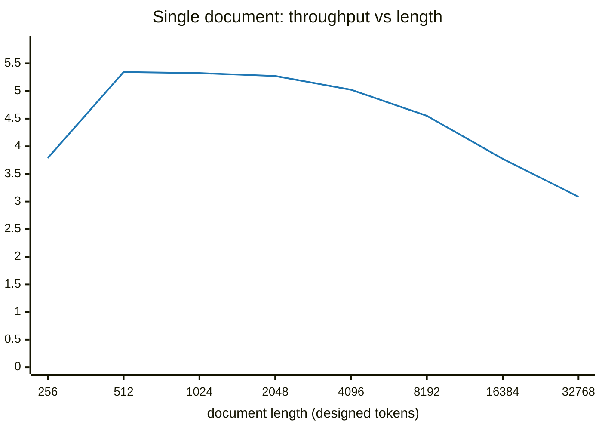
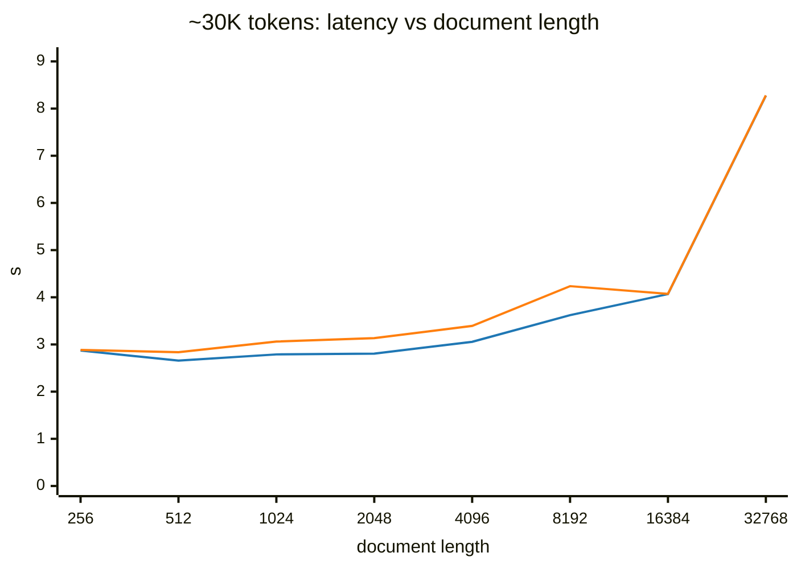
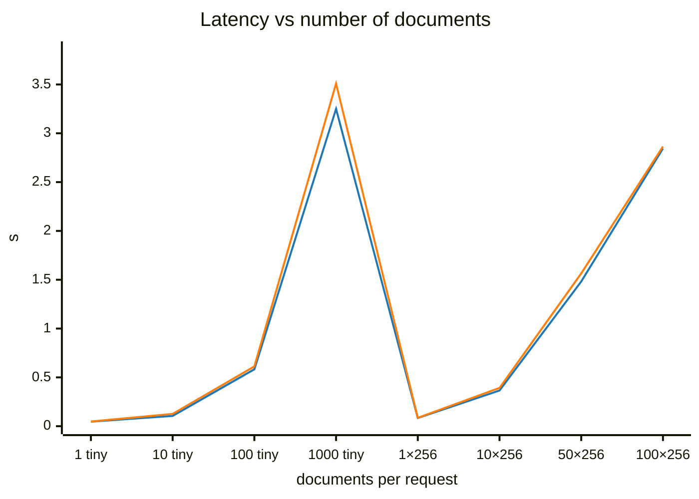
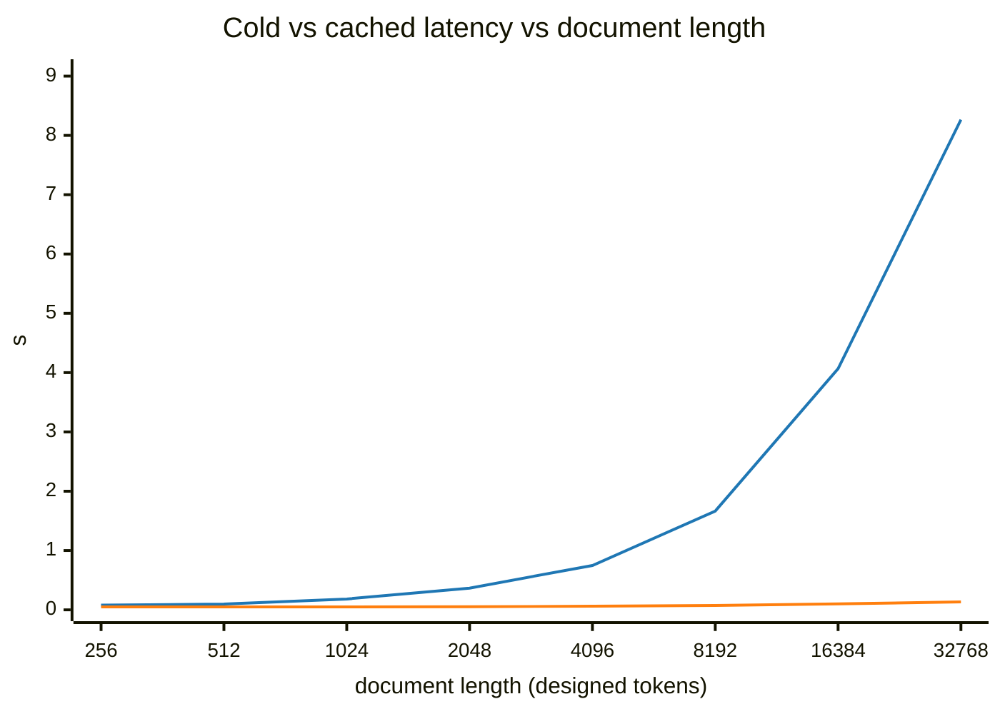
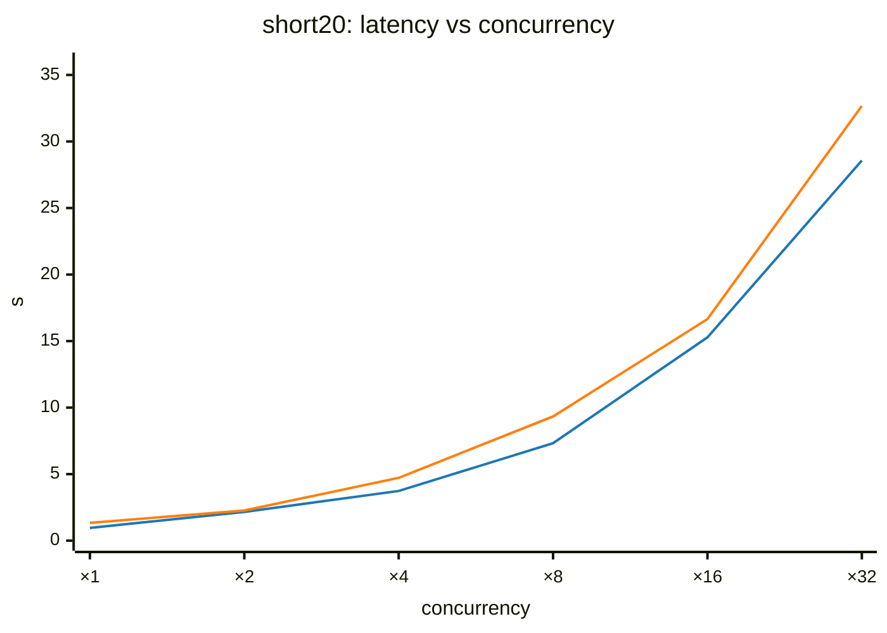
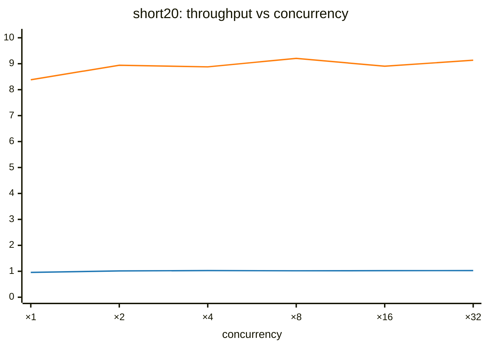
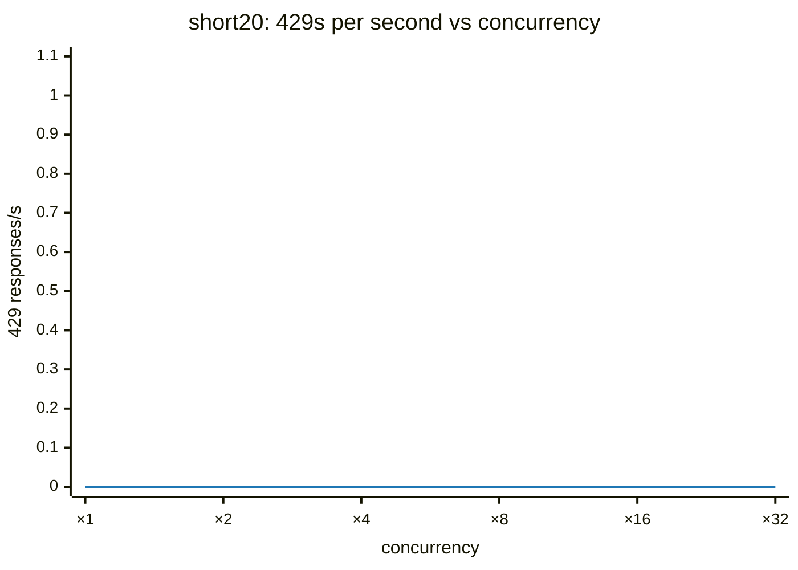

## meticulous — 2026-11-15 13:29 UTC

**PASS** · 1386 s · 812 requests · 0 (0.0%) errors · 0 rate-limited · 9,289,491 tokens billed

Sequential requests (one in flight) unless stated; every query carries a nonce so nothing is served from the API's prefix cache.

### Single document: latency vs length

| rung | Qwen tokens | billed | errors | p50 s | p90 s | max s | API tok/s |
|---|---|---|---|---|---|---|---|
| 256 | 229 | 324 | 0 (0.0%) | 0.084 | 0.086 | 0.113 | 3,788 |
| 512 | 457 | 551 | 0 (0.0%) | 0.103 | 0.104 | 0.106 | 5,344 |
| 1,024 | 911 | 1,005 | 0 (0.0%) | 0.188 | 0.190 | 0.191 | 5,324 |
| 2,048 | 1,872 | 1,966 | 0 (0.0%) | 0.372 | 0.375 | 0.378 | 5,272 |
| 4,096 | 3,707 | 3,801 | 0 (0.0%) | 0.757 | 0.760 | 0.761 | 5,023 |
| 8,192 | 7,545 | 7,639 | 0 (0.0%) | 1.678 | 1.681 | 1.682 | 4,551 |
| 16,384 | 15,274 | 15,368 | 0 (0.0%) | 4.073 | 4.078 | 4.079 | 3,773 |
| 32,768 | 25,438 | 25,536 | 0 (0.0%) | 8.276 | 8.296 | 8.339 | 3,086 |

*Single document: latency vs length: p50, p90*

*Single document: throughput vs length: API tokens/s ÷ 1000*

### ~30K tokens per request: latency vs document length (fewer, longer documents)

| rung | docs/request | billed | errors | p50 s | p90 s | max s | API tok/s |
|---|---|---|---|---|---|---|---|
| 256 | 100 | 32,359 | 0 (0.0%) | 2.872 | 2.884 | 2.901 | 11,282 |
| 512 | 55 | 30,256 | 0 (0.0%) | 2.658 | 2.836 | 2.986 | 11,278 |
| 1,024 | 28 | 28,179 | 0 (0.0%) | 2.789 | 3.061 | 3.151 | 10,109 |
| 2,048 | 13 | 25,575 | 0 (0.0%) | 2.805 | 3.135 | 3.340 | 9,326 |
| 4,096 | 6 | 22,806 | 0 (0.0%) | 3.056 | 3.393 | 3.618 | 7,598 |
| 8,192 | 3 | 22,923 | 0 (0.0%) | 3.621 | 4.236 | 4.655 | 6,502 |
| 16,384 | 1 | 15,367 | 0 (0.0%) | 4.068 | 4.072 | 4.076 | 3,776 |
| 32,768 | 1 | 25,540 | 0 (0.0%) | 8.273 | 8.281 | 8.335 | 3,088 |

*~30K tokens: latency vs document length: p50, p90*

### Latency vs number of documents

| documents | billed | errors | p50 s | p90 s | max s | MRR |
|---|---|---|---|---|---|---|
| 1 tiny | 91.0 | 0 (0.0%) | 0.046 | 0.048 | 0.050 | 1.000 |
| 10 tiny | 916 | 0 (0.0%) | 0.106 | 0.126 | 0.126 | 1.000 |
| 100 tiny | 9,309 | 0 (0.0%) | 0.583 | 0.612 | 0.616 | 1.000 |
| 1000 tiny | 94,189 | 0 (0.0%) | 3.250 | 3.509 | 5.554 | 1.000 |
| 1×256 | 323 | 0 (0.0%) | 0.084 | 0.086 | 0.086 | 1.000 |
| 10×256 | 3,231 | 0 (0.0%) | 0.365 | 0.392 | 0.428 | 1.000 |
| 50×256 | 16,160 | 0 (0.0%) | 1.482 | 1.565 | 1.610 | 1.000 |
| 100×256 | 32,349 | 0 (0.0%) | 2.845 | 2.865 | 2.868 | 1.000 |

*Latency vs number of documents: p50, p90*

### Cold vs cached: the same single-document request sent twice in a row

The API caches prompt prefixes, so a repeated (query, document) pair skips most of the compute. Cold = fresh nonce in the query; cached = the identical request again immediately after.

| rung | pairs | cold p50 s | cached p50 s | speed-up × | cold max s | cached max s | errors |
|---|---|---|---|---|---|---|---|
| 256 | 10 | 0.078 | 0.048 | 1.621 | 0.085 | 0.049 |  |
| 512 | 10 | 0.098 | 0.048 | 2.026 | 0.100 | 0.049 |  |
| 1,024 | 10 | 0.183 | 0.050 | 3.664 | 0.184 | 0.066 |  |
| 2,048 | 10 | 0.366 | 0.053 | 6.864 | 0.368 | 0.055 |  |
| 4,096 | 10 | 0.748 | 0.061 | 12.3 | 0.750 | 0.062 |  |
| 8,192 | 10 | 1.665 | 0.074 | 22.5 | 1.667 | 0.076 |  |
| 16,384 | 10 | 4.066 | 0.100 | 40.8 | 4.073 | 0.103 |  |
| 32,768 | 10 | 8.266 | 0.135 | 61.3 | 8.328 | 0.136 |  |

*Cold vs cached latency vs document length: cold p50, cached p50*

### short20: latency and throughput vs concurrency

|  | requests | errors | 429s | p50 s | p90 s | p99 s | max s | req/s | API tok/s | MRR |
|---|---|---|---|---|---|---|---|---|---|---|
| ×1 | 24 | 0 (0.0%) | 0 | 0.955 | 1.341 | 1.824 | 1.861 | 0.958 | 8,382 | 0.685 |
| ×2 | 27 | 0 (0.0%) | 0 | 2.161 | 2.263 | 2.907 | 2.909 | 1.014 | 8,941 | 0.707 |
| ×4 | 29 | 0 (0.0%) | 0 | 3.733 | 4.717 | 5.337 | 5.443 | 1.028 | 8,879 | 0.717 |
| ×8 | 33 | 0 (0.0%) | 0 | 7.327 | 9.334 | 9.406 | 9.407 | 1.019 | 9,207 | 0.715 |
| ×16 | 41 | 0 (0.0%) | 0 | 15.3 | 16.7 | 17.2 | 17.4 | 1.024 | 8,903 | 0.762 |
| ×32 | 58 | 0 (0.0%) | 0 | 28.6 | 32.7 | 33.8 | 33.8 | 1.027 | 9,135 | 0.741 |

No 429s up to concurrency ×32.

*short20: latency vs concurrency: p50, p90*

*short20: throughput vs concurrency: req/s, API tokens/s ÷ 1000*

*short20: 429s per second vs concurrency: 429/s*

812 requests, 9,289,491 tokens billed.
