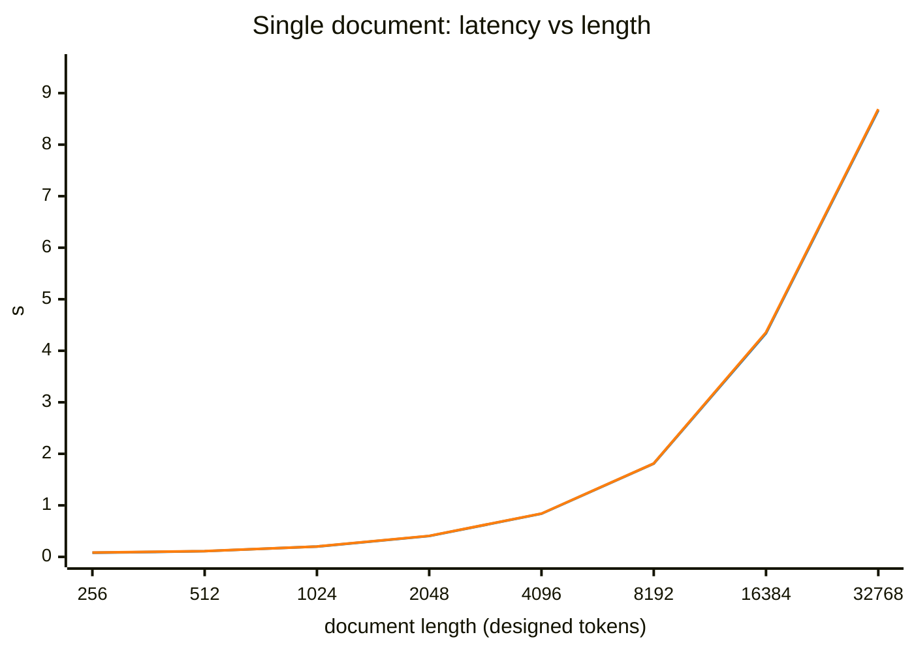
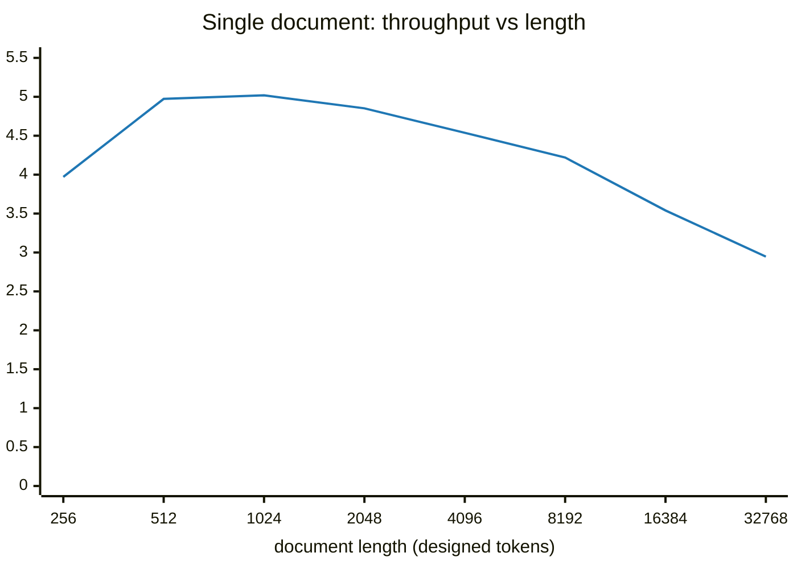
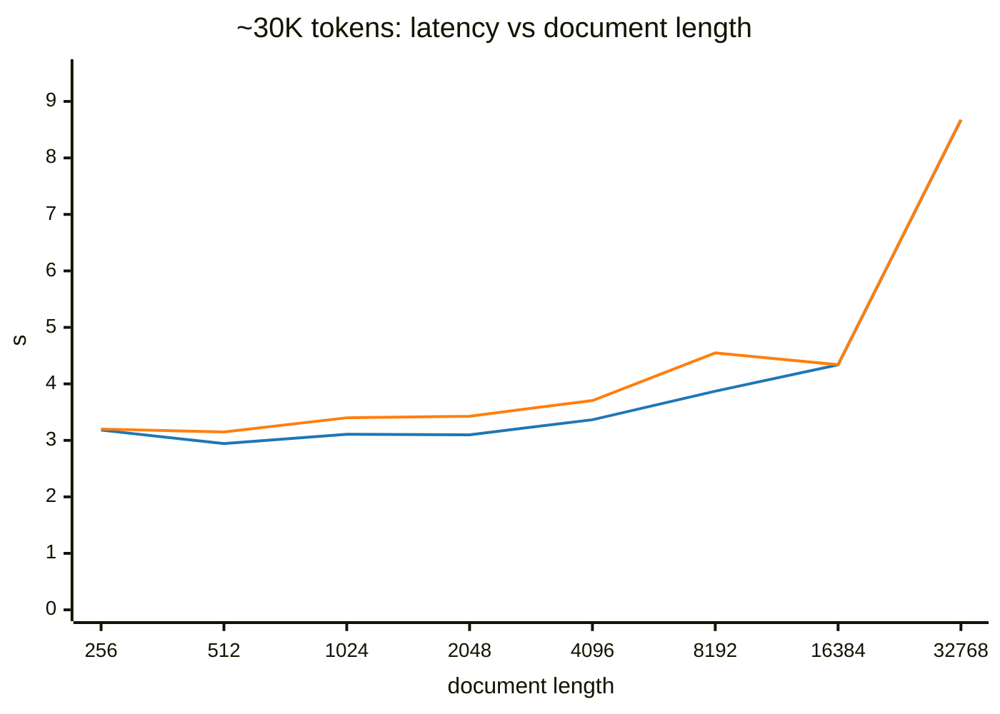
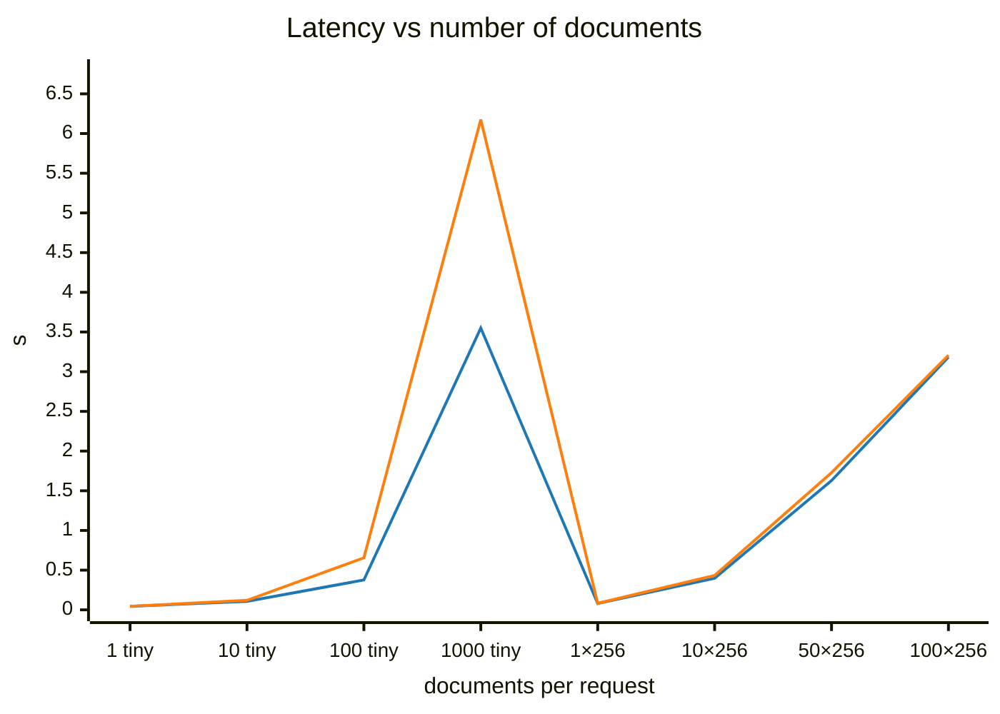
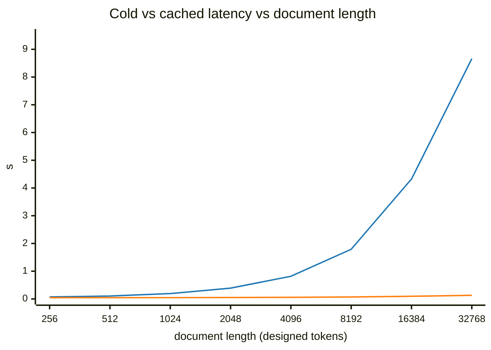
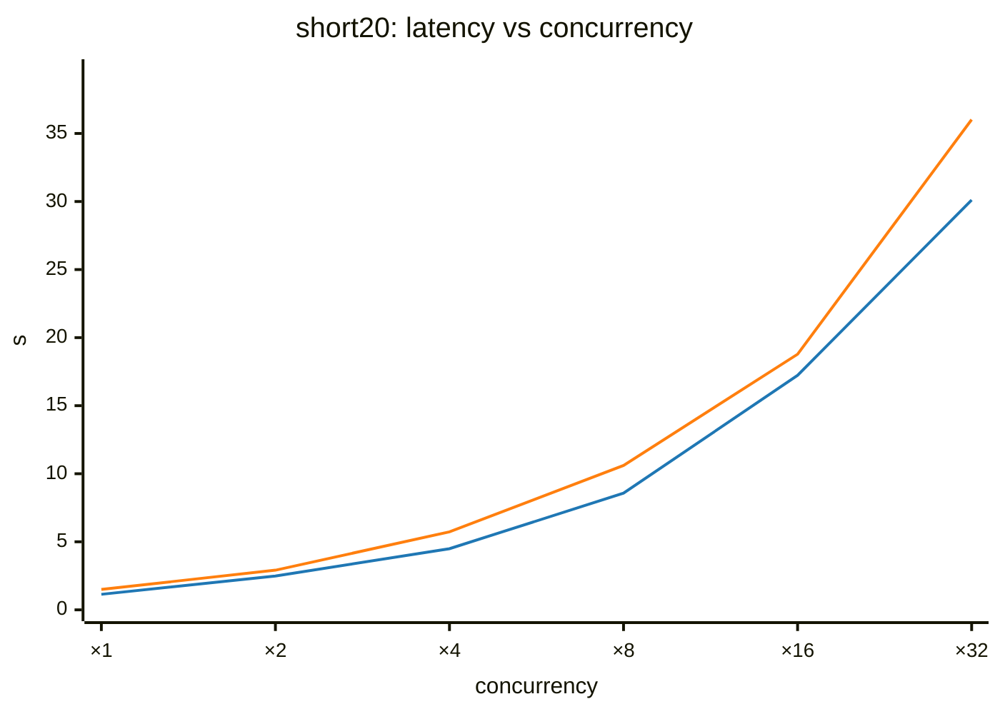
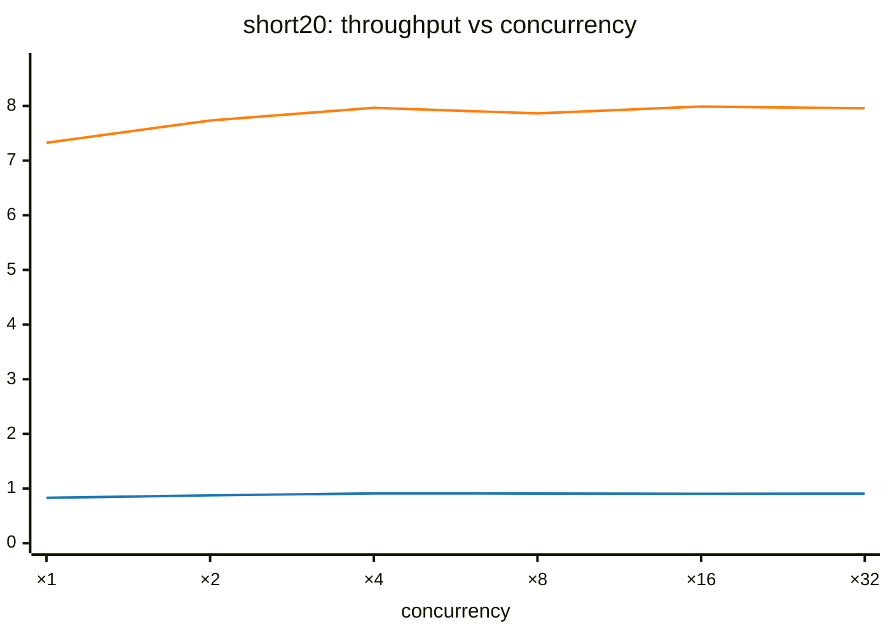
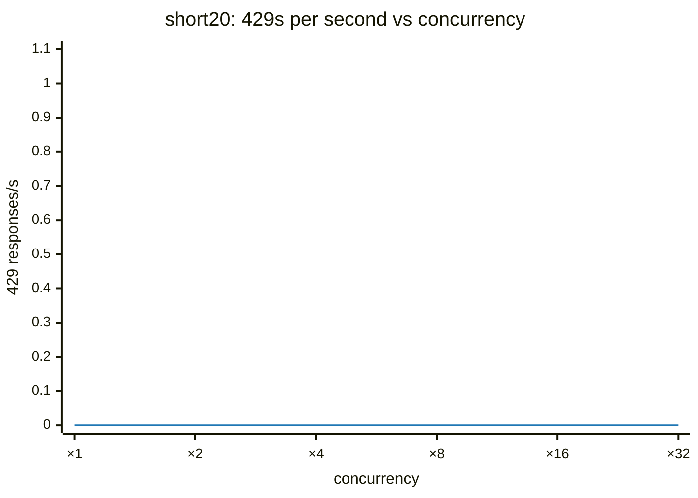

## meticulous — 2026-11-15 13:38 UTC

**PASS** · 1472 s · 790 requests · 0 (0.0%) errors · 0 rate-limited · 9,085,841 tokens billed

Sequential requests (one in flight) unless stated; every query carries a nonce so nothing is served from the API's prefix cache.

### Single document: latency vs length

| rung | Qwen tokens | billed | errors | p50 s | p90 s | max s | API tok/s |
|---|---|---|---|---|---|---|---|
| 256 | 229 | 323 | 0 (0.0%) | 0.080 | 0.083 | 0.114 | 3,971 |
| 512 | 457 | 551 | 0 (0.0%) | 0.111 | 0.112 | 0.114 | 4,973 |
| 1,024 | 911 | 1,005 | 0 (0.0%) | 0.200 | 0.202 | 0.205 | 5,019 |
| 2,048 | 1,872 | 1,966 | 0 (0.0%) | 0.405 | 0.408 | 0.415 | 4,852 |
| 4,096 | 3,707 | 3,800 | 0 (0.0%) | 0.837 | 0.841 | 0.841 | 4,538 |
| 8,192 | 7,545 | 7,640 | 0 (0.0%) | 1.810 | 1.814 | 1.817 | 4,220 |
| 16,384 | 15,274 | 15,368 | 0 (0.0%) | 4.339 | 4.357 | 4.358 | 3,540 |
| 32,768 | 25,438 | 25,536 | 0 (0.0%) | 8.667 | 8.688 | 8.746 | 2,947 |

*Single document: latency vs length: p50, p90*

*Single document: throughput vs length: API tokens/s ÷ 1000*

### ~30K tokens per request: latency vs document length (fewer, longer documents)

| rung | docs/request | billed | errors | p50 s | p90 s | max s | API tok/s |
|---|---|---|---|---|---|---|---|
| 256 | 100 | 32,392 | 0 (0.0%) | 3.182 | 3.201 | 3.213 | 10,177 |
| 512 | 55 | 30,264 | 0 (0.0%) | 2.944 | 3.148 | 3.316 | 10,176 |
| 1,024 | 28 | 28,185 | 0 (0.0%) | 3.107 | 3.400 | 3.478 | 9,130 |
| 2,048 | 13 | 25,574 | 0 (0.0%) | 3.099 | 3.428 | 3.691 | 8,477 |
| 4,096 | 6 | 22,808 | 0 (0.0%) | 3.365 | 3.705 | 3.970 | 6,954 |
| 8,192 | 3 | 22,923 | 0 (0.0%) | 3.871 | 4.548 | 5.031 | 6,066 |
| 16,384 | 1 | 15,366 | 0 (0.0%) | 4.338 | 4.339 | 4.340 | 3,542 |
| 32,768 | 1 | 25,540 | 0 (0.0%) | 8.671 | 8.678 | 8.714 | 2,948 |

*~30K tokens: latency vs document length: p50, p90*

### Latency vs number of documents

| documents | billed | errors | p50 s | p90 s | max s | MRR |
|---|---|---|---|---|---|---|
| 1 tiny | 91.0 | 0 (0.0%) | 0.044 | 0.045 | 0.047 | 1.000 |
| 10 tiny | 922 | 0 (0.0%) | 0.107 | 0.120 | 0.122 | 1.000 |
| 100 tiny | 9,349 | 0 (0.0%) | 0.376 | 0.655 | 0.660 | 1.000 |
| 1000 tiny | 93,989 | 0 (0.0%) | 3.550 | 6.176 | 6.255 | 1.000 |
| 1×256 | 323 | 0 (0.0%) | 0.080 | 0.082 | 0.084 | 1.000 |
| 10×256 | 3,231 | 0 (0.0%) | 0.397 | 0.433 | 0.480 | 1.000 |
| 50×256 | 16,160 | 0 (0.0%) | 1.628 | 1.728 | 1.787 | 1.000 |
| 100×256 | 32,319 | 0 (0.0%) | 3.184 | 3.207 | 3.208 | 1.000 |

*Latency vs number of documents: p50, p90*

### Cold vs cached: the same single-document request sent twice in a row

The API caches prompt prefixes, so a repeated (query, document) pair skips most of the compute. Cold = fresh nonce in the query; cached = the identical request again immediately after.

| rung | pairs | cold p50 s | cached p50 s | speed-up × | cold max s | cached max s | errors |
|---|---|---|---|---|---|---|---|
| 256 | 10 | 0.074 | 0.045 | 1.633 | 0.076 | 0.063 |  |
| 512 | 10 | 0.105 | 0.046 | 2.275 | 0.106 | 0.047 |  |
| 1,024 | 10 | 0.193 | 0.047 | 4.092 | 0.195 | 0.048 |  |
| 2,048 | 10 | 0.390 | 0.051 | 7.567 | 0.395 | 0.053 |  |
| 4,096 | 10 | 0.818 | 0.058 | 14.0 | 0.824 | 0.059 |  |
| 8,192 | 10 | 1.791 | 0.071 | 25.2 | 1.796 | 0.073 |  |
| 16,384 | 10 | 4.323 | 0.096 | 44.8 | 4.341 | 0.097 |  |
| 32,768 | 10 | 8.663 | 0.130 | 66.8 | 8.716 | 0.132 |  |

*Cold vs cached latency vs document length: cold p50, cached p50*

### short20: latency and throughput vs concurrency

|  | requests | errors | 429s | p50 s | p90 s | p99 s | max s | req/s | API tok/s | MRR |
|---|---|---|---|---|---|---|---|---|---|---|
| ×1 | 21 | 0 (0.0%) | 0 | 1.139 | 1.501 | 2.040 | 2.077 | 0.831 | 7,327 | 0.707 |
| ×2 | 23 | 0 (0.0%) | 0 | 2.484 | 2.914 | 3.334 | 3.335 | 0.875 | 7,733 | 0.703 |
| ×4 | 25 | 0 (0.0%) | 0 | 4.493 | 5.732 | 5.749 | 5.751 | 0.912 | 7,966 | 0.679 |
| ×8 | 29 | 0 (0.0%) | 0 | 8.570 | 10.6 | 10.6 | 10.6 | 0.910 | 7,864 | 0.697 |
| ×16 | 37 | 0 (0.0%) | 0 | 17.2 | 18.8 | 19.2 | 19.3 | 0.905 | 7,989 | 0.730 |
| ×32 | 55 | 0 (0.0%) | 0 | 30.1 | 36.0 | 36.4 | 36.5 | 0.907 | 7,957 | 0.736 |

No 429s up to concurrency ×32.

*short20: latency vs concurrency: p50, p90*

*short20: throughput vs concurrency: req/s, API tokens/s ÷ 1000*

*short20: 429s per second vs concurrency: 429/s*

790 requests, 9,085,841 tokens billed.
