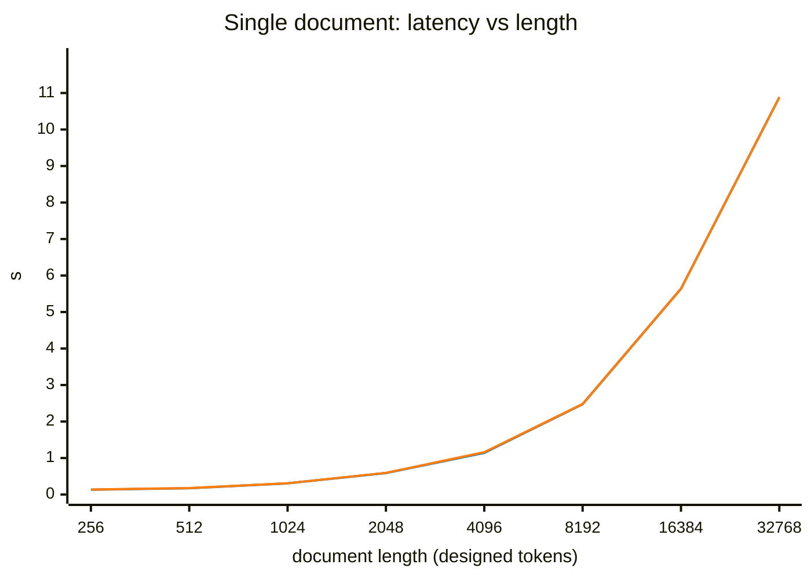
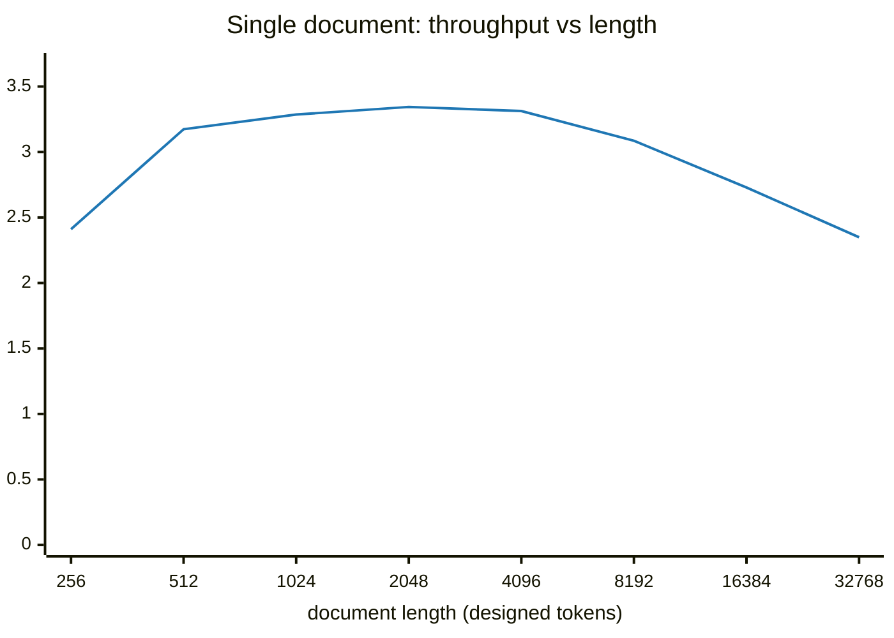
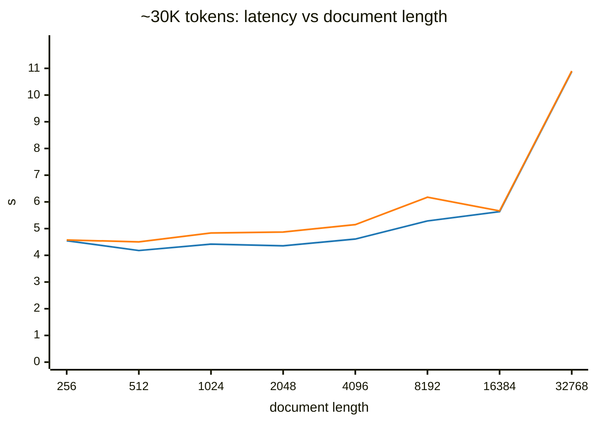
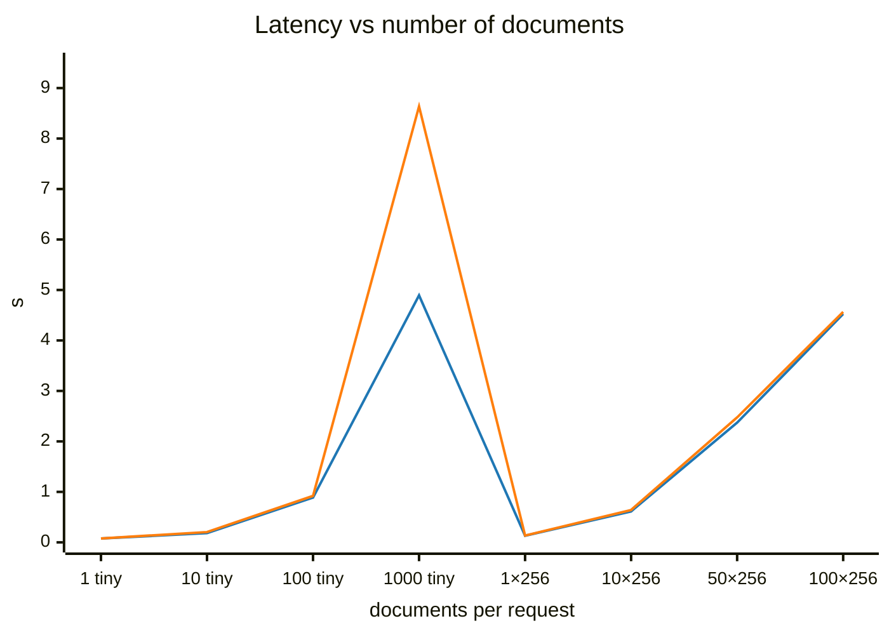
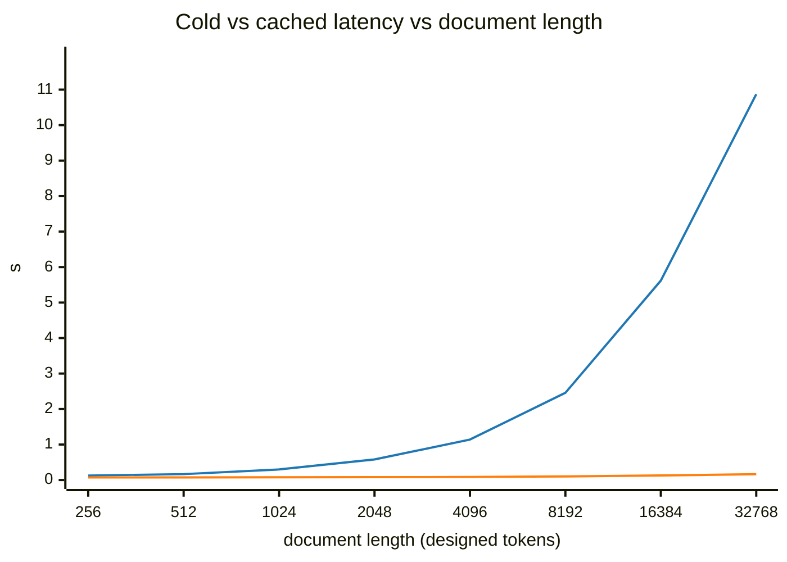
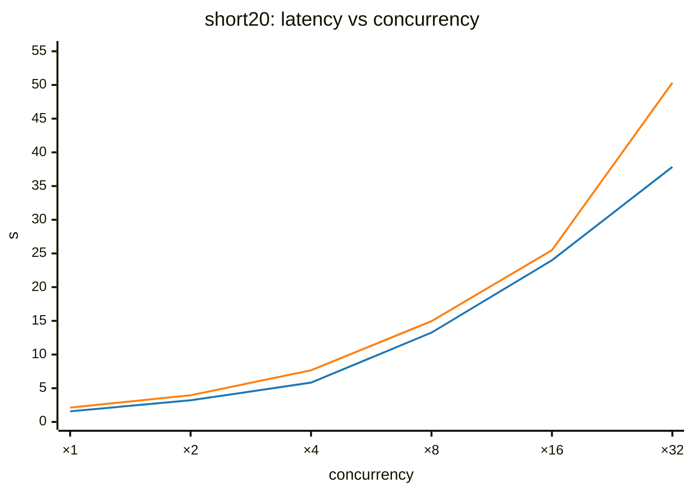
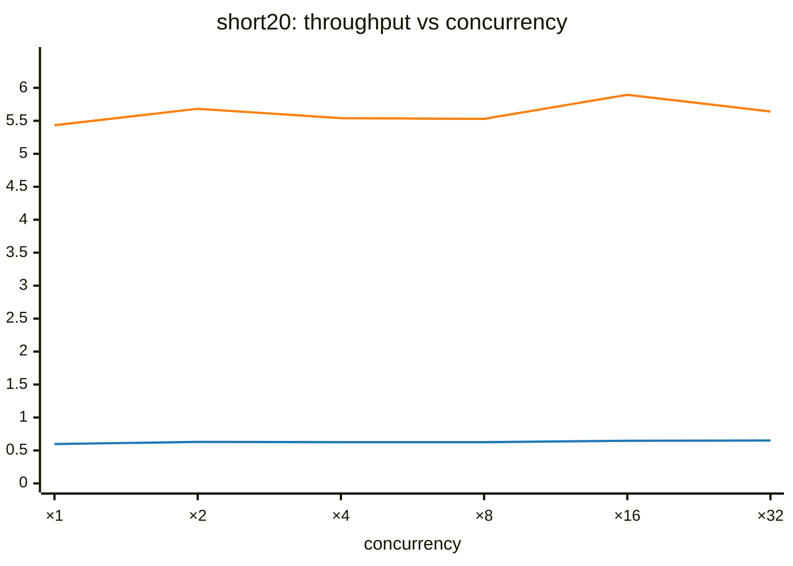
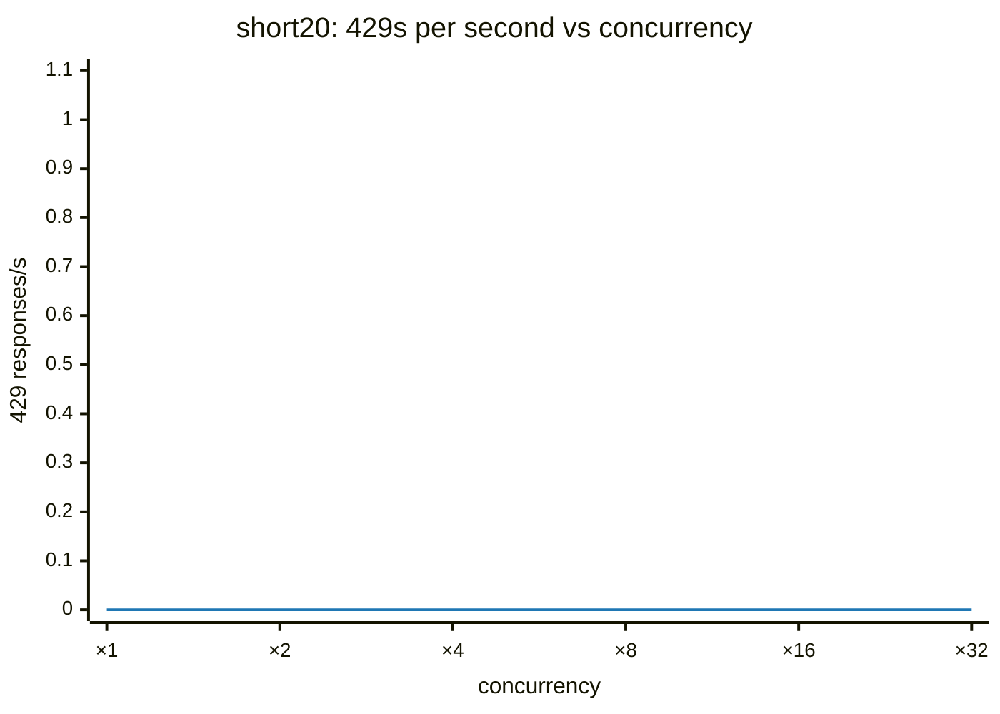

## meticulous — 2026-11-15 16:24 UTC

**PASS** · 1910 s · 753 requests · 0 (0.0%) errors · 0 rate-limited · 8,778,711 tokens billed

Sequential requests (one in flight) unless stated; every query carries a nonce so nothing is served from the API's prefix cache.

### Single document: latency vs length

| rung | Qwen tokens | billed | errors | p50 s | p90 s | max s | API tok/s |
|---|---|---|---|---|---|---|---|
| 256 | 229 | 324 | 0 (0.0%) | 0.133 | 0.137 | 0.160 | 2,411 |
| 512 | 457 | 551 | 0 (0.0%) | 0.173 | 0.177 | 0.181 | 3,174 |
| 1,024 | 911 | 1,005 | 0 (0.0%) | 0.306 | 0.309 | 0.311 | 3,286 |
| 2,048 | 1,872 | 1,966 | 0 (0.0%) | 0.588 | 0.595 | 0.597 | 3,344 |
| 4,096 | 3,707 | 3,800 | 0 (0.0%) | 1.143 | 1.160 | 1.165 | 3,313 |
| 8,192 | 7,545 | 7,640 | 0 (0.0%) | 2.475 | 2.483 | 2.501 | 3,086 |
| 16,384 | 15,274 | 15,368 | 0 (0.0%) | 5.636 | 5.643 | 5.657 | 2,729 |
| 32,768 | 25,438 | 25,536 | 0 (0.0%) | 10.9 | 10.9 | 11.0 | 2,349 |

*Single document: latency vs length: p50, p90*

*Single document: throughput vs length: API tokens/s ÷ 1000*

### ~30K tokens per request: latency vs document length (fewer, longer documents)

| rung | docs/request | billed | errors | p50 s | p90 s | max s | API tok/s |
|---|---|---|---|---|---|---|---|
| 256 | 100 | 32,406 | 0 (0.0%) | 4.546 | 4.575 | 4.589 | 7,124 |
| 512 | 55 | 30,286 | 0 (0.0%) | 4.179 | 4.503 | 4.697 | 7,154 |
| 1,024 | 28 | 28,164 | 0 (0.0%) | 4.420 | 4.837 | 4.957 | 6,430 |
| 2,048 | 13 | 25,572 | 0 (0.0%) | 4.355 | 4.871 | 5.192 | 6,036 |
| 4,096 | 6 | 22,806 | 0 (0.0%) | 4.609 | 5.149 | 5.495 | 5,028 |
| 8,192 | 3 | 22,922 | 0 (0.0%) | 5.287 | 6.175 | 6.836 | 4,480 |
| 16,384 | 1 | 15,367 | 0 (0.0%) | 5.636 | 5.663 | 5.668 | 2,726 |
| 32,768 | 1 | 25,540 | 0 (0.0%) | 10.9 | 10.9 | 10.9 | 2,346 |

*~30K tokens: latency vs document length: p50, p90*

### Latency vs number of documents

| documents | billed | errors | p50 s | p90 s | max s | MRR |
|---|---|---|---|---|---|---|
| 1 tiny | 91.5 | 0 (0.0%) | 0.077 | 0.078 | 0.079 | 1.000 |
| 10 tiny | 919 | 0 (0.0%) | 0.183 | 0.204 | 0.214 | 1.000 |
| 100 tiny | 9,259 | 0 (0.0%) | 0.887 | 0.921 | 0.928 | 1.000 |
| 1000 tiny | 94,089 | 0 (0.0%) | 4.893 | 8.637 | 8.691 | 1.000 |
| 1×256 | 323 | 0 (0.0%) | 0.132 | 0.136 | 0.137 | 1.000 |
| 10×256 | 3,228 | 0 (0.0%) | 0.614 | 0.642 | 0.697 | 1.000 |
| 50×256 | 16,135 | 0 (0.0%) | 2.371 | 2.476 | 2.579 | 1.000 |
| 100×256 | 32,309 | 0 (0.0%) | 4.525 | 4.565 | 4.571 | 1.000 |

*Latency vs number of documents: p50, p90*

### Cold vs cached: the same single-document request sent twice in a row

The API caches prompt prefixes, so a repeated (query, document) pair skips most of the compute. Cold = fresh nonce in the query; cached = the identical request again immediately after.

| rung | pairs | cold p50 s | cached p50 s | speed-up × | cold max s | cached max s | errors |
|---|---|---|---|---|---|---|---|
| 256 | 10 | 0.127 | 0.073 | 1.723 | 0.131 | 0.089 |  |
| 512 | 10 | 0.166 | 0.074 | 2.243 | 0.168 | 0.075 |  |
| 1,024 | 10 | 0.298 | 0.076 | 3.932 | 0.302 | 0.076 |  |
| 2,048 | 10 | 0.579 | 0.080 | 7.271 | 0.588 | 0.080 |  |
| 4,096 | 10 | 1.140 | 0.087 | 13.1 | 1.150 | 0.088 |  |
| 8,192 | 10 | 2.457 | 0.100 | 24.6 | 2.467 | 0.102 |  |
| 16,384 | 10 | 5.619 | 0.128 | 43.9 | 5.631 | 0.130 |  |
| 32,768 | 10 | 10.9 | 0.164 | 66.3 | 10.9 | 0.165 |  |

*Cold vs cached latency vs document length: cold p50, cached p50*

### short20: latency and throughput vs concurrency

|  | requests | errors | 429s | p50 s | p90 s | p99 s | max s | req/s | API tok/s | MRR |
|---|---|---|---|---|---|---|---|---|---|---|
| ×1 | 16 | 0 (0.0%) | 0 | 1.574 | 2.127 | 2.893 | 3.014 | 0.598 | 5,433 | 0.656 |
| ×2 | 17 | 0 (0.0%) | 0 | 3.210 | 3.958 | 4.655 | 4.657 | 0.630 | 5,683 | 0.637 |
| ×4 | 19 | 0 (0.0%) | 0 | 5.830 | 7.655 | 8.110 | 8.119 | 0.626 | 5,541 | 0.676 |
| ×8 | 23 | 0 (0.0%) | 0 | 13.2 | 15.0 | 15.1 | 15.1 | 0.626 | 5,530 | 0.710 |
| ×16 | 31 | 0 (0.0%) | 0 | 24.0 | 25.5 | 26.1 | 26.1 | 0.648 | 5,895 | 0.715 |
| ×32 | 47 | 0 (0.0%) | 0 | 37.8 | 50.3 | 50.9 | 50.9 | 0.651 | 5,641 | 0.745 |

No 429s up to concurrency ×32.

*short20: latency vs concurrency: p50, p90*

*short20: throughput vs concurrency: req/s, API tokens/s ÷ 1000*

*short20: 429s per second vs concurrency: 429/s*

753 requests, 8,778,711 tokens billed.
