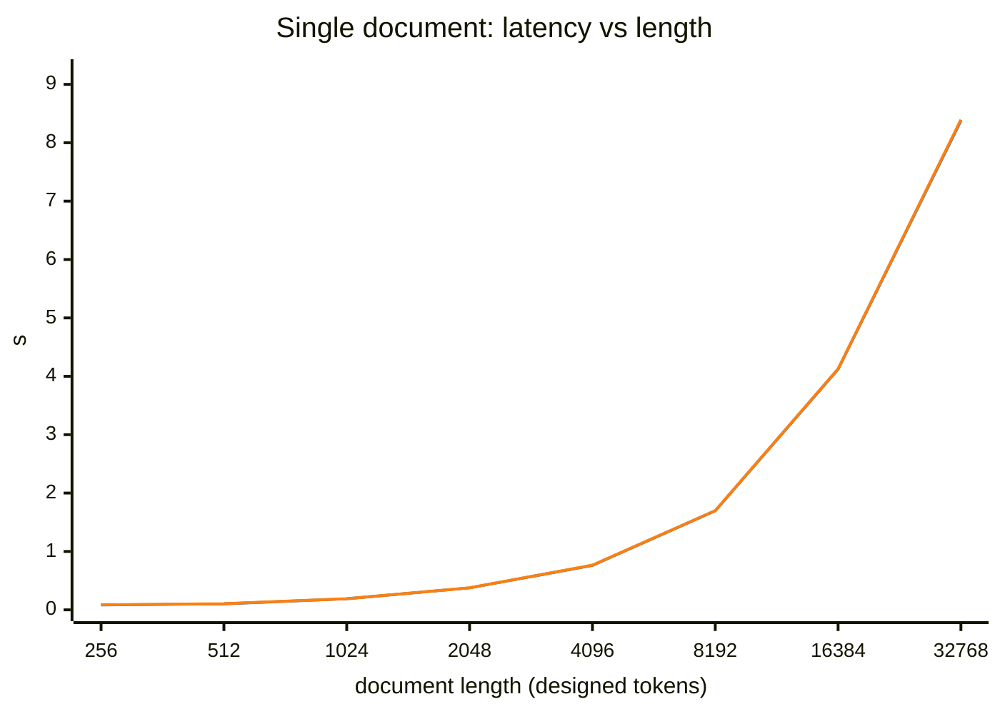
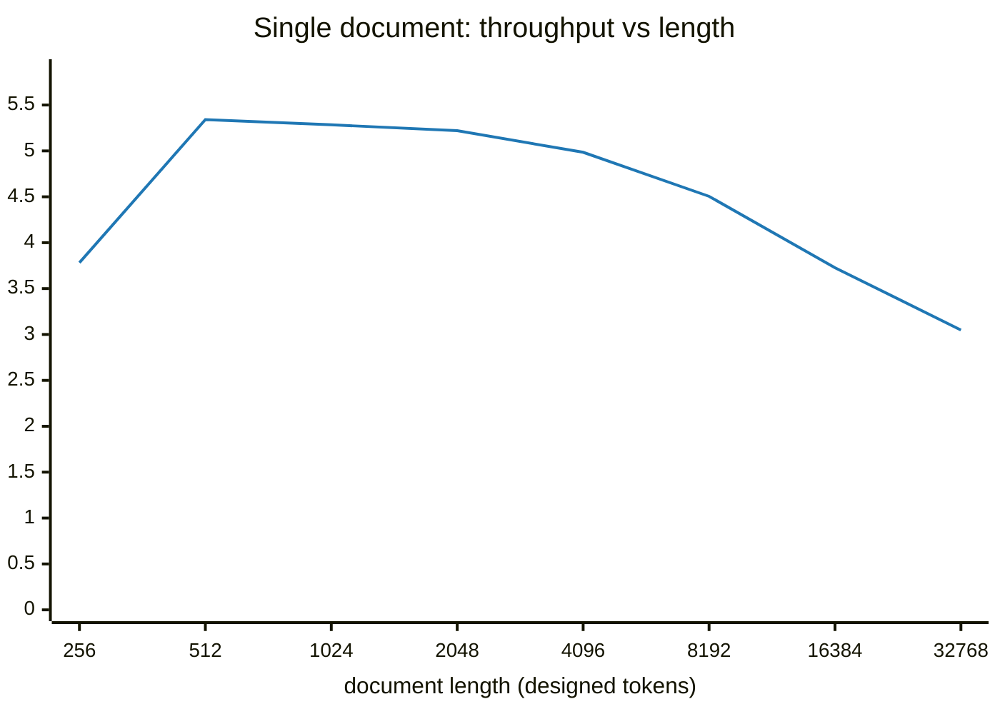
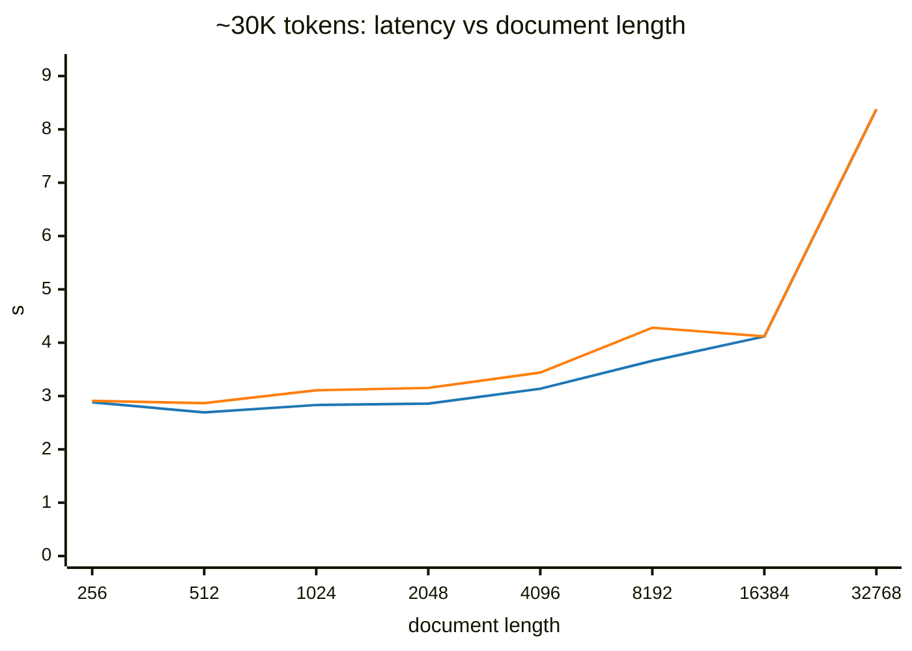
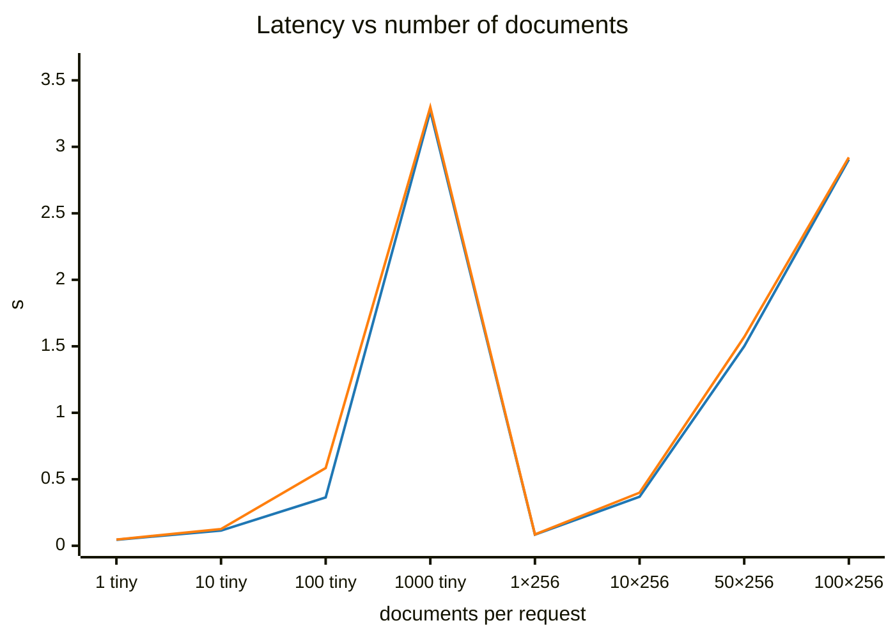
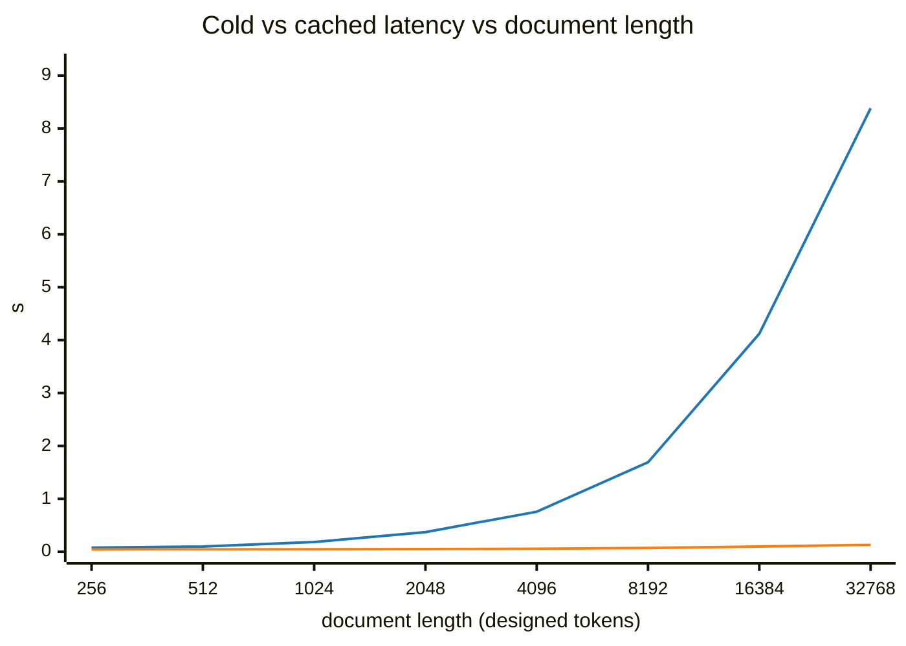
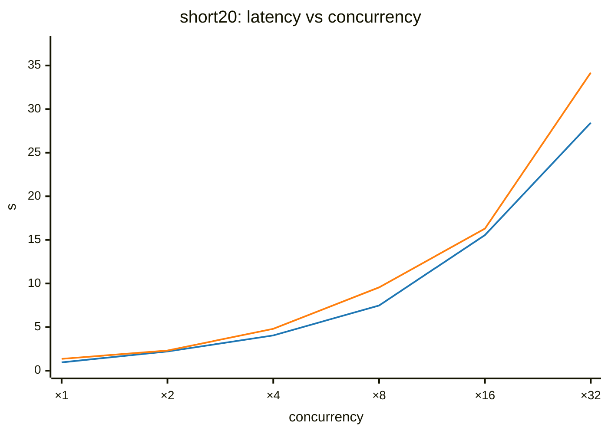
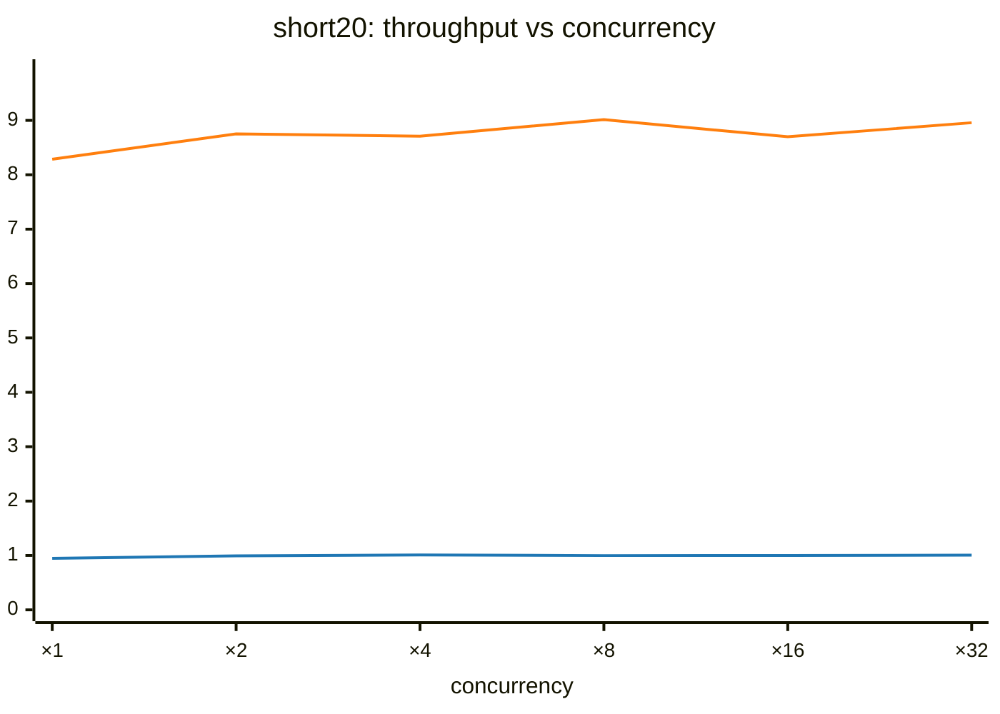
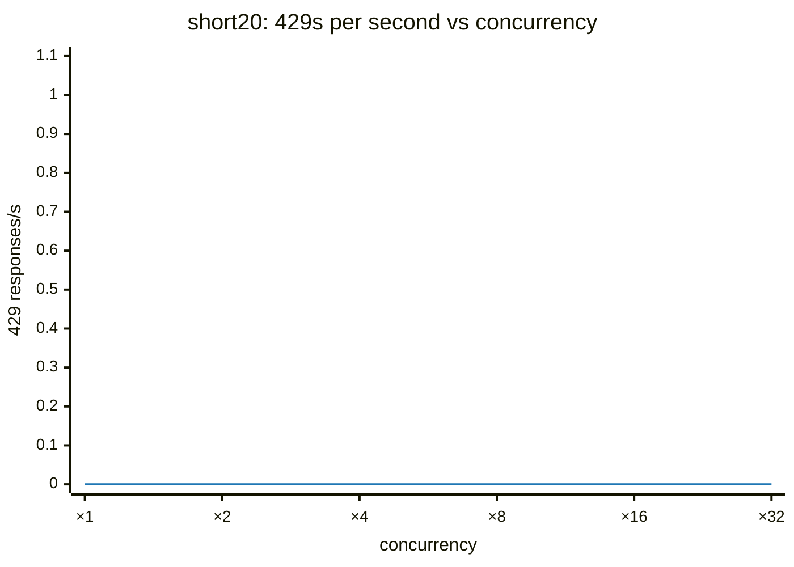

## meticulous — 2026-11-15 18:32 UTC

**PASS** · 1399 s · 810 requests · 0 (0.0%) errors · 0 rate-limited · 9,275,867 tokens billed

Sequential requests (one in flight) unless stated; every query carries a nonce so nothing is served from the API's prefix cache.

### Single document: latency vs length

| rung | Qwen tokens | billed | errors | p50 s | p90 s | max s | API tok/s |
|---|---|---|---|---|---|---|---|
| 256 | 229 | 324 | 0 (0.0%) | 0.084 | 0.085 | 0.124 | 3,782 |
| 512 | 457 | 551 | 0 (0.0%) | 0.103 | 0.105 | 0.105 | 5,341 |
| 1,024 | 911 | 1,005 | 0 (0.0%) | 0.190 | 0.191 | 0.193 | 5,284 |
| 2,048 | 1,872 | 1,966 | 0 (0.0%) | 0.376 | 0.378 | 0.381 | 5,221 |
| 4,096 | 3,707 | 3,801 | 0 (0.0%) | 0.761 | 0.766 | 0.767 | 4,985 |
| 8,192 | 7,545 | 7,640 | 0 (0.0%) | 1.696 | 1.699 | 1.702 | 4,505 |
| 16,384 | 15,274 | 15,368 | 0 (0.0%) | 4.122 | 4.127 | 4.131 | 3,727 |
| 32,768 | 25,438 | 25,536 | 0 (0.0%) | 8.377 | 8.396 | 8.450 | 3,048 |

*Single document: latency vs length: p50, p90*

*Single document: throughput vs length: API tokens/s ÷ 1000*

### ~30K tokens per request: latency vs document length (fewer, longer documents)

| rung | docs/request | billed | errors | p50 s | p90 s | max s | API tok/s |
|---|---|---|---|---|---|---|---|
| 256 | 100 | 32,379 | 0 (0.0%) | 2.883 | 2.909 | 2.919 | 11,217 |
| 512 | 55 | 30,282 | 0 (0.0%) | 2.693 | 2.867 | 3.042 | 11,141 |
| 1,024 | 28 | 28,168 | 0 (0.0%) | 2.832 | 3.108 | 3.197 | 9,966 |
| 2,048 | 13 | 25,572 | 0 (0.0%) | 2.858 | 3.152 | 3.401 | 9,182 |
| 4,096 | 6 | 22,806 | 0 (0.0%) | 3.137 | 3.441 | 3.654 | 7,494 |
| 8,192 | 3 | 22,921 | 0 (0.0%) | 3.660 | 4.281 | 4.718 | 6,431 |
| 16,384 | 1 | 15,366 | 0 (0.0%) | 4.117 | 4.118 | 4.123 | 3,733 |
| 32,768 | 1 | 25,541 | 0 (0.0%) | 8.375 | 8.381 | 8.438 | 3,050 |

*~30K tokens: latency vs document length: p50, p90*

### Latency vs number of documents

| documents | billed | errors | p50 s | p90 s | max s | MRR |
|---|---|---|---|---|---|---|
| 1 tiny | 91.6 | 0 (0.0%) | 0.045 | 0.047 | 0.049 | 1.000 |
| 10 tiny | 922 | 0 (0.0%) | 0.115 | 0.126 | 0.126 | 1.000 |
| 100 tiny | 9,349 | 0 (0.0%) | 0.364 | 0.585 | 0.591 | 1.000 |
| 1000 tiny | 94,389 | 0 (0.0%) | 3.268 | 3.299 | 3.300 | 1.000 |
| 1×256 | 323 | 0 (0.0%) | 0.084 | 0.085 | 0.086 | 1.000 |
| 10×256 | 3,233 | 0 (0.0%) | 0.369 | 0.400 | 0.432 | 1.000 |
| 50×256 | 16,140 | 0 (0.0%) | 1.500 | 1.570 | 1.626 | 1.000 |
| 100×256 | 32,349 | 0 (0.0%) | 2.905 | 2.921 | 2.936 | 1.000 |

*Latency vs number of documents: p50, p90*

### Cold vs cached: the same single-document request sent twice in a row

The API caches prompt prefixes, so a repeated (query, document) pair skips most of the compute. Cold = fresh nonce in the query; cached = the identical request again immediately after.

| rung | pairs | cold p50 s | cached p50 s | speed-up × | cold max s | cached max s | errors |
|---|---|---|---|---|---|---|---|
| 256 | 10 | 0.077 | 0.045 | 1.717 | 0.087 | 0.064 |  |
| 512 | 10 | 0.098 | 0.046 | 2.138 | 0.100 | 0.048 |  |
| 1,024 | 10 | 0.185 | 0.047 | 3.911 | 0.188 | 0.050 |  |
| 2,048 | 10 | 0.370 | 0.051 | 7.304 | 0.374 | 0.052 |  |
| 4,096 | 10 | 0.758 | 0.058 | 13.0 | 0.764 | 0.059 |  |
| 8,192 | 10 | 1.691 | 0.072 | 23.6 | 1.695 | 0.072 |  |
| 16,384 | 10 | 4.122 | 0.098 | 42.0 | 4.138 | 0.099 |  |
| 32,768 | 10 | 8.383 | 0.131 | 63.8 | 8.444 | 0.132 |  |

*Cold vs cached latency vs document length: cold p50, cached p50*

### short20: latency and throughput vs concurrency

|  | requests | errors | 429s | p50 s | p90 s | p99 s | max s | req/s | API tok/s | MRR |
|---|---|---|---|---|---|---|---|---|---|---|
| ×1 | 24 | 0 (0.0%) | 0 | 0.955 | 1.357 | 1.848 | 1.888 | 0.947 | 8,286 | 0.695 |
| ×2 | 27 | 0 (0.0%) | 0 | 2.203 | 2.308 | 2.959 | 2.960 | 0.994 | 8,753 | 0.710 |
| ×4 | 29 | 0 (0.0%) | 0 | 4.041 | 4.804 | 5.434 | 5.540 | 1.008 | 8,709 | 0.730 |
| ×8 | 33 | 0 (0.0%) | 0 | 7.481 | 9.555 | 9.638 | 9.639 | 0.998 | 9,014 | 0.705 |
| ×16 | 40 | 0 (0.0%) | 0 | 15.6 | 16.3 | 16.9 | 17.0 | 0.998 | 8,699 | 0.758 |
| ×32 | 57 | 0 (0.0%) | 0 | 28.4 | 34.2 | 34.4 | 34.6 | 1.006 | 8,957 | 0.728 |

No 429s up to concurrency ×32.

*short20: latency vs concurrency: p50, p90*

*short20: throughput vs concurrency: req/s, API tokens/s ÷ 1000*

*short20: 429s per second vs concurrency: 429/s*

810 requests, 9,275,867 tokens billed.
