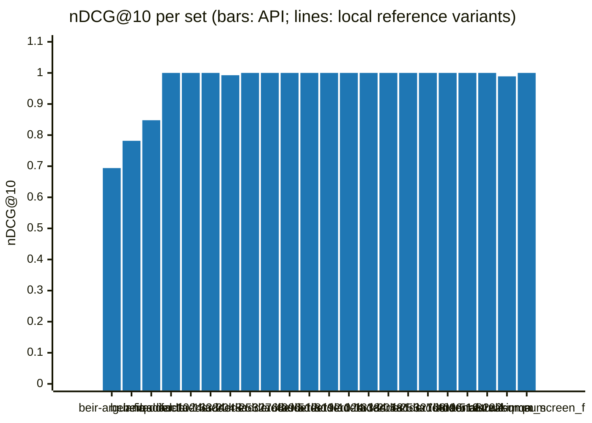

## quality — 2026-11-15 17:04 UTC

**PASS** · 5272 s · 2000 requests · 0 (0.0%) errors · 0 rate-limited · 29,476,787 tokens billed

Up to 300 requests per set (100 for natural-*) at 2 in flight (429s retried); 2000 requests, 29,476,787 tokens billed. nDCG@10 / MRR are against the ground-truth labels; every reference column is computed over the same requests. Local reference variants of Qwen3-Reranker-0.6B (scripts/reference.py): **none available here** — run scripts/reference.py on a GPU. |Δ| is the mean absolute score difference per document; top-1 is the share of requests where the API and the reference pick the same best document.

| set | requests | errors | 429s | nDCG@10 API | MRR API | p50 s |
|---|---|---|---|---|---|---|
| beir-arguana | 300 | 0 (0.0%) | 0 | 0.694 | 0.588 | 1.793 |
| beir-fiqa | 300 | 0 (0.0%) | 0 | 0.782 | 0.807 | 1.481 |
| beir-scifact | 300 | 0 (0.0%) | 0 | 0.848 | 0.811 | 2.580 |
| ladder-1024 | 50 | 0 (0.0%) | 0 | 1.000 | 1.000 | 5.301 |
| ladder-16384 | 50 | 0 (0.0%) | 0 | 1.000 | 1.000 | 8.189 |
| ladder-2048 | 50 | 0 (0.0%) | 0 | 1.000 | 1.000 | 5.485 |
| ladder-256 | 50 | 0 (0.0%) | 0 | 0.993 | 0.990 | 5.487 |
| ladder-32768 | 50 | 0 (0.0%) | 0 | 1.000 | 1.000 | 16.7 |
| ladder-4096 | 50 | 0 (0.0%) | 0 | 1.000 | 1.000 | 5.857 |
| ladder-512 | 50 | 0 (0.0%) | 0 | 1.000 | 1.000 | 5.175 |
| ladder-8192 | 50 | 0 (0.0%) | 0 | 1.000 | 1.000 | 7.131 |
| ladder1-1024 | 50 | 0 (0.0%) | 0 | 1.000 | 1.000 | 0.365 |
| ladder1-16384 | 50 | 0 (0.0%) | 0 | 1.000 | 1.000 | 8.187 |
| ladder1-2048 | 50 | 0 (0.0%) | 0 | 1.000 | 1.000 | 0.735 |
| ladder1-256 | 50 | 0 (0.0%) | 0 | 1.000 | 1.000 | 0.115 |
| ladder1-32768 | 50 | 0 (0.0%) | 0 | 1.000 | 1.000 | 16.7 |
| ladder1-4096 | 50 | 0 (0.0%) | 0 | 1.000 | 1.000 | 1.609 |
| ladder1-512 | 50 | 0 (0.0%) | 0 | 1.000 | 1.000 | 0.195 |
| ladder1-8192 | 50 | 0 (0.0%) | 0 | 1.000 | 1.000 | 3.194 |
| natural-2wikimqa | 100 | 0 (0.0%) | 0 | 1.000 | 1.000 | 13.8 |
| natural-qmsum | 100 | 0 (0.0%) | 0 | 0.989 | 0.985 | 14.3 |
| natural-summ_screen_fd | 100 | 0 (0.0%) | 0 | 1.000 | 1.000 | 14.3 |

*nDCG@10 per set (bars: API; lines: local reference variants): API*
