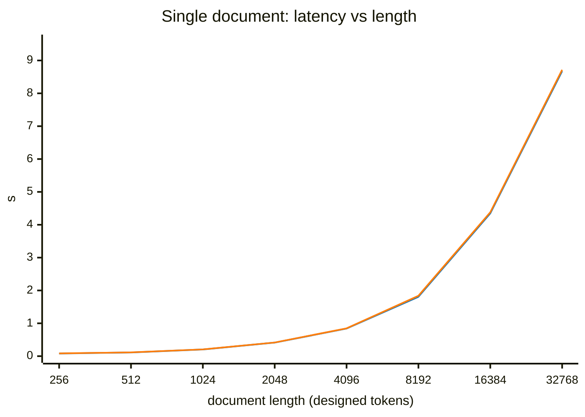
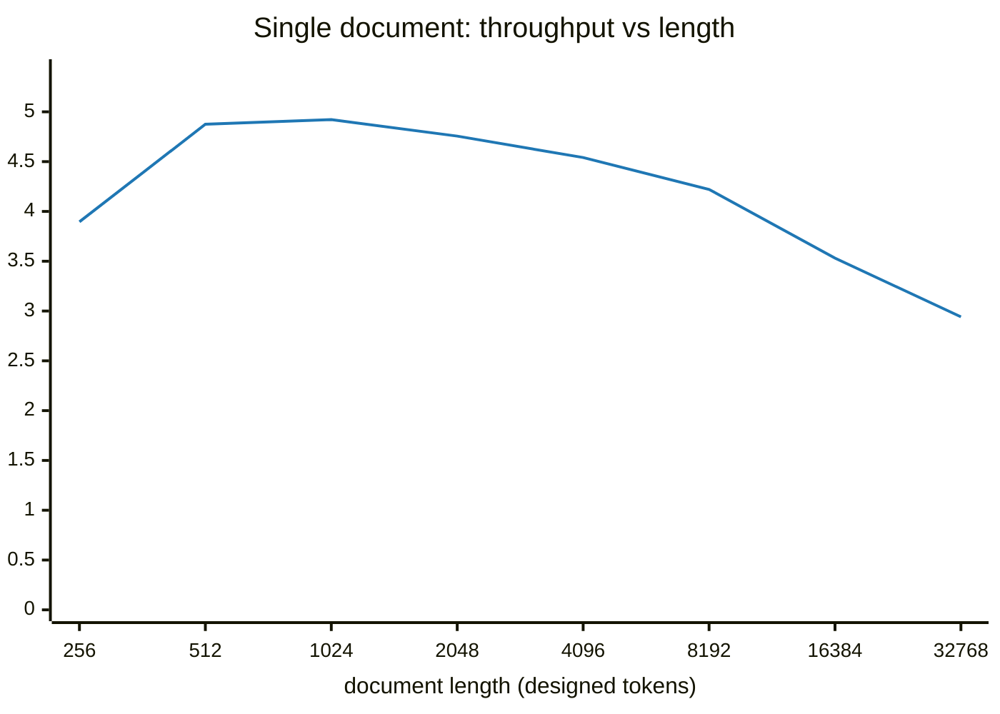
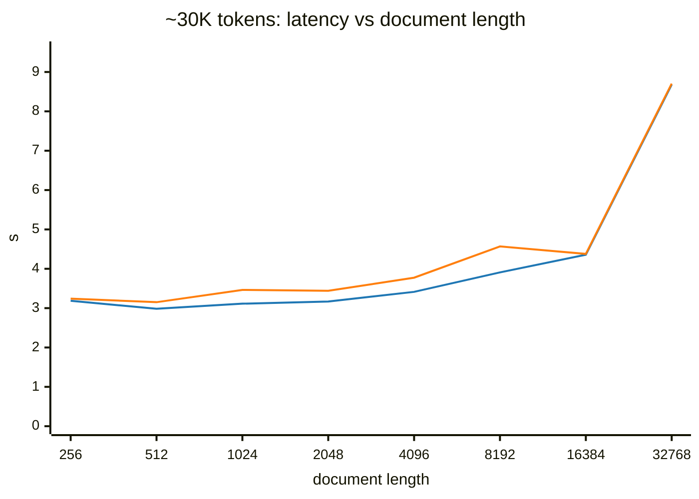
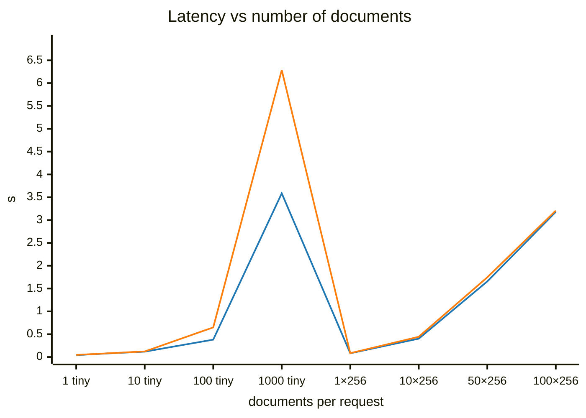
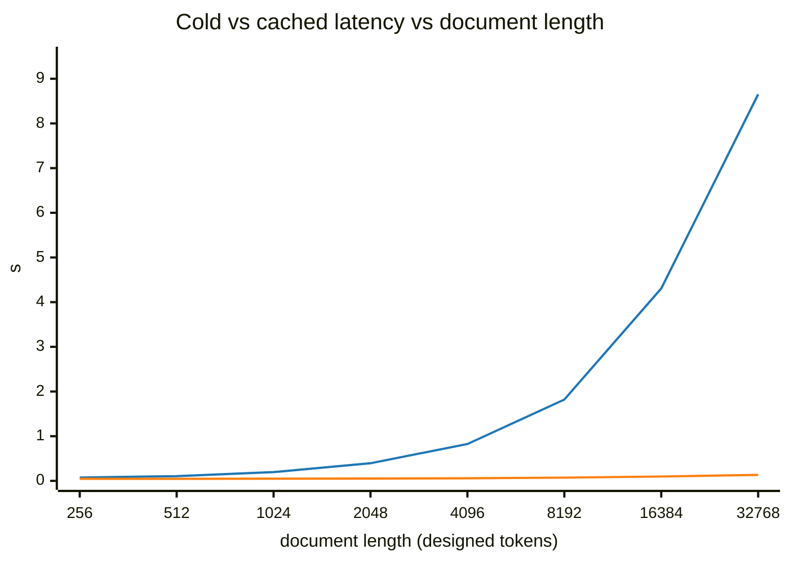
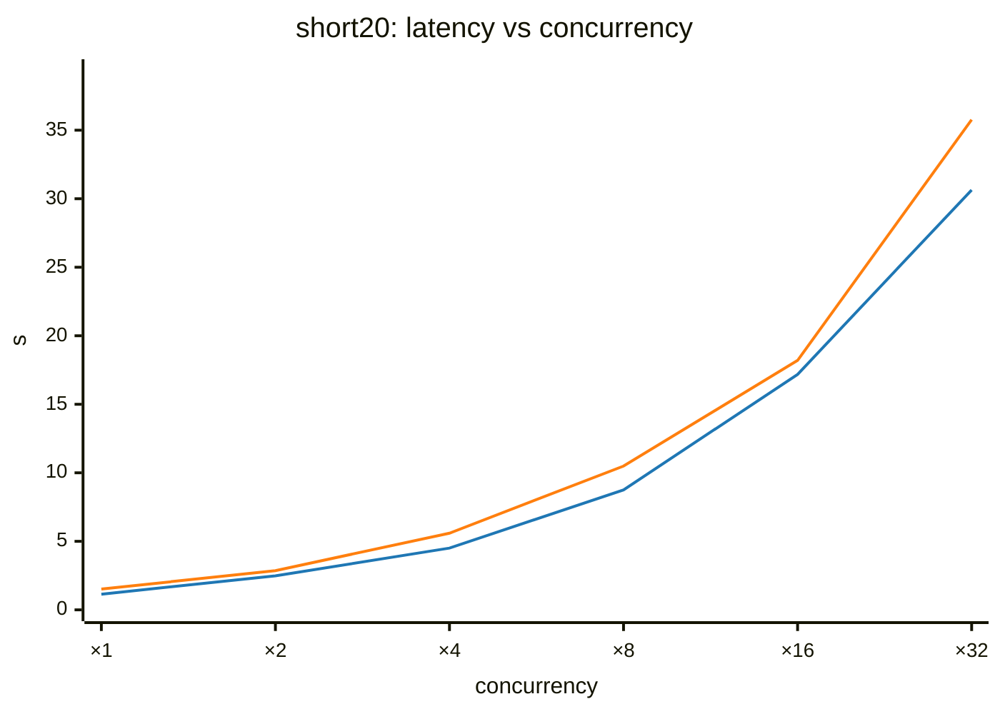
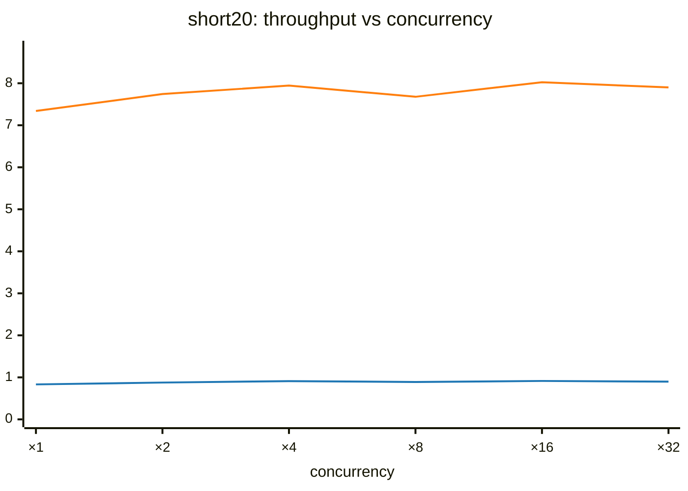
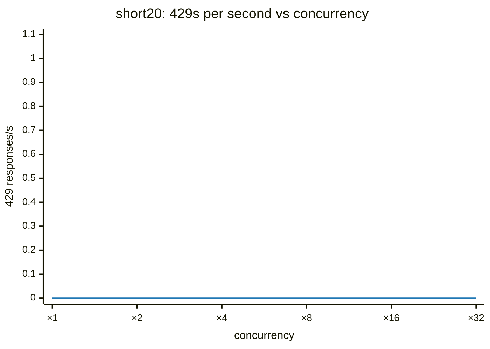

## meticulous — 2026-11-15 18:43 UTC

**PASS** · 1480 s · 789 requests · 0 (0.0%) errors · 0 rate-limited · 9,073,547 tokens billed

Sequential requests (one in flight) unless stated; every query carries a nonce so nothing is served from the API's prefix cache.

### Single document: latency vs length

| rung | Qwen tokens | billed | errors | p50 s | p90 s | max s | API tok/s |
|---|---|---|---|---|---|---|---|
| 256 | 229 | 323 | 0 (0.0%) | 0.082 | 0.084 | 0.105 | 3,896 |
| 512 | 457 | 551 | 0 (0.0%) | 0.113 | 0.115 | 0.116 | 4,875 |
| 1,024 | 911 | 1,005 | 0 (0.0%) | 0.204 | 0.206 | 0.207 | 4,922 |
| 2,048 | 1,872 | 1,966 | 0 (0.0%) | 0.413 | 0.416 | 0.426 | 4,756 |
| 4,096 | 3,707 | 3,801 | 0 (0.0%) | 0.840 | 0.847 | 0.858 | 4,541 |
| 8,192 | 7,545 | 7,640 | 0 (0.0%) | 1.807 | 1.838 | 1.839 | 4,221 |
| 16,384 | 15,274 | 15,368 | 0 (0.0%) | 4.348 | 4.379 | 4.397 | 3,531 |
| 32,768 | 25,438 | 25,536 | 0 (0.0%) | 8.675 | 8.715 | 8.746 | 2,942 |

*Single document: latency vs length: p50, p90*

*Single document: throughput vs length: API tokens/s ÷ 1000*

### ~30K tokens per request: latency vs document length (fewer, longer documents)

| rung | docs/request | billed | errors | p50 s | p90 s | max s | API tok/s |
|---|---|---|---|---|---|---|---|
| 256 | 100 | 32,379 | 0 (0.0%) | 3.186 | 3.241 | 3.248 | 10,139 |
| 512 | 55 | 30,286 | 0 (0.0%) | 2.985 | 3.151 | 3.376 | 10,089 |
| 1,024 | 28 | 28,196 | 0 (0.0%) | 3.113 | 3.463 | 3.558 | 9,056 |
| 2,048 | 13 | 25,569 | 0 (0.0%) | 3.168 | 3.441 | 3.669 | 8,405 |
| 4,096 | 6 | 22,809 | 0 (0.0%) | 3.414 | 3.774 | 4.019 | 6,885 |
| 8,192 | 3 | 22,921 | 0 (0.0%) | 3.908 | 4.568 | 5.088 | 6,006 |
| 16,384 | 1 | 15,367 | 0 (0.0%) | 4.356 | 4.378 | 4.380 | 3,527 |
| 32,768 | 1 | 25,540 | 0 (0.0%) | 8.678 | 8.705 | 8.771 | 2,942 |

*~30K tokens: latency vs document length: p50, p90*

### Latency vs number of documents

| documents | billed | errors | p50 s | p90 s | max s | MRR |
|---|---|---|---|---|---|---|
| 1 tiny | 91.1 | 0 (0.0%) | 0.043 | 0.046 | 0.047 | 1.000 |
| 10 tiny | 925 | 0 (0.0%) | 0.119 | 0.122 | 0.122 | 1.000 |
| 100 tiny | 9,329 | 0 (0.0%) | 0.380 | 0.649 | 0.655 | 1.000 |
| 1000 tiny | 93,689 | 0 (0.0%) | 3.586 | 6.287 | 6.306 | 1.000 |
| 1×256 | 323 | 0 (0.0%) | 0.082 | 0.085 | 0.086 | 1.000 |
| 10×256 | 3,228 | 0 (0.0%) | 0.403 | 0.444 | 0.487 | 1.000 |
| 50×256 | 16,160 | 0 (0.0%) | 1.656 | 1.746 | 1.801 | 1.000 |
| 100×256 | 32,359 | 0 (0.0%) | 3.180 | 3.207 | 3.223 | 1.000 |

*Latency vs number of documents: p50, p90*

### Cold vs cached: the same single-document request sent twice in a row

The API caches prompt prefixes, so a repeated (query, document) pair skips most of the compute. Cold = fresh nonce in the query; cached = the identical request again immediately after.

| rung | pairs | cold p50 s | cached p50 s | speed-up × | cold max s | cached max s | errors |
|---|---|---|---|---|---|---|---|
| 256 | 10 | 0.075 | 0.045 | 1.649 | 0.083 | 0.046 |  |
| 512 | 10 | 0.106 | 0.047 | 2.271 | 0.110 | 0.048 |  |
| 1,024 | 10 | 0.197 | 0.048 | 4.122 | 0.201 | 0.066 |  |
| 2,048 | 10 | 0.394 | 0.052 | 7.616 | 0.399 | 0.054 |  |
| 4,096 | 10 | 0.824 | 0.059 | 14.0 | 0.831 | 0.060 |  |
| 8,192 | 10 | 1.820 | 0.073 | 25.1 | 1.832 | 0.074 |  |
| 16,384 | 10 | 4.306 | 0.098 | 44.2 | 4.364 | 0.101 |  |
| 32,768 | 10 | 8.652 | 0.133 | 65.1 | 8.718 | 0.134 |  |

*Cold vs cached latency vs document length: cold p50, cached p50*

### short20: latency and throughput vs concurrency

|  | requests | errors | 429s | p50 s | p90 s | p99 s | max s | req/s | API tok/s | MRR |
|---|---|---|---|---|---|---|---|---|---|---|
| ×1 | 21 | 0 (0.0%) | 0 | 1.141 | 1.515 | 2.050 | 2.095 | 0.833 | 7,341 | 0.685 |
| ×2 | 23 | 0 (0.0%) | 0 | 2.485 | 2.861 | 3.353 | 3.354 | 0.877 | 7,743 | 0.699 |
| ×4 | 25 | 0 (0.0%) | 0 | 4.507 | 5.594 | 5.761 | 5.761 | 0.911 | 7,944 | 0.672 |
| ×8 | 29 | 0 (0.0%) | 0 | 8.751 | 10.5 | 11.2 | 11.3 | 0.889 | 7,678 | 0.713 |
| ×16 | 38 | 0 (0.0%) | 0 | 17.2 | 18.2 | 18.6 | 18.7 | 0.914 | 8,024 | 0.733 |
| ×32 | 53 | 0 (0.0%) | 0 | 30.6 | 35.8 | 36.6 | 37.0 | 0.898 | 7,901 | 0.760 |

No 429s up to concurrency ×32.

*short20: latency vs concurrency: p50, p90*

*short20: throughput vs concurrency: req/s, API tokens/s ÷ 1000*

*short20: 429s per second vs concurrency: 429/s*

789 requests, 9,073,547 tokens billed.
