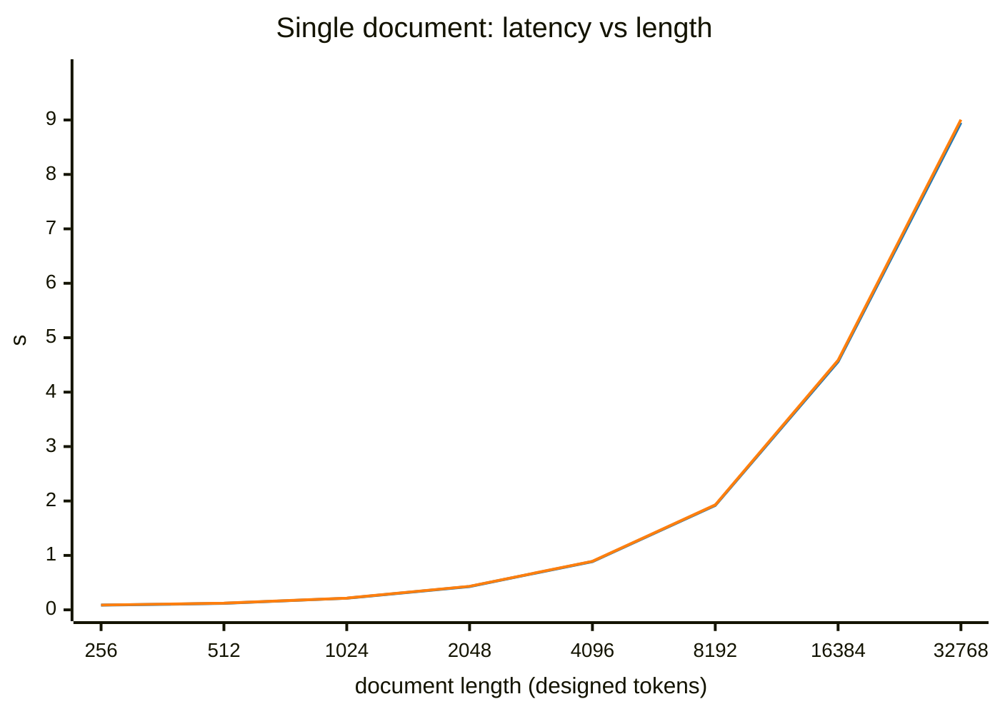
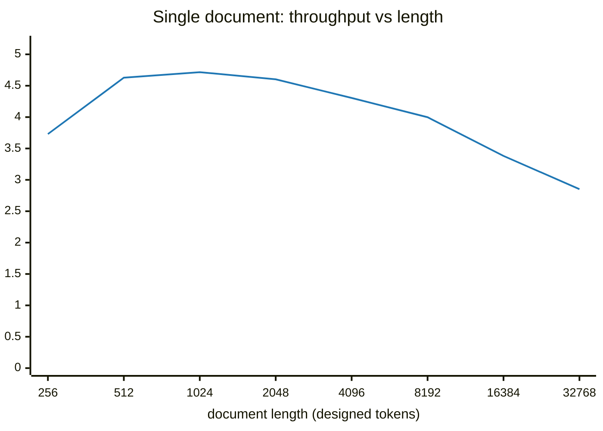
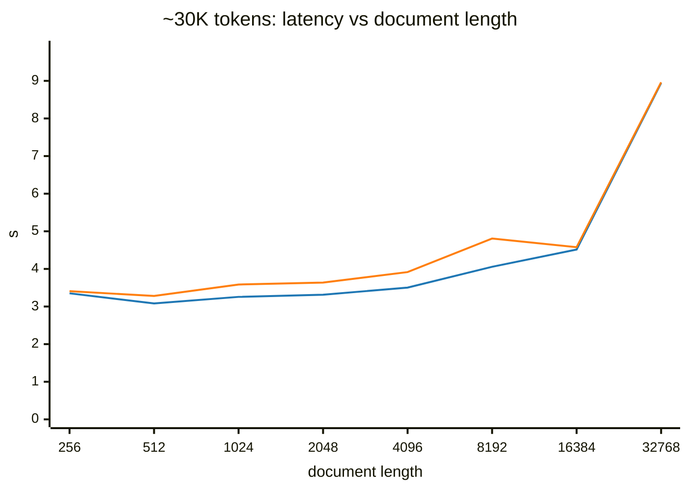
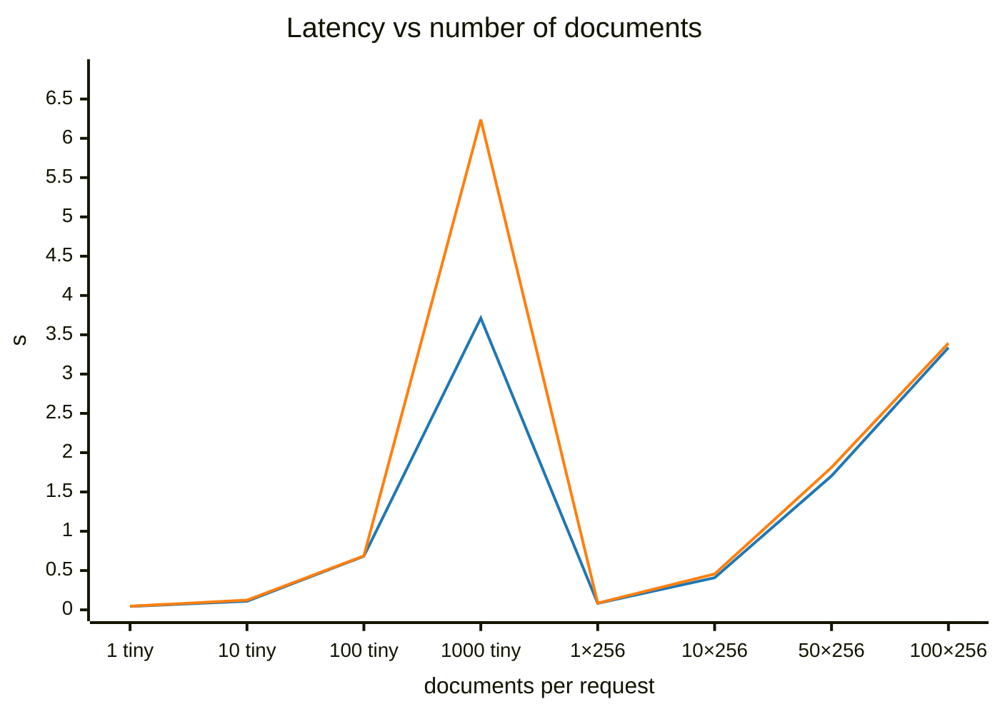
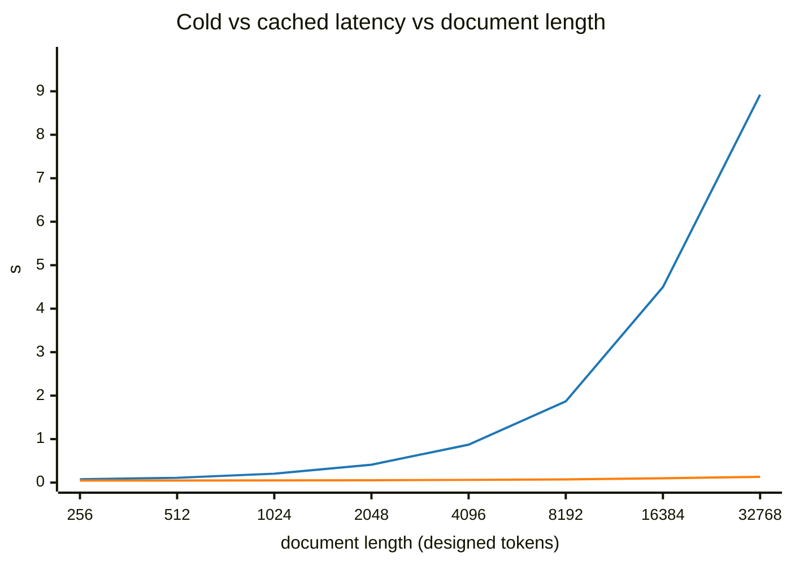
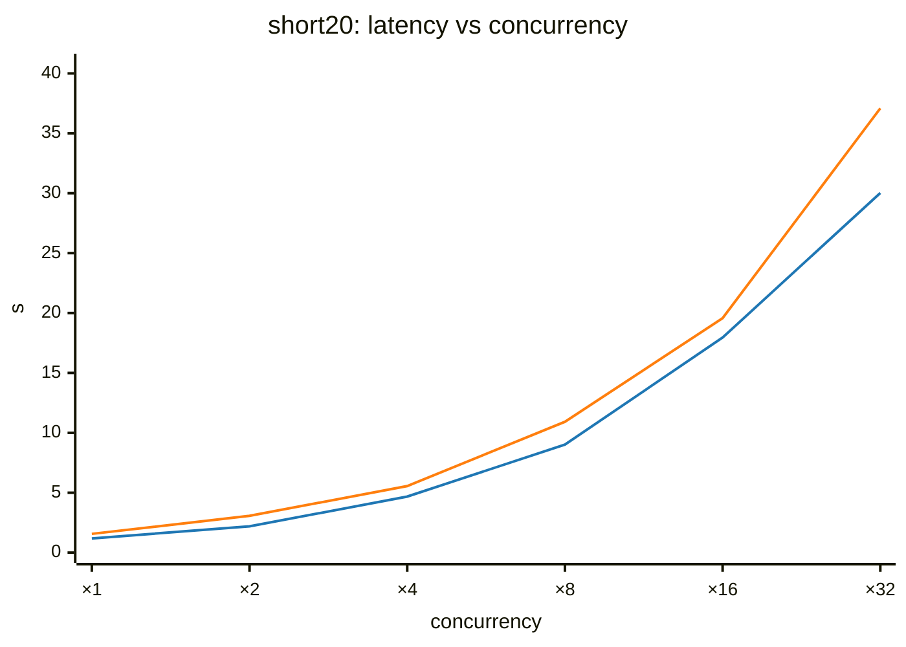
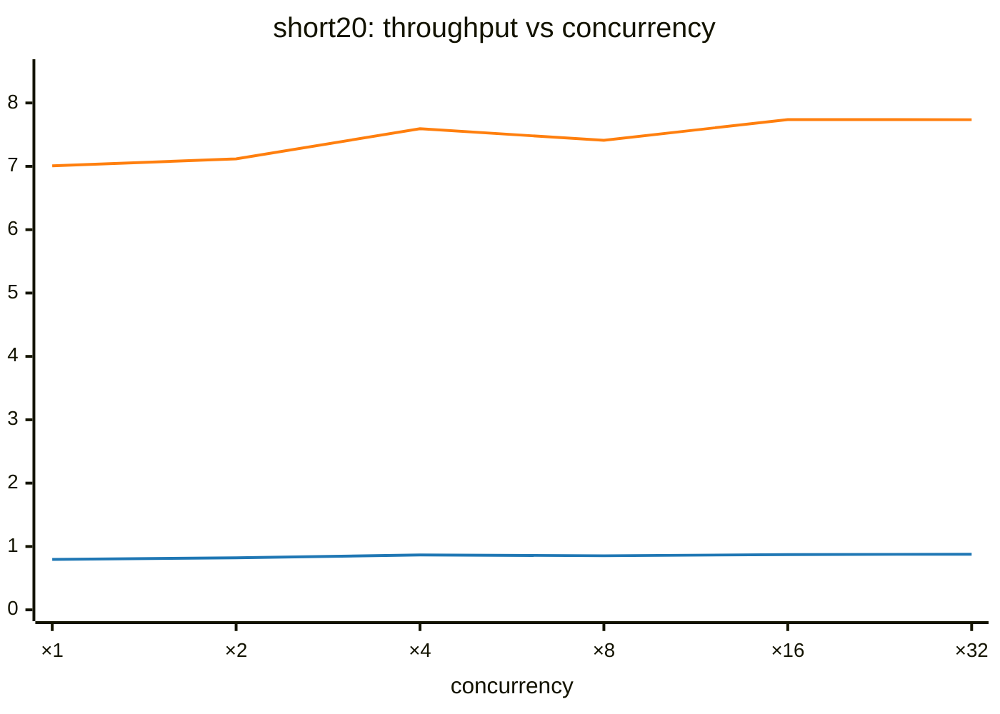
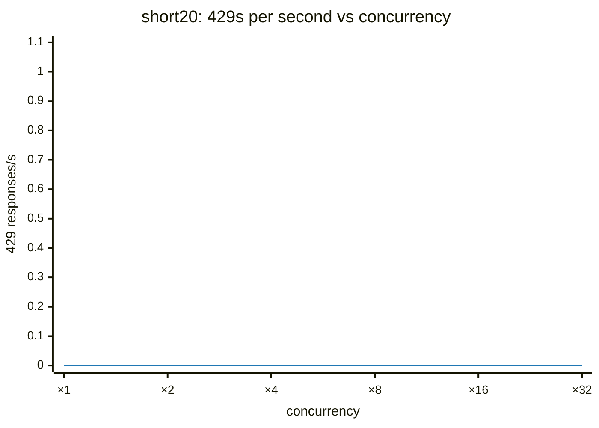

## meticulous — 2026-11-15 20:59 UTC

**PASS** · 1531 s · 784 requests · 0 (0.0%) errors · 0 rate-limited · 9,033,331 tokens billed

Sequential requests (one in flight) unless stated; every query carries a nonce so nothing is served from the API's prefix cache.

### Single document: latency vs length

| rung | Qwen tokens | billed | errors | p50 s | p90 s | max s | API tok/s |
|---|---|---|---|---|---|---|---|
| 256 | 229 | 323 | 0 (0.0%) | 0.086 | 0.089 | 0.114 | 3,730 |
| 512 | 457 | 551 | 0 (0.0%) | 0.118 | 0.122 | 0.125 | 4,628 |
| 1,024 | 911 | 1,005 | 0 (0.0%) | 0.213 | 0.216 | 0.218 | 4,716 |
| 2,048 | 1,872 | 1,966 | 0 (0.0%) | 0.428 | 0.433 | 0.442 | 4,602 |
| 4,096 | 3,707 | 3,801 | 0 (0.0%) | 0.886 | 0.893 | 0.894 | 4,305 |
| 8,192 | 7,545 | 7,640 | 0 (0.0%) | 1.919 | 1.928 | 1.930 | 3,998 |
| 16,384 | 15,274 | 15,368 | 0 (0.0%) | 4.559 | 4.585 | 4.590 | 3,381 |
| 32,768 | 25,438 | 25,536 | 0 (0.0%) | 8.949 | 9.007 | 9.048 | 2,852 |

*Single document: latency vs length: p50, p90*

*Single document: throughput vs length: API tokens/s ÷ 1000*

### ~30K tokens per request: latency vs document length (fewer, longer documents)

| rung | docs/request | billed | errors | p50 s | p90 s | max s | API tok/s |
|---|---|---|---|---|---|---|---|
| 256 | 100 | 32,426 | 0 (0.0%) | 3.351 | 3.408 | 3.420 | 9,636 |
| 512 | 55 | 30,271 | 0 (0.0%) | 3.083 | 3.281 | 3.532 | 9,680 |
| 1,024 | 28 | 28,174 | 0 (0.0%) | 3.257 | 3.585 | 3.691 | 8,665 |
| 2,048 | 13 | 25,574 | 0 (0.0%) | 3.313 | 3.638 | 3.858 | 8,029 |
| 4,096 | 6 | 22,807 | 0 (0.0%) | 3.504 | 3.916 | 4.228 | 6,594 |
| 8,192 | 3 | 22,922 | 0 (0.0%) | 4.056 | 4.808 | 5.374 | 5,743 |
| 16,384 | 1 | 15,367 | 0 (0.0%) | 4.516 | 4.578 | 4.579 | 3,390 |
| 32,768 | 1 | 25,541 | 0 (0.0%) | 8.941 | 8.962 | 9.059 | 2,855 |

*~30K tokens: latency vs document length: p50, p90*

### Latency vs number of documents

| documents | billed | errors | p50 s | p90 s | max s | MRR |
|---|---|---|---|---|---|---|
| 1 tiny | 91.1 | 0 (0.0%) | 0.044 | 0.046 | 0.048 | 1.000 |
| 10 tiny | 918 | 0 (0.0%) | 0.109 | 0.124 | 0.124 | 1.000 |
| 100 tiny | 9,269 | 0 (0.0%) | 0.682 | 0.687 | 0.691 | 1.000 |
| 1000 tiny | 93,889 | 0 (0.0%) | 3.713 | 6.238 | 6.554 | 1.000 |
| 1×256 | 323 | 0 (0.0%) | 0.084 | 0.087 | 0.088 | 1.000 |
| 10×256 | 3,226 | 0 (0.0%) | 0.409 | 0.455 | 0.505 | 1.000 |
| 50×256 | 16,160 | 0 (0.0%) | 1.704 | 1.812 | 1.889 | 1.000 |
| 100×256 | 32,369 | 0 (0.0%) | 3.337 | 3.393 | 3.396 | 1.000 |

*Latency vs number of documents: p50, p90*

### Cold vs cached: the same single-document request sent twice in a row

The API caches prompt prefixes, so a repeated (query, document) pair skips most of the compute. Cold = fresh nonce in the query; cached = the identical request again immediately after.

| rung | pairs | cold p50 s | cached p50 s | speed-up × | cold max s | cached max s | errors |
|---|---|---|---|---|---|---|---|
| 256 | 10 | 0.078 | 0.047 | 1.665 | 0.088 | 0.048 |  |
| 512 | 10 | 0.110 | 0.048 | 2.289 | 0.113 | 0.065 |  |
| 1,024 | 10 | 0.205 | 0.050 | 4.116 | 0.208 | 0.051 |  |
| 2,048 | 10 | 0.411 | 0.054 | 7.571 | 0.426 | 0.055 |  |
| 4,096 | 10 | 0.872 | 0.062 | 14.1 | 0.875 | 0.062 |  |
| 8,192 | 10 | 1.868 | 0.074 | 25.2 | 1.905 | 0.075 |  |
| 16,384 | 10 | 4.496 | 0.100 | 45.1 | 4.510 | 0.102 |  |
| 32,768 | 10 | 8.922 | 0.132 | 67.4 | 8.975 | 0.135 |  |

*Cold vs cached latency vs document length: cold p50, cached p50*

### short20: latency and throughput vs concurrency

|  | requests | errors | 429s | p50 s | p90 s | p99 s | max s | req/s | API tok/s | MRR |
|---|---|---|---|---|---|---|---|---|---|---|
| ×1 | 21 | 0 (0.0%) | 0 | 1.183 | 1.567 | 2.133 | 2.163 | 0.795 | 7,007 | 0.691 |
| ×2 | 22 | 0 (0.0%) | 0 | 2.194 | 3.068 | 3.761 | 3.944 | 0.821 | 7,118 | 0.718 |
| ×4 | 24 | 0 (0.0%) | 0 | 4.680 | 5.555 | 6.303 | 6.404 | 0.867 | 7,593 | 0.693 |
| ×8 | 28 | 0 (0.0%) | 0 | 9.013 | 10.9 | 11.6 | 11.8 | 0.854 | 7,411 | 0.719 |
| ×16 | 36 | 0 (0.0%) | 0 | 18.0 | 19.6 | 20.3 | 20.4 | 0.872 | 7,737 | 0.717 |
| ×32 | 53 | 0 (0.0%) | 0 | 30.0 | 37.1 | 37.5 | 37.5 | 0.879 | 7,736 | 0.761 |

No 429s up to concurrency ×32.

*short20: latency vs concurrency: p50, p90*

*short20: throughput vs concurrency: req/s, API tokens/s ÷ 1000*

*short20: 429s per second vs concurrency: 429/s*

784 requests, 9,033,331 tokens billed.
