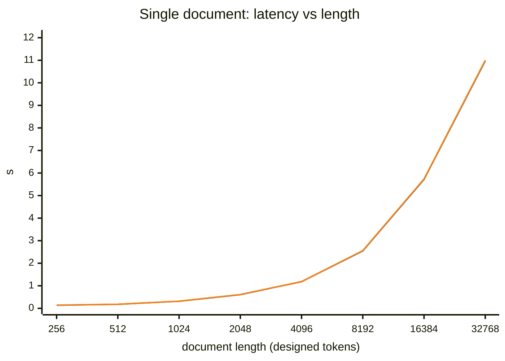
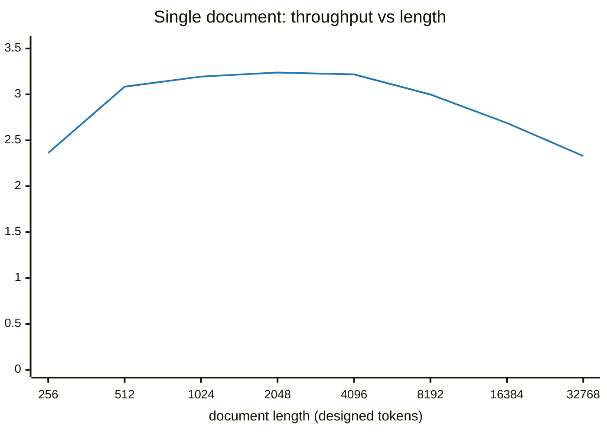
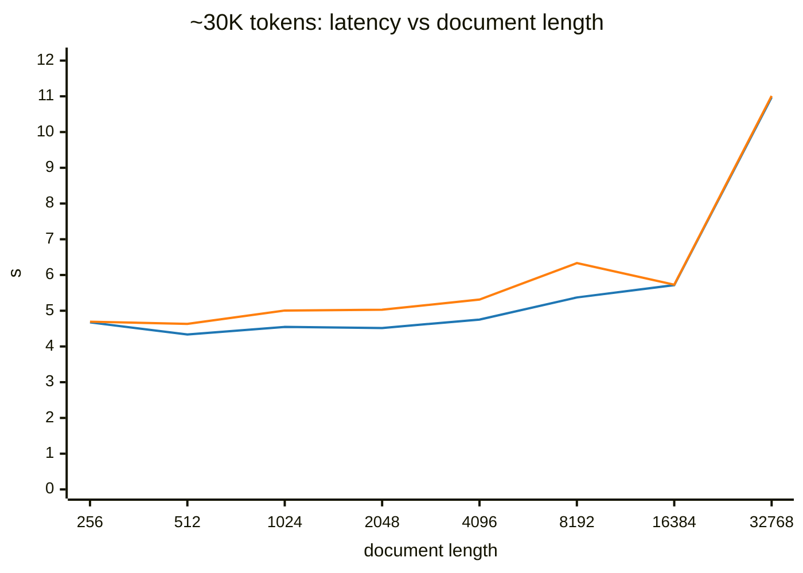
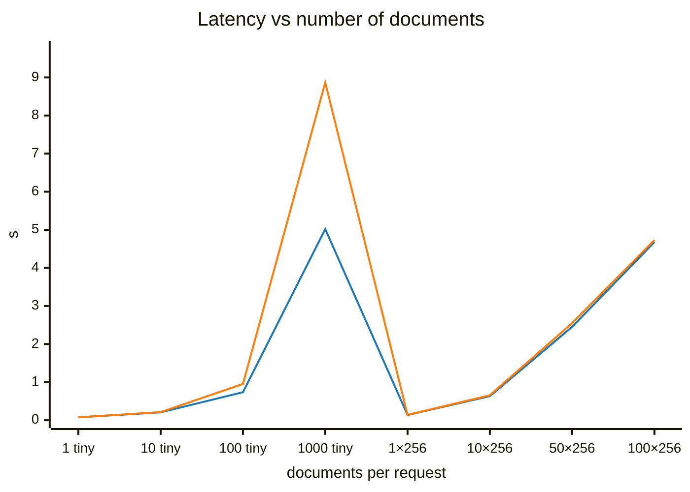
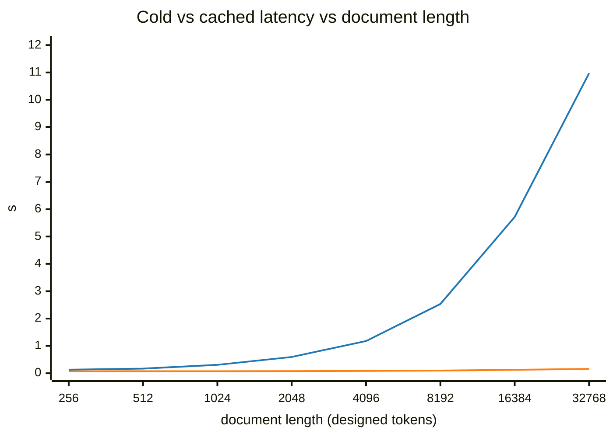
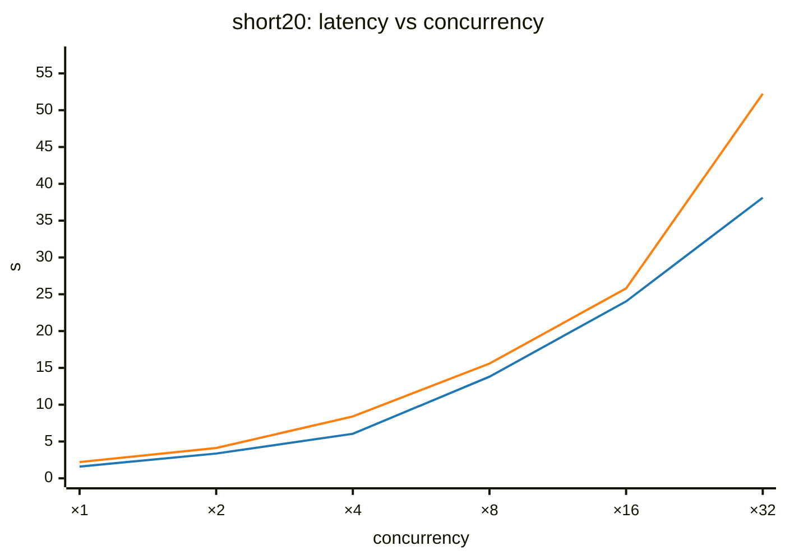
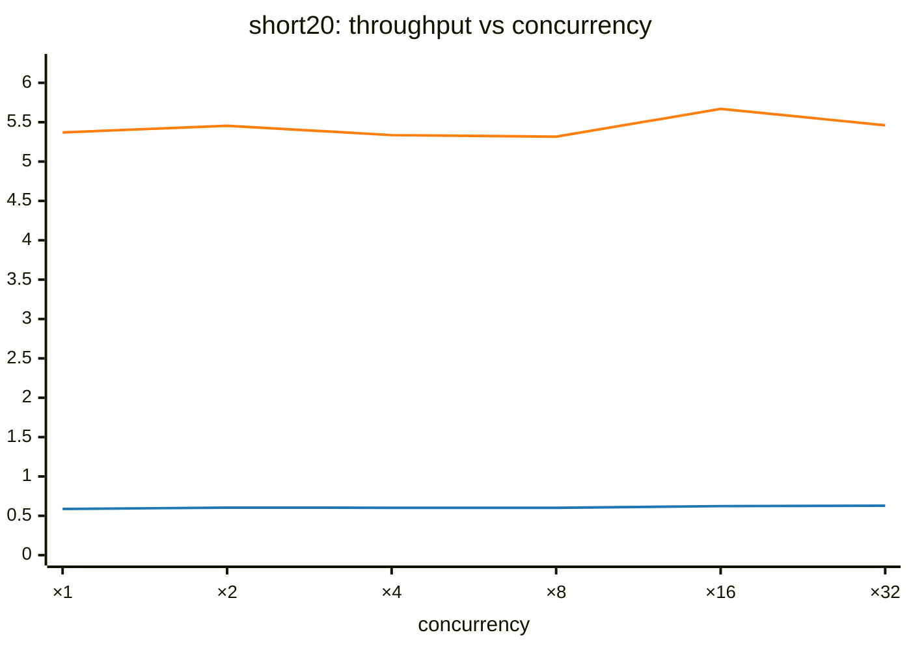
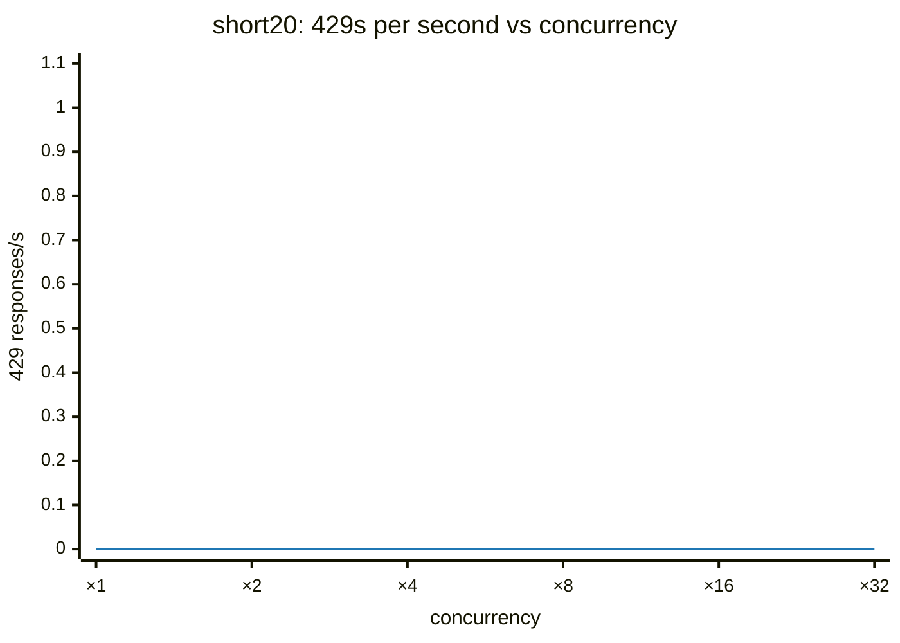

## meticulous — 2026-11-15 23:17 UTC

**PASS** · 1951 s · 751 requests · 0 (0.0%) errors · 0 rate-limited · 8,760,888 tokens billed

Sequential requests (one in flight) unless stated; every query carries a nonce so nothing is served from the API's prefix cache.

### Single document: latency vs length

| rung | Qwen tokens | billed | errors | p50 s | p90 s | max s | API tok/s |
|---|---|---|---|---|---|---|---|
| 256 | 229 | 323 | 0 (0.0%) | 0.136 | 0.144 | 0.168 | 2,362 |
| 512 | 457 | 551 | 0 (0.0%) | 0.178 | 0.182 | 0.185 | 3,084 |
| 1,024 | 911 | 1,005 | 0 (0.0%) | 0.314 | 0.318 | 0.318 | 3,194 |
| 2,048 | 1,872 | 1,966 | 0 (0.0%) | 0.607 | 0.612 | 0.615 | 3,238 |
| 4,096 | 3,707 | 3,801 | 0 (0.0%) | 1.181 | 1.186 | 1.190 | 3,218 |
| 8,192 | 7,545 | 7,640 | 0 (0.0%) | 2.545 | 2.560 | 2.563 | 2,999 |
| 16,384 | 15,274 | 15,368 | 0 (0.0%) | 5.716 | 5.737 | 5.740 | 2,689 |
| 32,768 | 25,438 | 25,536 | 0 (0.0%) | 11.0 | 11.0 | 11.1 | 2,329 |

*Single document: latency vs length: p50, p90*

*Single document: throughput vs length: API tokens/s ÷ 1000*

### ~30K tokens per request: latency vs document length (fewer, longer documents)

| rung | docs/request | billed | errors | p50 s | p90 s | max s | API tok/s |
|---|---|---|---|---|---|---|---|
| 256 | 100 | 32,419 | 0 (0.0%) | 4.674 | 4.694 | 4.740 | 6,936 |
| 512 | 55 | 30,267 | 0 (0.0%) | 4.336 | 4.633 | 4.895 | 6,884 |
| 1,024 | 28 | 28,179 | 0 (0.0%) | 4.546 | 5.006 | 5.152 | 6,204 |
| 2,048 | 13 | 25,578 | 0 (0.0%) | 4.516 | 5.028 | 5.359 | 5,829 |
| 4,096 | 6 | 22,807 | 0 (0.0%) | 4.753 | 5.313 | 5.657 | 4,879 |
| 8,192 | 3 | 22,923 | 0 (0.0%) | 5.372 | 6.333 | 7.026 | 4,388 |
| 16,384 | 1 | 15,367 | 0 (0.0%) | 5.717 | 5.729 | 5.733 | 2,688 |
| 32,768 | 1 | 25,540 | 0 (0.0%) | 11.0 | 11.0 | 11.0 | 2,326 |

*~30K tokens: latency vs document length: p50, p90*

### Latency vs number of documents

| documents | billed | errors | p50 s | p90 s | max s | MRR |
|---|---|---|---|---|---|---|
| 1 tiny | 91.2 | 0 (0.0%) | 0.076 | 0.078 | 0.078 | 1.000 |
| 10 tiny | 922 | 0 (0.0%) | 0.207 | 0.214 | 0.215 | 1.000 |
| 100 tiny | 9,299 | 0 (0.0%) | 0.734 | 0.952 | 0.954 | 1.000 |
| 1000 tiny | 93,789 | 0 (0.0%) | 5.019 | 8.869 | 8.894 | 1.000 |
| 1×256 | 324 | 0 (0.0%) | 0.136 | 0.140 | 0.142 | 1.000 |
| 10×256 | 3,227 | 0 (0.0%) | 0.631 | 0.656 | 0.719 | 1.000 |
| 50×256 | 16,140 | 0 (0.0%) | 2.452 | 2.550 | 2.651 | 1.000 |
| 100×256 | 32,339 | 0 (0.0%) | 4.680 | 4.731 | 4.732 | 1.000 |

*Latency vs number of documents: p50, p90*

### Cold vs cached: the same single-document request sent twice in a row

The API caches prompt prefixes, so a repeated (query, document) pair skips most of the compute. Cold = fresh nonce in the query; cached = the identical request again immediately after.

| rung | pairs | cold p50 s | cached p50 s | speed-up × | cold max s | cached max s | errors |
|---|---|---|---|---|---|---|---|
| 256 | 10 | 0.130 | 0.072 | 1.808 | 0.136 | 0.091 |  |
| 512 | 10 | 0.169 | 0.073 | 2.317 | 0.175 | 0.075 |  |
| 1,024 | 10 | 0.307 | 0.075 | 4.112 | 0.317 | 0.076 |  |
| 2,048 | 10 | 0.596 | 0.078 | 7.599 | 0.609 | 0.080 |  |
| 4,096 | 10 | 1.177 | 0.086 | 13.7 | 1.183 | 0.089 |  |
| 8,192 | 10 | 2.534 | 0.099 | 25.5 | 2.546 | 0.100 |  |
| 16,384 | 10 | 5.716 | 0.126 | 45.5 | 5.729 | 0.130 |  |
| 32,768 | 10 | 11.0 | 0.160 | 68.7 | 11.1 | 0.161 |  |

*Cold vs cached latency vs document length: cold p50, cached p50*

### short20: latency and throughput vs concurrency

|  | requests | errors | 429s | p50 s | p90 s | p99 s | max s | req/s | API tok/s | MRR |
|---|---|---|---|---|---|---|---|---|---|---|
| ×1 | 15 | 0 (0.0%) | 0 | 1.588 | 2.206 | 2.974 | 3.092 | 0.587 | 5,370 | 0.686 |
| ×2 | 17 | 0 (0.0%) | 0 | 3.364 | 4.120 | 4.845 | 4.846 | 0.604 | 5,455 | 0.637 |
| ×4 | 19 | 0 (0.0%) | 0 | 6.050 | 8.401 | 8.405 | 8.405 | 0.602 | 5,336 | 0.671 |
| ×8 | 23 | 0 (0.0%) | 0 | 13.8 | 15.6 | 15.8 | 15.8 | 0.602 | 5,317 | 0.703 |
| ×16 | 31 | 0 (0.0%) | 0 | 24.0 | 25.8 | 26.3 | 26.4 | 0.623 | 5,669 | 0.715 |
| ×32 | 46 | 0 (0.0%) | 0 | 38.1 | 52.2 | 52.8 | 52.8 | 0.629 | 5,461 | 0.739 |

No 429s up to concurrency ×32.

*short20: latency vs concurrency: p50, p90*

*short20: throughput vs concurrency: req/s, API tokens/s ÷ 1000*

*short20: 429s per second vs concurrency: 429/s*

751 requests, 8,760,888 tokens billed.
