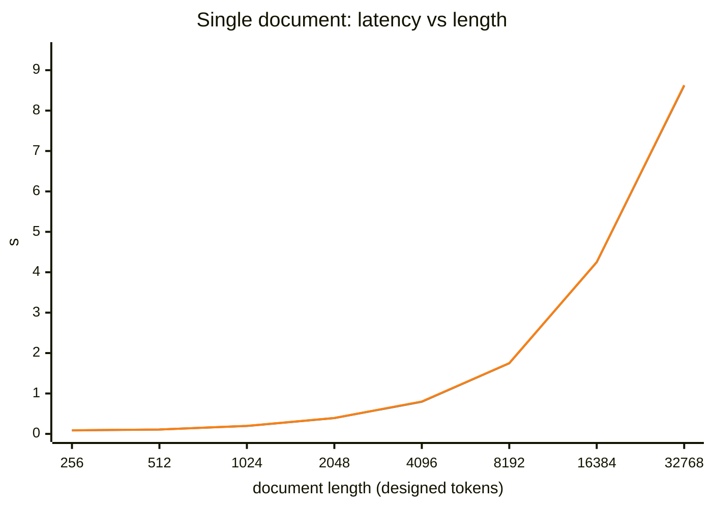
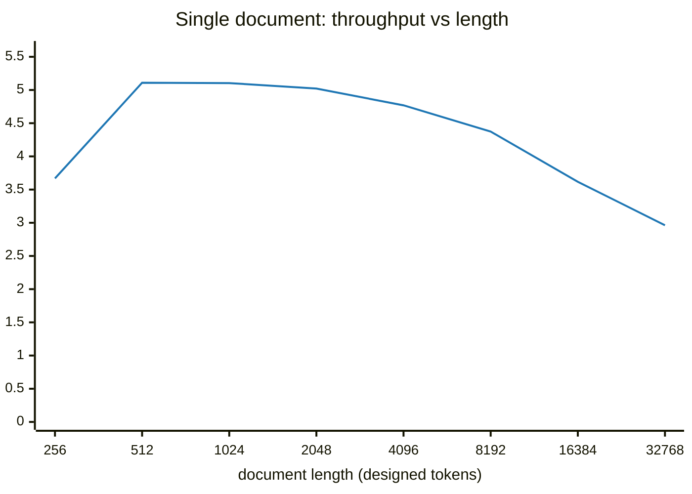
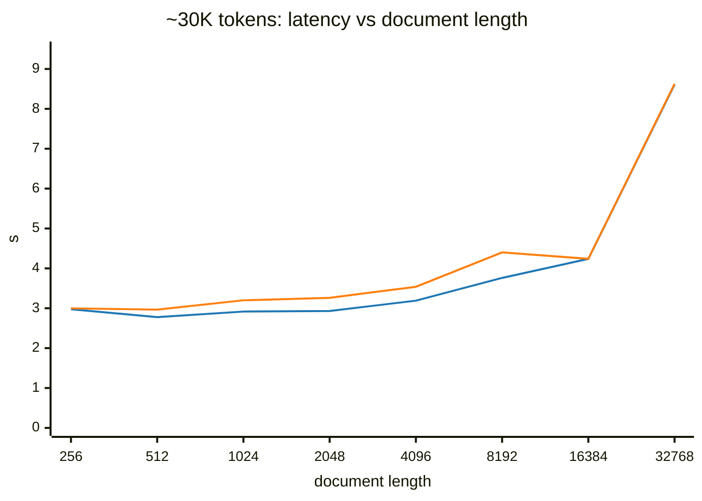
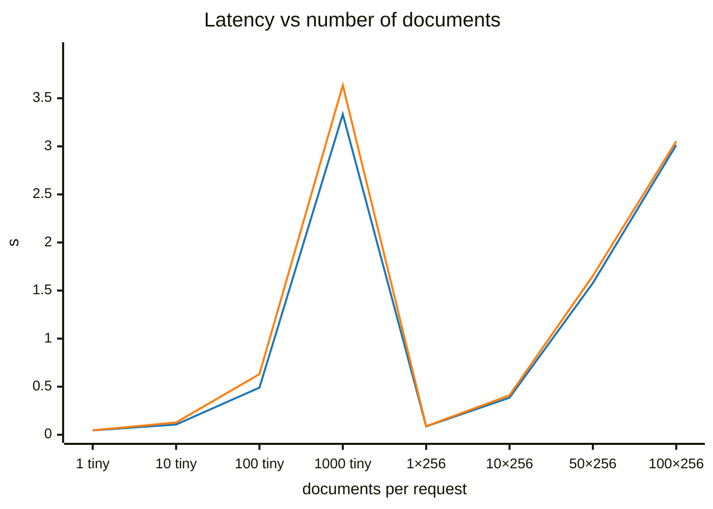
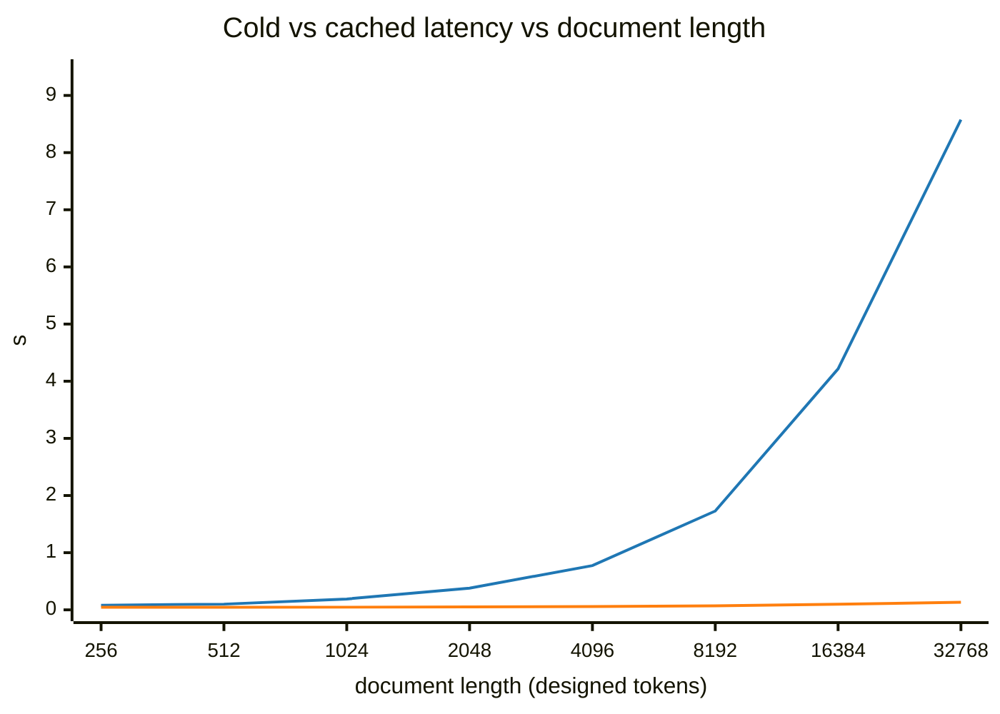
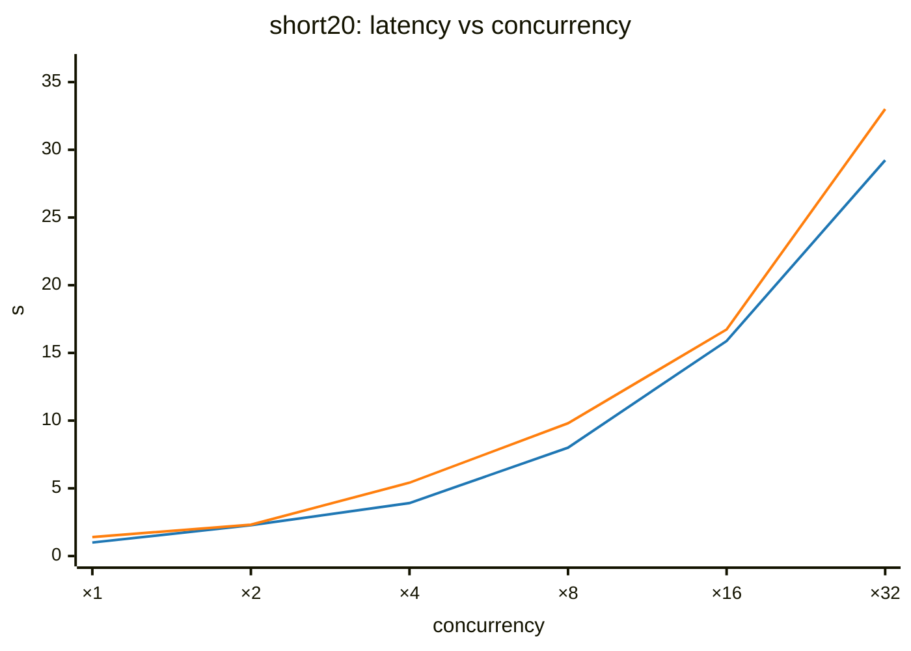
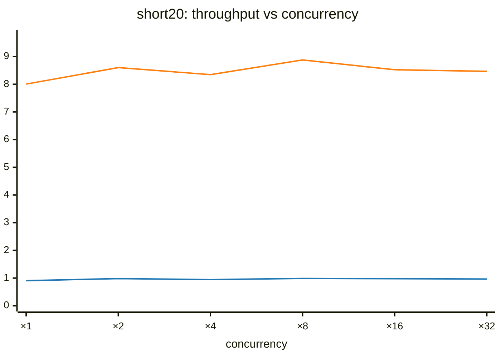
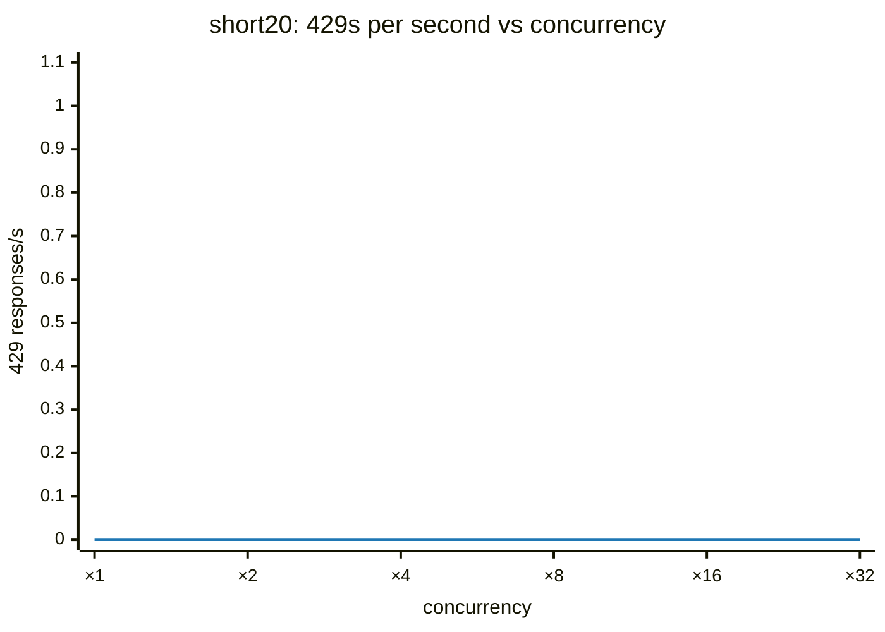

## meticulous — 2026-11-16 08:14 UTC

**PASS** · 1436 s · 803 requests · 1 (0.1%) errors · 0 rate-limited · 9,208,211 tokens billed

Sequential requests (one in flight) unless stated; every query carries a nonce so nothing is served from the API's prefix cache.

### Single document: latency vs length

| rung | Qwen tokens | billed | errors | p50 s | p90 s | max s | API tok/s |
|---|---|---|---|---|---|---|---|
| 256 | 229 | 324 | 0 (0.0%) | 0.087 | 0.089 | 0.121 | 3,668 |
| 512 | 457 | 551 | 0 (0.0%) | 0.107 | 0.110 | 0.113 | 5,109 |
| 1,024 | 911 | 1,005 | 1 (3.3%) | 0.196 | 0.199 | 0.201 | 5,104 |
| 2,048 | 1,872 | 1,966 | 0 (0.0%) | 0.390 | 0.395 | 0.395 | 5,022 |
| 4,096 | 3,707 | 3,800 | 0 (0.0%) | 0.797 | 0.801 | 0.808 | 4,769 |
| 8,192 | 7,545 | 7,640 | 0 (0.0%) | 1.747 | 1.751 | 1.758 | 4,374 |
| 16,384 | 15,274 | 15,368 | 0 (0.0%) | 4.248 | 4.252 | 4.255 | 3,617 |
| 32,768 | 25,438 | 25,536 | 0 (0.0%) | 8.618 | 8.631 | 8.687 | 2,963 |

*Single document: latency vs length: p50, p90*

*Single document: throughput vs length: API tokens/s ÷ 1000*

### ~30K tokens per request: latency vs document length (fewer, longer documents)

| rung | docs/request | billed | errors | p50 s | p90 s | max s | API tok/s |
|---|---|---|---|---|---|---|---|
| 256 | 100 | 32,346 | 0 (0.0%) | 2.976 | 2.999 | 3.016 | 10,846 |
| 512 | 55 | 30,293 | 0 (0.0%) | 2.777 | 2.965 | 3.131 | 10,797 |
| 1,024 | 28 | 28,178 | 0 (0.0%) | 2.917 | 3.200 | 3.302 | 9,674 |
| 2,048 | 13 | 25,573 | 0 (0.0%) | 2.932 | 3.262 | 3.488 | 8,942 |
| 4,096 | 6 | 22,804 | 0 (0.0%) | 3.190 | 3.538 | 3.767 | 7,288 |
| 8,192 | 3 | 22,922 | 0 (0.0%) | 3.761 | 4.400 | 4.845 | 6,258 |
| 16,384 | 1 | 15,367 | 0 (0.0%) | 4.238 | 4.240 | 4.241 | 3,626 |
| 32,768 | 1 | 25,541 | 0 (0.0%) | 8.609 | 8.625 | 8.683 | 2,967 |

*~30K tokens: latency vs document length: p50, p90*

### Latency vs number of documents

| documents | billed | errors | p50 s | p90 s | max s | MRR |
|---|---|---|---|---|---|---|
| 1 tiny | 91.0 | 0 (0.0%) | 0.046 | 0.046 | 0.049 | 1.000 |
| 10 tiny | 923 | 0 (0.0%) | 0.106 | 0.127 | 0.132 | 1.000 |
| 100 tiny | 9,319 | 0 (0.0%) | 0.490 | 0.631 | 0.632 | 1.000 |
| 1000 tiny | 94,289 | 0 (0.0%) | 3.334 | 3.636 | 5.789 | 1.000 |
| 1×256 | 323 | 0 (0.0%) | 0.087 | 0.088 | 0.090 | 1.000 |
| 10×256 | 3,232 | 0 (0.0%) | 0.386 | 0.411 | 0.449 | 1.000 |
| 50×256 | 16,160 | 0 (0.0%) | 1.578 | 1.653 | 1.685 | 1.000 |
| 100×256 | 32,299 | 0 (0.0%) | 3.014 | 3.053 | 3.054 | 1.000 |

*Latency vs number of documents: p50, p90*

### Cold vs cached: the same single-document request sent twice in a row

The API caches prompt prefixes, so a repeated (query, document) pair skips most of the compute. Cold = fresh nonce in the query; cached = the identical request again immediately after.

| rung | pairs | cold p50 s | cached p50 s | speed-up × | cold max s | cached max s | errors |
|---|---|---|---|---|---|---|---|
| 256 | 10 | 0.079 | 0.044 | 1.779 | 0.085 | 0.046 |  |
| 512 | 10 | 0.100 | 0.046 | 2.173 | 0.104 | 0.048 |  |
| 1,024 | 10 | 0.190 | 0.047 | 4.061 | 0.193 | 0.047 |  |
| 2,048 | 10 | 0.379 | 0.051 | 7.481 | 0.381 | 0.052 |  |
| 4,096 | 10 | 0.775 | 0.057 | 13.5 | 0.779 | 0.059 |  |
| 8,192 | 10 | 1.729 | 0.071 | 24.3 | 1.738 | 0.074 |  |
| 16,384 | 10 | 4.217 | 0.098 | 42.9 | 4.222 | 0.100 |  |
| 32,768 | 10 | 8.577 | 0.132 | 65.1 | 8.631 | 0.134 |  |

*Cold vs cached latency vs document length: cold p50, cached p50*

### short20: latency and throughput vs concurrency

|  | requests | errors | 429s | p50 s | p90 s | p99 s | max s | req/s | API tok/s | MRR |
|---|---|---|---|---|---|---|---|---|---|---|
| ×1 | 23 | 0 (0.0%) | 0 | 0.997 | 1.401 | 1.918 | 1.957 | 0.907 | 8,006 | 0.709 |
| ×2 | 26 | 0 (0.0%) | 0 | 2.276 | 2.314 | 3.058 | 3.060 | 0.981 | 8,602 | 0.704 |
| ×4 | 27 | 0 (0.0%) | 0 | 3.912 | 5.415 | 5.438 | 5.442 | 0.947 | 8,348 | 0.735 |
| ×8 | 32 | 0 (0.0%) | 0 | 8.002 | 9.803 | 9.896 | 9.898 | 0.987 | 8,878 | 0.706 |
| ×16 | 40 | 0 (0.0%) | 0 | 15.9 | 16.7 | 17.3 | 17.4 | 0.978 | 8,524 | 0.768 |
| ×32 | 55 | 0 (0.0%) | 0 | 29.2 | 33.0 | 33.4 | 33.4 | 0.965 | 8,466 | 0.750 |

No 429s up to concurrency ×32.

*short20: latency vs concurrency: p50, p90*

*short20: throughput vs concurrency: req/s, API tokens/s ÷ 1000*

*short20: 429s per second vs concurrency: 429/s*

| error | count | example | response |
|---|---|---|---|
| http 424 ModelError container 0 | 1 | ladder1-1024 ladder1-1024/ctx1024_query35 | {"ErrorCode":"INTERNAL_FAILURE_FROM_MODEL","LogStreamArn":"arn:aws:logs:eu-west-3:<account-id>:log-group:/aws/sagemaker/Endpoints/reranker-aws031-8b-int8-3","Message":"Received server error (0) from primary with message \"Connection reset by peer for the reranker-aws031-8b-int8-3 endpoint. Please re |

803 requests, 9,208,211 tokens billed.
