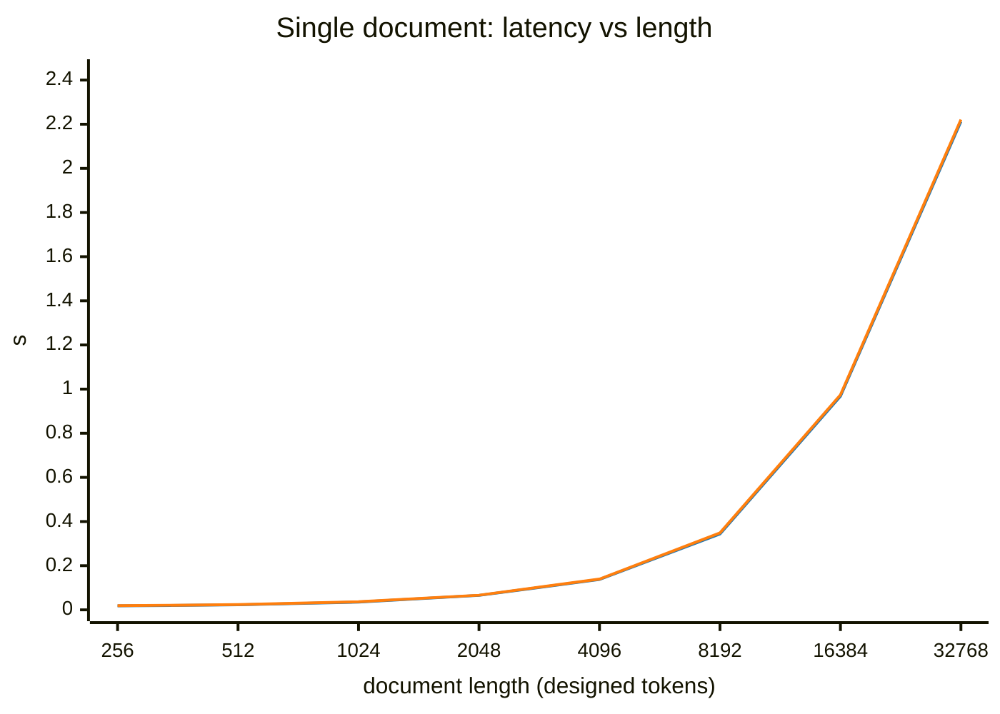
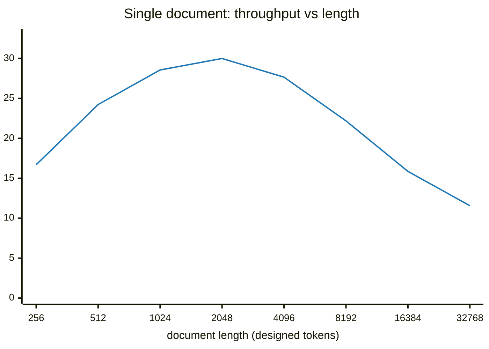
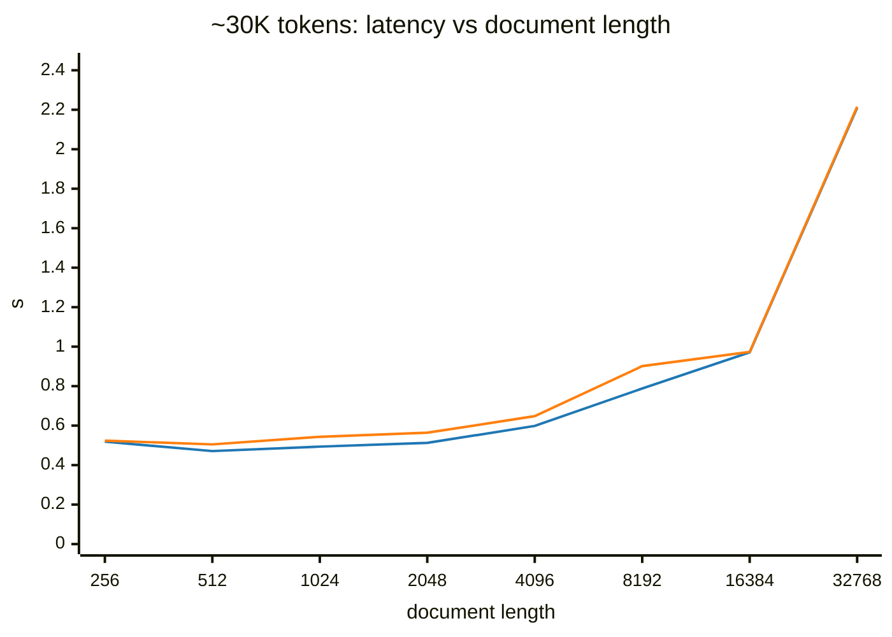
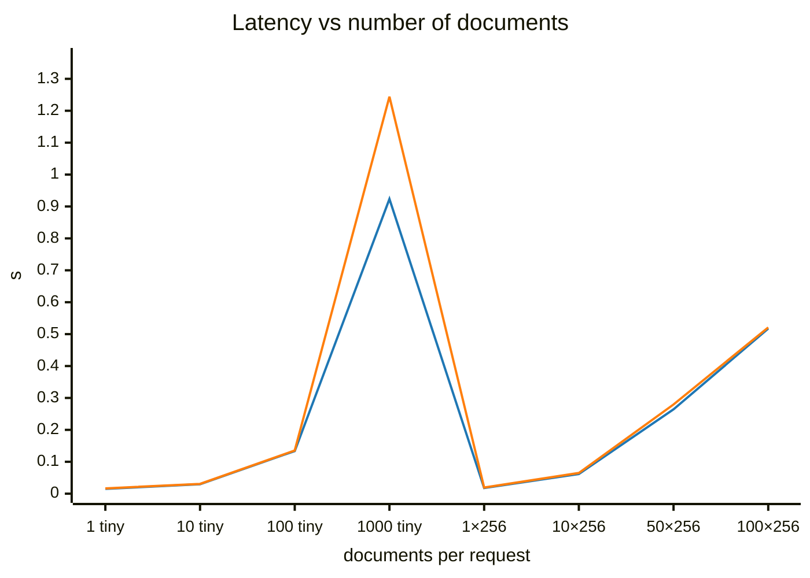
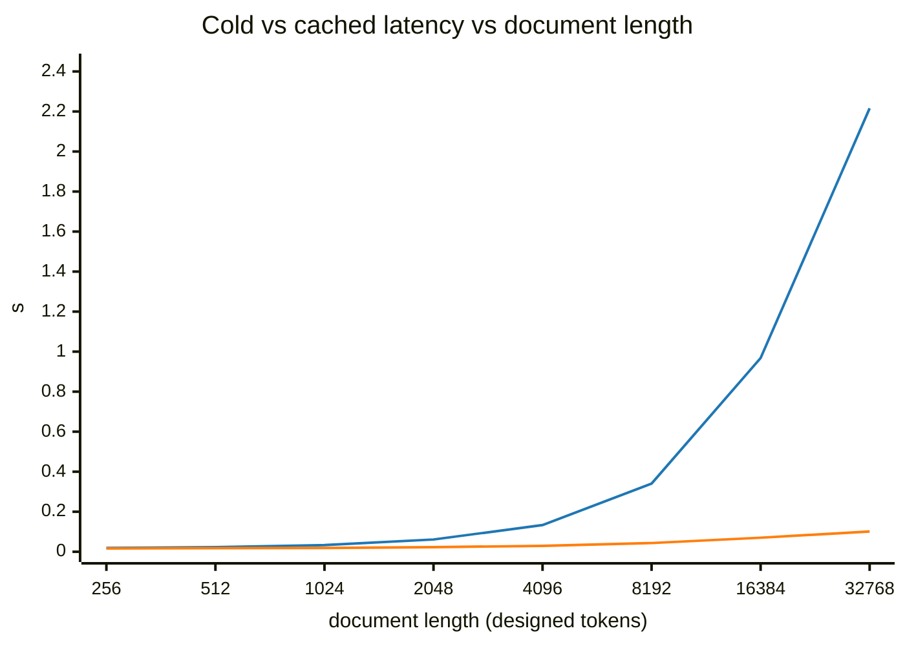
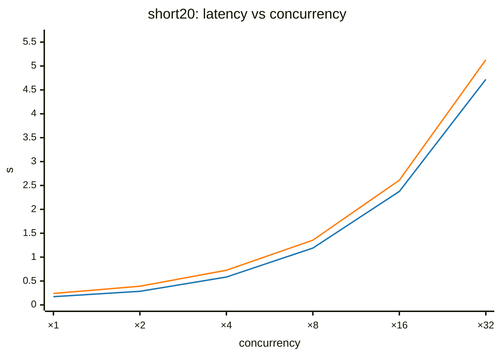
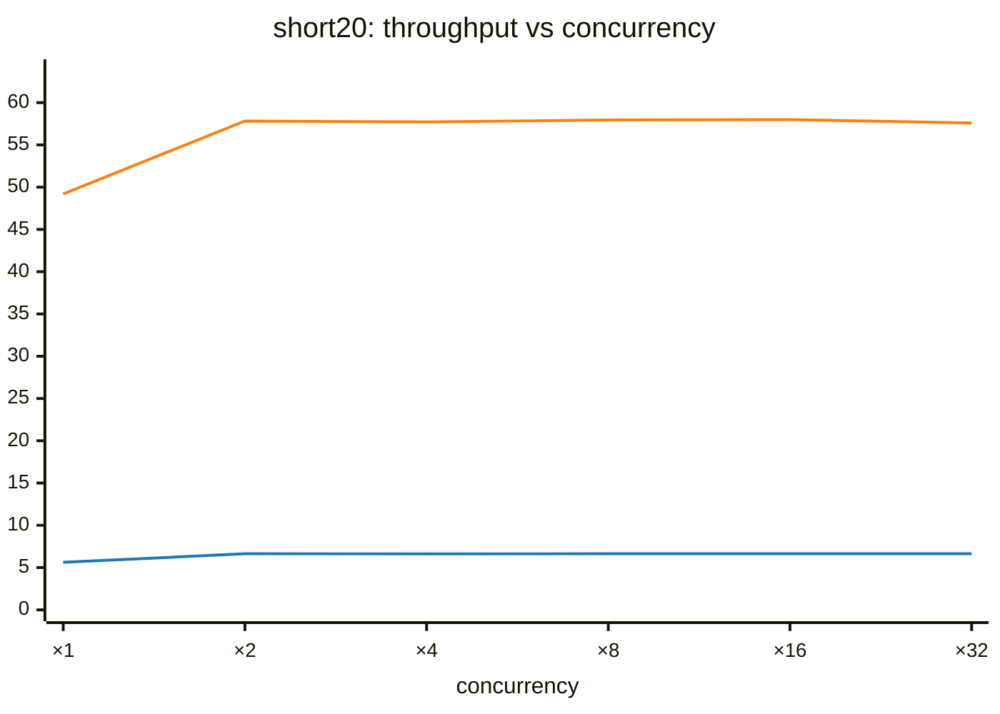
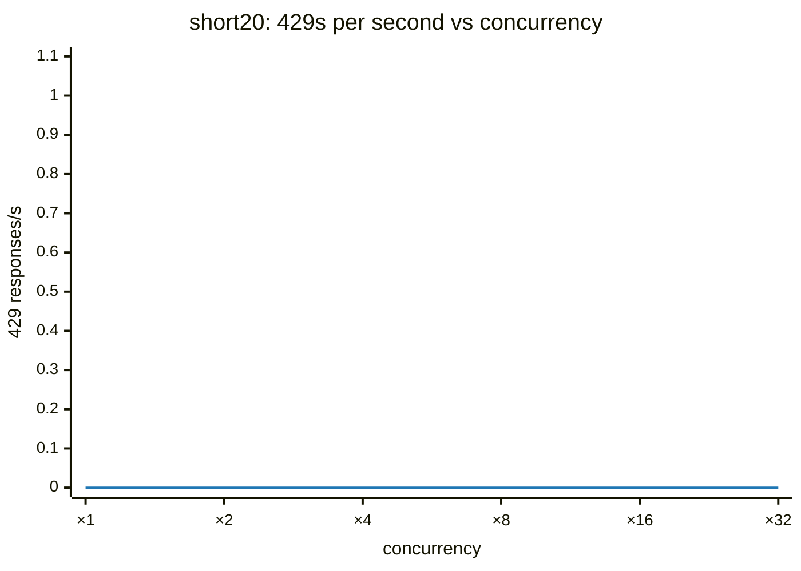

## meticulous — 2026-11-17 09:32 UTC

**PASS** · 445 s · 1628 requests · 0 (0.0%) errors · 0 rate-limited · 16,388,119 tokens billed

Sequential requests (one in flight) unless stated; every query carries a nonce so nothing is served from the API's prefix cache.

### Single document: latency vs length

| rung | Qwen tokens | billed | errors | p50 s | p90 s | max s | API tok/s |
|---|---|---|---|---|---|---|---|
| 256 | 229 | 324 | 0 (0.0%) | 0.018 | 0.019 | 0.060 | 16,690 |
| 512 | 457 | 551 | 0 (0.0%) | 0.023 | 0.024 | 0.029 | 24,222 |
| 1,024 | 911 | 1,005 | 0 (0.0%) | 0.035 | 0.036 | 0.038 | 28,550 |
| 2,048 | 1,872 | 1,966 | 0 (0.0%) | 0.065 | 0.066 | 0.067 | 29,995 |
| 4,096 | 3,707 | 3,800 | 0 (0.0%) | 0.137 | 0.139 | 0.141 | 27,650 |
| 8,192 | 7,545 | 7,640 | 0 (0.0%) | 0.344 | 0.349 | 0.351 | 22,179 |
| 16,384 | 15,274 | 15,368 | 0 (0.0%) | 0.968 | 0.974 | 0.977 | 15,864 |
| 32,768 | 25,438 | 25,536 | 0 (0.0%) | 2.212 | 2.221 | 2.227 | 11,558 |

*Single document: latency vs length: p50, p90*

*Single document: throughput vs length: API tokens/s ÷ 1000*

### ~30K tokens per request: latency vs document length (fewer, longer documents)

| rung | docs/request | billed | errors | p50 s | p90 s | max s | API tok/s |
|---|---|---|---|---|---|---|---|
| 256 | 100 | 32,399 | 0 (0.0%) | 0.519 | 0.524 | 0.526 | 62,343 |
| 512 | 55 | 30,293 | 0 (0.0%) | 0.471 | 0.505 | 0.529 | 63,078 |
| 1,024 | 28 | 28,181 | 0 (0.0%) | 0.494 | 0.544 | 0.552 | 56,776 |
| 2,048 | 13 | 25,578 | 0 (0.0%) | 0.513 | 0.564 | 0.601 | 51,009 |
| 4,096 | 6 | 22,809 | 0 (0.0%) | 0.598 | 0.648 | 0.688 | 39,269 |
| 8,192 | 3 | 22,923 | 0 (0.0%) | 0.788 | 0.901 | 0.972 | 30,055 |
| 16,384 | 1 | 15,367 | 0 (0.0%) | 0.971 | 0.973 | 0.978 | 15,834 |
| 32,768 | 1 | 25,541 | 0 (0.0%) | 2.210 | 2.215 | 2.226 | 11,565 |

*~30K tokens: latency vs document length: p50, p90*

### Latency vs number of documents

| documents | billed | errors | p50 s | p90 s | max s | MRR |
|---|---|---|---|---|---|---|
| 1 tiny | 90.5 | 0 (0.0%) | 0.015 | 0.017 | 0.018 | 1.000 |
| 10 tiny | 924 | 0 (0.0%) | 0.030 | 0.031 | 0.032 | 1.000 |
| 100 tiny | 9,299 | 0 (0.0%) | 0.134 | 0.135 | 0.137 | 1.000 |
| 1000 tiny | 94,289 | 0 (0.0%) | 0.924 | 1.244 | 1.272 | 1.000 |
| 1×256 | 323 | 0 (0.0%) | 0.018 | 0.019 | 0.019 | 1.000 |
| 10×256 | 3,229 | 0 (0.0%) | 0.062 | 0.065 | 0.072 | 1.000 |
| 50×256 | 16,170 | 0 (0.0%) | 0.264 | 0.280 | 0.282 | 1.000 |
| 100×256 | 32,309 | 0 (0.0%) | 0.517 | 0.521 | 0.529 | 1.000 |

*Latency vs number of documents: p50, p90*

### Cold vs cached: the same single-document request sent twice in a row

The API caches prompt prefixes, so a repeated (query, document) pair skips most of the compute. Cold = fresh nonce in the query; cached = the identical request again immediately after.

| rung | pairs | cold p50 s | cached p50 s | speed-up × | cold max s | cached max s | errors |
|---|---|---|---|---|---|---|---|
| 256 | 10 | 0.019 | 0.017 | 1.119 | 0.040 | 0.018 |  |
| 512 | 10 | 0.023 | 0.018 | 1.304 | 0.024 | 0.021 |  |
| 1,024 | 10 | 0.033 | 0.019 | 1.754 | 0.036 | 0.023 |  |
| 2,048 | 10 | 0.061 | 0.023 | 2.675 | 0.062 | 0.025 |  |
| 4,096 | 10 | 0.133 | 0.030 | 4.521 | 0.136 | 0.031 |  |
| 8,192 | 10 | 0.340 | 0.044 | 7.806 | 0.345 | 0.051 |  |
| 16,384 | 10 | 0.968 | 0.070 | 13.8 | 0.978 | 0.072 |  |
| 32,768 | 10 | 2.216 | 0.101 | 21.8 | 2.222 | 0.108 |  |

*Cold vs cached latency vs document length: cold p50, cached p50*

### short20: latency and throughput vs concurrency

|  | requests | errors | 429s | p50 s | p90 s | p99 s | max s | req/s | API tok/s | MRR |
|---|---|---|---|---|---|---|---|---|---|---|
| ×1 | 141 | 0 (0.0%) | 0 | 0.172 | 0.240 | 0.306 | 0.314 | 5.622 | 49,203 | 0.676 |
| ×2 | 167 | 0 (0.0%) | 0 | 0.285 | 0.391 | 0.452 | 0.508 | 6.635 | 57,828 | 0.669 |
| ×4 | 169 | 0 (0.0%) | 0 | 0.583 | 0.725 | 0.845 | 0.858 | 6.627 | 57,722 | 0.668 |
| ×8 | 173 | 0 (0.0%) | 0 | 1.190 | 1.355 | 1.486 | 1.535 | 6.634 | 57,953 | 0.661 |
| ×16 | 181 | 0 (0.0%) | 0 | 2.375 | 2.610 | 2.764 | 2.821 | 6.635 | 57,995 | 0.667 |
| ×32 | 197 | 0 (0.0%) | 0 | 4.721 | 5.130 | 5.315 | 5.368 | 6.633 | 57,591 | 0.667 |

No 429s up to concurrency ×32.

*short20: latency vs concurrency: p50, p90*

*short20: throughput vs concurrency: req/s, API tokens/s ÷ 1000*

*short20: 429s per second vs concurrency: 429/s*

1628 requests, 16,388,119 tokens billed.
