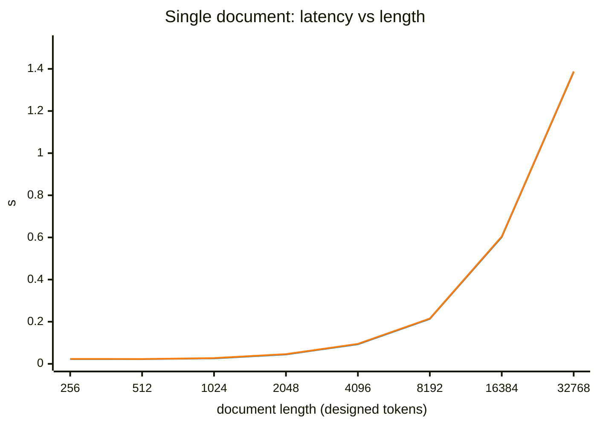
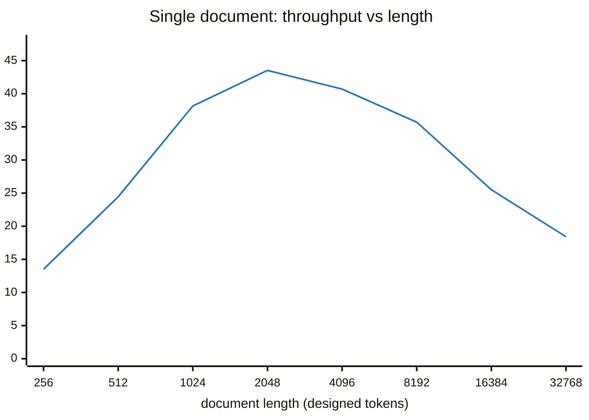
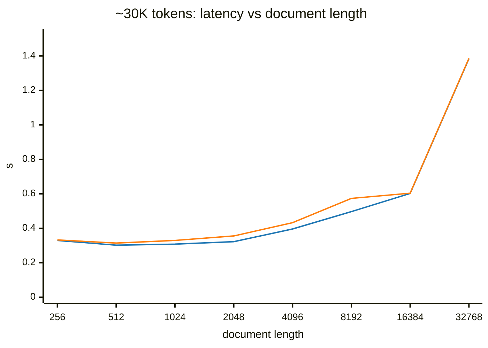
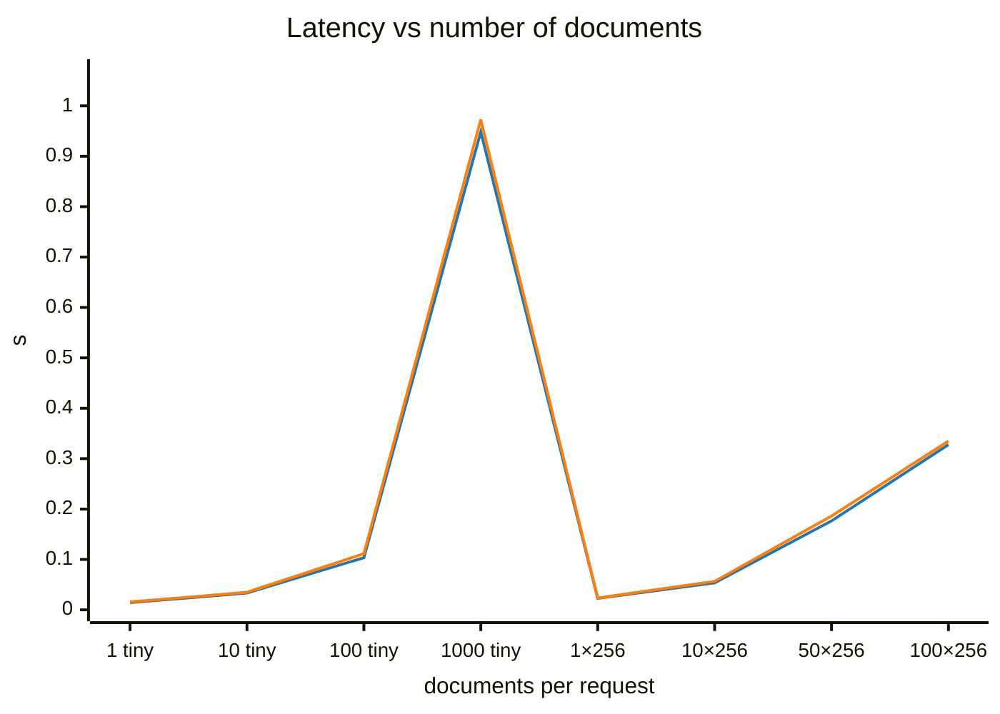
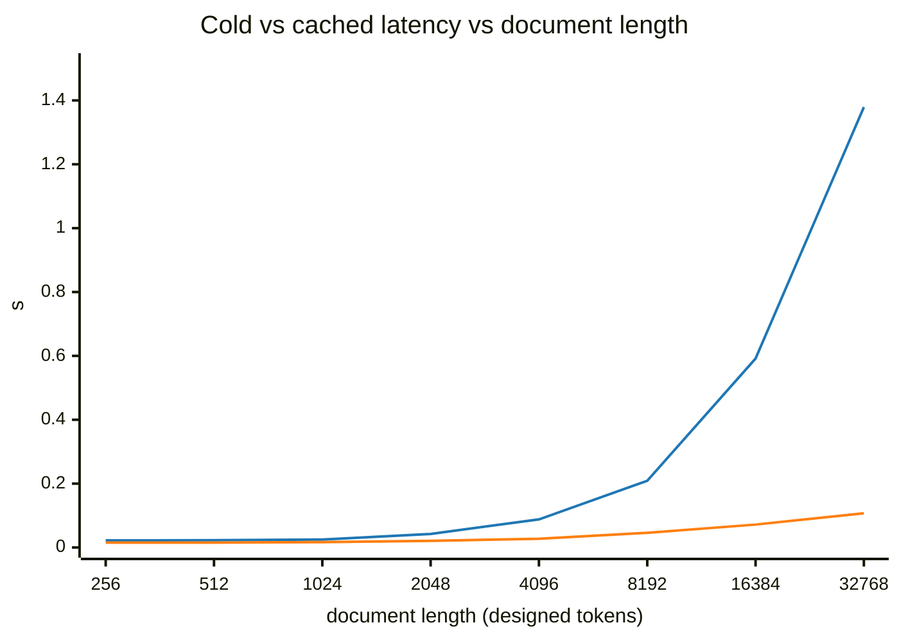
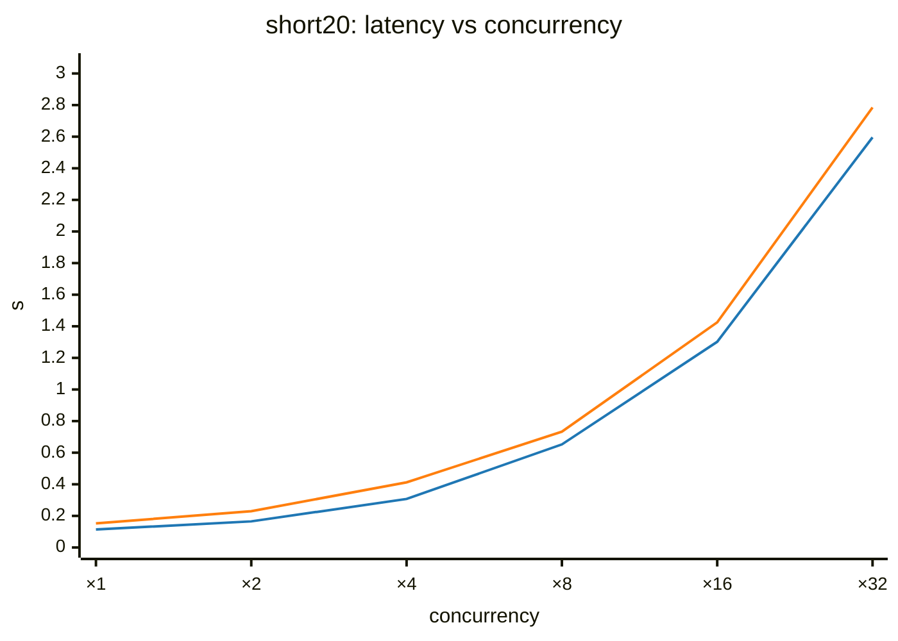
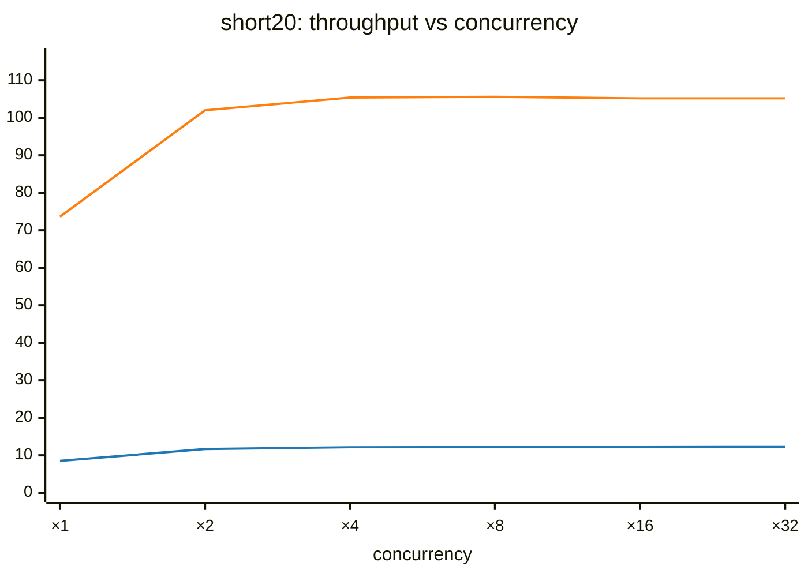
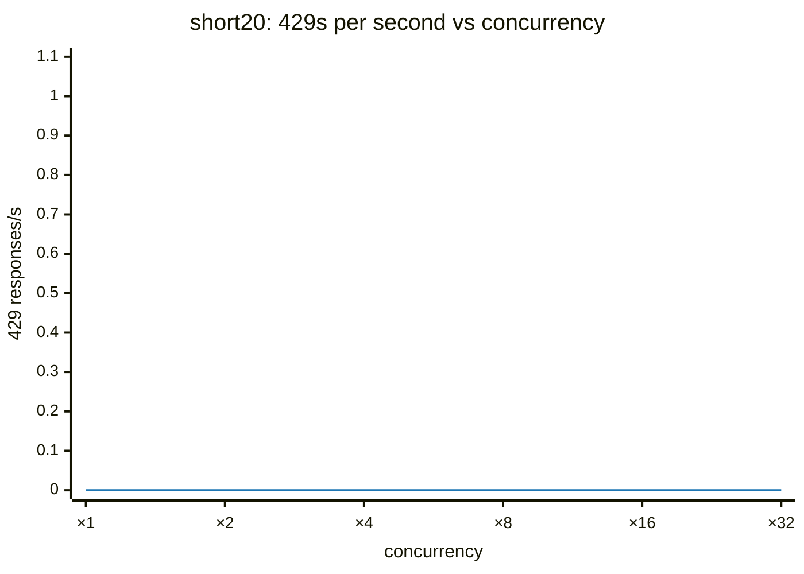

## meticulous — 2026-11-17 09:37 UTC

**PASS** · 345 s · 2373 requests · 0 (0.0%) errors · 0 rate-limited · 22,783,802 tokens billed

Sequential requests (one in flight) unless stated; every query carries a nonce so nothing is served from the API's prefix cache.

### Single document: latency vs length

| rung | Qwen tokens | billed | errors | p50 s | p90 s | max s | API tok/s |
|---|---|---|---|---|---|---|---|
| 256 | 229 | 323 | 0 (0.0%) | 0.022 | 0.023 | 0.064 | 13,510 |
| 512 | 457 | 551 | 0 (0.0%) | 0.022 | 0.023 | 0.023 | 24,444 |
| 1,024 | 911 | 1,005 | 0 (0.0%) | 0.026 | 0.027 | 0.030 | 38,153 |
| 2,048 | 1,872 | 1,966 | 0 (0.0%) | 0.045 | 0.046 | 0.048 | 43,526 |
| 4,096 | 3,707 | 3,801 | 0 (0.0%) | 0.093 | 0.095 | 0.095 | 40,698 |
| 8,192 | 7,545 | 7,640 | 0 (0.0%) | 0.213 | 0.215 | 0.217 | 35,712 |
| 16,384 | 15,274 | 15,368 | 0 (0.0%) | 0.602 | 0.605 | 0.607 | 25,505 |
| 32,768 | 25,438 | 25,536 | 0 (0.0%) | 1.385 | 1.388 | 1.392 | 18,422 |

*Single document: latency vs length: p50, p90*

*Single document: throughput vs length: API tokens/s ÷ 1000*

### ~30K tokens per request: latency vs document length (fewer, longer documents)

| rung | docs/request | billed | errors | p50 s | p90 s | max s | API tok/s |
|---|---|---|---|---|---|---|---|
| 256 | 100 | 32,399 | 0 (0.0%) | 0.329 | 0.333 | 0.338 | 98,030 |
| 512 | 55 | 30,286 | 0 (0.0%) | 0.302 | 0.314 | 0.327 | 99,676 |
| 1,024 | 28 | 28,172 | 0 (0.0%) | 0.308 | 0.330 | 0.334 | 91,726 |
| 2,048 | 13 | 25,574 | 0 (0.0%) | 0.322 | 0.355 | 0.373 | 80,172 |
| 4,096 | 6 | 22,805 | 0 (0.0%) | 0.396 | 0.433 | 0.454 | 58,804 |
| 8,192 | 3 | 22,922 | 0 (0.0%) | 0.497 | 0.573 | 0.628 | 46,693 |
| 16,384 | 1 | 15,367 | 0 (0.0%) | 0.602 | 0.604 | 0.604 | 25,513 |
| 32,768 | 1 | 25,540 | 0 (0.0%) | 1.384 | 1.386 | 1.390 | 18,441 |

*~30K tokens: latency vs document length: p50, p90*

### Latency vs number of documents

| documents | billed | errors | p50 s | p90 s | max s | MRR |
|---|---|---|---|---|---|---|
| 1 tiny | 90.7 | 0 (0.0%) | 0.014 | 0.016 | 0.018 | 1.000 |
| 10 tiny | 915 | 0 (0.0%) | 0.033 | 0.035 | 0.036 | 1.000 |
| 100 tiny | 9,289 | 0 (0.0%) | 0.103 | 0.111 | 0.117 | 1.000 |
| 1000 tiny | 94,389 | 0 (0.0%) | 0.948 | 0.973 | 0.977 | 0.900 |
| 1×256 | 323 | 0 (0.0%) | 0.023 | 0.023 | 0.024 | 1.000 |
| 10×256 | 3,232 | 0 (0.0%) | 0.053 | 0.057 | 0.058 | 1.000 |
| 50×256 | 16,155 | 0 (0.0%) | 0.176 | 0.186 | 0.188 | 1.000 |
| 100×256 | 32,299 | 0 (0.0%) | 0.328 | 0.335 | 0.336 | 1.000 |

*Latency vs number of documents: p50, p90*

### Cold vs cached: the same single-document request sent twice in a row

The API caches prompt prefixes, so a repeated (query, document) pair skips most of the compute. Cold = fresh nonce in the query; cached = the identical request again immediately after.

| rung | pairs | cold p50 s | cached p50 s | speed-up × | cold max s | cached max s | errors |
|---|---|---|---|---|---|---|---|
| 256 | 10 | 0.022 | 0.015 | 1.441 | 0.040 | 0.018 |  |
| 512 | 10 | 0.023 | 0.015 | 1.468 | 0.025 | 0.016 |  |
| 1,024 | 10 | 0.025 | 0.017 | 1.477 | 0.026 | 0.018 |  |
| 2,048 | 10 | 0.043 | 0.021 | 2.041 | 0.045 | 0.023 |  |
| 4,096 | 10 | 0.088 | 0.027 | 3.205 | 0.090 | 0.029 |  |
| 8,192 | 10 | 0.209 | 0.046 | 4.538 | 0.211 | 0.049 |  |
| 16,384 | 10 | 0.592 | 0.072 | 8.249 | 0.596 | 0.075 |  |
| 32,768 | 10 | 1.379 | 0.107 | 12.9 | 1.385 | 0.116 |  |

*Cold vs cached latency vs document length: cold p50, cached p50*

### short20: latency and throughput vs concurrency

|  | requests | errors | 429s | p50 s | p90 s | p99 s | max s | req/s | API tok/s | MRR |
|---|---|---|---|---|---|---|---|---|---|---|
| ×1 | 213 | 0 (0.0%) | 0 | 0.114 | 0.153 | 0.190 | 0.196 | 8.508 | 73,609 | 0.660 |
| ×2 | 293 | 0 (0.0%) | 0 | 0.165 | 0.230 | 0.285 | 0.290 | 11.7 | 101,974 | 0.640 |
| ×4 | 306 | 0 (0.0%) | 0 | 0.307 | 0.412 | 0.477 | 0.484 | 12.1 | 105,415 | 0.640 |
| ×8 | 310 | 0 (0.0%) | 0 | 0.652 | 0.733 | 0.836 | 0.845 | 12.2 | 105,591 | 0.634 |
| ×16 | 318 | 0 (0.0%) | 0 | 1.302 | 1.425 | 1.534 | 1.549 | 12.2 | 105,163 | 0.637 |
| ×32 | 333 | 0 (0.0%) | 0 | 2.596 | 2.785 | 2.917 | 2.983 | 12.2 | 105,249 | 0.636 |

No 429s up to concurrency ×32.

*short20: latency vs concurrency: p50, p90*

*short20: throughput vs concurrency: req/s, API tokens/s ÷ 1000*

*short20: 429s per second vs concurrency: 429/s*

2373 requests, 22,783,802 tokens billed.
