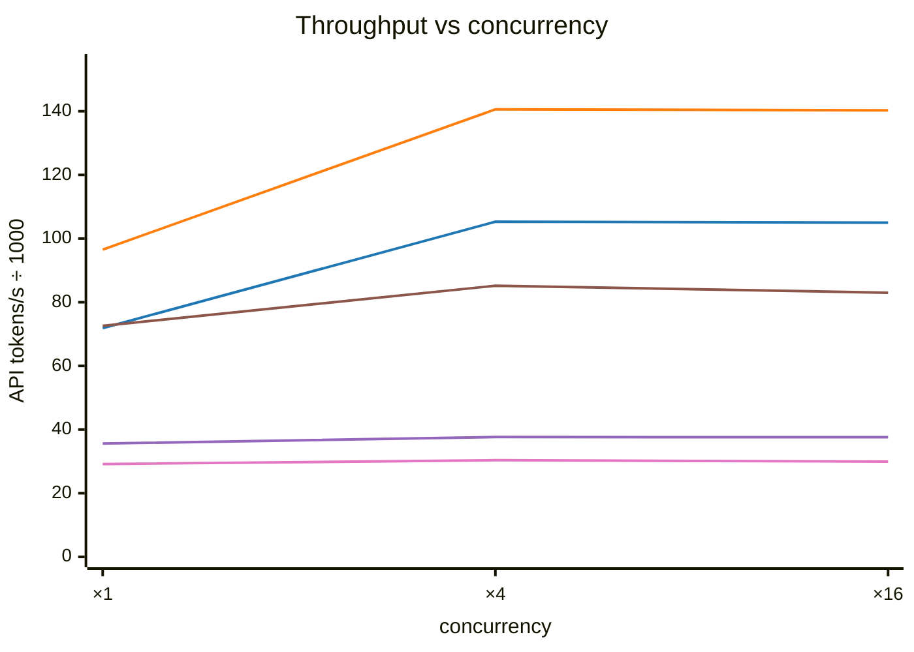
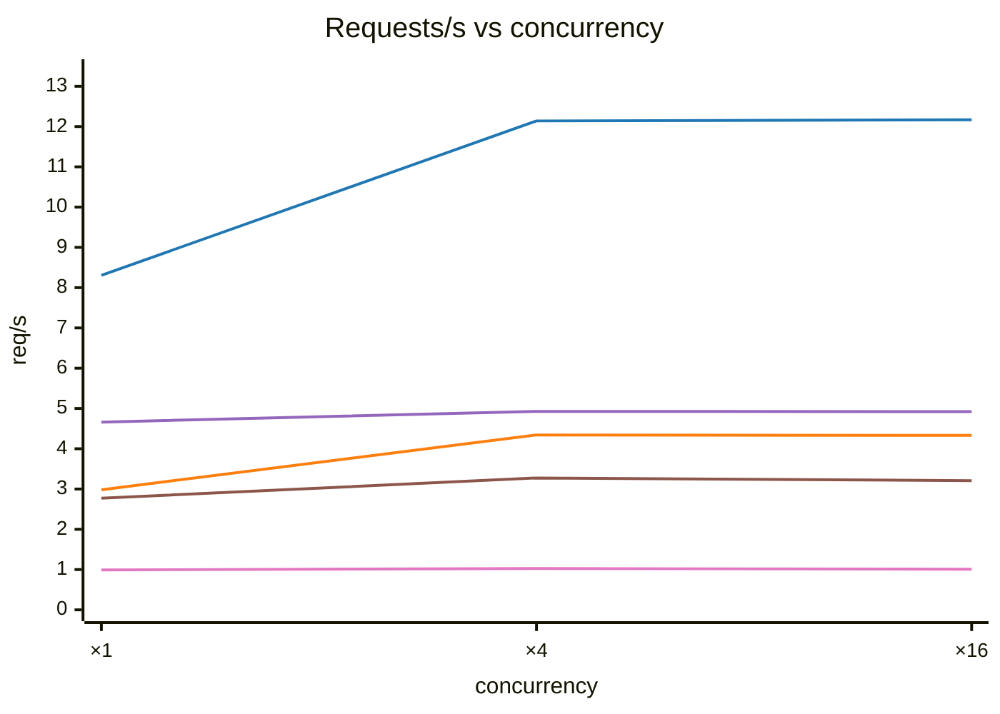
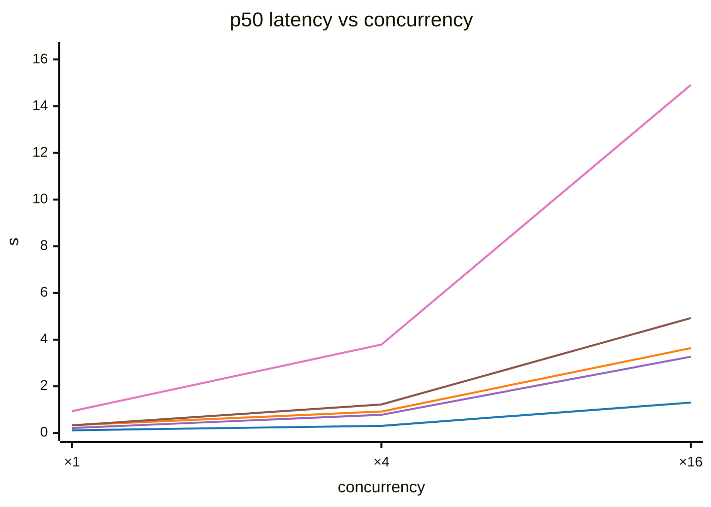

## speed — 2026-11-17 09:43 UTC

**PASS** · 442 s · 1875 requests · 0 (0.0%) errors · 0 rate-limited · 29,617,031 tokens billed

Closed loop, 25 s per cell, 5 request classes × concurrency [1, 4, 16]. 1875 requests, 29,617,031 tokens billed.

|  | requests | errors | 429s | p50 s | p90 s | p99 s | max s | req/s | API tok/s | MRR |
|---|---|---|---|---|---|---|---|---|---|---|
| short20 ×1 | 209 | 0 (0.0%) | 0 | 0.118 | 0.154 | 0.194 | 0.199 | 8.306 | 71,875 | 0.665 |
| short20 ×4 | 306 | 0 (0.0%) | 0 | 0.308 | 0.411 | 0.480 | 0.483 | 12.1 | 105,324 | 0.639 |
| short20 ×16 | 318 | 0 (0.0%) | 0 | 1.303 | 1.428 | 1.538 | 1.551 | 12.2 | 105,007 | 0.635 |
| many100 ×1 | 75 | 0 (0.0%) | 0 | 0.334 | 0.338 | 0.349 | 0.369 | 2.982 | 96,534 | 0.987 |
| many100 ×4 | 112 | 0 (0.0%) | 0 | 0.922 | 0.926 | 0.930 | 1.048 | 4.343 | 140,641 | 0.982 |
| many100 ×16 | 124 | 0 (0.0%) | 0 | 3.636 | 3.693 | 3.699 | 3.898 | 4.331 | 140,259 | 0.984 |
| long8k ×1 | 117 | 0 (0.0%) | 0 | 0.214 | 0.216 | 0.221 | 0.222 | 4.661 | 35,613 | 1.000 |
| long8k ×4 | 127 | 0 (0.0%) | 0 | 0.782 | 0.866 | 0.873 | 0.873 | 4.928 | 37,652 | 1.000 |
| long8k ×16 | 138 | 0 (0.0%) | 0 | 3.269 | 3.285 | 3.290 | 3.291 | 4.921 | 37,599 | 1.000 |
| pack32k ×1 | 70 | 0 (0.0%) | 0 | 0.328 | 0.510 | 0.589 | 0.620 | 2.772 | 72,575 | 1.000 |
| pack32k ×4 | 86 | 0 (0.0%) | 0 | 1.224 | 1.415 | 1.529 | 1.544 | 3.274 | 85,184 | 1.000 |
| pack32k ×16 | 97 | 0 (0.0%) | 0 | 4.923 | 5.297 | 5.422 | 5.430 | 3.207 | 82,994 | 1.000 |
| long32k ×1 | 26 | 0 (0.0%) | 0 | 0.937 | 1.385 | 1.389 | 1.389 | 0.992 | 29,182 | 1.000 |
| long32k ×4 | 29 | 0 (0.0%) | 0 | 3.788 | 4.400 | 4.555 | 4.582 | 1.026 | 30,369 | 1.000 |
| long32k ×16 | 41 | 0 (0.0%) | 0 | 14.9 | 16.8 | 17.0 | 17.0 | 1.009 | 29,931 | 0.988 |

*Throughput vs concurrency: short20, many100, long8k, pack32k, long32k*

*Requests/s vs concurrency: short20, many100, long8k, pack32k, long32k*

*p50 latency vs concurrency: short20, many100, long8k, pack32k, long32k*
