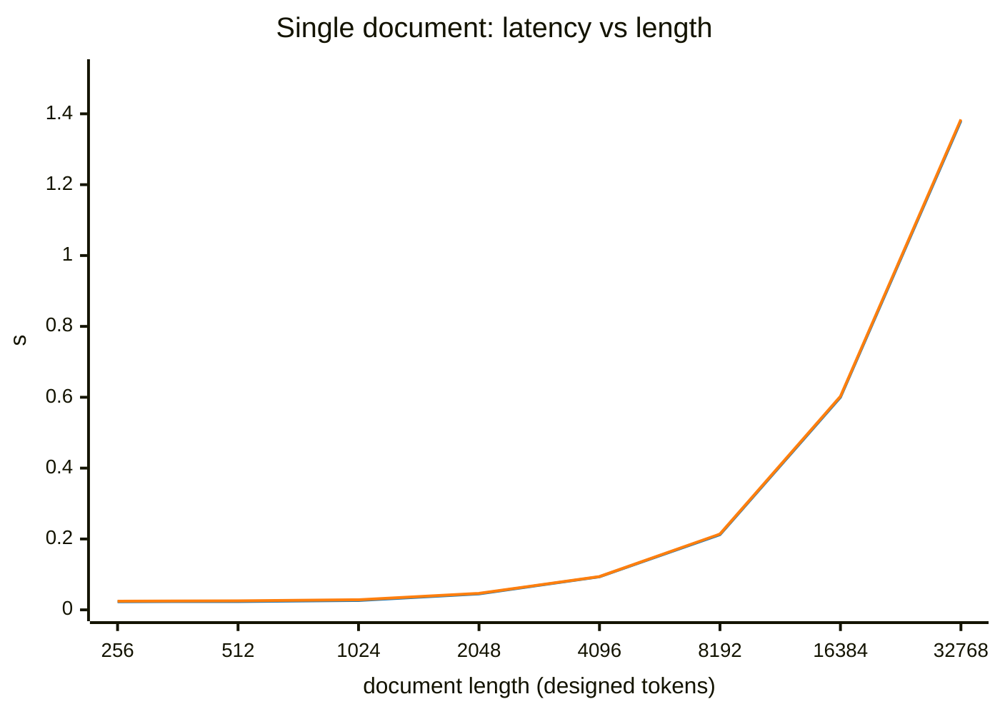
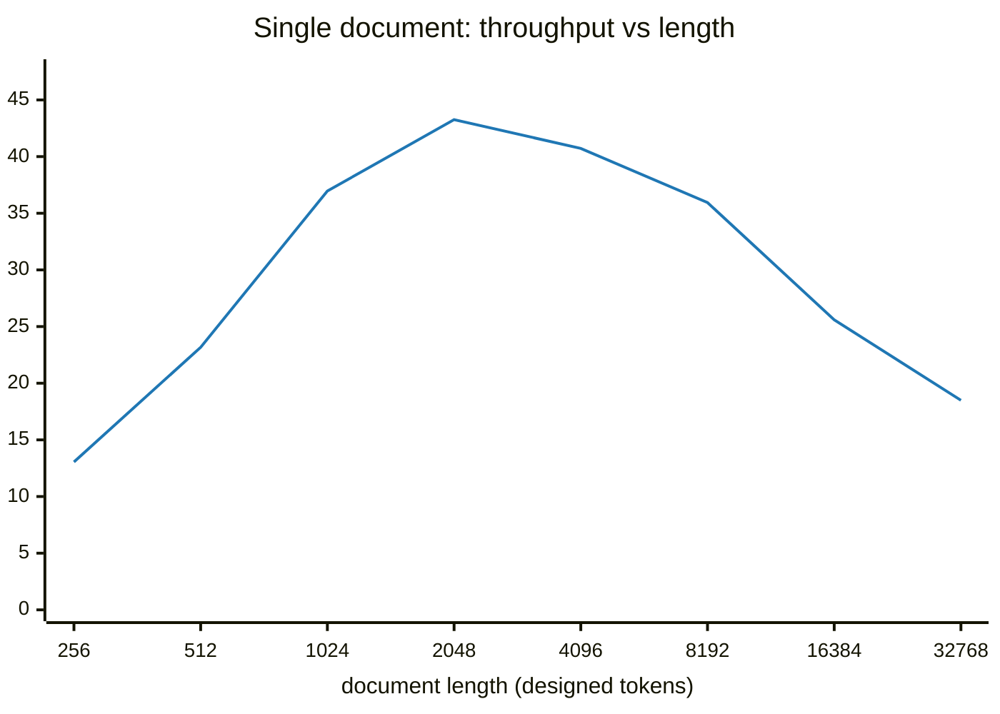
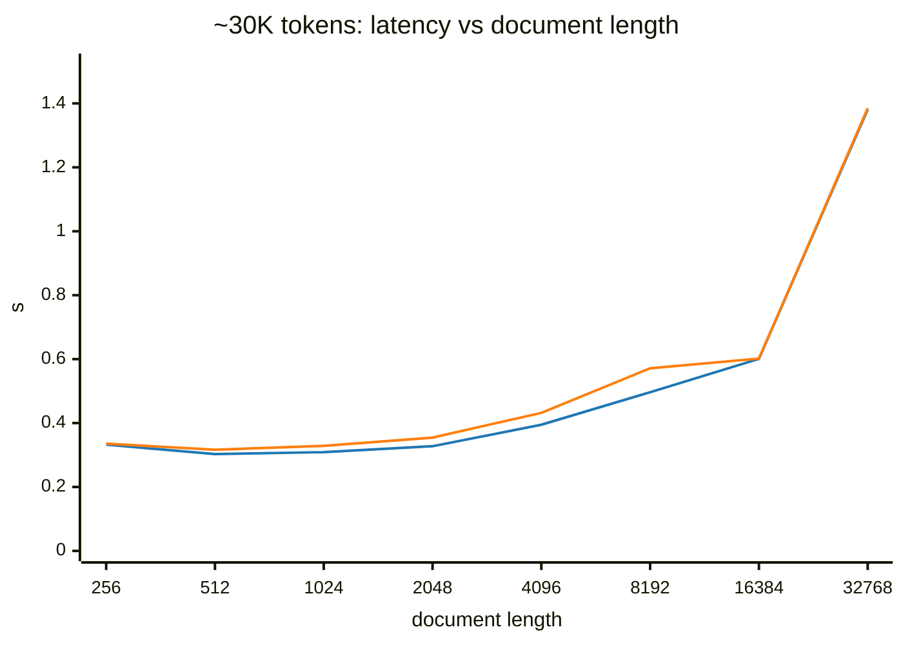
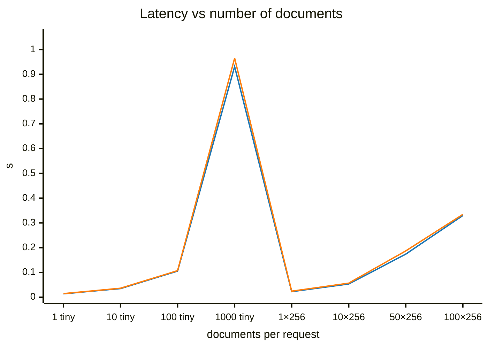
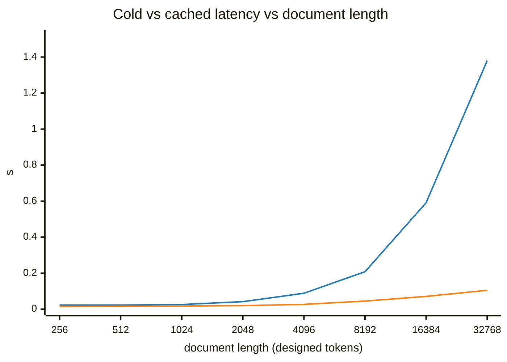
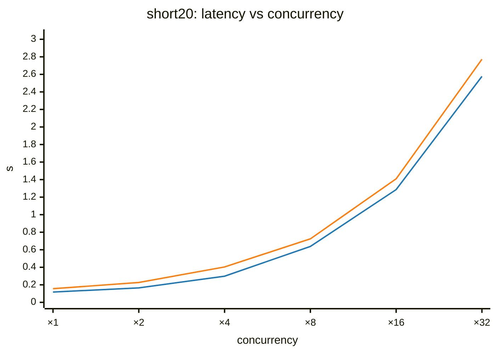
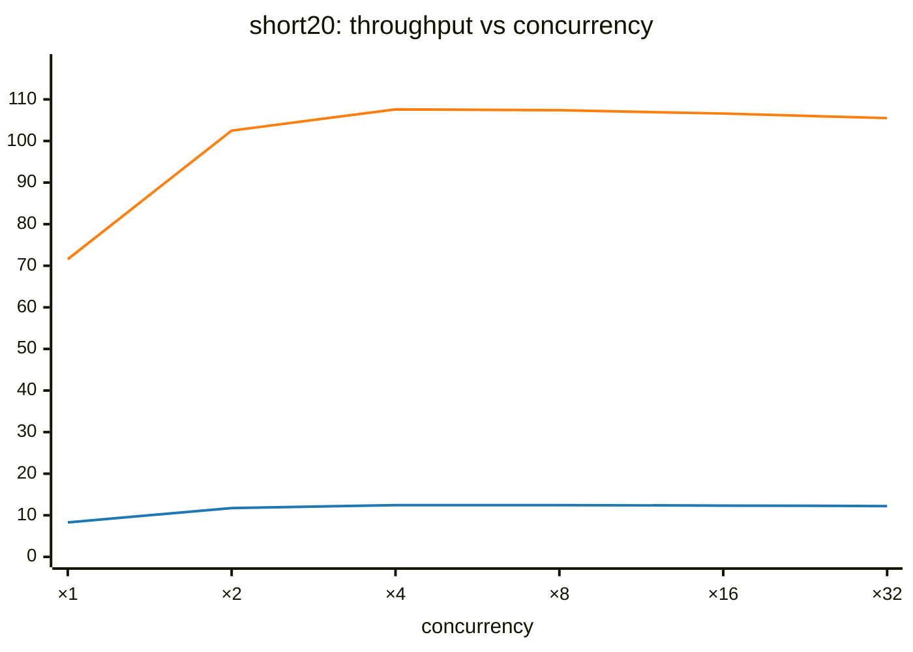
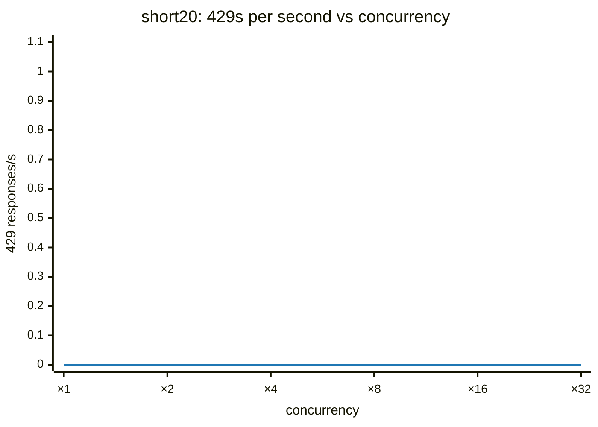

## meticulous — 2026-11-17 09:55 UTC

**PASS** · 345 s · 2392 requests · 0 (0.0%) errors · 0 rate-limited · 22,924,382 tokens billed

Sequential requests (one in flight) unless stated; every query carries a nonce so nothing is served from the API's prefix cache.

### Single document: latency vs length

| rung | Qwen tokens | billed | errors | p50 s | p90 s | max s | API tok/s |
|---|---|---|---|---|---|---|---|
| 256 | 229 | 324 | 0 (0.0%) | 0.023 | 0.024 | 0.063 | 13,054 |
| 512 | 457 | 550 | 0 (0.0%) | 0.023 | 0.026 | 0.026 | 23,175 |
| 1,024 | 911 | 1,005 | 0 (0.0%) | 0.027 | 0.029 | 0.032 | 36,956 |
| 2,048 | 1,872 | 1,966 | 0 (0.0%) | 0.045 | 0.046 | 0.048 | 43,264 |
| 4,096 | 3,707 | 3,800 | 0 (0.0%) | 0.093 | 0.094 | 0.095 | 40,718 |
| 8,192 | 7,545 | 7,640 | 0 (0.0%) | 0.212 | 0.214 | 0.216 | 35,938 |
| 16,384 | 15,274 | 15,368 | 0 (0.0%) | 0.600 | 0.603 | 0.606 | 25,600 |
| 32,768 | 25,438 | 25,536 | 0 (0.0%) | 1.380 | 1.384 | 1.386 | 18,493 |

*Single document: latency vs length: p50, p90*

*Single document: throughput vs length: API tokens/s ÷ 1000*

### ~30K tokens per request: latency vs document length (fewer, longer documents)

| rung | docs/request | billed | errors | p50 s | p90 s | max s | API tok/s |
|---|---|---|---|---|---|---|---|
| 256 | 100 | 32,406 | 0 (0.0%) | 0.333 | 0.336 | 0.337 | 97,305 |
| 512 | 55 | 30,278 | 0 (0.0%) | 0.303 | 0.317 | 0.329 | 99,524 |
| 1,024 | 28 | 28,185 | 0 (0.0%) | 0.309 | 0.328 | 0.334 | 91,784 |
| 2,048 | 13 | 25,567 | 0 (0.0%) | 0.328 | 0.354 | 0.372 | 80,070 |
| 4,096 | 6 | 22,805 | 0 (0.0%) | 0.395 | 0.432 | 0.449 | 59,039 |
| 8,192 | 3 | 22,922 | 0 (0.0%) | 0.496 | 0.571 | 0.626 | 47,074 |
| 16,384 | 1 | 15,367 | 0 (0.0%) | 0.601 | 0.602 | 0.603 | 25,584 |
| 32,768 | 1 | 25,541 | 0 (0.0%) | 1.381 | 1.385 | 1.388 | 18,480 |

*~30K tokens: latency vs document length: p50, p90*

### Latency vs number of documents

| documents | billed | errors | p50 s | p90 s | max s | MRR |
|---|---|---|---|---|---|---|
| 1 tiny | 91.1 | 0 (0.0%) | 0.014 | 0.015 | 0.018 | 1.000 |
| 10 tiny | 919 | 0 (0.0%) | 0.035 | 0.036 | 0.037 | 1.000 |
| 100 tiny | 9,299 | 0 (0.0%) | 0.106 | 0.107 | 0.107 | 1.000 |
| 1000 tiny | 93,789 | 0 (0.0%) | 0.931 | 0.965 | 0.991 | 1.000 |
| 1×256 | 324 | 0 (0.0%) | 0.022 | 0.024 | 0.025 | 1.000 |
| 10×256 | 3,237 | 0 (0.0%) | 0.053 | 0.057 | 0.059 | 1.000 |
| 50×256 | 16,155 | 0 (0.0%) | 0.174 | 0.187 | 0.188 | 1.000 |
| 100×256 | 32,319 | 0 (0.0%) | 0.330 | 0.334 | 0.337 | 1.000 |

*Latency vs number of documents: p50, p90*

### Cold vs cached: the same single-document request sent twice in a row

The API caches prompt prefixes, so a repeated (query, document) pair skips most of the compute. Cold = fresh nonce in the query; cached = the identical request again immediately after.

| rung | pairs | cold p50 s | cached p50 s | speed-up × | cold max s | cached max s | errors |
|---|---|---|---|---|---|---|---|
| 256 | 10 | 0.023 | 0.015 | 1.495 | 0.049 | 0.017 |  |
| 512 | 10 | 0.023 | 0.016 | 1.452 | 0.025 | 0.018 |  |
| 1,024 | 10 | 0.026 | 0.018 | 1.464 | 0.027 | 0.019 |  |
| 2,048 | 10 | 0.042 | 0.020 | 2.110 | 0.044 | 0.022 |  |
| 4,096 | 10 | 0.089 | 0.027 | 3.285 | 0.090 | 0.029 |  |
| 8,192 | 10 | 0.208 | 0.045 | 4.616 | 0.211 | 0.047 |  |
| 16,384 | 10 | 0.591 | 0.071 | 8.313 | 0.593 | 0.074 |  |
| 32,768 | 10 | 1.380 | 0.105 | 13.2 | 1.385 | 0.107 |  |

*Cold vs cached latency vs document length: cold p50, cached p50*

### short20: latency and throughput vs concurrency

|  | requests | errors | 429s | p50 s | p90 s | p99 s | max s | req/s | API tok/s | MRR |
|---|---|---|---|---|---|---|---|---|---|---|
| ×1 | 208 | 0 (0.0%) | 0 | 0.118 | 0.156 | 0.191 | 0.196 | 8.278 | 71,571 | 0.667 |
| ×2 | 295 | 0 (0.0%) | 0 | 0.165 | 0.227 | 0.280 | 0.291 | 11.7 | 102,489 | 0.636 |
| ×4 | 314 | 0 (0.0%) | 0 | 0.298 | 0.404 | 0.471 | 0.527 | 12.4 | 107,645 | 0.634 |
| ×8 | 318 | 0 (0.0%) | 0 | 0.638 | 0.724 | 0.823 | 0.829 | 12.4 | 107,398 | 0.639 |
| ×16 | 323 | 0 (0.0%) | 0 | 1.286 | 1.409 | 1.489 | 1.518 | 12.3 | 106,600 | 0.638 |
| ×32 | 334 | 0 (0.0%) | 0 | 2.577 | 2.772 | 2.885 | 2.949 | 12.2 | 105,518 | 0.639 |

No 429s up to concurrency ×32.

*short20: latency vs concurrency: p50, p90*

*short20: throughput vs concurrency: req/s, API tokens/s ÷ 1000*

*short20: 429s per second vs concurrency: 429/s*

2392 requests, 22,924,382 tokens billed.
