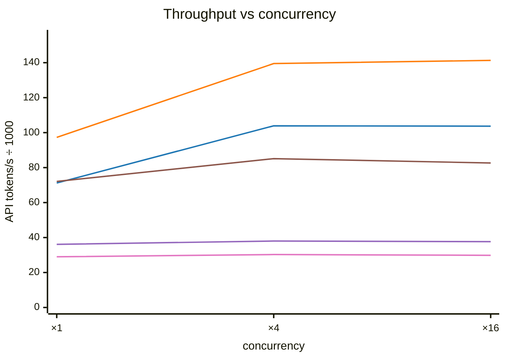
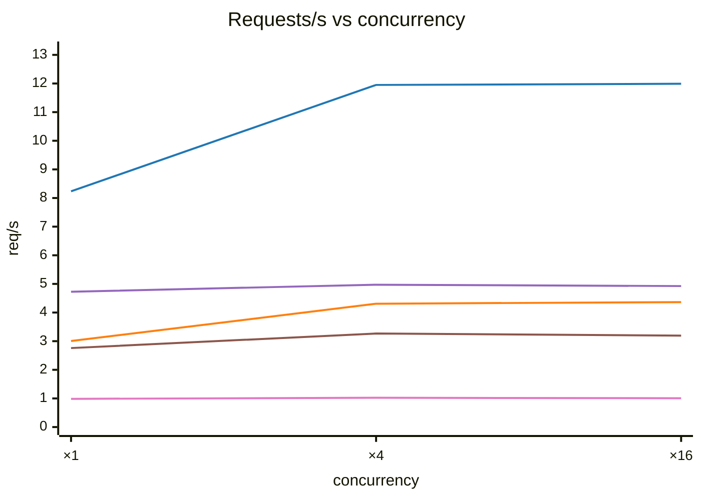
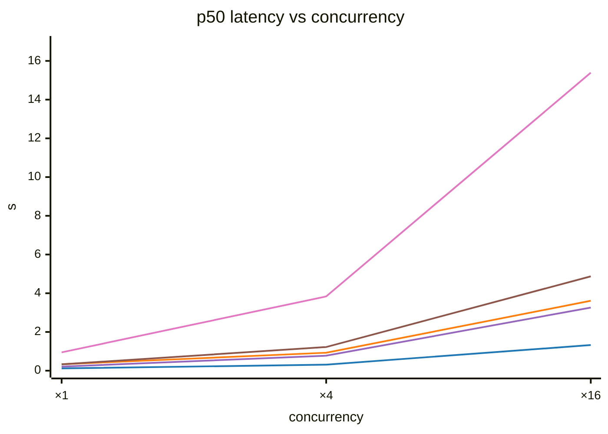

## speed — 2026-11-17 10:01 UTC

**PASS** · 442 s · 1865 requests · 0 (0.0%) errors · 0 rate-limited · 29,501,364 tokens billed

Closed loop, 25 s per cell, 5 request classes × concurrency [1, 4, 16]. 1865 requests, 29,501,364 tokens billed.

|  | requests | errors | 429s | p50 s | p90 s | p99 s | max s | req/s | API tok/s | MRR |
|---|---|---|---|---|---|---|---|---|---|---|
| short20 ×1 | 207 | 0 (0.0%) | 0 | 0.119 | 0.154 | 0.191 | 0.196 | 8.233 | 71,191 | 0.673 |
| short20 ×4 | 302 | 0 (0.0%) | 0 | 0.311 | 0.417 | 0.479 | 0.492 | 12.0 | 103,910 | 0.646 |
| short20 ×16 | 313 | 0 (0.0%) | 0 | 1.325 | 1.451 | 1.528 | 1.564 | 12.0 | 103,699 | 0.637 |
| many100 ×1 | 76 | 0 (0.0%) | 0 | 0.332 | 0.336 | 0.339 | 0.341 | 3.005 | 97,276 | 0.987 |
| many100 ×4 | 111 | 0 (0.0%) | 0 | 0.927 | 0.938 | 0.943 | 1.077 | 4.308 | 139,534 | 0.982 |
| many100 ×16 | 124 | 0 (0.0%) | 0 | 3.611 | 3.664 | 3.667 | 3.885 | 4.365 | 141,345 | 0.984 |
| long8k ×1 | 119 | 0 (0.0%) | 0 | 0.211 | 0.213 | 0.218 | 0.220 | 4.727 | 36,118 | 1.000 |
| long8k ×4 | 128 | 0 (0.0%) | 0 | 0.775 | 0.859 | 0.865 | 0.866 | 4.972 | 37,990 | 1.000 |
| long8k ×16 | 138 | 0 (0.0%) | 0 | 3.260 | 3.292 | 3.302 | 3.304 | 4.925 | 37,631 | 1.000 |
| pack32k ×1 | 69 | 0 (0.0%) | 0 | 0.329 | 0.511 | 0.591 | 0.626 | 2.759 | 72,091 | 1.000 |
| pack32k ×4 | 85 | 0 (0.0%) | 0 | 1.222 | 1.418 | 1.526 | 1.549 | 3.267 | 85,123 | 1.000 |
| pack32k ×16 | 97 | 0 (0.0%) | 0 | 4.872 | 5.225 | 5.392 | 5.468 | 3.194 | 82,644 | 1.000 |
| long32k ×1 | 26 | 0 (0.0%) | 0 | 0.946 | 1.391 | 1.393 | 1.393 | 0.985 | 28,989 | 1.000 |
| long32k ×4 | 29 | 0 (0.0%) | 0 | 3.836 | 4.425 | 4.578 | 4.602 | 1.024 | 30,285 | 1.000 |
| long32k ×16 | 41 | 0 (0.0%) | 0 | 15.4 | 16.9 | 17.0 | 17.0 | 1.006 | 29,842 | 0.988 |

*Throughput vs concurrency: short20, many100, long8k, pack32k, long32k*

*Requests/s vs concurrency: short20, many100, long8k, pack32k, long32k*

*p50 latency vs concurrency: short20, many100, long8k, pack32k, long32k*
