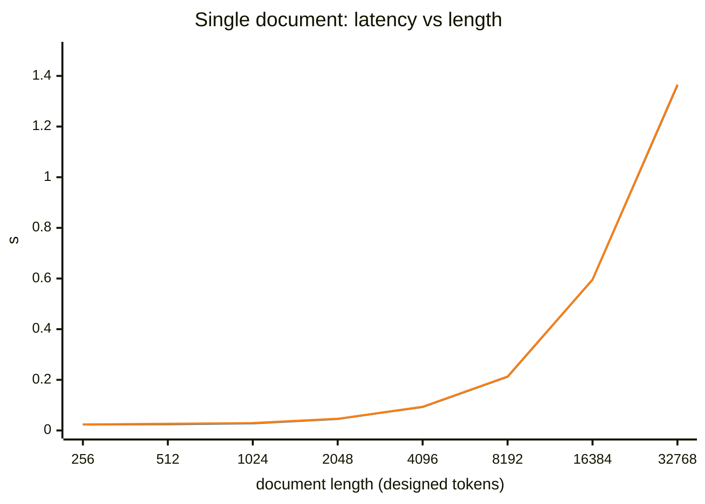
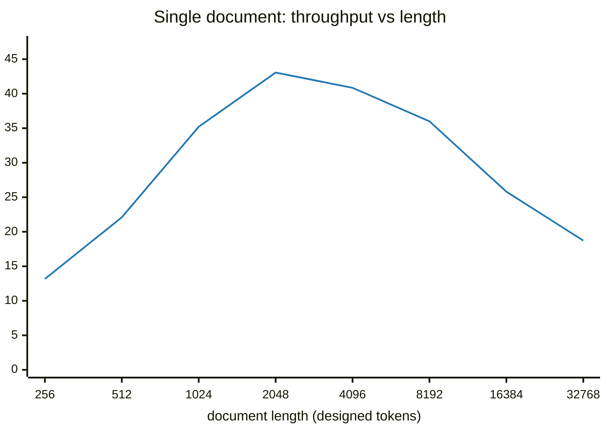
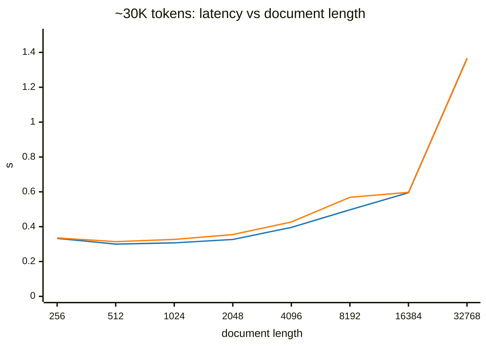
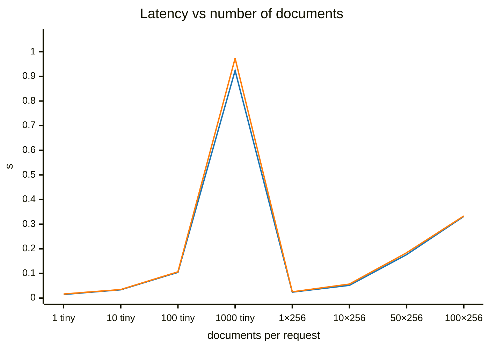
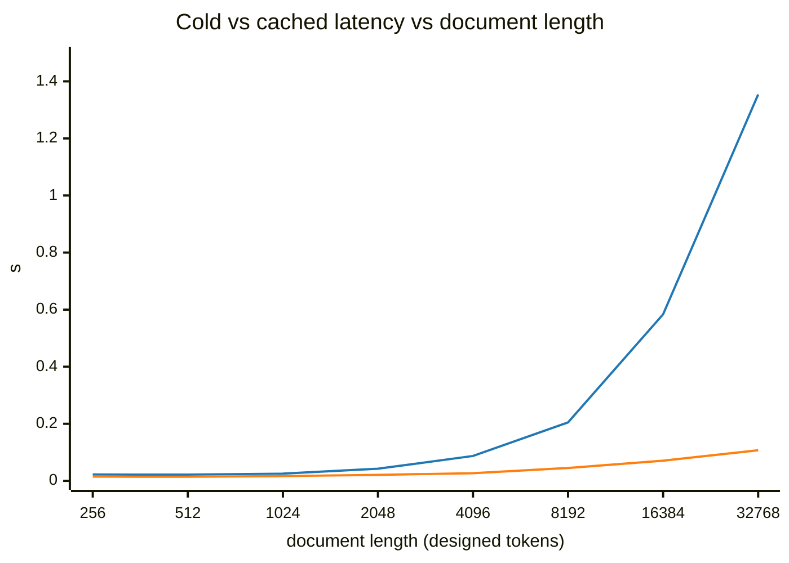
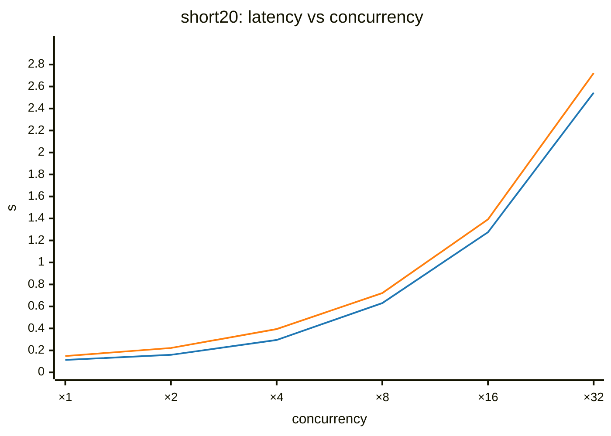
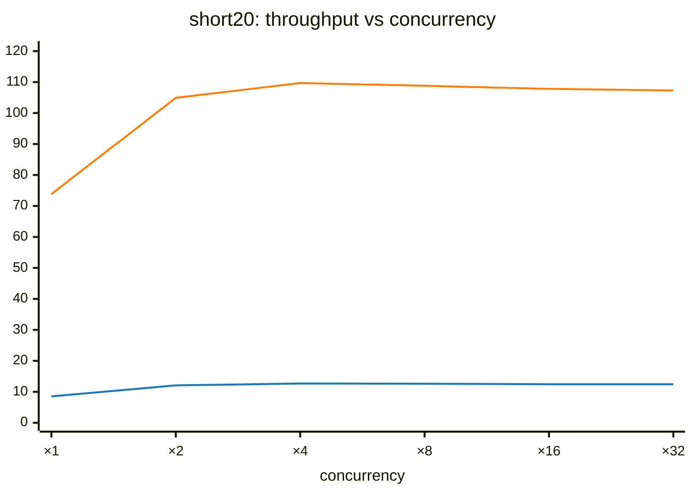
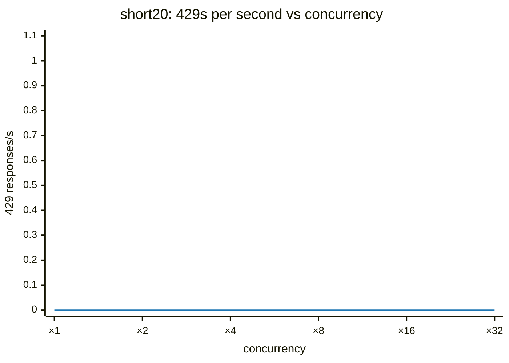

## meticulous — 2026-11-17 10:10 UTC

**PASS** · 343 s · 2426 requests · 0 (0.0%) errors · 0 rate-limited · 23,216,060 tokens billed

Sequential requests (one in flight) unless stated; every query carries a nonce so nothing is served from the API's prefix cache.

### Single document: latency vs length

| rung | Qwen tokens | billed | errors | p50 s | p90 s | max s | API tok/s |
|---|---|---|---|---|---|---|---|
| 256 | 229 | 323 | 0 (0.0%) | 0.024 | 0.024 | 0.052 | 13,158 |
| 512 | 457 | 551 | 0 (0.0%) | 0.025 | 0.027 | 0.027 | 22,094 |
| 1,024 | 911 | 1,005 | 0 (0.0%) | 0.028 | 0.029 | 0.031 | 35,212 |
| 2,048 | 1,872 | 1,966 | 0 (0.0%) | 0.046 | 0.046 | 0.047 | 43,063 |
| 4,096 | 3,707 | 3,801 | 0 (0.0%) | 0.093 | 0.094 | 0.094 | 40,847 |
| 8,192 | 7,545 | 7,640 | 0 (0.0%) | 0.212 | 0.213 | 0.216 | 35,996 |
| 16,384 | 15,274 | 15,368 | 0 (0.0%) | 0.595 | 0.596 | 0.598 | 25,807 |
| 32,768 | 25,438 | 25,536 | 0 (0.0%) | 1.363 | 1.366 | 1.378 | 18,719 |

*Single document: latency vs length: p50, p90*

*Single document: throughput vs length: API tokens/s ÷ 1000*

### ~30K tokens per request: latency vs document length (fewer, longer documents)

| rung | docs/request | billed | errors | p50 s | p90 s | max s | API tok/s |
|---|---|---|---|---|---|---|---|
| 256 | 100 | 32,346 | 0 (0.0%) | 0.333 | 0.335 | 0.337 | 97,319 |
| 512 | 55 | 30,271 | 0 (0.0%) | 0.300 | 0.314 | 0.328 | 100,279 |
| 1,024 | 28 | 28,179 | 0 (0.0%) | 0.307 | 0.327 | 0.335 | 92,263 |
| 2,048 | 13 | 25,573 | 0 (0.0%) | 0.327 | 0.355 | 0.373 | 80,314 |
| 4,096 | 6 | 22,806 | 0 (0.0%) | 0.396 | 0.427 | 0.450 | 58,954 |
| 8,192 | 3 | 22,923 | 0 (0.0%) | 0.497 | 0.569 | 0.624 | 47,004 |
| 16,384 | 1 | 15,367 | 0 (0.0%) | 0.595 | 0.597 | 0.597 | 25,798 |
| 32,768 | 1 | 25,541 | 0 (0.0%) | 1.364 | 1.367 | 1.376 | 18,707 |

*~30K tokens: latency vs document length: p50, p90*

### Latency vs number of documents

| documents | billed | errors | p50 s | p90 s | max s | MRR |
|---|---|---|---|---|---|---|
| 1 tiny | 91.2 | 0 (0.0%) | 0.015 | 0.016 | 0.017 | 1.000 |
| 10 tiny | 919 | 0 (0.0%) | 0.034 | 0.035 | 0.035 | 1.000 |
| 100 tiny | 9,339 | 0 (0.0%) | 0.105 | 0.107 | 0.108 | 1.000 |
| 1000 tiny | 93,989 | 0 (0.0%) | 0.924 | 0.973 | 0.994 | 1.000 |
| 1×256 | 323 | 0 (0.0%) | 0.024 | 0.026 | 0.027 | 1.000 |
| 10×256 | 3,229 | 0 (0.0%) | 0.052 | 0.057 | 0.060 | 1.000 |
| 50×256 | 16,155 | 0 (0.0%) | 0.176 | 0.184 | 0.187 | 1.000 |
| 100×256 | 32,339 | 0 (0.0%) | 0.332 | 0.333 | 0.334 | 1.000 |

*Latency vs number of documents: p50, p90*

### Cold vs cached: the same single-document request sent twice in a row

The API caches prompt prefixes, so a repeated (query, document) pair skips most of the compute. Cold = fresh nonce in the query; cached = the identical request again immediately after.

| rung | pairs | cold p50 s | cached p50 s | speed-up × | cold max s | cached max s | errors |
|---|---|---|---|---|---|---|---|
| 256 | 10 | 0.022 | 0.015 | 1.492 | 0.046 | 0.019 |  |
| 512 | 10 | 0.022 | 0.015 | 1.501 | 0.024 | 0.016 |  |
| 1,024 | 10 | 0.025 | 0.017 | 1.511 | 0.027 | 0.018 |  |
| 2,048 | 10 | 0.043 | 0.021 | 2.033 | 0.045 | 0.024 |  |
| 4,096 | 10 | 0.087 | 0.027 | 3.224 | 0.089 | 0.029 |  |
| 8,192 | 10 | 0.205 | 0.045 | 4.538 | 0.208 | 0.050 |  |
| 16,384 | 10 | 0.584 | 0.071 | 8.249 | 0.586 | 0.072 |  |
| 32,768 | 10 | 1.354 | 0.107 | 12.6 | 1.360 | 0.109 |  |

*Cold vs cached latency vs document length: cold p50, cached p50*

### short20: latency and throughput vs concurrency

|  | requests | errors | 429s | p50 s | p90 s | p99 s | max s | req/s | API tok/s | MRR |
|---|---|---|---|---|---|---|---|---|---|---|
| ×1 | 214 | 0 (0.0%) | 0 | 0.114 | 0.149 | 0.189 | 0.197 | 8.530 | 73,832 | 0.658 |
| ×2 | 303 | 0 (0.0%) | 0 | 0.160 | 0.222 | 0.274 | 0.276 | 12.1 | 104,858 | 0.639 |
| ×4 | 320 | 0 (0.0%) | 0 | 0.295 | 0.394 | 0.460 | 0.466 | 12.7 | 109,718 | 0.639 |
| ×8 | 323 | 0 (0.0%) | 0 | 0.630 | 0.722 | 0.808 | 0.818 | 12.6 | 108,849 | 0.633 |
| ×16 | 326 | 0 (0.0%) | 0 | 1.275 | 1.392 | 1.497 | 1.511 | 12.5 | 107,771 | 0.639 |
| ×32 | 340 | 0 (0.0%) | 0 | 2.544 | 2.722 | 2.851 | 2.913 | 12.4 | 107,326 | 0.635 |

No 429s up to concurrency ×32.

*short20: latency vs concurrency: p50, p90*

*short20: throughput vs concurrency: req/s, API tokens/s ÷ 1000*

*short20: 429s per second vs concurrency: 429/s*

2426 requests, 23,216,060 tokens billed.
