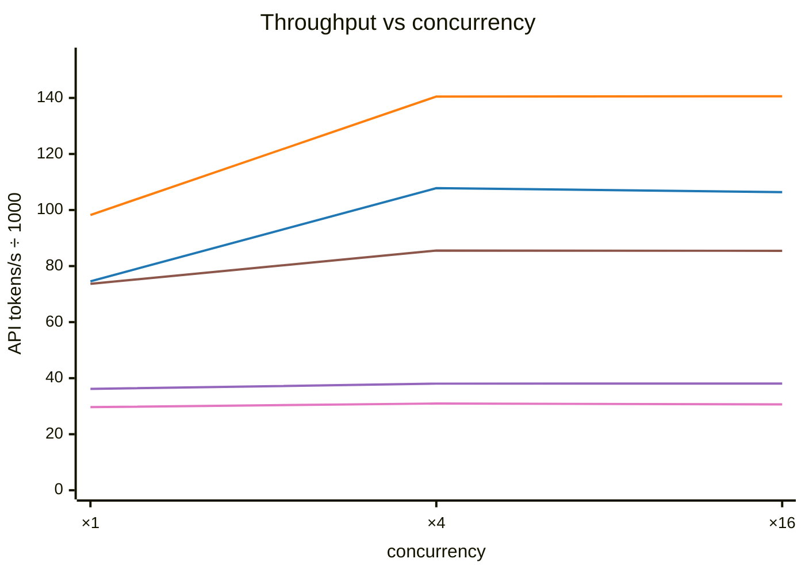
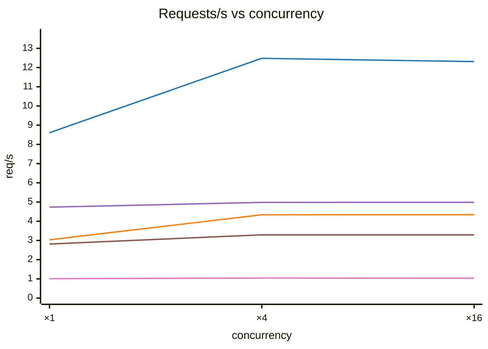
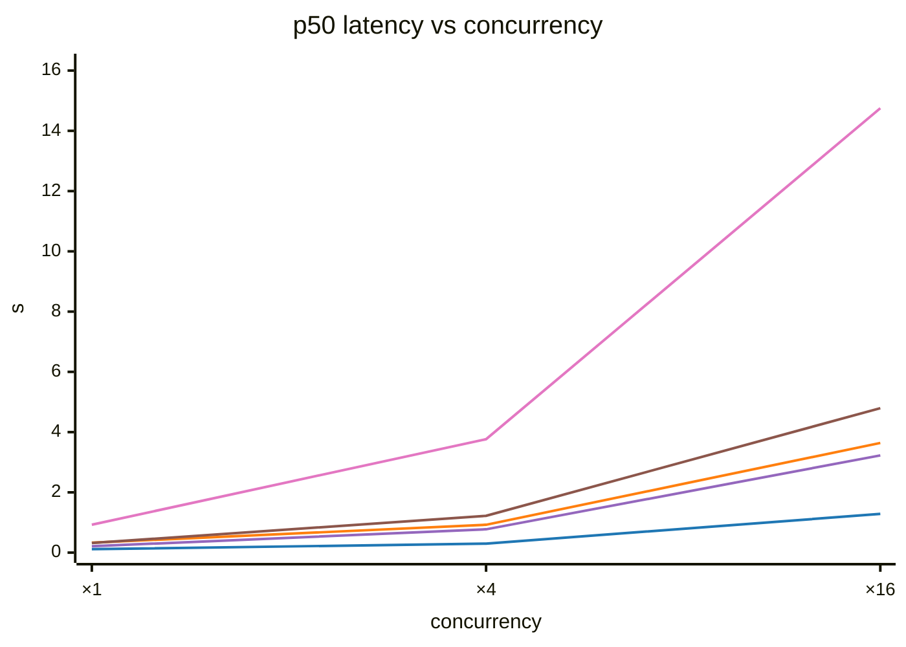

## speed — 2026-11-17 10:16 UTC

**PASS** · 442 s · 1907 requests · 0 (0.0%) errors · 0 rate-limited · 30,028,265 tokens billed

Closed loop, 25 s per cell, 5 request classes × concurrency [1, 4, 16]. 1907 requests, 30,028,265 tokens billed.

|  | requests | errors | 429s | p50 s | p90 s | p99 s | max s | req/s | API tok/s | MRR |
|---|---|---|---|---|---|---|---|---|---|---|
| short20 ×1 | 216 | 0 (0.0%) | 0 | 0.114 | 0.150 | 0.192 | 0.193 | 8.608 | 74,569 | 0.654 |
| short20 ×4 | 315 | 0 (0.0%) | 0 | 0.297 | 0.404 | 0.464 | 0.524 | 12.5 | 107,784 | 0.643 |
| short20 ×16 | 322 | 0 (0.0%) | 0 | 1.285 | 1.404 | 1.510 | 1.518 | 12.3 | 106,366 | 0.631 |
| many100 ×1 | 76 | 0 (0.0%) | 0 | 0.328 | 0.334 | 0.349 | 0.370 | 3.034 | 98,234 | 0.987 |
| many100 ×4 | 112 | 0 (0.0%) | 0 | 0.924 | 0.928 | 0.933 | 1.039 | 4.337 | 140,475 | 0.982 |
| many100 ×16 | 124 | 0 (0.0%) | 0 | 3.641 | 3.696 | 3.702 | 3.869 | 4.340 | 140,591 | 0.984 |
| long8k ×1 | 119 | 0 (0.0%) | 0 | 0.211 | 0.212 | 0.218 | 0.221 | 4.733 | 36,163 | 1.000 |
| long8k ×4 | 128 | 0 (0.0%) | 0 | 0.774 | 0.859 | 0.865 | 0.865 | 4.981 | 38,054 | 1.000 |
| long8k ×16 | 140 | 0 (0.0%) | 0 | 3.226 | 3.244 | 3.249 | 3.252 | 4.985 | 38,087 | 1.000 |
| pack32k ×1 | 71 | 0 (0.0%) | 0 | 0.318 | 0.502 | 0.589 | 0.609 | 2.815 | 73,672 | 1.000 |
| pack32k ×4 | 87 | 0 (0.0%) | 0 | 1.221 | 1.400 | 1.506 | 1.512 | 3.292 | 85,555 | 1.000 |
| pack32k ×16 | 99 | 0 (0.0%) | 0 | 4.795 | 5.167 | 5.335 | 5.410 | 3.291 | 85,440 | 1.000 |
| long32k ×1 | 26 | 0 (0.0%) | 0 | 0.927 | 1.362 | 1.364 | 1.364 | 1.008 | 29,659 | 1.000 |
| long32k ×4 | 30 | 0 (0.0%) | 0 | 3.765 | 4.354 | 4.480 | 4.493 | 1.044 | 30,948 | 1.000 |
| long32k ×16 | 42 | 0 (0.0%) | 0 | 14.7 | 16.4 | 16.6 | 16.6 | 1.032 | 30,655 | 0.988 |

*Throughput vs concurrency: short20, many100, long8k, pack32k, long32k*

*Requests/s vs concurrency: short20, many100, long8k, pack32k, long32k*

*p50 latency vs concurrency: short20, many100, long8k, pack32k, long32k*
