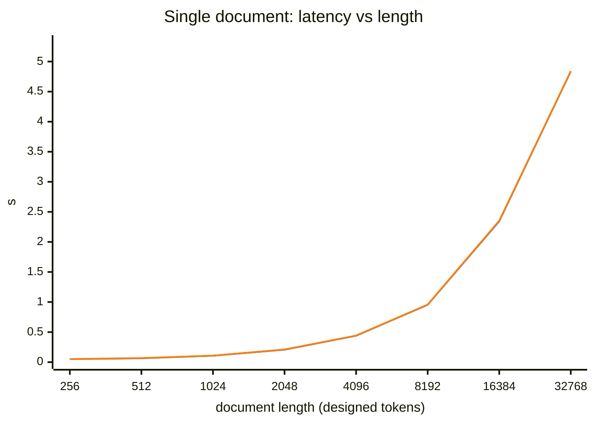
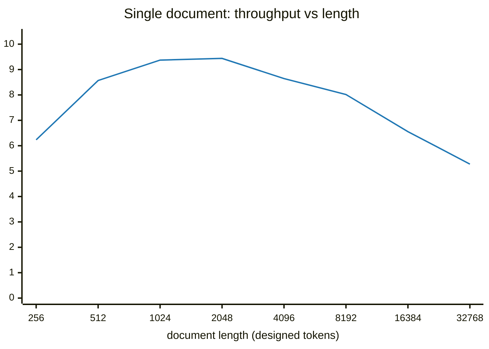
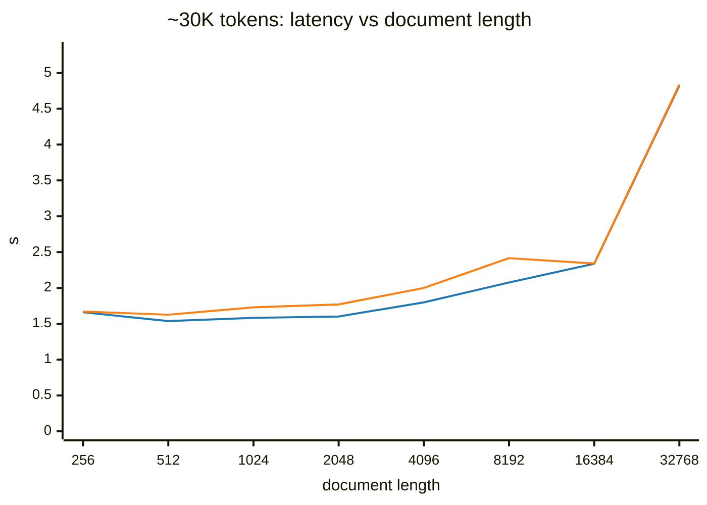
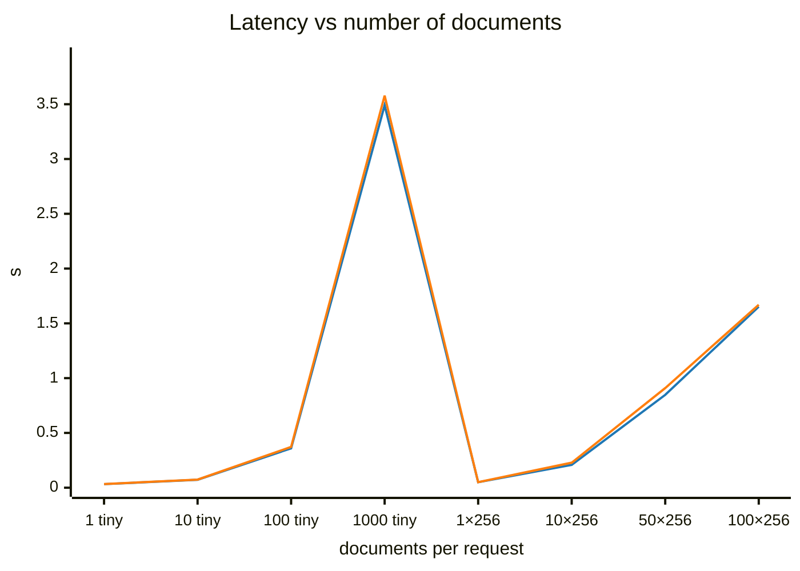
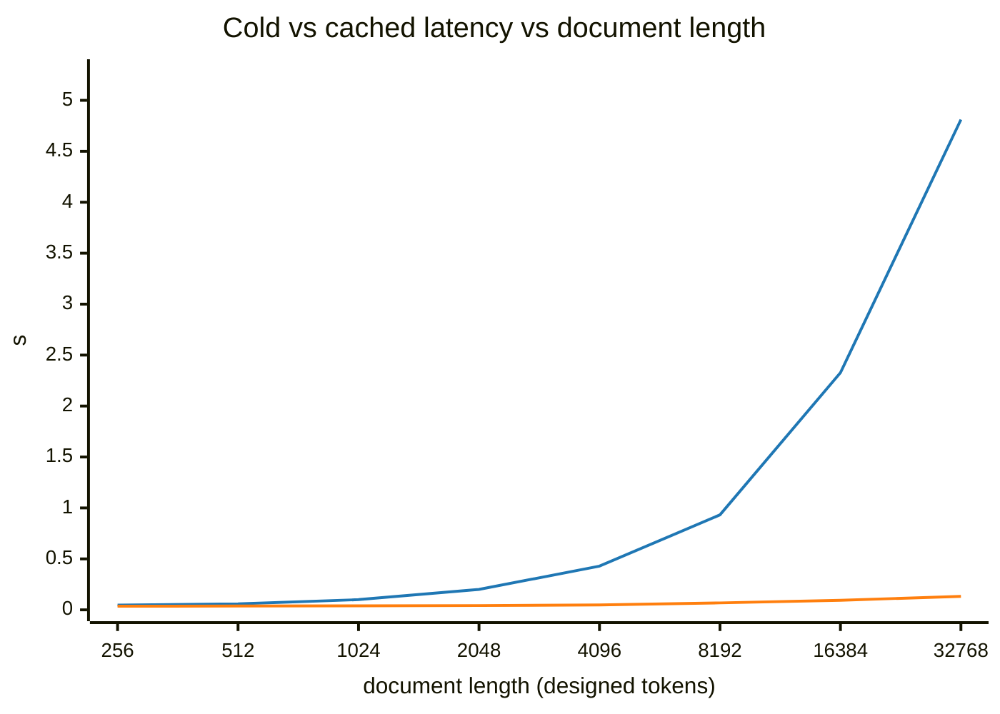
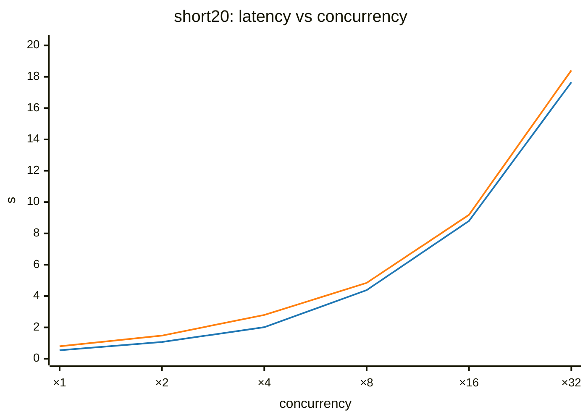
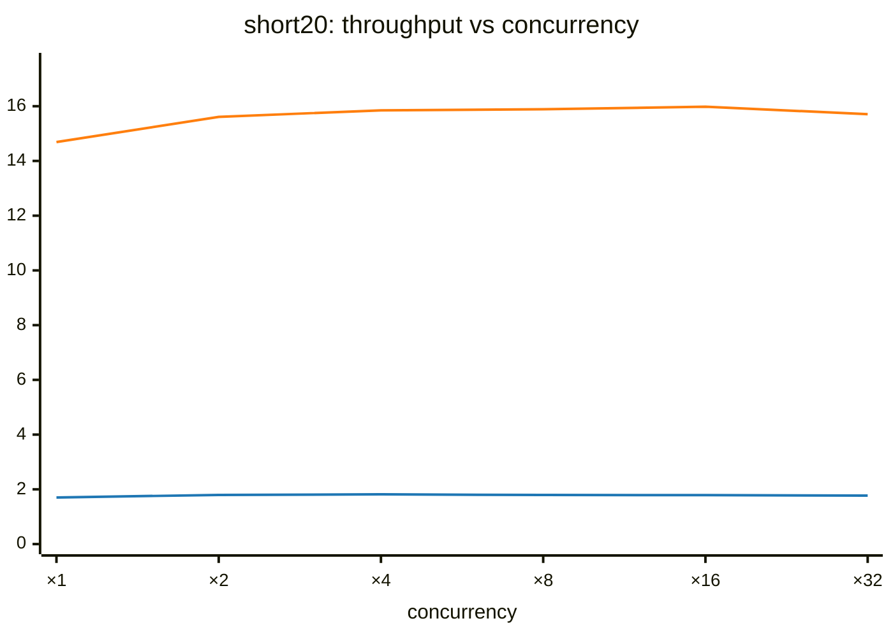
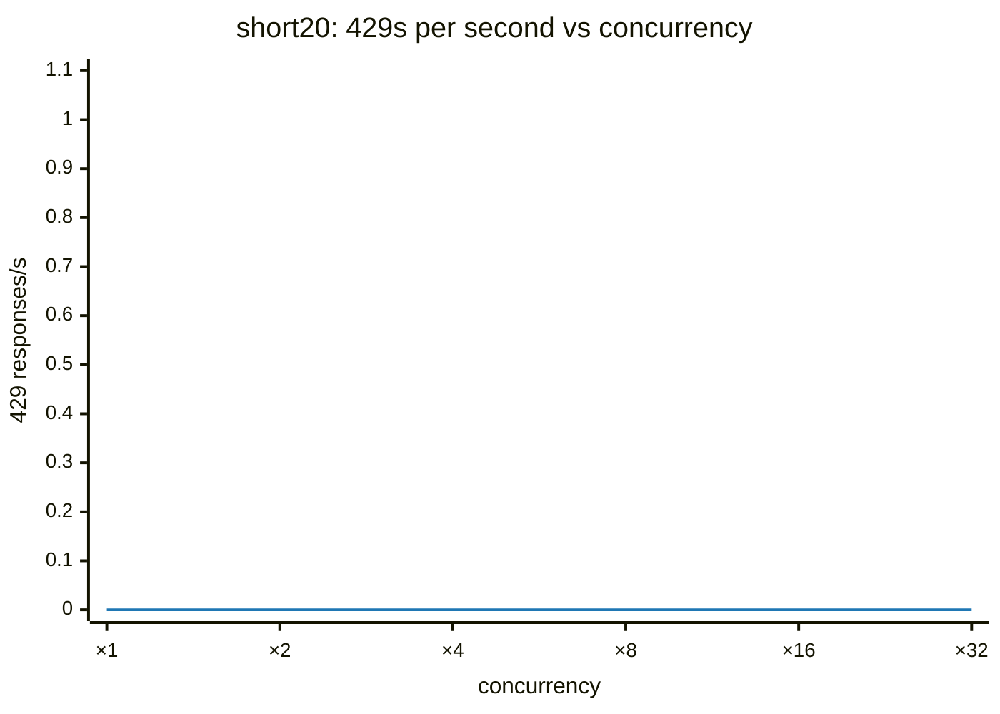

## meticulous — 2026-11-17 11:09 UTC

**PASS** · 887 s · 925 requests · 0 (0.0%) errors · 0 rate-limited · 10,280,214 tokens billed

Sequential requests (one in flight) unless stated; every query carries a nonce so nothing is served from the API's prefix cache.

### Single document: latency vs length

| rung | Qwen tokens | billed | errors | p50 s | p90 s | max s | API tok/s |
|---|---|---|---|---|---|---|---|
| 256 | 229 | 323 | 0 (0.0%) | 0.050 | 0.051 | 0.098 | 6,233 |
| 512 | 457 | 551 | 0 (0.0%) | 0.064 | 0.068 | 0.069 | 8,568 |
| 1,024 | 911 | 1,005 | 0 (0.0%) | 0.107 | 0.108 | 0.111 | 9,372 |
| 2,048 | 1,872 | 1,966 | 0 (0.0%) | 0.208 | 0.210 | 0.216 | 9,440 |
| 4,096 | 3,707 | 3,801 | 0 (0.0%) | 0.439 | 0.442 | 0.445 | 8,645 |
| 8,192 | 7,545 | 7,640 | 0 (0.0%) | 0.953 | 0.957 | 0.964 | 8,017 |
| 16,384 | 15,274 | 15,368 | 0 (0.0%) | 2.343 | 2.352 | 2.355 | 6,555 |
| 32,768 | 25,438 | 25,536 | 0 (0.0%) | 4.837 | 4.843 | 4.908 | 5,277 |

*Single document: latency vs length: p50, p90*

*Single document: throughput vs length: API tokens/s ÷ 1000*

### ~30K tokens per request: latency vs document length (fewer, longer documents)

| rung | docs/request | billed | errors | p50 s | p90 s | max s | API tok/s |
|---|---|---|---|---|---|---|---|
| 256 | 100 | 32,406 | 0 (0.0%) | 1.661 | 1.671 | 1.682 | 19,496 |
| 512 | 55 | 30,286 | 0 (0.0%) | 1.538 | 1.627 | 1.722 | 19,549 |
| 1,024 | 28 | 28,161 | 0 (0.0%) | 1.583 | 1.730 | 1.769 | 17,859 |
| 2,048 | 13 | 25,574 | 0 (0.0%) | 1.602 | 1.771 | 1.894 | 16,375 |
| 4,096 | 6 | 22,803 | 0 (0.0%) | 1.799 | 2.000 | 2.131 | 12,848 |
| 8,192 | 3 | 22,922 | 0 (0.0%) | 2.076 | 2.416 | 2.653 | 11,377 |
| 16,384 | 1 | 15,366 | 0 (0.0%) | 2.338 | 2.342 | 2.343 | 6,571 |
| 32,768 | 1 | 25,541 | 0 (0.0%) | 4.821 | 4.837 | 4.884 | 5,290 |

*~30K tokens: latency vs document length: p50, p90*

### Latency vs number of documents

| documents | billed | errors | p50 s | p90 s | max s | MRR |
|---|---|---|---|---|---|---|
| 1 tiny | 91.4 | 0 (0.0%) | 0.032 | 0.033 | 0.036 | 1.000 |
| 10 tiny | 927 | 0 (0.0%) | 0.073 | 0.074 | 0.074 | 1.000 |
| 100 tiny | 9,339 | 0 (0.0%) | 0.359 | 0.373 | 0.374 | 1.000 |
| 1000 tiny | 93,989 | 0 (0.0%) | 3.490 | 3.578 | 3.589 | 1.000 |
| 1×256 | 324 | 0 (0.0%) | 0.050 | 0.050 | 0.050 | 1.000 |
| 10×256 | 3,233 | 0 (0.0%) | 0.209 | 0.228 | 0.267 | 1.000 |
| 50×256 | 16,140 | 0 (0.0%) | 0.847 | 0.909 | 0.941 | 1.000 |
| 100×256 | 32,389 | 0 (0.0%) | 1.652 | 1.670 | 1.672 | 0.950 |

*Latency vs number of documents: p50, p90*

### Cold vs cached: the same single-document request sent twice in a row

The API caches prompt prefixes, so a repeated (query, document) pair skips most of the compute. Cold = fresh nonce in the query; cached = the identical request again immediately after.

| rung | pairs | cold p50 s | cached p50 s | speed-up × | cold max s | cached max s | errors |
|---|---|---|---|---|---|---|---|
| 256 | 10 | 0.047 | 0.035 | 1.338 | 0.064 | 0.036 |  |
| 512 | 10 | 0.059 | 0.038 | 1.561 | 0.065 | 0.040 |  |
| 1,024 | 10 | 0.100 | 0.039 | 2.545 | 0.102 | 0.040 |  |
| 2,048 | 10 | 0.201 | 0.042 | 4.765 | 0.208 | 0.043 |  |
| 4,096 | 10 | 0.429 | 0.049 | 8.807 | 0.433 | 0.051 |  |
| 8,192 | 10 | 0.932 | 0.068 | 13.7 | 0.944 | 0.069 |  |
| 16,384 | 10 | 2.327 | 0.094 | 24.8 | 2.335 | 0.099 |  |
| 32,768 | 10 | 4.811 | 0.133 | 36.2 | 4.875 | 0.135 |  |

*Cold vs cached latency vs document length: cold p50, cached p50*

### short20: latency and throughput vs concurrency

|  | requests | errors | 429s | p50 s | p90 s | p99 s | max s | req/s | API tok/s | MRR |
|---|---|---|---|---|---|---|---|---|---|---|
| ×1 | 43 | 0 (0.0%) | 0 | 0.539 | 0.793 | 1.023 | 1.058 | 1.701 | 14,686 | 0.707 |
| ×2 | 46 | 0 (0.0%) | 0 | 1.068 | 1.476 | 1.830 | 1.958 | 1.797 | 15,614 | 0.717 |
| ×4 | 48 | 0 (0.0%) | 0 | 2.012 | 2.794 | 2.831 | 2.845 | 1.816 | 15,854 | 0.729 |
| ×8 | 52 | 0 (0.0%) | 0 | 4.379 | 4.841 | 5.189 | 5.190 | 1.794 | 15,888 | 0.720 |
| ×16 | 60 | 0 (0.0%) | 0 | 8.794 | 9.187 | 9.392 | 9.573 | 1.787 | 15,978 | 0.687 |
| ×32 | 76 | 0 (0.0%) | 0 | 17.6 | 18.4 | 18.5 | 18.5 | 1.773 | 15,711 | 0.682 |

No 429s up to concurrency ×32.

*short20: latency vs concurrency: p50, p90*

*short20: throughput vs concurrency: req/s, API tokens/s ÷ 1000*

*short20: 429s per second vs concurrency: 429/s*

925 requests, 10,280,214 tokens billed.
